<div dir="rtl" markdown="1">

# انواع دامنه و آموزش ثبت آن‌ها

این صفحه انواع دامنه‌هایی را که می‌توانید به هیدیفای‌منیجر اضافه کنید توضیح می‌دهد و می‌گوید هر کدام را چطور در سرویس DNS خود تنظیم کنید. قبل از اضافه کردن اولین دامنه به پنل، این صفحه را بخوانید.

**دامنه** نامی مثل `sub.example.com` است که به یک آی‌پی اشاره می‌کند. **زیردامنه** (ساب‌دامین) بخشی است که جلوی دامنه اصلی اضافه می‌کنید (`sub` در `sub.example.com`). **رکورد DNS** تنظیمی در سرویس DNS است که مشخص می‌کند هر نام به کدام آی‌پی اشاره کند. برای مفاهیم پایه، [مفاهیم پایه](/fa/manager/basic-concepts-and-troubleshooting/Basic-Concepts/) را ببینید.

!!! info "انواع دامنه در نسخه ۱۳ هیدیفای‌منیجر تغییر کرد"
    از نسخه ۱۳، هر دامنه یک **حالت** و یک **حالت TLS** دارد. حالت‌های قدیمی هنگام به‌روزرسانی خودکار تبدیل شدند:

    - `auto_cdn_ip` به **CDN** تبدیل شد (با روشن بودن «تبدیل به IP»).
    - `fake` به **مستقیم** با حالت TLS **جعلی** تبدیل شد.
    - `reality` و `special_reality_*` به **مستقیم** با حالت TLS **ریالتی** تبدیل شدند.
    - `old_xtls_direct` به **مستقیم** تبدیل شد.
    - گزینه «استفاده فقط برای لینک اشتراک» به حالت **فقط لینک اشتراک** تبدیل شد.

## حالت‌های دامنه در پنل

در پنل، صفحه **دامنه‌ها** را باز کنید و **افزودن دامنه** را بزنید. یک راهنمای کوتاه ابتدا دامنه را می‌پرسد، بعد «چطور تنظیم شده؟» (حالت) و بعد «کدام TLS؟» (حالت TLS).

| حالت | چه زمانی استفاده شود | رکورد DNS باید چه کند |
|---|---|---|
| **مستقیم** (Direct) | کاربران مستقیم به سرور شما وصل می‌شوند. | به آی‌پی سرور اشاره کند. در Cloudflare پروکسی باید خاموش باشد (**DNS only**، ابر خاکستری). |
| **CDN** | سرور شما پشت یک CDN مثل Cloudflare است. آی‌پی سرور پنهان می‌ماند و با مسدود شدن آی‌پی هم کار می‌کند. | از CDN عبور کند. در Cloudflare پروکسی باید روشن باشد (**Proxied**، ابر نارنجی). نباید مستقیم به آی‌پی سرور برسد. |
| **رله** (Relay) | کاربران به یک سرور میانی وصل می‌شوند که ترافیک را به سرور شما می‌رساند. [درباره رله](/fa/manager/domain-worker-cdn-and-tunneling/How-to-add-relay-domain-to-Hiddify-manager/) | به سرور میانی (رله) اشاره کند، نه به سرور شما. |
| **ورکر کلادفلر** (Cloudflare Worker) | ترافیک از طریق یک ورکر Cloudflare به سرور می‌رسد. [درباره ورکر](/fa/manager/domain-worker-cdn-and-tunneling/How-to-use-the-Cloudflare-worker-domain-on-Hiddify/) | دامنه باید روی Cloudflare باشد. |
| **فقط لینک اشتراک** (Subscription only) | فقط برای لینک اشتراک کاربران، بدون پروکسی. اگر دامنه‌های پروکسی مسدود شوند، کاربران همچنان اشتراک را به‌روز می‌کنند و کانفیگ‌های سالم جدید می‌گیرند. [درباره دامنه اشتراک](/fa/manager/domain-worker-cdn-and-tunneling/How-to-create-subscription-link-on-Hiddify/) | به سرور شما یا از طریق CDN اشاره کند. پشت CDN بهتر است. |

**حالت TLS** مشخص می‌کند دامنه از چه گواهی‌ای استفاده کند:

| حالت TLS | معنی |
|---|---|
| **TLS معتبر** | گواهی واقعی که پنل خودش می‌گیرد و تمدید می‌کند. تقریباً همیشه از این استفاده کنید. دامنه‌های CDN، ورکر کلادفلر و فقط لینک اشتراک همیشه از این حالت استفاده می‌کنند. |
| **جعلی** (Fake) | TLS فریب با نام یک سایت دیگر (مثلاً `soft98.ir`) برای عبور از لیست سفید SNI. پیشنهاد نمی‌شود، چون ممکن است سرور فیلتر شود. فقط برای مستقیم یا رله. [درباره دامنه جعلی](/fa/manager/domain-worker-cdn-and-tunneling/How-to-create-and-use-fake-domain/) |
| **ریالتی** (Reality) | TLS یک سایت واقعی دیگر را با پروتکل Reality قرض می‌گیرد. لازم نیست صاحب دامنه باشید. فقط برای مستقیم یا رله. |
| **DNS** | فقط برای تونل‌های DNS. |

پنل هنگام ذخیره، رکورد DNS را بررسی می‌کند. مثلاً دامنه مستقیم باید به آی‌پی سرور اشاره کند و دامنه CDN **نباید** مستقیم به آن اشاره کند. اگر بررسی خطا داد، رکورد DNS را درست کنید، چند دقیقه صبر کنید و دوباره ذخیره کنید.

!!! tip "ساخت خودکار رکوردهای DNS توسط پنل"
    اگر دامنه شما روی Cloudflare است، می‌توانید یک توکن API کلادفلر به پنل بدهید. در این صورت پنل برای هر دامنه جدید رکورد DNS را خودش می‌سازد (برای CDN با پروکسی روشن و برای مستقیم با پروکسی خاموش). [گرفتن کلید توسعه کلادفلر](/fa/manager/domain-worker-cdn-and-tunneling/Get-Cloudflare-API/) را ببینید.

# نحوه ثبت دامنه

<details markdown="1"><summary><h2>ثبت دامنه مستقیم</h2></summary>

می‌توانید یک زیردامنه رایگان بگیرید یا از دامنه‌ای که خریده‌اید استفاده کنید.

### زیردامنه رایگان (FreeDNS)

سایت [FreeDNS (afraid.org)](https://freedns.afraid.org/) اجازه می‌دهد روی دامنه‌هایی که دیگران به صورت عمومی به اشتراک گذاشته‌اند زیردامنه بسازید.

1. [یک حساب بسازید](https://freedns.afraid.org/signup/?plan=starter). به یک ایمیل واقعی نیاز دارید. فرم ثبت‌نام از شما می‌خواهد تأیید کنید که ساکن کشورهای تحریم‌شدهٔ آمریکا (از جمله ایران) نیستید.

    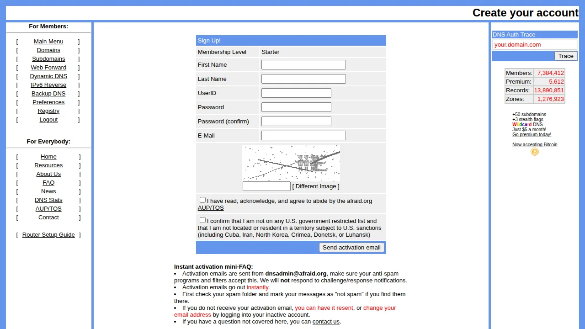

2. [فهرست دامنه‌ها](https://freedns.afraid.org/domain/registry/) را باز کنید. یک دامنه **عمومی** (public) انتخاب کنید که تعداد هاست کمتری دارد. دامنه‌های `.com`، `.org` یا `.net` بهتر هستند.

    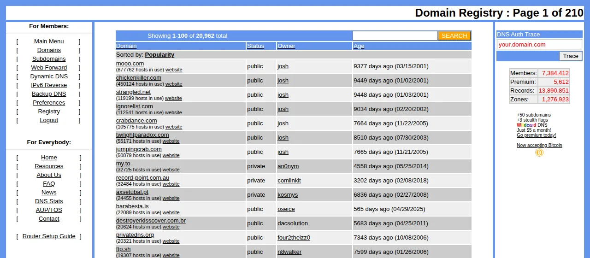

3. زیردامنه خود را روی آن دامنه بسازید و آدرس آن را آی‌پی سرور خود قرار دهید.

### دامنه خریداری‌شده روی Cloudflare

دامنه‌ای را که خریده‌اید می‌توانید در هر سرویس DNS مدیریت کنید. این مراحل برای Cloudflare است.

1. [در Cloudflare حساب بسازید](https://dash.cloudflare.com/sign-up) و وارد شوید.

    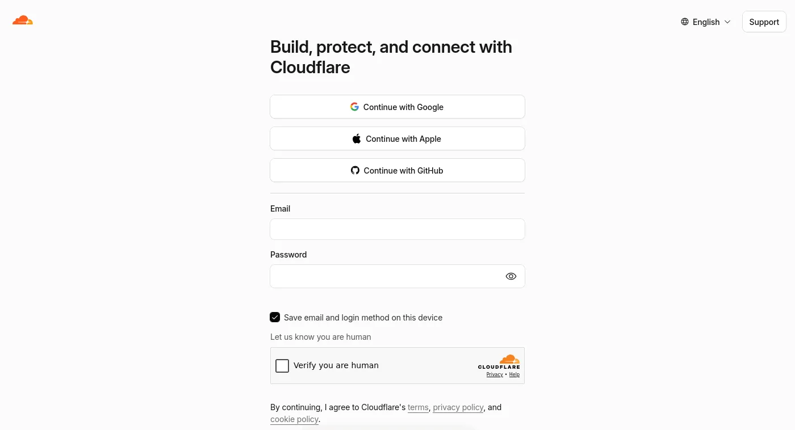

2. دامنه را به Cloudflare اضافه کنید:
    - از منوی کناری **Domains** › **Overview** را باز کنید (اگر منو جمع است، روی آیکون کره بزنید).

        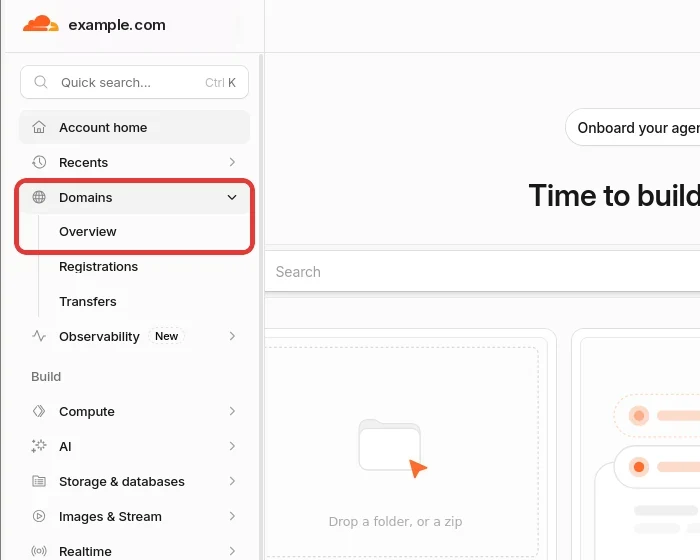

    - روی **Add domain** بزنید.

        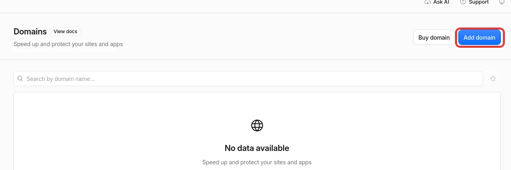

    - **Connect a domain** را انتخاب کنید.

        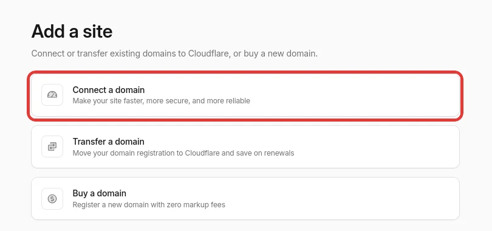

    - دامنهٔ اصلی (مثلاً `example.com`) را در **Domain name** بنویسید. بقیهٔ گزینه‌ها را همان‌طور بگذارید و **Continue** را بزنید.

        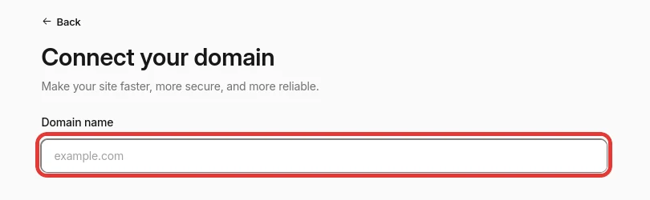

    در صفحهٔ اصلی حساب (Account home) هم کارت **Add a domain** همین کار را می‌کند.

3. یک پلن انتخاب کنید: زیر **Free** روی **Select plan** بزنید. پلن رایگان کافی است.

    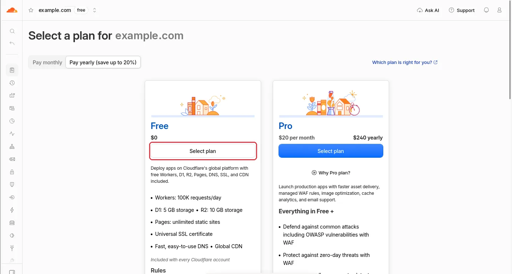

4. Cloudflare رکوردهای DNS فعلی دامنه را پیدا می‌کند و نشان می‌دهد. آن‌ها را بررسی کنید و **Continue to activation** را بزنید.

    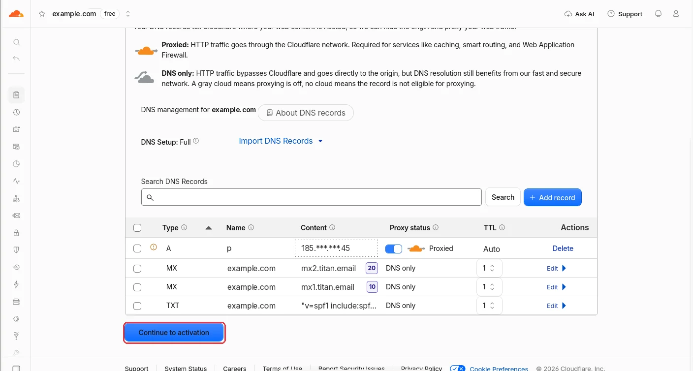

5. Cloudflare دو **نیم‌سرور** (nameserver) به شما نشان می‌دهد. به سایتی که دامنه را از آن خریده‌اید بروید، نیم‌سرورهای فعلی را پاک کنید و این دو را به جایشان بگذارید.

    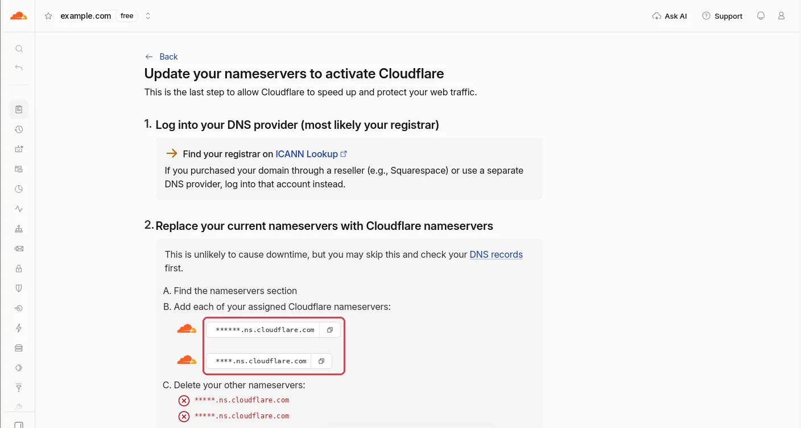

6. صبر کنید تا وضعیت دامنه در **Domains** › **Overview** به **Active** تغییر کند. این کار از چند دقیقه تا یک روز طول می‌کشد. تا وقتی نیم‌سرورها عوض نشده‌اند، ستون **Status** پیامی مثل **Invalid nameservers** نشان می‌دهد.

    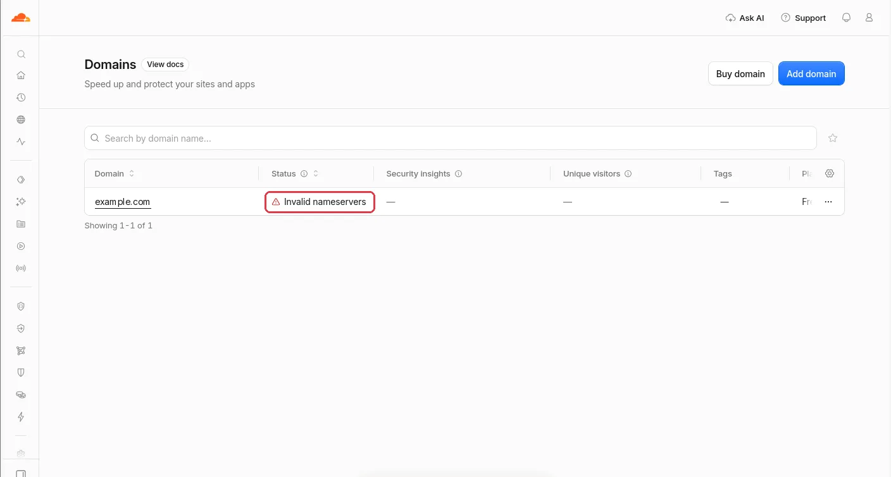

7. روی دامنه بزنید، از منوی کناری **DNS** › **Records** را باز کنید و **Add record** را بزنید.

    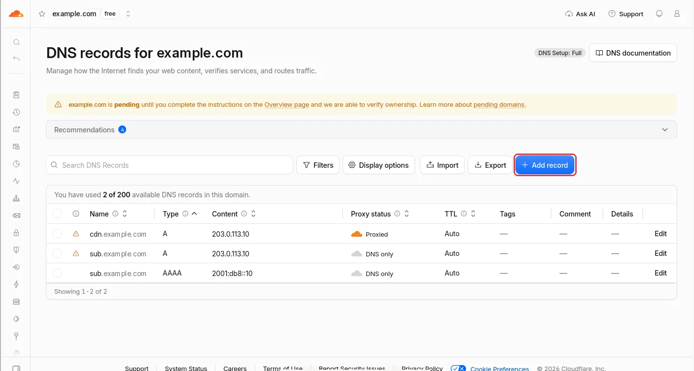

8. رکورد را پر کنید:
    - **Type**: `A` (برای آی‌پی نسخه ۴ سرور).
    - **Name**: زیردامنه دلخواه، مثلاً `sub`.
    - **IPv4 address**: آی‌پی سرور شما.
    - **Proxy status**: آن را **خاموش** کنید (**DNS only**، ابر خاکستری). دامنه مستقیم نباید پروکسی شود.
    - **TTL**: روی Auto بماند.

    بالای فرم، Cloudflare خلاصهٔ رکورد را می‌نویسد (مثلاً `sub.example.com points to 203.0.113.10`). **Save** را بزنید.

    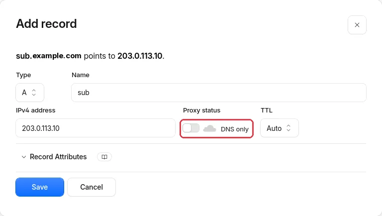{ width="600" }

9. اگر سرور آی‌پی نسخه ۶ هم دارد، یک رکورد دوم به همین شکل بسازید، با **Type** برابر `AAAA` و آی‌پی نسخه ۶.

    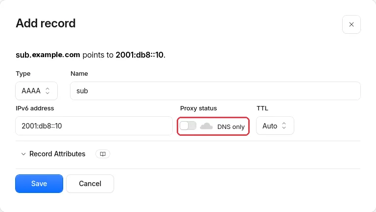{ width="600" }

### بررسی کارکرد دامنه مستقیم

اعمال تغییرات DNS ممکن است چند دقیقه طول بکشد. بعد روی کامپیوتر خودتان این دستور را اجرا کنید:

```bash
ping sub.example.com
```

باید آی‌پی سرور خود را در جواب ببینید. از `nslookup` یا `dig` هم می‌توانید استفاده کنید. اگر آی‌پی دیگری یا پیام «unknown host» دیدید، رکورد را بررسی کنید و کمی بیشتر صبر کنید. برای اطلاعات بیشتر [این مقاله درباره DNS](https://wikicensorship.github.io/fa/docs/measure-internet-censorship/DNS/) را بخوانید.

### افزودن دامنه مستقیم به پنل

در پنل، **دامنه‌ها** › **افزودن دامنه** را بزنید و دامنه را بنویسید. در **چطور تنظیم شده است؟** گزینهٔ **مستقیم** و در **کدام TLS؟** گزینهٔ **TLS معتبر** را انتخاب کنید و مراحل را تمام کنید.

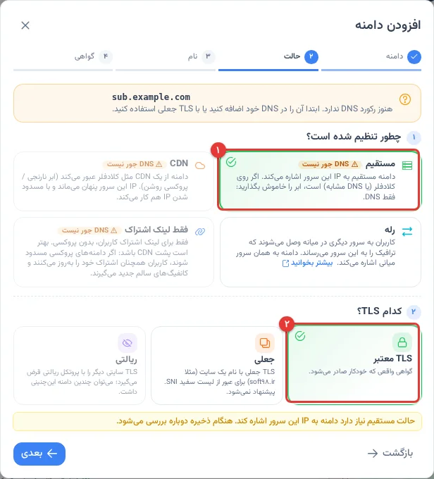{ width="560" }

اگر پنل کنار گزینه برچسب **DNS جور نیست** نشان داد، یعنی رکورد DNS هنوز به آی‌پی این سرور نمی‌رسد. چند دقیقه صبر کنید؛ پنل هنگام ذخیره دوباره بررسی می‌کند.

</details>

<details markdown="1"><summary><h2>ثبت دامنه CDN</h2></summary>

**CDN** (شبکه توزیع محتوا) شبکه‌ای از سرورهاست که بین کاربران و سرور شما قرار می‌گیرد. کاربران به CDN وصل می‌شوند و CDN ترافیک را به سرور شما می‌رساند. [CDN چیست و چه کمکی به ما می‌کند؟](/fa/manager/domain-worker-cdn-and-tunneling/What-is-CDN-and-how-does-it-help-us%3F/)

این مراحل برای Cloudflare است. برای CDNهای دیگر، [GCore](/fa/manager/domain-worker-cdn-and-tunneling/How-to-use-GCore-CDN-on-Cloudflare-registered-domain/) و [Amazon CloudFront](/fa/manager/domain-worker-cdn-and-tunneling/How-to-use-Amazon-CDN/) را ببینید.

### ساخت رکورد CDN در Cloudflare

1. دامنه را همان‌طور که در بخش دامنه مستقیم گفته شد به Cloudflare اضافه کنید (مراحل ۱ تا ۶).
2. به **DNS** › **Records** بروید و **Add record** را بزنید.
3. **Type** را `A` (یا `AAAA` برای آی‌پی نسخه ۶)، یک نام زیردامنه جدید (مثلاً `cdn`) و آی‌پی سرور را وارد کنید.
4. **Proxy status** را **روشن** بگذارید (**Proxied**، ابر نارنجی). تنها تفاوت با دامنه مستقیم همین است.
5. **Save** را بزنید.

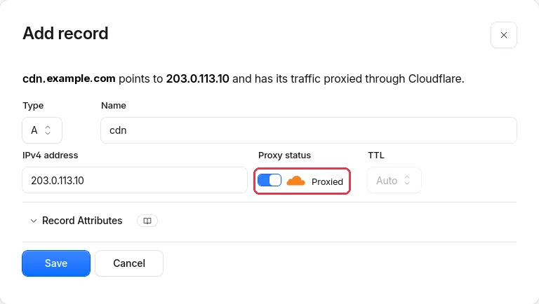{ width="600" }

### بررسی کارکرد دامنه CDN

وقتی این زیردامنه را `ping` کنید، باید یکی از آی‌پی‌های Cloudflare را ببینید، نه آی‌پی سرور خود را. به این ترتیب سرور شما پنهان می‌ماند. این آی‌پی ممکن است با گذشت زمان عوض شود.

گاهی آی‌پی‌هایی که Cloudflare به کاربران شما می‌دهد در ایران مسدود یا کند هستند. در این صورت از **اسکنر** خود پنل (**ابزارها** › **اسکنر**) آی‌پی‌های سالم را پیدا کنید، یا [راهنمای پیدا کردن آی‌پی تمیز کلادفلر](/fa/manager/domain-worker-cdn-and-tunneling/Guide-for-finding-a-clean-Cloudflare-IP/) را ببینید.

### تنظیمات SSL/TLS در Cloudflare

**TLS** رمزگذاری‌ای است که ارتباط کاربر و سرور را امن می‌کند. **گواهی** (سرتیفیکیت) ثابت می‌کند که یک سرور واقعاً صاحب دامنه است. هیدیفای‌منیجر برای دامنه شما گواهی واقعی می‌گیرد، پس Cloudflare می‌تواند با TLS به سرور وصل شود.

1. دامنه را در Cloudflare باز کنید، از منوی کناری **SSL/TLS** را باز کنید و **Configure** را بزنید. همین صفحه در بخش **Traffic Served Over TLS** نشان می‌دهد ترافیک شما با کدام نسخه‌های TLS عبور کرده است؛ هر چه نسخه جدیدتر، امن‌تر.

    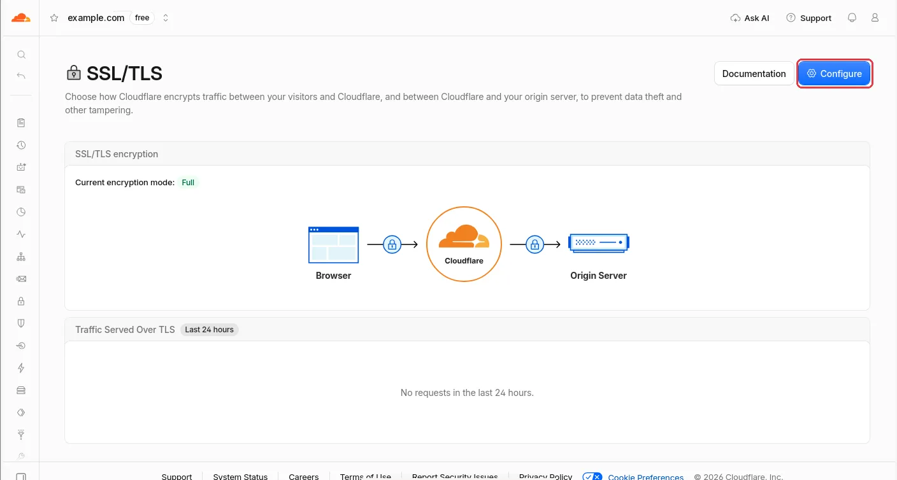

2. حالت رمزگذاری را **Full (Strict)** یا **Full** بگذارید. از **Flexible** استفاده نکنید. اگر **Automatic SSL/TLS (recommended)** انتخاب شده است، Cloudflare امن‌ترین حالتی را که کار می‌کند خودش انتخاب می‌کند و می‌توانید آن را تغییر ندهید.

    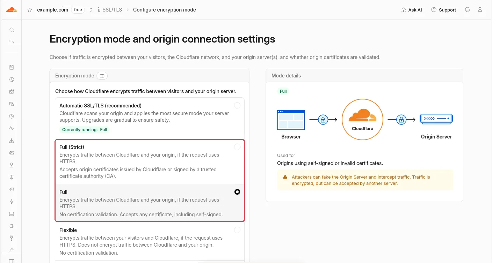

3. از منوی کناری **Network** را باز کنید و **gRPC** و **WebSockets** را روشن کنید. پروکسی‌های CDN هیدیفای‌منیجر از WebSocket، gRPC، HTTPUpgrade و XHTTP استفاده می‌کنند.

    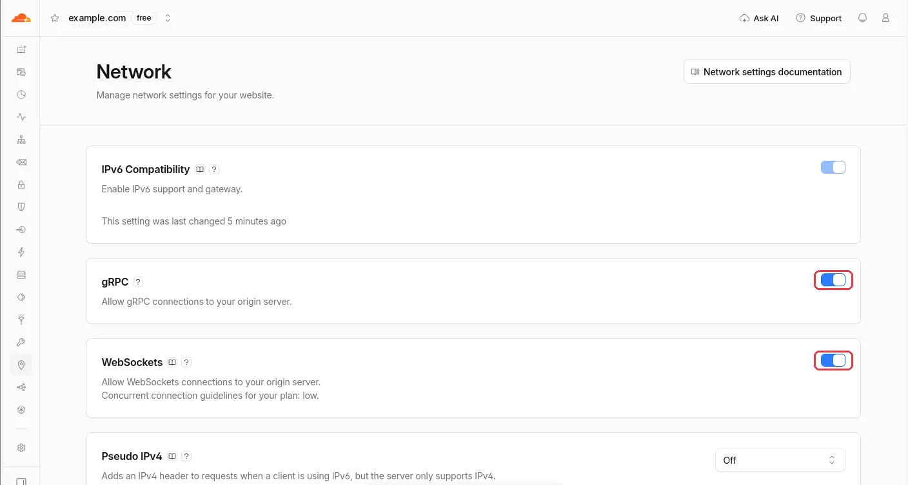

آموزش‌های قدیمی می‌گفتند **SSL/TLS Recommender** را روشن کنید. Cloudflare این گزینه را با Automatic SSL/TLS جایگزین کرده است، پس به آن نیازی ندارید.

### افزودن دامنه CDN به پنل

در پنل، **دامنه‌ها** › **افزودن دامنه** را بزنید، دامنه را بنویسید و در **چطور تنظیم شده است؟** گزینهٔ **CDN** را انتخاب کنید. دامنه‌های CDN همیشه از **TLS معتبر** استفاده می‌کنند.

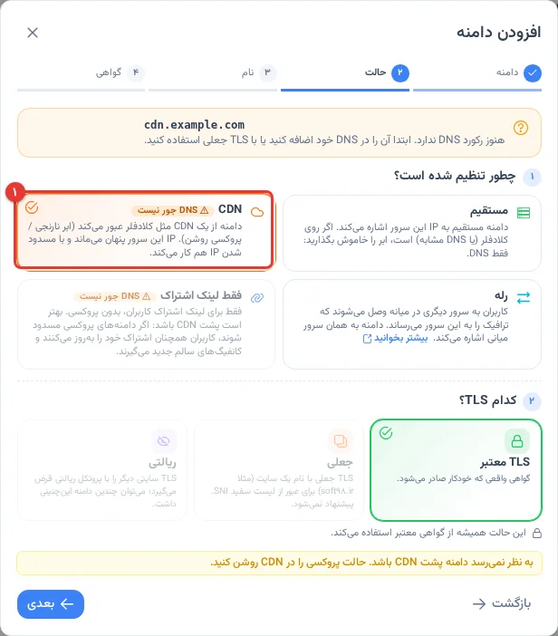{ width="560" }

اگر پنل هشدار داد که دامنه پشت CDN به نظر نمی‌رسد، پروکسی (ابر نارنجی) را در Cloudflare روشن کنید.

</details>

## ثبت دامنه رله

دامنه رله مثل دامنه مستقیم ثبت می‌شود، با این تفاوت که رکورد آن به سرور میانی (رله) اشاره می‌کند، نه به سرور اصلی. [بیشتر بخوانید](/fa/manager/domain-worker-cdn-and-tunneling/How-to-add-relay-domain-to-Hiddify-manager/)

## دامنه‌های جعلی و ریالتی

در حالت TLS **جعلی** یا **ریالتی** از نام سایت دیگری استفاده می‌کنید که صاحبش نیستید، پس لازم نیست چیزی در سرویس DNS ثبت کنید. فقط نام را در پنل وارد می‌کنید. [آموزش ساخت و استفاده از دامنه جعلی](/fa/manager/domain-worker-cdn-and-tunneling/How-to-create-and-use-fake-domain/) را ببینید.

## مقاله‌های مرتبط

- [دامنهٔ فیک](/fa/manager/domain-worker-cdn-and-tunneling/How-to-create-and-use-fake-domain/)
- [زیردامنه‌های متغیر (wildcard)](/fa/manager/domain-worker-cdn-and-tunneling/Tutorial-for-using-wildcard-subdomains-on-Hiddify/)
- [ساخت خودکار زیردامنه در کلادفلر](/fa/manager/domain-worker-cdn-and-tunneling/Get-Cloudflare-API/)
- [دامین فرانتینگ](/fa/manager/domain-worker-cdn-and-tunneling/Guide-for-domain-fronting/)

</div>
