<div dir="ltr" markdown="1">

# Domain types and how to register them

This page explains the kinds of domains you can add to HiddifyManager and how to set up each one at your DNS provider. Read it before you add your first domain to the panel.

A **domain** is a name such as `sub.example.com` that points to an IP address. A **subdomain** is the part you add in front of your main domain (`sub` in `sub.example.com`). A **DNS record** is the entry at your DNS provider that tells the internet which IP a name points to. For more basics, see [Basic concepts](/manager/basic-concepts-and-troubleshooting/Basic-Concepts/).

!!! info "Domain types changed in HiddifyManager v13"
    Since v13, every domain has a **Mode** and a **TLS mode**. The old modes were moved automatically when you upgraded:

    - `auto_cdn_ip` became **CDN** (with "Resolve IP" turned on).
    - `fake` became **Direct** with TLS mode **Fake**.
    - `reality` and `special_reality_*` became **Direct** with TLS mode **Reality**.
    - `old_xtls_direct` became **Direct**.
    - "Use only for subscription link" became the **Subscription only** mode.

## Domain modes in the panel

In the panel, open the **Domains** page and select **Add domain**. A short wizard asks for the domain, then "How is it set up?" (the mode), then "Which TLS?" (the TLS mode).

| Mode | When to use it | What your DNS record must do |
|---|---|---|
| **Direct** | Users connect straight to your server. | Point to your server's IP. On Cloudflare, the proxy must be off (**DNS only**, grey cloud). |
| **CDN** | Your server sits behind a CDN such as Cloudflare. This hides your server's IP and keeps working when the IP is blocked. | Go through the CDN. On Cloudflare, the proxy must be on (**Proxied**, orange cloud). It must not resolve to your server's IP. |
| **Relay** | Users connect to another server in between, which passes traffic on to your server. [More about relays](/manager/domain-worker-cdn-and-tunneling/How-to-add-relay-domain-to-Hiddify-manager/) | Point to the in-between (relay) server, not to your server. |
| **Cloudflare Worker** | Traffic reaches your server through a Cloudflare Worker. [More about workers](/manager/domain-worker-cdn-and-tunneling/How-to-use-the-Cloudflare-worker-domain-on-Hiddify/) | The domain must be on Cloudflare. |
| **Subscription only** | Only for users' subscription links, no proxies. If your proxy domains get blocked, users can still update their subscription and get new working configs. [More about subscription domains](/manager/domain-worker-cdn-and-tunneling/How-to-create-subscription-link-on-Hiddify/) | Point to your server or go through a CDN. Behind a CDN is best. |

The **TLS mode** decides which certificate the domain uses:

| TLS mode | Meaning |
|---|---|
| **Valid TLS** | A real certificate that the panel gets and renews for you automatically. Use this in almost all cases. CDN, Cloudflare Worker and Subscription only domains always use it. |
| **Fake** | Decoy TLS with another site's name (for example `soft98.ir`) to pass an SNI whitelist. Not recommended, because it can get your server filtered. Only for Direct or Relay. [More about fake domains](/manager/domain-worker-cdn-and-tunneling/How-to-create-and-use-fake-domain/) |
| **Reality** | Borrows another real site's TLS with the Reality protocol. You do not need to own the domain. Only for Direct or Relay. |
| **DNS** | For DNS tunnels only. |

The panel checks the DNS record when you save. For example, a Direct domain must point to your server's IP, and a CDN domain must **not** point to it directly. If the check fails, fix the DNS record, wait a few minutes, and save again.

!!! tip "Let the panel create the DNS records"
    If your domain is on Cloudflare, you can give the panel a Cloudflare API token. The panel then creates the DNS record for each new domain (proxy on for CDN, off for Direct). See [Get Cloudflare API](/manager/domain-worker-cdn-and-tunneling/Get-Cloudflare-API/).

# How to register a domain

<details markdown="1"><summary><h2>Direct domain registration</h2></summary>

You can get a free subdomain or use a domain you bought.

### Free subdomain (FreeDNS)

[FreeDNS (afraid.org)](https://freedns.afraid.org/) lets you create a subdomain on domains that other people have shared publicly.

1. [Create an account](https://freedns.afraid.org/signup/?plan=starter). You need a real email address. The form asks you to confirm that you do not live in a country under U.S. sanctions (Iran is one of them).

    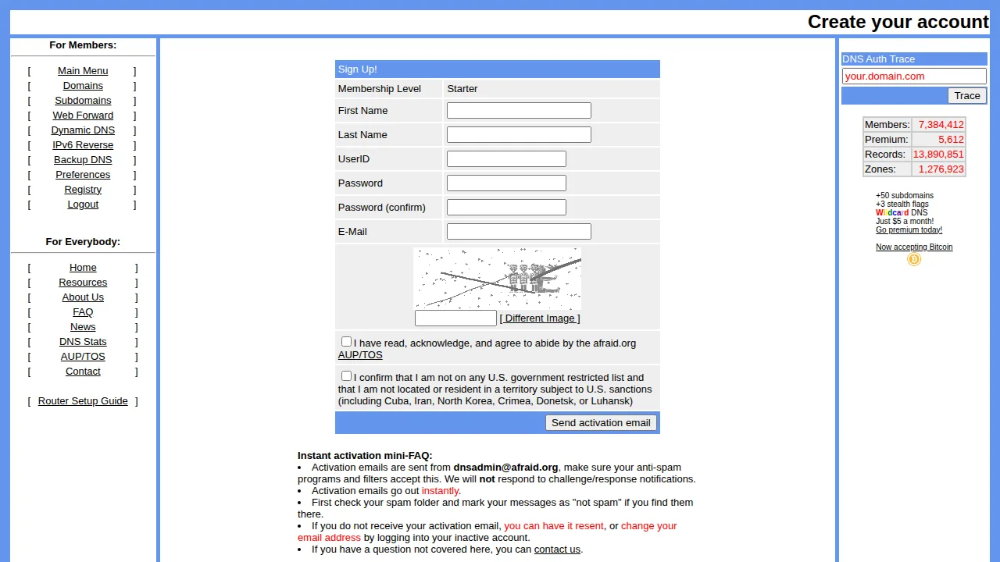

2. Open the [domain registry](https://freedns.afraid.org/domain/registry/). Pick a **public** domain that has few hosts. Domains ending in `.com`, `.org` or `.net` are best.

    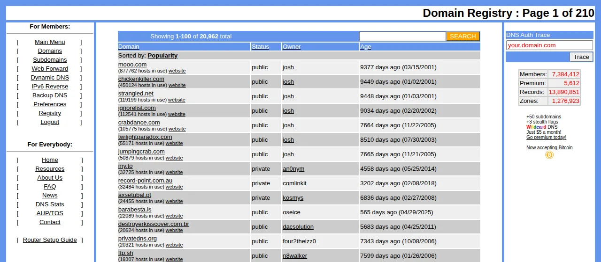

3. Create your subdomain on that domain and set its address to your server’s IP.

### A domain you bought, on Cloudflare

You can manage a domain you bought with any DNS provider. These steps use Cloudflare.

1. [Create a Cloudflare account](https://dash.cloudflare.com/sign-up) and log in.

    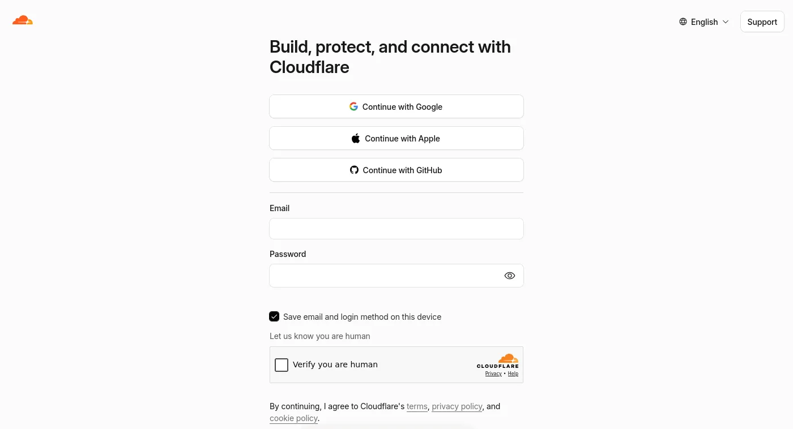

2. Add the domain to Cloudflare:
    - In the sidebar, open **Domains** › **Overview** (if the sidebar is collapsed, click the globe icon).

        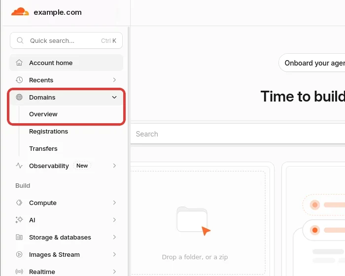

    - Click **Add domain**.

        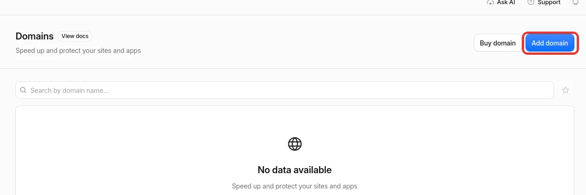

    - Choose **Connect a domain**.

        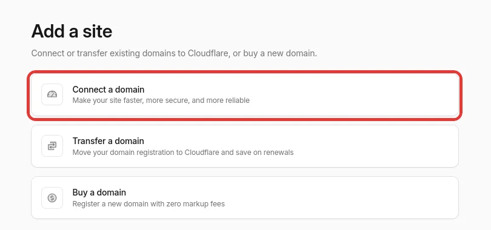

    - Type your main domain (for example `example.com`) in **Domain name**. Leave the other options as they are and click **Continue**.

        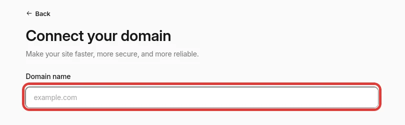

    The **Add a domain** card on the Account home page does the same.

3. Choose a plan: click **Select plan** under **Free**. The free plan is enough.

    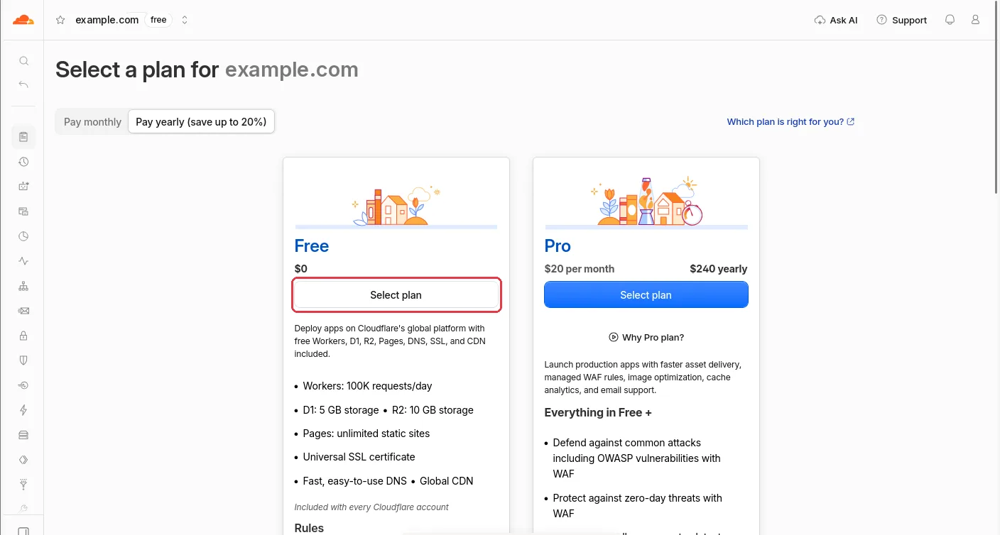

4. Cloudflare finds the domain’s current DNS records and lists them. Check them and click **Continue to activation**.

    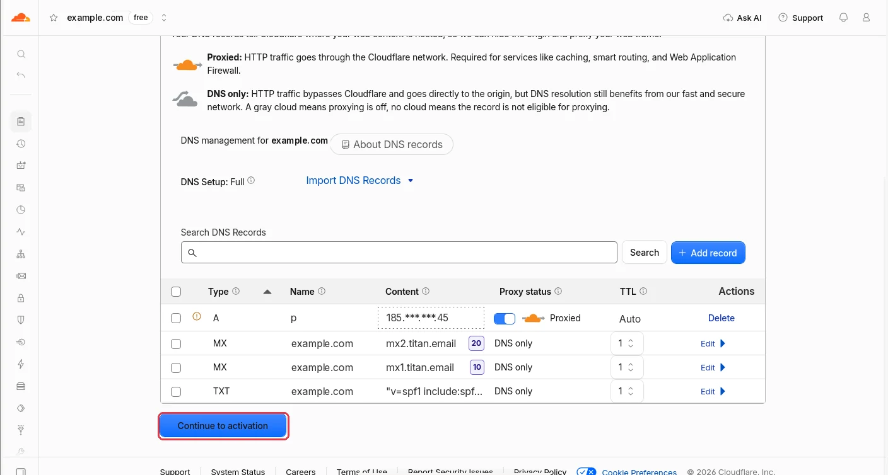

5. Cloudflare shows you two **nameservers**. Go to the site where you bought the domain, delete its current nameservers and put these two in their place.

    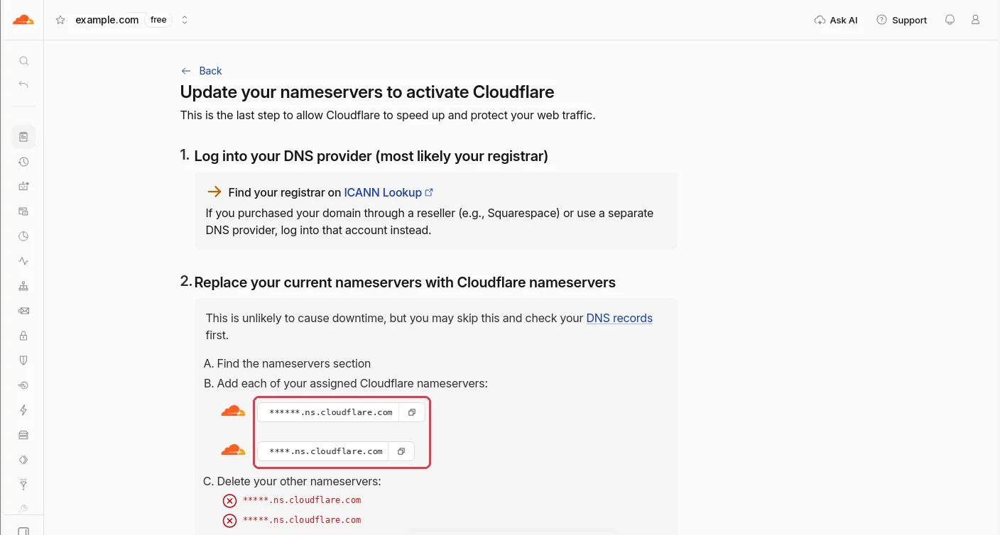

6. Wait until the domain’s status in **Domains** › **Overview** changes to **Active**. This takes from a few minutes to a day. Until the nameservers are changed, the **Status** column shows a message like **Invalid nameservers**.

    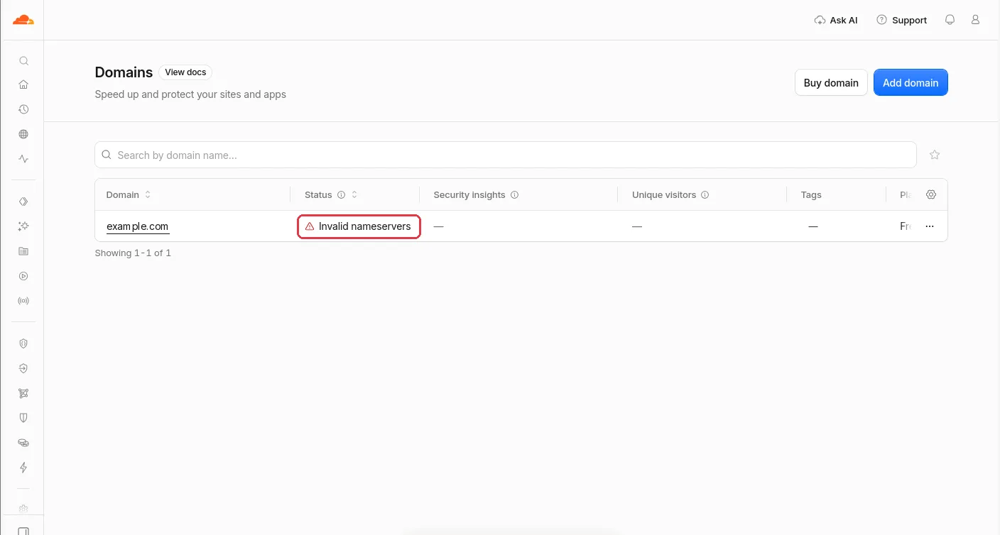

7. Click the domain, open **DNS** › **Records** in the sidebar and click **Add record**.

    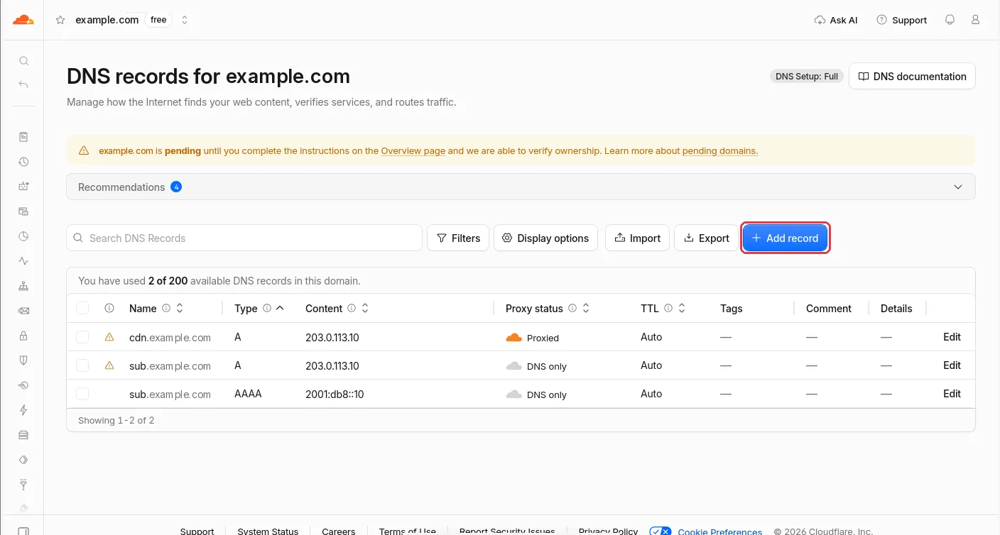

8. Fill in the record:
    - **Type**: `A` (for the server’s IPv4 address).
    - **Name**: the subdomain you want, for example `sub`.
    - **IPv4 address**: your server’s IP.
    - **Proxy status**: turn it **off** (**DNS only**, grey cloud). A Direct domain must not be proxied.
    - **TTL**: leave it on Auto.

    Above the form, Cloudflare sums up the record (for example `sub.example.com points to 203.0.113.10`). Click **Save**.

    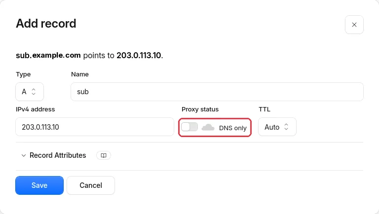{ width="600" }

9. If your server also has an IPv6 address, add a second record the same way, with **Type** `AAAA` and the IPv6 address.

    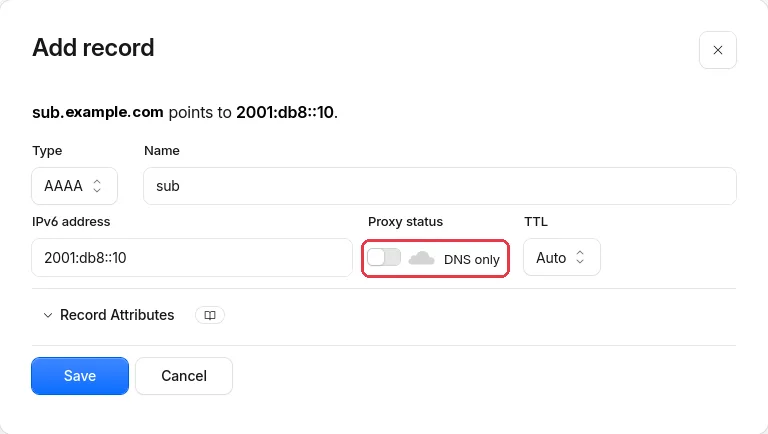{ width="600" }

### Check that the direct domain works

DNS changes can take a few minutes to spread. Then, on your own computer, run:

```bash
ping sub.example.com
```

You should see your server’s IP in the answer. You can also use `nslookup` or `dig`. If you see a different IP or "unknown host", check the record and wait a little longer. To learn more, read [this article on DNS](https://wikicensorship.github.io/fa/docs/measure-internet-censorship/DNS/) (Persian).

### Add the direct domain to the panel

In the panel, click **Domains** › **Add domain** and type the domain. Under **How is it set up?** choose **Direct**, under **Which TLS?** choose **Valid TLS**, and finish the steps.

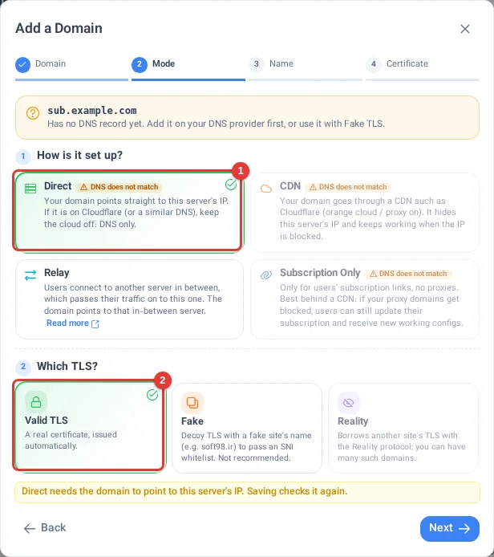{ width="560" }

If the panel shows **DNS does not match** next to the option, the DNS record does not reach this server’s IP yet. Wait a few minutes; the panel checks again when you save.

</details>

<details markdown="1"><summary><h2>CDN domain registration</h2></summary>

A **CDN** (content delivery network) is a network of servers that sits between your users and your server. Users connect to the CDN, and the CDN passes the traffic to your server. [What is CDN and how does it help us?](/manager/domain-worker-cdn-and-tunneling/What-is-CDN-and-how-does-it-help-us%3F/)

These steps use Cloudflare. For other CDNs, see [GCore](/manager/domain-worker-cdn-and-tunneling/How-to-use-GCore-CDN-on-Cloudflare-registered-domain/) and [Amazon CloudFront](/manager/domain-worker-cdn-and-tunneling/How-to-use-Amazon-CDN/).

### Add the CDN record on Cloudflare

1. Add your domain to Cloudflare as described in the direct domain section above (steps 1 to 6).
2. Go to **DNS** › **Records** and click **Add record**.
3. Use **Type** `A` (or `AAAA` for IPv6), a new subdomain name (for example `cdn`), and your server’s IP.
4. Leave **Proxy status** **on** (**Proxied**, orange cloud). This is the only difference from a direct domain.
5. Click **Save**.

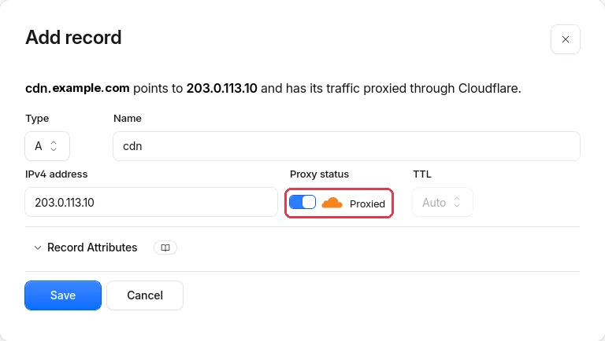{ width="600" }

### Check that the CDN domain works

When you `ping` this subdomain, you should see one of Cloudflare’s IPs, not your server’s IP. This hides your server. The Cloudflare IP can change over time.

Sometimes the Cloudflare IPs that your users get are blocked or slow in Iran. In that case, find working IPs with the panel’s own **Scanner** (**Tools** › **Scanner**), or see [Guide for finding a clean Cloudflare IP](/manager/domain-worker-cdn-and-tunneling/Guide-for-finding-a-clean-Cloudflare-IP/).

### Cloudflare SSL/TLS settings

**TLS** is the encryption that protects the connection between the user and the server. A **certificate** proves that a server really owns a domain. HiddifyManager gets a real certificate for your domain, so Cloudflare can connect to your server over TLS.

1. Open your domain in Cloudflare, open **SSL/TLS** in the sidebar and click **Configure**. The same page shows, under **Traffic Served Over TLS**, which TLS versions your traffic used; newer is safer.

    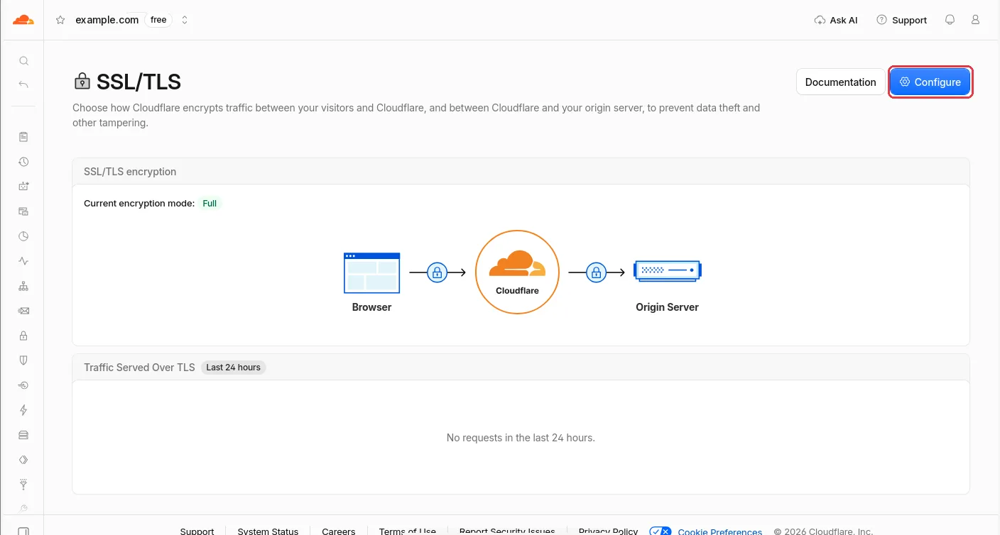

2. Choose the encryption mode **Full (Strict)** or **Full**. Do not use **Flexible**. If **Automatic SSL/TLS (recommended)** is selected, Cloudflare picks the most secure mode that works by itself, and you can leave it.

    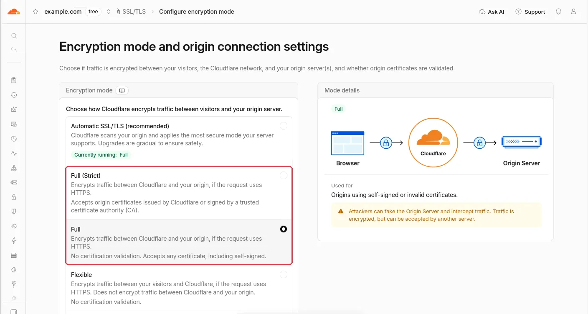

3. Open **Network** in the sidebar and turn on **gRPC** and **WebSockets**. HiddifyManager’s CDN proxies use WebSocket, gRPC, HTTPUpgrade and XHTTP.

    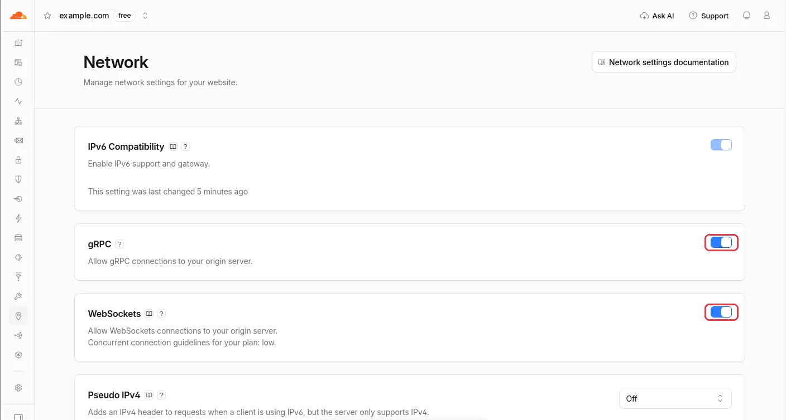

Older guides told you to turn on **SSL/TLS Recommender**. Cloudflare replaced it with Automatic SSL/TLS, so you do not need it.

### Add the CDN domain to the panel

In the panel, click **Domains** › **Add domain**, type the domain, and under **How is it set up?** choose **CDN**. CDN domains always use **Valid TLS**.

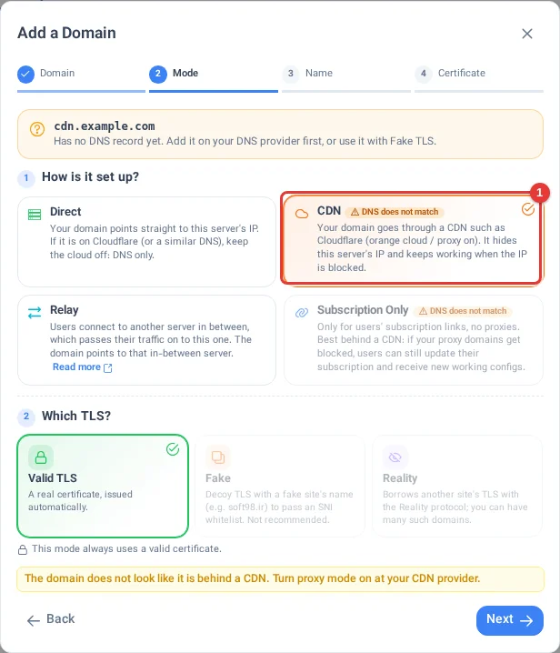{ width="560" }

If the panel warns that the domain does not look like it is behind a CDN, turn the proxy (orange cloud) on in Cloudflare.

</details>

## Relay domain registration

A relay domain is registered like a direct domain, but its record points to the in-between (relay) server instead of your main server. [Read more](/manager/domain-worker-cdn-and-tunneling/How-to-add-relay-domain-to-Hiddify-manager/)

## Fake and Reality domains

With the **Fake** or **Reality** TLS mode, you use the name of another site that you do not own, so you do not register anything at a DNS provider. You only add the name in the panel. See [How to create and use fake domain](/manager/domain-worker-cdn-and-tunneling/How-to-create-and-use-fake-domain/).

## Related articles

- [Fake domain](/manager/domain-worker-cdn-and-tunneling/How-to-create-and-use-fake-domain/)
- [Wildcard subdomains](/manager/domain-worker-cdn-and-tunneling/Tutorial-for-using-wildcard-subdomains-on-Hiddify/)
- [Automatic subdomains on Cloudflare](/manager/domain-worker-cdn-and-tunneling/Get-Cloudflare-API/)
- [Domain fronting](/manager/domain-worker-cdn-and-tunneling/Guide-for-domain-fronting/)

</div>
