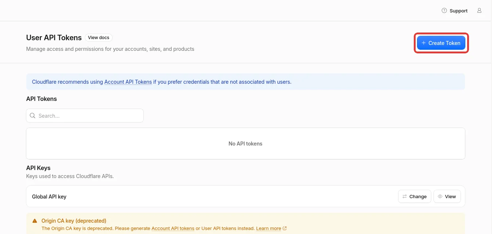
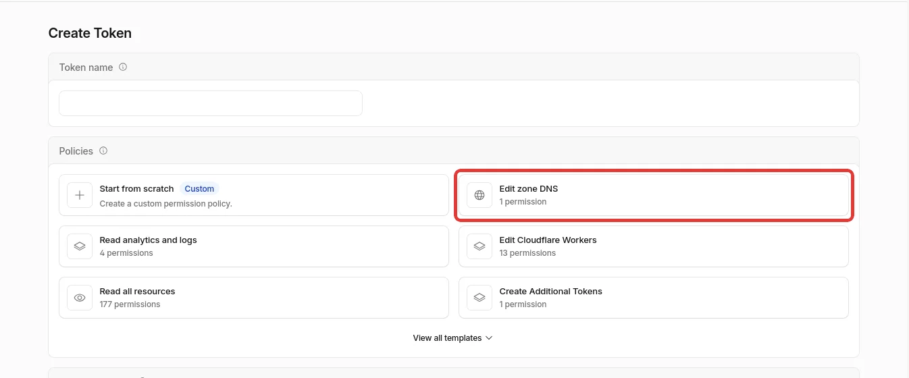
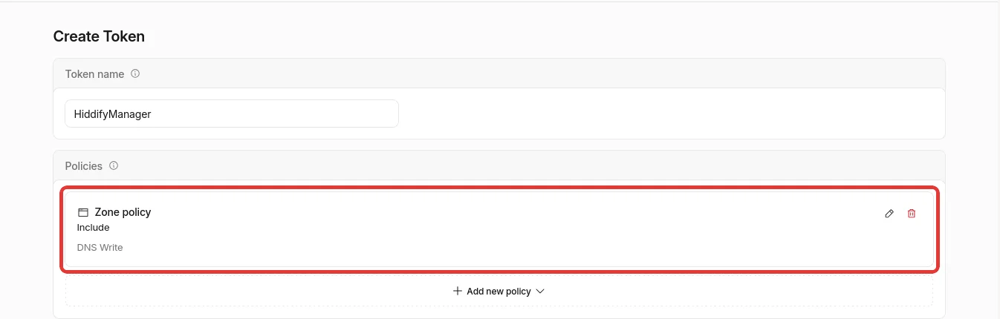
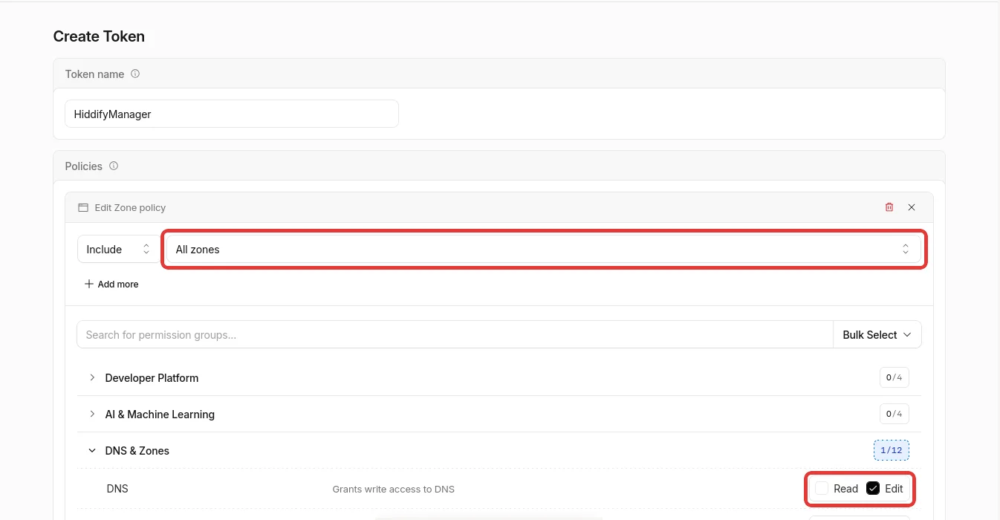
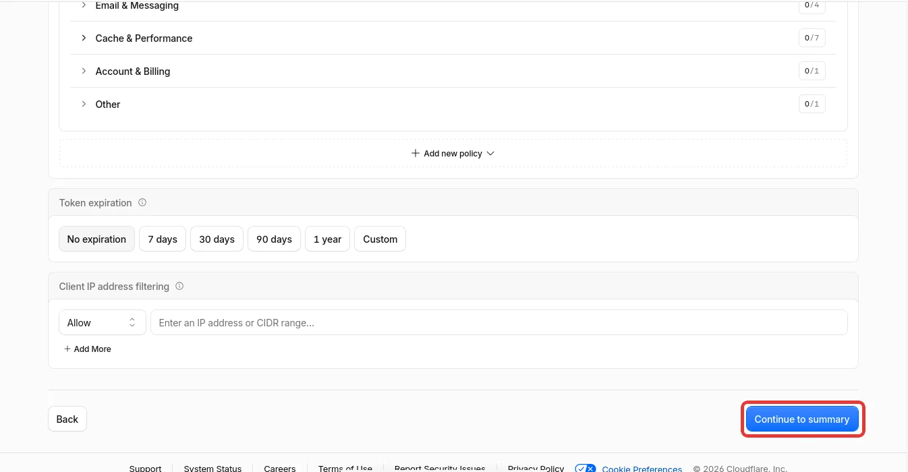
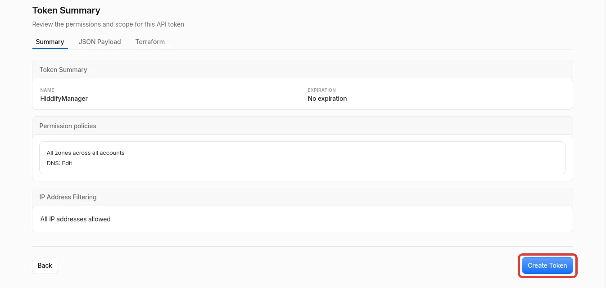
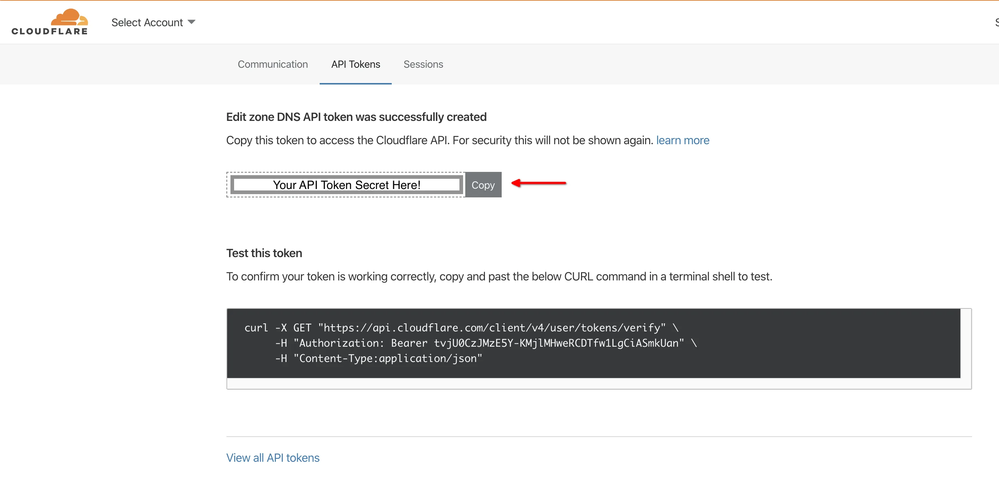
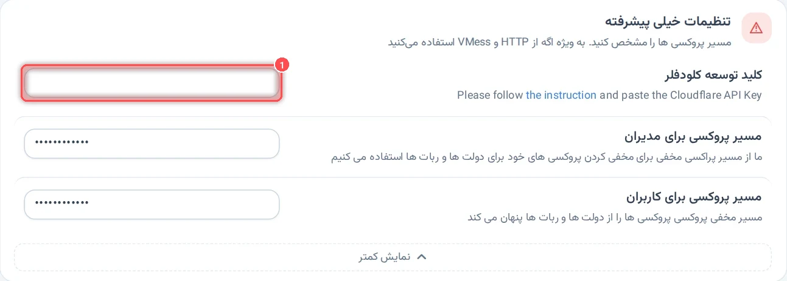

# گرفتن کلید توسعه کلادفلر

با یک توکن API کلادفلر، پنل رکوردهای DNS دامنه‌های شما را خودش مدیریت می‌کند: وقتی در صفحهٔ **دامنه‌ها** دامنه‌ای اضافه می‌کنید (زیردامنه‌ای از دامنه‌ای که در حساب کلادفلر شماست)، پنل رکورد `A` / `AAAA` آن را با آی‌پی سرور می‌سازد یا به‌روز می‌کند؛ برای دامنه‌های **CDN** با پروکسی (ابر نارنجی) و برای دامنه‌های مستقیم فقط DNS. این صفحه برای هیدیفای‌منیجر نسخهٔ ۱۴.۵ است.

!!! note "نکته"
    نسخه‌های قدیمی‌تر با این توکن ورکر کلادفلر هم می‌ساختند. نسخهٔ ۱۴.۵ این کار را نمی‌کند: [آموزش استفاده از دامنهٔ ورکر کلادفلر](/fa/manager/domain-worker-cdn-and-tunneling/How-to-use-the-Cloudflare-worker-domain-on-Hiddify/) را ببینید.

مراحل زیر را به ترتیب انجام دهید تا توکن را بگیرید.

1. وارد حساب کلادفلر خود شوید و دامنه‌تان را در آن اضافه کنید. اطلاعات بیشتر: [انواع دامنه و نحوهٔ ثبت آن‌ها](/fa/manager/domain-worker-cdn-and-tunneling/Domain-types-and-how-to-register-them/).
2. صفحهٔ [My Profile › API Tokens](https://dash.cloudflare.com/profile/api-tokens) را باز کنید (آیکون پروفایل بالا سمت راست › **My Profile** › **API Tokens**). نام این صفحه **User API Tokens** است. روی **Create Token** بزنید.

    

3. در **Token name** یک نام بنویسید، مثلاً `HiddifyManager`. در بخش **Policies** روی **Edit zone DNS** بزنید.

    

4. یک **Zone policy** با مجوز **DNS Write** اضافه می‌شود. روی مداد آن بزنید تا مشخص کنید شامل کدام دامنه‌ها شود.

    

5. **Include** را نگه دارید و **Specific zone** و دامنهٔ خود را انتخاب کنید، یا اگر چند دامنه دارید **All zones** را. در گروه **DNS & Zones**، **DNS** باید روی **Edit** باشد؛ الگو این کار را از قبل انجام داده است.

    

6. **Token expiration** را روی **No expiration** بگذارید (یا تاریخی انتخاب کنید) و پایین صفحه روی **Continue to summary** بزنید.

    

7. خلاصه را بررسی کنید (**DNS: Edit**) و روی **Create Token** بزنید.

    

8. توکن را کپی کنید. کلادفلر آن را فقط یک بار نشان می‌دهد؛ اگر گمش کردید، یک توکن تازه بسازید.

    

# استفاده از کلید توسعه کلادفلر در هیدیفای‌منیجر

بعد از ساختن توکن، در پنل به **تنظیمات** بروید و کلید **نمایش تنظیمات پیشرفته** را بالای صفحه روشن کنید. در کارت **تنظیمات خیلی پیشرفته**، توکن را در فیلد **کلید توسعه کلادفلر** بچسبانید و ذخیره کنید.

حالا اگر در صفحهٔ **دامنه‌ها** دامنه‌ای اضافه کنید که دامنهٔ اصلی‌اش در حساب کلادفلر شماست، رکورد DNS آن خودکار ساخته می‌شود. اگر توکن اشتباه باشد یا مجوز کافی نداشته باشد، هنگام ذخیرهٔ دامنه خطای *Cloudflare error* با علت آن نمایش داده می‌شود.

## مقاله‌های مرتبط

- [انواع دامنه و ثبت آن‌ها](/fa/manager/domain-worker-cdn-and-tunneling/Domain-types-and-how-to-register-them/)
- [دامنهٔ فیک](/fa/manager/domain-worker-cdn-and-tunneling/How-to-create-and-use-fake-domain/)
- [زیردامنه‌های متغیر (wildcard)](/fa/manager/domain-worker-cdn-and-tunneling/Tutorial-for-using-wildcard-subdomains-on-Hiddify/)
- [دامین فرانتینگ](/fa/manager/domain-worker-cdn-and-tunneling/Guide-for-domain-fronting/)

