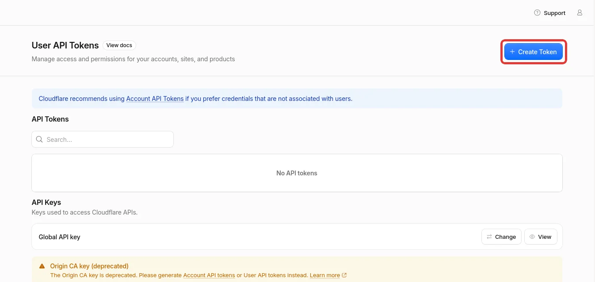
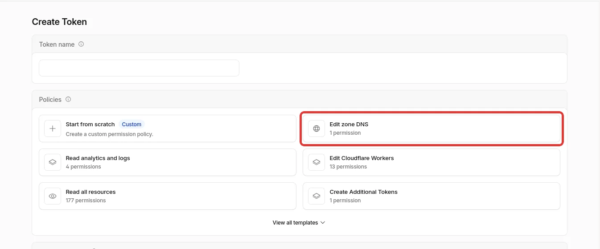
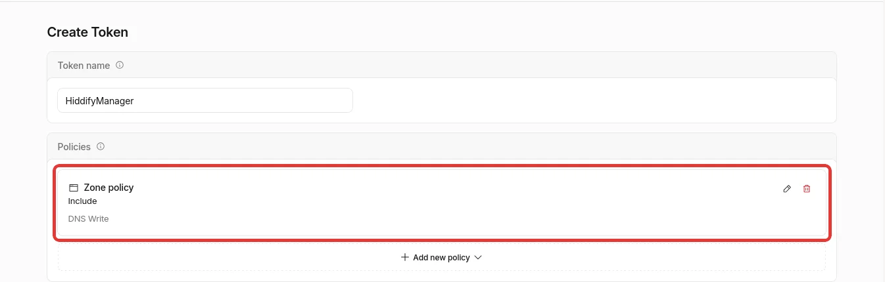
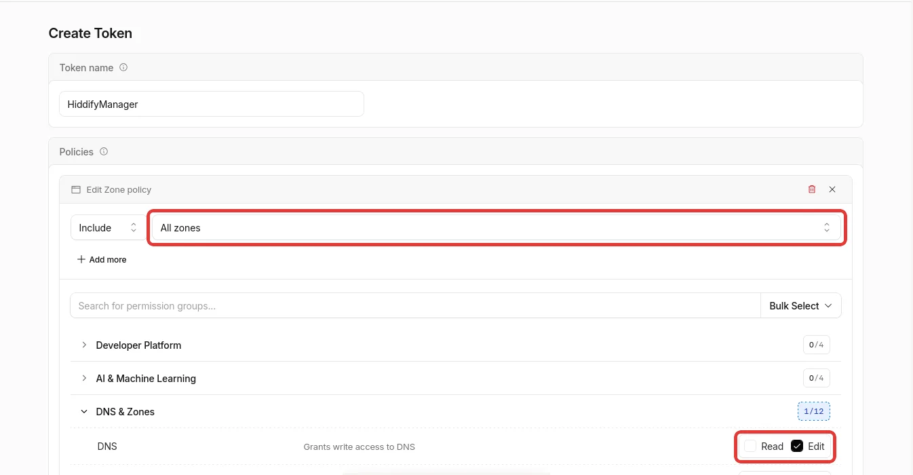
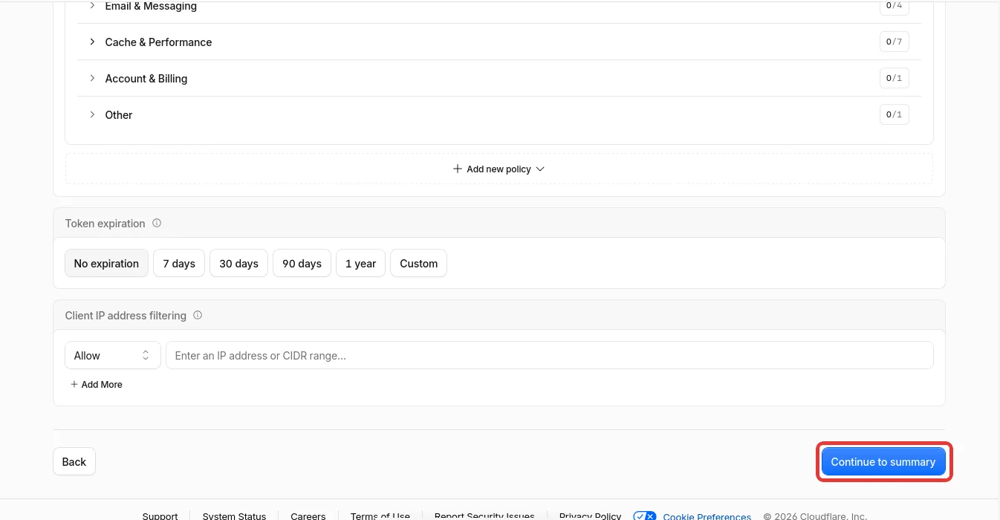
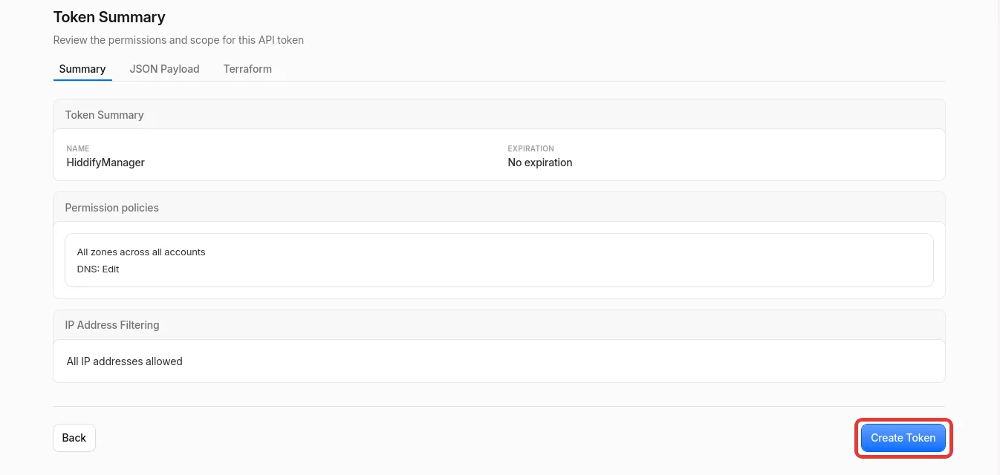
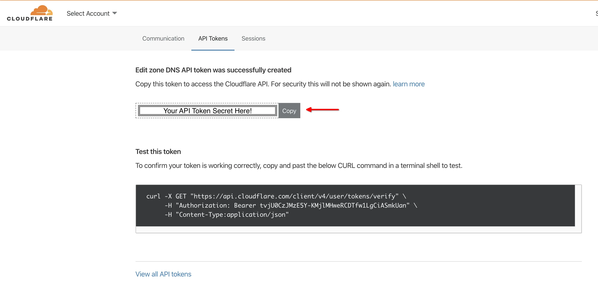
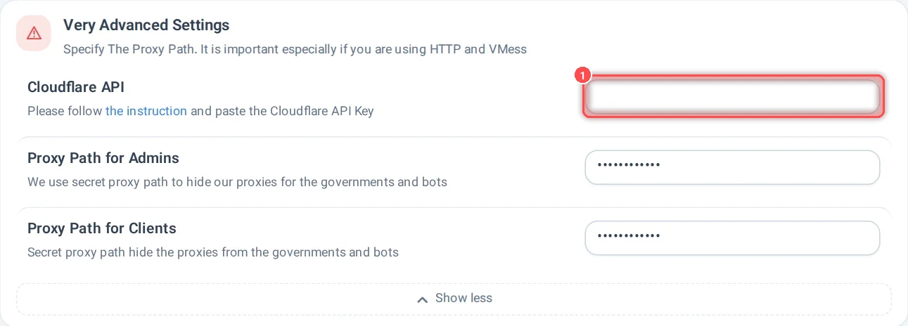

# Get Cloudflare API

With a Cloudflare API token, the panel manages the DNS records of your domains for you: when you add a domain (a subdomain of a domain that is on your Cloudflare account) on the **Domains** page, the panel creates or updates its `A` / `AAAA` record with your server's IP, proxied (orange cloud) for **CDN** domains and DNS only for direct ones. This page is for Hiddify Manager v14.5.

!!! note
    Older versions also created Cloudflare Workers with this token. v14.5 does not: see [How to use the Cloudflare worker domain](/manager/domain-worker-cdn-and-tunneling/How-to-use-the-Cloudflare-worker-domain-on-Hiddify/).

Follow the steps below to get the token.

1. Sign in to your Cloudflare account and add your domain to it. More: [Domain types and how to register them](/manager/domain-worker-cdn-and-tunneling/Domain-types-and-how-to-register-them/).
2. Open [My Profile › API Tokens](https://dash.cloudflare.com/profile/api-tokens) (the profile icon at the top right › **My Profile** › **API Tokens**). The page is called **User API Tokens**. Click **Create Token**.

    

3. Under **Token name**, type a name, for example `HiddifyManager`. Under **Policies**, click **Edit zone DNS**.

    

4. A **Zone policy** with **DNS Write** is added. Click its pencil to choose which domains it covers.

    

5. Keep **Include** and choose **Specific zone** and your domain, or **All zones** if you will use several domains. Under **DNS & Zones**, **DNS** must be on **Edit**: the template already did this.

    

6. Leave **Token expiration** on **No expiration** (or choose a date), and click **Continue to summary** at the bottom.

    

7. Check the summary (**DNS: Edit**) and click **Create Token**.

    

8. Copy the token. Cloudflare shows it only once; if you lose it, create a new one.

    

# How to use Cloudflare API in HiddifyManager
After creating the token, open **Settings** in the panel and turn on **Show Advanced Settings** at the top of the page. In the **Very Advanced Settings** card, paste the token into **Cloudflare API** and save.

Now, when you add a domain on the **Domains** page whose main domain is on your Cloudflare account, its DNS record is created automatically. If the token is wrong or lacks the permission, saving the domain shows a *Cloudflare error* with the reason.

## Related articles

- [Domain types and how to add them](/manager/domain-worker-cdn-and-tunneling/Domain-types-and-how-to-register-them/)
- [Fake domain](/manager/domain-worker-cdn-and-tunneling/How-to-create-and-use-fake-domain/)
- [Wildcard subdomains](/manager/domain-worker-cdn-and-tunneling/Tutorial-for-using-wildcard-subdomains-on-Hiddify/)
- [Domain fronting](/manager/domain-worker-cdn-and-tunneling/Guide-for-domain-fronting/)

