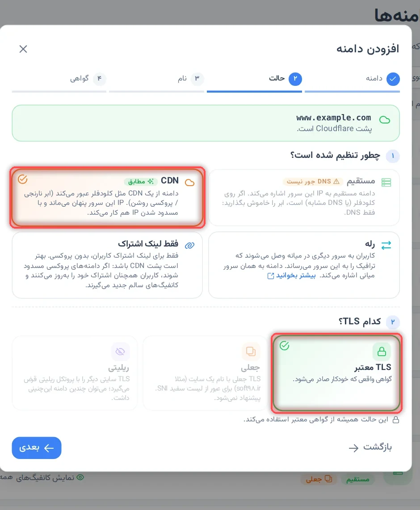

# آموزش استفاده از دامین فرانتینگ
دامین فرانتینگ روشی برای دور زدن سیستم فیلترینگ از طریق CDN است. فیلتر نام سایت دیگری (SNI) را می‌بیند، مثلا `discord.com`، در حالی که `Host` درخواست به دامنهٔ خود شما روی همان CDN اشاره می‌کند و CDN ترافیک را به سرور شما می‌رساند.

این روش فقط وقتی کار می‌کند که سایت دیگر روی **همان CDN** دامنهٔ شما باشد (مثلا دو سایت روی کلادفلر)، و روی هر CDN و هر اپراتوری جواب نمی‌دهد؛ پس اول با چند کاربر امتحانش کنید. این صفحه برای هیدیفای‌منیجر نسخهٔ ۱۴.۵ است.

!!! warning "ممکن است CDN دامین فرانتینگ را غیرفعال کند"
    خیلی از CDNها اجازهٔ دامین فرانتینگ نمی‌دهند. Amazon CloudFront، گوگل و Microsoft Azure از قبل جلوی آن را گرفته‌اند و هر CDN دیگری هم ممکن است هر زمان و بدون اطلاع قبلی آن را مسدود کند. استفاده از آن ممکن است خلاف قوانین CDN هم باشد و باعث تعلیق حساب شما شود.

    - دامین فرانتینگ را تنها راه اتصال کاربران نکنید. دست‌کم یک کانفیگ دیگر (مثلاً [ریالتی](/fa/manager/configuration-and-advanced-settings/How-to-use-Reality-on-Hiddify/) یا یک کانفیگ CDN معمولی) در لینک اشتراک نگه دارید.
    - اگر کانفیگ‌های فرانتینگ ناگهان برای همه از کار افتادند، احتمالاً CDN آن را مسدود کرده است. فیلد **دامین فرانتینگ** (قدم ۵ پایین) را خالی کنید و از کانفیگ‌های دیگر استفاده کنید.

## ثبت دامنه روی CDN

* ابتدا می‌بایست در سایت CDN مورد نظر خود ثبت نام کنید و یک دامنه در آن ثبت نمایید. [آموزش ثبت دامنه](/fa/manager/domain-worker-cdn-and-tunneling/Domain-types-and-how-to-register-them/)

* پس از آن یک رکورد DNS ثبت کنید و پروکسی آن را روشن کنید (در کلادفلر: ابر نارنجی).

## تنظیمات دامین فرانتینگ روی هیدیفای‌منیجر

۱. در پنل به **دامنه‌ها** بروید و روی **افزودن دامنه** بزنید.

۲. زیردامنهٔ خود را (همانی که پروکسی‌اش روشن است) وارد کنید و روی **بررسی** بزنید.

۳. در بخش **چطور تنظیم شده است؟** گزینهٔ **CDN** و در بخش **کدام TLS؟** گزینهٔ **TLS معتبر** را انتخاب کنید و مراحل (نام و گواهی) را تمام کنید.

۴. روی مداد کنار دامنهٔ جدید بزنید و بخش **پیشرفته** را باز کنید.

۵. در فیلد **دامین فرانتینگ** یک یا چند سایت را که روی همان CDN هستند ولی فیلتر نیستند، با ویرگول جدا کنید (مثلا `another-site.com, cdn-site.net`). برای اینکه بفهمید یک سایت از کدام CDN استفاده می‌کند، آی‌پی آن را با یک [ابزار DNS Lookup](https://dns-lookup.com) پیدا کنید. برای خاموش کردن فرانتینگ، فیلد را خالی بگذارید.

۶. در صورت نیاز آی‌پی‌های تمیز آن CDN را در فیلد **اجبار به استفاده از این IPها یا دامنه‌ها** بگذارید ([پیدا کردن آی‌پی تمیز کلادفلر](/fa/manager/domain-worker-cdn-and-tunneling/Guide-for-finding-a-clean-Cloudflare-IP/) را ببینید).

۷. ذخیره کنید و در صفحهٔ **اقدامات** روی **الان اعمال کن** بزنید.

کار تمام است: کانفیگ‌های این دامنه حالا از دامین فرانتینگ استفاده می‌کنند. در صفحهٔ **دامنه‌ها** کنار این دامنه نشان فرانتینگ دیده می‌شود.

!!! info "تغییر در نسخهٔ ۱۳"
    نسخه‌های قدیمی‌تر یک گروه تنظیمات سراسری **دامین فرانتینگ** داشتند. از نسخهٔ ۱۳ فرانتینگ برای هر دامنهٔ CDN جداگانه و به روش بالا تنظیم می‌شود.

## اضافه کردن کانفیگ به لینک سابسکریپشن
همانطور که می‌دانید، در هیدیفای‌منیجر همواره توصیه می‌شود لینک‌های سابسکریپشن از کانفیگ‌ها جدا باشند. بنابراین اگر قبلا لینک سابسکریپشن ایجاد نموده‌اید، کافیست در تنظیمات آن دامنه جدید CDN را هم اضافه نمایید تا کانفیگ‌های جدید دامین فرانتینگ نیز به لینک سابسکریپشن متصل گردند. [آموزش مربوط به تنظیم لینک سابسکریپشن](/fa/manager/domain-worker-cdn-and-tunneling/How-to-create-subscription-link-on-Hiddify/)

## مقاله‌های مرتبط

- [انواع دامنه و ثبت آن‌ها](/fa/manager/domain-worker-cdn-and-tunneling/Domain-types-and-how-to-register-them/)
- [دامنهٔ فیک](/fa/manager/domain-worker-cdn-and-tunneling/How-to-create-and-use-fake-domain/)
- [زیردامنه‌های متغیر (wildcard)](/fa/manager/domain-worker-cdn-and-tunneling/Tutorial-for-using-wildcard-subdomains-on-Hiddify/)
- [ساخت خودکار زیردامنه در کلادفلر](/fa/manager/domain-worker-cdn-and-tunneling/Get-Cloudflare-API/)

