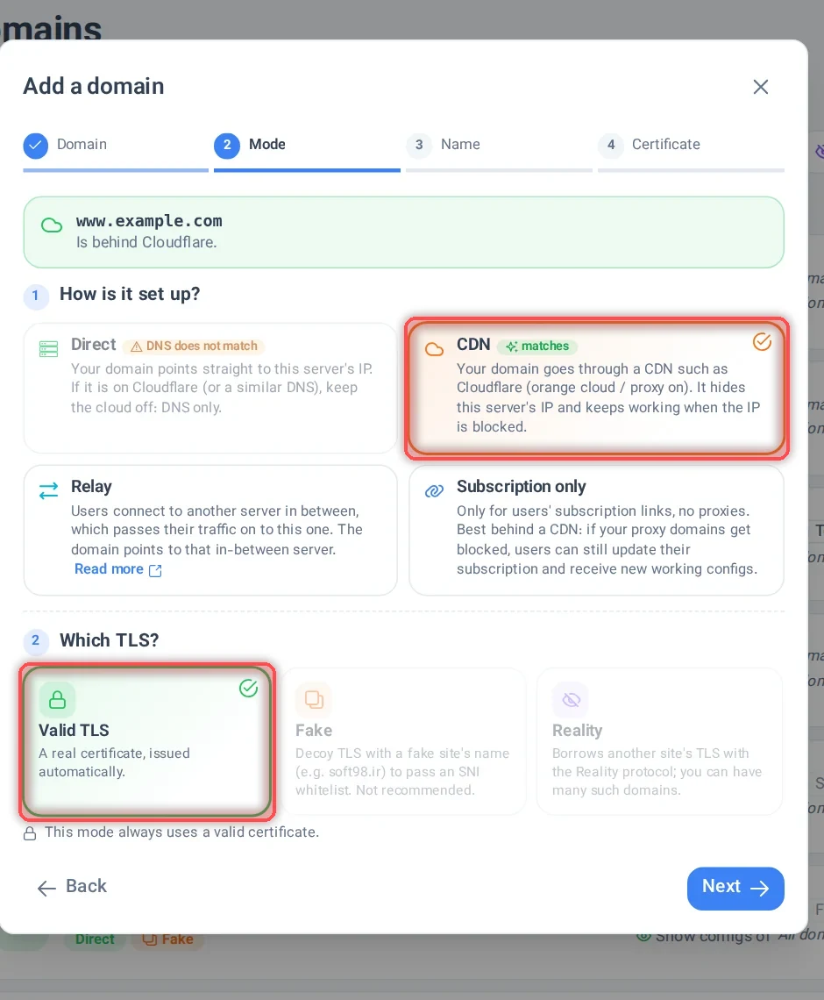

# Guide for domain fronting
Domain fronting is a way to bypass the filtering system through a CDN. The filter sees the name of another site (the SNI), for example `discord.com`, while the `Host` of the request points to your own domain on the same CDN; the CDN delivers the traffic to your server.

It only works when the other site is on the **same CDN** as your domain (for example, two Cloudflare sites), and it does not work on every CDN or every operator, so test it with a few users first. This page is for Hiddify Manager v14.5.

!!! warning "CDNs can turn domain fronting off"
    Many CDNs don't allow domain fronting. Amazon CloudFront, Google and Microsoft Azure already block it, and any CDN can start blocking it at any time, without notice. Using it may also be against the CDN's terms and can get your CDN account suspended.

    - Don't make fronting the only way your users connect. Keep at least one other config (for example [Reality](/manager/configuration-and-advanced-settings/How-to-use-Reality-on-Hiddify/) or a normal CDN config) in the subscription.
    - If fronting configs suddenly stop working for everyone, the CDN has probably blocked it. Clear the **Domain fronting** field (step 5 below) and use other configs.

## Domain registration on CDN

- First, you need to register on the CDN site of your choice and register a domain in it. [Tutorial for domain registration](/manager/domain-worker-cdn-and-tunneling/Domain-types-and-how-to-register-them/)

- After that, register a DNS record and turn on its proxy (on Cloudflare: the orange cloud).

## Domain fronting settings on HiddifyManager panel

1. In the panel, open **Domains** and click **Add domain**.
2. Type your subdomain (the one with the proxy turned on) and click **Check**.
3. In **How is it set up?** choose **CDN**, and in **Which TLS?** choose **Valid TLS**. Finish the wizard (name and certificate).

4. Click the pencil next to the new domain and open **Advanced**.
5. In **Domain fronting**, enter one or more sites that are on the same CDN but not filtered, separated by commas (for example `another-site.com, cdn-site.net`). To check which CDN a site uses, look up its IP with a [DNS lookup tool](https://dns-lookup.com/). Leave the field empty to turn fronting off.
6. If needed, put clean IPs of that CDN in **Force configs to use these IPs / domains** (see [finding a clean Cloudflare IP](/manager/domain-worker-cdn-and-tunneling/Guide-for-finding-a-clean-Cloudflare-IP/)).
7. Save, then click **Apply now** on the **Actions** page.

The work is done: this domain's configs now use domain fronting. On the **Domains** page the domain shows a fronting badge.

!!! info "Changed in v13"
    Older versions had a global **Domain Fronting** settings group. Since v13 fronting is set on each CDN domain, as above.

## Add config to the subscription link

As you know, it is always recommended to keep subscription links separate from configs. Therefore, if you have already created a subscription link, just add the new CDN domain in its settings so that the new domain fronting configurations are also connected to the subscription link. [How to create subscription link on HiddifyManager](/manager/domain-worker-cdn-and-tunneling/How-to-create-subscription-link-on-Hiddify/)

## Related articles

- [Domain types and how to add them](/manager/domain-worker-cdn-and-tunneling/Domain-types-and-how-to-register-them/)
- [Fake domain](/manager/domain-worker-cdn-and-tunneling/How-to-create-and-use-fake-domain/)
- [Wildcard subdomains](/manager/domain-worker-cdn-and-tunneling/Tutorial-for-using-wildcard-subdomains-on-Hiddify/)
- [Automatic subdomains on Cloudflare](/manager/domain-worker-cdn-and-tunneling/Get-Cloudflare-API/)

