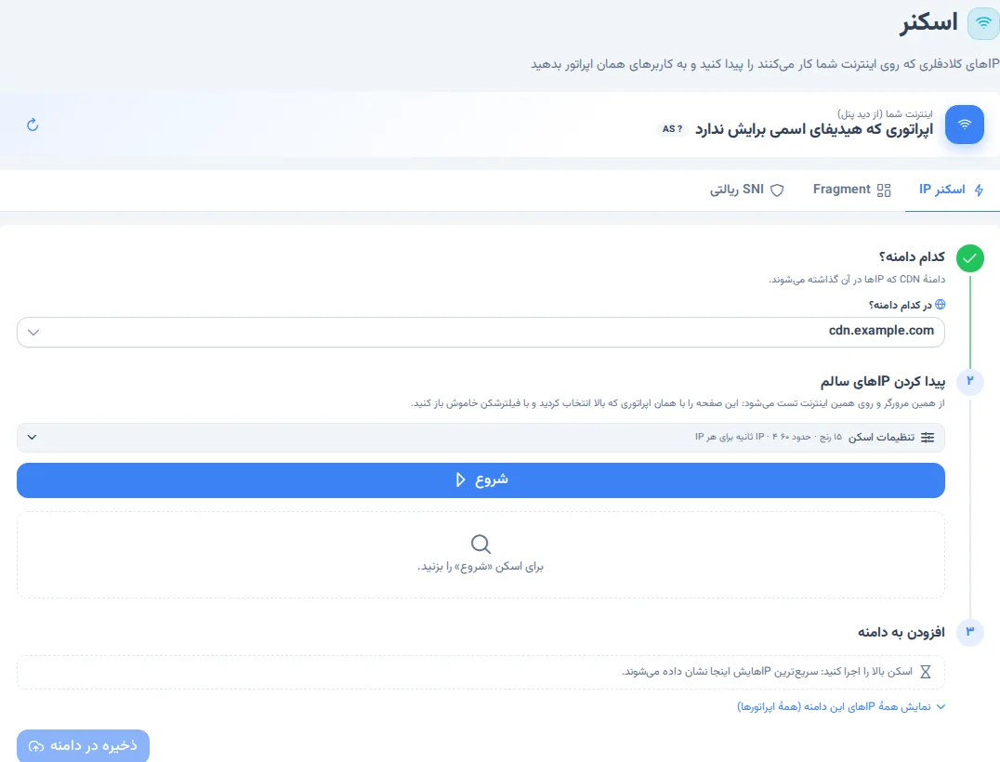
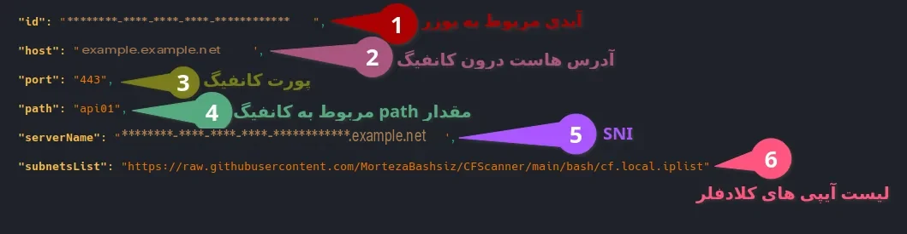
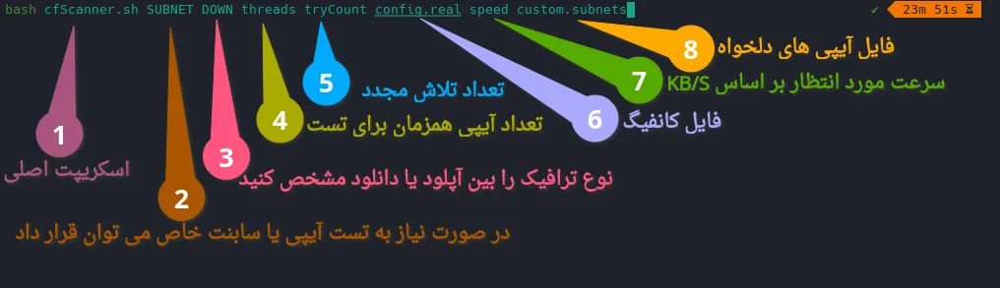
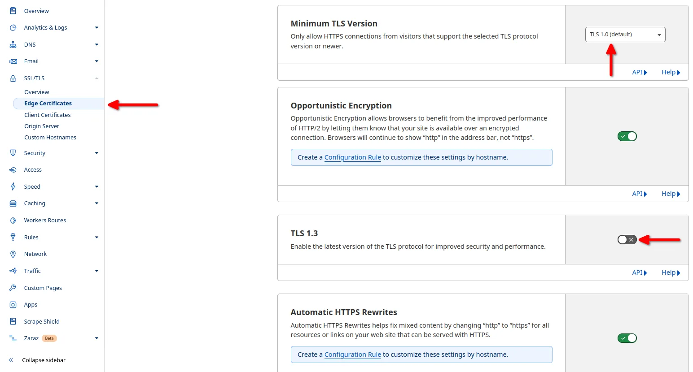
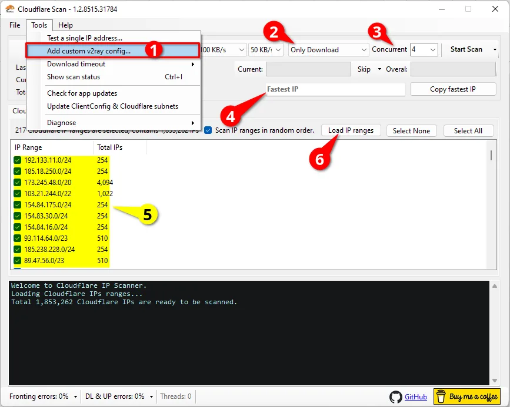
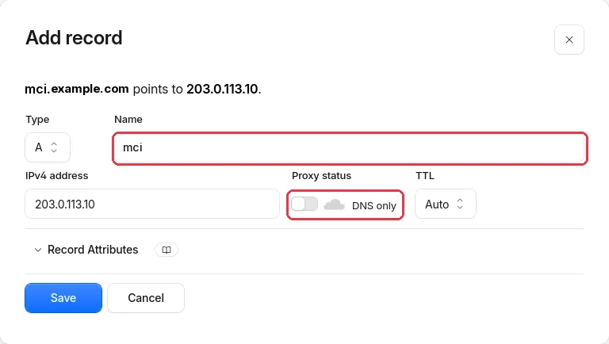

<div dir="rtl" markdown=1>
	
# چگونگی یافتن آی‌پی تمیز کلادفلر

بزرگترین ارائه‌دهنده خدمات CDN در جهان کلادفلر است و احتمالا می‌دانید؛ به دلیل فیلترینگ شدید اینترنت در ایران اختلال زیادی روی سرویس‌های آن وجود دارد زیرا امکان فیلتر نمودن کامل آن برای فیلترچی مقدور نیست اما می‌تواند روی آن اختلال ایجاد کند. 

در اینجا اگر شما نیز از سرویس‌های CDN کلادفلر استفاده می‌کنید؛ متاثر از این اختلالات خواهید شد. برای کاهش تاثیر این اختلالات می‌بایست آی‌پی‌های تمیز (آی‌پی‌هایی که اختلالی روی آن نیست) را پیدا کرد.

در اینجا چند راه کار برای این موضوع معرفی و بررسی می‌گردد.

!!! tip "نکته"

    قبل از شروع تاکید می‌شود تمامی این تست‌ها روی سیستم کلاینت و بدون اتصال به VPN باید انجام شوند.


## استفاده از اسکنر هیدیفای‌منیجر (ساده‌ترین روش) { #panel-scanner }
از نسخهٔ ۱۴.۵ پنل اسکنر خودش را دارد: **ابزارها** › **اسکنر** (یا **باز کردن اسکنر** زیر فیلد **اجبار به استفاده از این IPها یا دامنه‌ها** در یک دامنهٔ CDN). برای استفاده از آن، اول باید در صفحهٔ **دامنه‌ها** یک دامنهٔ CDN داشته باشید.

۱. پنل را **روی اپراتوری که برایش آی‌پی می‌خواهید و با فیلترشکن خاموش** باز کنید (مثلا روی گوشی با سیم‌کارت همراه اول). اسکن در مرورگر شما و روی همان اینترنتی انجام می‌شود که الان به آن وصل هستید.

۲. **کدام دامنه؟** دامنهٔ CDN را انتخاب کنید (و اگر پرسید، اپراتوری که کاربرانش این آی‌پی‌ها را می‌گیرند).

۳. **پیدا کردن IPهای سالم:** روی **شروع** بزنید. پنل بازه‌های آی‌پی کلادفلر را از مرورگر شما تست می‌کند و سریع‌ترین‌ها را نگه می‌دارد. با **تنظیمات اسکن** تعداد بازه‌ها و آی‌پی‌های تست‌شده را تعیین می‌کنید.

۴. **افزودن به دامنه:** فهرست را بررسی کنید (چند تا را حذف کنید یا آی‌پی، بازه یا دامنهٔ خودتان را اضافه کنید) و **ذخیره در دامنه** را بزنید. آی‌پی‌ها برای همان اپراتور در فیلد **اجبار کانفیگ‌ها به استفاده از این IPها / دامنه‌ها** نوشته می‌شوند و بقیهٔ اپراتورها مقدار خودشان را نگه می‌دارند.




۵. در صفحهٔ **اقدامات** روی **الان اعمال کن** بزنید. همین کار را روی هر اپراتور تکرار کنید (مثلا یک بار با گوشی همراه اول و یک بار با ایرانسل).

اسکنر دو زبانهٔ دیگر هم دارد: **Fragment** (آزمایش پیش‌تنظیم‌های fragment برای یک دامنهٔ CDN) و **REALITY SNI** (پیدا کردن SNIهایی که برای ریالتی کار می‌کنند). اگر آی‌پی‌های پیدا شده باز هم وصل نشدند، گزینهٔ **تست کامل با آپلود، از یک دستگاه دیگر** دستوری می‌دهد که روی گوشی یا کامپیوتر همان اپراتور اجرا کنید؛ بعضی اپراتورها بعد از کمی آپلود اتصال را قطع می‌کنند و مرورگر نمی‌تواند این را تست کند.

اسکنرهای بیرونی زیر هم اگر ترجیح می‌دهید همچنان مفیدند.

## اسکنر آی‌پی کلادفلر مرتضی باشسیز
آقای باشسیز یک مهندس ایرانی است که برنامه‌ای تحت عنوان CFScanner توسعه داده است که با استفاده از آن می‌توان لیست آی‌پی‌های کلادفلر را بر روی شبکه‌های مختلف تست نمود و به آی‌پی‌های تمیز کلادفلر رسید.

این برنامه در نسخه‌های متعدد از جمله لینوکس و ویندوز منتشر شده است.
نسخه‌های در دسترس تا تاریخ ویرایش این مطلب:
- بَش
- داکر
- ویندوز
- پایتون
- گولنگ
- اندروید

این پروژه هنوز نگهداری می‌شود (آخرین نسخهٔ ویندوز: آوریل ۲۰۲۶). نسخه‌های **بَش (لینوکس)**، **ویندوز** و **اندروید** را پیشنهاد می‌کنیم؛ نسخه‌های پایتون و گولنگ در گیت‌هاب مشکلات باز دارند.

برای این کار در ابتدا از [اینجا](https://github.com/MortezaBashsiz/CFScanner) نسخه مدنظر خود را دانلود کنید و سپس نحوه اجرای آن را بر اساس سیستم عامل مورد نظر دنبال کنید.


<details dir="rtl" markdown="1"><summary><h3>اجرا در نسخه لینوکس</h3>(کلیک کنید)</summary>

<div dir="rtl" align=center markdown="1">


فایل‌های برنامه را دانلود کنید.

</div>

این برنامه پیش نیازهایی دارد که باید از قبل نصب باشند.
	
[jq](https://stedolan.github.io/jq/)&nbsp;&nbsp;&nbsp;[git](https://git-scm.com/)&nbsp;&nbsp;&nbsp;[tput](https://command-not-found.com/tput)&nbsp;&nbsp;&nbsp;[bc](https://www.gnu.org/software/bc/)&nbsp;&nbsp;&nbsp;[curl](https://curl.se/download.html)&nbsp;&nbsp;&nbsp;
[parallel](https://www.gnu.org/software/parallel/)


سپس ابتدا آن را با کد زیر روی سیستم خود clone کنید.

<div dir="ltr" markdown=1>

```
git clone https://github.com/MortezaBashsiz/CFScanner.git 
```
</div>


به پوشه دانلود برنامه بروید و به آن دسترسی اجرا دهید.
<div dir="ltr" markdown=1>

```
cd CFScanner/bash
chmod +x ../bin/*
```
</div>

فایل config.real را دانلود کنید.

<div dir="ltr" markdown=1>

```
curl -s https://raw.githubusercontent.com/MortezaBashsiz/CFScanner/main/bash/ClientConfig.json -o config.real
```
</div>

توصیه می‌شود فایل config.real را بر اساس کانفیگ خود تغییر دهید.





اگر می‌خواهید فایل کانفیگ خود را داشته باشید آن را به اسم دیگری ذخیره کنید که هنگام آپدیت اسکریپت تغییر نکند.

#### اجرای اسکریپت 

به محل فایل اسکریپت دانلود شده بروید و سپس اسکریپت را به شکل زیر اجرا کنید


<div dir="ltr" markdown=1>

```
bash cfScanner.sh SUBNET DOWN threads tryCount config.real speed custom.subnets
```

</div>




	
	مثلا
<div dir="ltr" markdown=1>

```
bash cfScanner.sh SUBNET DOWN 8 1 config.real 100 custom.subnets
```
	
در نهایت نتیجه تست در پوشه result قرار می‌گیرد که می‌توانید آن را ملاحظه کنید و از آن استفاده نمایید. اطلاعات بیشتر در [ویکی](https://github.com/MortezaBashsiz/CFScanner/tree/main/bash) برنامه

</div>

</details>


<details dir=rtl markdown="1"><summary><h3>اجرا در نسخه ویندوز</h3>(کلیک کنید)</summary>


<details markdown="1"><summary><h4>پیش‌نیازها<h4></summary>


	
ابتدا باید پیش‌نیازهایی وجود داشته باشند که به ترتیب توضیح داده خواهند شد:

- دانلود اپ اسکنر ویندوز از [گیتهاب پروژه](https://github.com/MortezaBashsiz/CFScanner/tree/main/windows)

- اپ .NET Desktop Runtime 6 را نصب کنید از سایت اصلی برنامه که در زیر آورده شده
‍‍‍‍

<div dir=ltr markdown=1>
	
```
https://dotnet.microsoft.com/en-us/download/dotnet/6.0
```

</div>

	
- چک نمودن TLS Handshake

برای این کار ابتدا باید وارد پوشه برنامه بشید و Command Prompt از داخل آن پوشه را باز نمایید. یعنی در پوشه `شیفت+راست‌کلیک` را بزنید و گزینه `Open in Windows Terminal` را بزنید. 

در محیط ترمینال کامند زیر را اجرا کنید.


<div dir=ltr markdown=1>
	
‍‍`.\v2ray.exe tls ping sub.yourdomain.com`


</div>

	
به جای `sub.yourdomain.com` ساب‌دامین خودتون را بذارید. اگر پیغام `handshake succeeded` ظاهر شد؛ یعنی اسکنر آماده استفاده است در غیر اینصورت باید در تنظیمات سرتیفیکت در سایت کلادفلر به صورت موقت تغییراتی اعمال کنید.

ورژن TLS را روی TLS 1.0 بذارید و گزینه TLS 1.3 را غیرفعال کنید.



* نکته: یادتون نره بعد انجام تست این گزینه‌ها را به حالت اول برگردونید.


- ساختارهای الگوی کانفیگ را برای تست آماده کنید.

اگر می‌خواهید کانفیگ‌های خودتون را تست کنید باید در فایل Json مربوط به کانکشن درون پوشه برنامه اعمال کنید. نیاز است در `inbound` این تغییر اعمال گردد.


<div dir="ltr" markdown=1>
	
```

{
  "inbounds": [{
    "port": "PORTPORT", 
    "listen": "127.0.0.1",
    "tag": "socks-inbound",
    "protocol": "socks",
    "settings": {
...
```

</div>

<div dir=rtl markdown=1>
	
و همینطور در `outbound` نیز این تغییر اعمال گردد.

</div>

<div dir=ltr markdown=1>
	
```
{
"outbounds": [
   {
   "protocol": "vmess",
   "settings": {
     "vnext": [{
       "address": "IP.IP.IP.IP",
...
```

</div>


حالا برای راحتی کار، چند نمونه الگوی کانفیگ که iSegaro زحمت کشیده حاضر کرده؛ قرار داده می‌شه می‌توانید مطابق با نیازتون یکی را انتخاب کنید.

* دقت کنید در این ساختارها فقط در قسمت `outbounds` باید مشخصات کانفیگ شامل ۵ قسمت `Port , UUID, PATH , HOST , SNI` را تغییر بدهید که با عبارت `xxxxx` مشخص شده , پس هرجا که عبارت `xxxxx` وجود داره رو فقط بسته به کانفیگ خودتون تغییر بدید و در باقی کدها تغییری انجام ندهید.

- نمونه الگوی Vmess+WS+TLS : 

<div dir=ltr markdown=1>
	
```
{
  "inbounds": [{
    "port": "PORTPORT", 
    "listen": "127.0.0.1",
    "tag": "socks-inbound",
    "protocol": "socks",
    "settings": {
      "auth": "noauth",
      "udp": false,
      "ip": "127.0.0.1"
    },
    "sniffing": {
      "enabled": true,
      "destOverride": ["http", "tls"]
    }
  }],
  "outbounds": [
    {
    "protocol": "vmess",
    "settings": {
      "vnext": [{
        "address": "IP.IP.IP.IP", 
        "port": xxxxx,
        "users": [{"id": "xxxxx" }]
      }]
    },
		"streamSettings": {
        "network": "ws",
        "security": "tls",
        "wsSettings": {
            "headers": {
                "Host": "xxxxx"
            },
            "path": "xxxxx"
        },
        "tlsSettings": {
            "serverName": "xxxxx",
            "allowInsecure": false,
			"fingerprint": "chrome",
			"alpn": [
			"http/1.1"
			]
        }
    }
	}],
  "other": {}
}
```
</div>

- نمونه الگوی Vless+GRPC+TLS :

<div dir=ltr markdown=1>
	
```
{
  "inbounds": [{
    "port": "PORTPORT", 
    "listen": "127.0.0.1",
    "tag": "socks-inbound",
    "protocol": "socks",
    "settings": {
      "auth": "noauth",
      "udp": false,
      "ip": "127.0.0.1"
    },
    "sniffing": {
      "enabled": true,
      "destOverride": ["http", "tls"]
    }
  }],
  "outbounds": [
    {
    "protocol": "vless",
    "settings": {
      "vnext": [{
        "address": "IP.IP.IP.IP", 
        "port": xxxxx,
        "users": [{"id": "xxxxx",
		"encryption": "none"
			}]
      }]
    },
		"streamSettings": {
        "network": "grpc",
        "security": "tls",
        "tlsSettings": {
          "allowInsecure": false,
          "serverName": "xxxxx",
          "alpn": [
            "http/1.1"
          ],
          "fingerprint": "chrome"
        },
        "grpcSettings": {
          "serviceName": "",
          "multiMode": false
        }
      }
	}],
  "other": {}
}
```

</div>

- نمونه الگوی Trojan+WS+TLS :

<div dir=ltr markdown=1>
	
```
{
  "inbounds": [{
    "port": "PORTPORT", 
    "listen": "127.0.0.1",
    "tag": "socks-inbound",
    "protocol": "socks",
    "settings": {
      "auth": "noauth",
      "udp": false,
      "ip": "127.0.0.1"
    },
    "sniffing": {
      "enabled": true,
      "destOverride": ["http", "tls"]
    }
  }],
  "outbounds": [
    {
      "tag": "proxy",
      "protocol": "trojan",
      "settings": {
        "servers": [
          {
            "address": "IP.IP.IP.IP",
            "method": "chacha20",
            "ota": false,
            "password": "xxxxx",
            "port": xxxxx,
            "level": 1,
            "flow": ""
          }
        ]
      },
      "streamSettings": {
        "network": "ws",
        "security": "tls",
        "tlsSettings": {
          "allowInsecure": false,
          "serverName": "xxxxx",
          "alpn": [
            "http/1.1"
          ],
          "fingerprint": "chrome"
        },
        "wsSettings": {
          "path": "xxxxx",
          "headers": {
            "Host": "xxxxx"
          }
        }
      },
      "mux": {
        "enabled": false,
        "concurrency": -1
      }
    }
  ],
  "other": {}
}
```

</div>

- نمونه الگوی Vless+WS+TLS :

<div dir=ltr markdown=1>
	
```
{
"inbounds": [{
    "port": "PORTPORT", 
    "listen": "127.0.0.1",
    "tag": "socks-inbound",
    "protocol": "socks",
    "settings": {
      "auth": "noauth",
      "udp": false,
      "ip": "127.0.0.1"
    },
    "sniffing": {
      "enabled": true,
      "destOverride": ["http", "tls"]
    }
  }],
  "outbounds": [
    {
      "tag": "proxy",
      "protocol": "vless",
      "settings": {
        "vnext": [{
        "address": "IP.IP.IP.IP", 
        "port": xxxxx,
        "users": [{"id": "xxxxx",
		"encryption": "none"
			}]
      }]
      },
      "streamSettings": {
        "network": "ws",
        "security": "tls",
        "tlsSettings": {
          "allowInsecure": false,
          "serverName": "xxxxx",
          "alpn": [
            "http/1.1"
          ],
          "fingerprint": "chrome"
        },
        "wsSettings": {
          "path": "xxxxx",
          "headers": {
            "Host": "xxxxx"
          }
        }
      }
    }
  ],
	"other": {}
}
```

</div>

در نهایت شما کانفیگ خودتون را طبق نمونه‌ها برای مرحله بعد حاضر کنید یا از کانفیگ دیفالت استفاده کنید.

</details>

حالا فرض  کنیم پیش‌نیازها را انجام دادید؛ کافیه فایل کانفیگ نمونه برنامه یا فایل کانفیگ ساخته شده توسط خودتون را که به فرمت Json است؛ از منوی `Tools > Add custom v2ray config` در برنامه قرار بدید تا اسکن بر اساس اون انجام بشه در غیر اینصورت برنامه با کانفیگ دیفالت اسکن می‌کند.



۱. از مسبر `Tools > Add custom v2ray config` می‌توانید فایل مورد نظر خود را مطابق با الگوی توضیح داده شده به نرم‌افزار بدید تا اسکن بر اساس اون انجام بشه.

۲. می‌توانید نوع تست دانلود یا آپلود یا هردو را تعیین کنید.

۳. در این قسمت می‌توانید تعداد همزمانی آی‌پی‌ها برای تست توسط اسکنر را مشخص کنید. پیشنهاد می‌گردد به صورت مرحله‌ای این عدد را بالا ببرید و بر اساس قدرت پردازش CPU سیستم خود آن را کم یا زیاد کنید. مقدار دیفالت آن ۴ می‌باشد.

۴. سریع‌ترین آی‌پی بعد از اتمام اسکن نمایش داده می‌شه

۵. رنج آی‌پی‌های تست شده نمایش داده می‌شه

۶. از این قسمت می‌تونید رنج آی‌پی‌های مورد نظر خود را به نرم‌افزار بدید که اسکن بر اساس آن انجام بشه.

* **پیشنهاد:** می‌تونید نرم‌افزار را تنظیم کنید که یک‌بار کل رنج آی‌پی دیفالت را اسکن کنه. برای دفعالت بعد می‌تونید این خروجی را فقط اسکن کنید (با دقت بالاتر) احتمالا نتیجه بهتری خواهید گرفت. همچنین اگر تست آپلود بگیرید احتمالا نتیجه بهتری خواهید گرفت. همه اینها به تلاش و خلاقیت خودتون بستگی داره.

</details>


!!! info "اسکنرهای قدیمی‌تر"
    اسکنرهای «وحید فرید» (cf-ip-scanner-py) و «صفا صفری» (ss-cloud-scanner) که قبلا در این صفحه بودند از ۲۰۲۴ به‌روز نشده‌اند و دیگر نگهداری نمی‌شوند، پس از این راهنما برداشته شدند. به‌جای آن‌ها از [اسکنر پنل](#panel-scanner) یا CFScanner استفاده کنید.

## بعد از یافتن آی‌پی تمیز چه کار کنیم؟
اگر از اسکنر پنل استفاده کرده‌اید، آی‌پی‌ها از قبل در دامنهٔ CDN شما ذخیره شده‌اند. برای آی‌پی‌هایی که با اسکنرهای دیگر پیدا کرده‌اید:

- آن‌ها را مستقیم در فیلد **اجبار به استفاده از این IPها یا دامنه‌ها** دامنهٔ CDN بگذارید (**دامنه‌ها** › مداد › **پیشرفته**)، هر کدام در یک خط و اگر خواستید با کد اپراتور بعد از آن (مثلا `1.1.1.1 MCI`)؛ یا
- بهتر: در کلادفلر یک رکورد DNS با **پروکسی خاموش** بسازید که به آی‌پی تمیز اشاره کند (مثلا `mci.yourdomain.com`) و همین نام را در فیلد بگذارید. بعدا که آی‌پی تمیز جدید لازم شد، فقط رکورد DNS را عوض می‌کنید.



بیشتر: [انواع دامنه و نحوه ثبت آن‌ها](/fa/manager/domain-worker-cdn-and-tunneling/Domain-types-and-how-to-register-them/)، [دامنه CDN](/fa/manager/configuration-and-advanced-settings/How-to-configure-Hiddify-panel-properly/#cdn-domain) و [آموزش استفاده از دامنه AutoCDN](/fa/manager/domain-worker-cdn-and-tunneling/Guide-for-using-mode-Auto_CDN_IP-on-Hiddify/) (فرمت برای هر اپراتور).

## مقاله‌های مرتبط

- [گذاشتن آی‌پی تمیز دلخواه](/fa/manager/domain-worker-cdn-and-tunneling/How-to-use-desired-clean-IPs-based-on-a-specific-format/)
- [انواع دامنه و ثبت آن‌ها](/fa/manager/domain-worker-cdn-and-tunneling/Domain-types-and-how-to-register-them/)
- [دامنهٔ فیک](/fa/manager/domain-worker-cdn-and-tunneling/How-to-create-and-use-fake-domain/)
- [زیردامنه‌های متغیر (wildcard)](/fa/manager/domain-worker-cdn-and-tunneling/Tutorial-for-using-wildcard-subdomains-on-Hiddify/)

</div>
