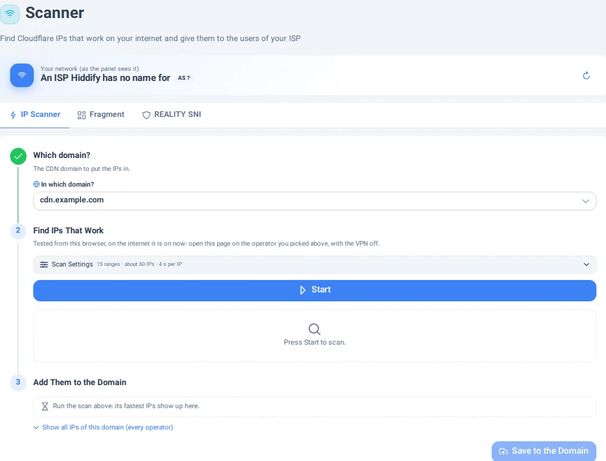
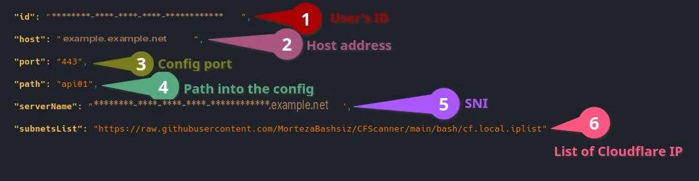
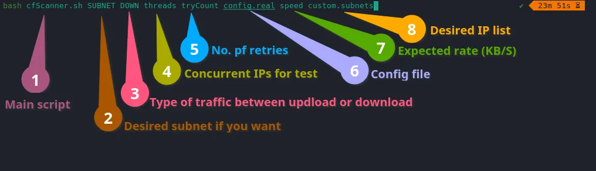
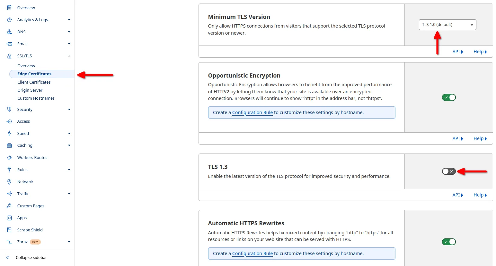
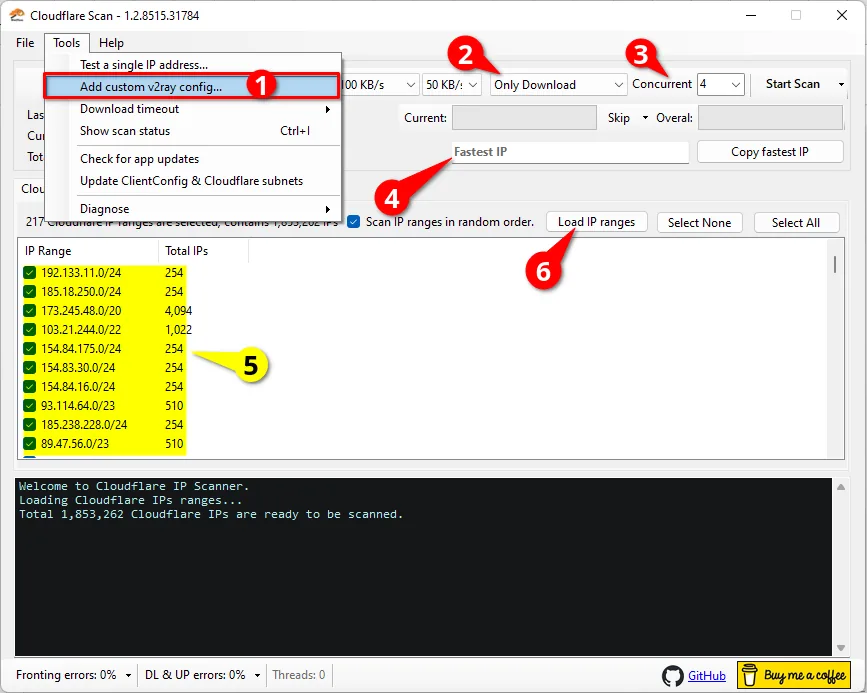
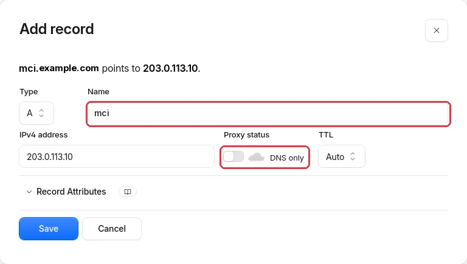

<div dir="ltr" markdown="1">

# Guide for finding a clean Cloudflare IP
The largest CDN service provider in the world is Cloudflare, and you probably know; Due to the severe filtering of the Internet in Iran, there is a lot of disruption to its services because it is not possible for the filter to completely filter it, but it can cause disruption.
Here, if you also use CDN Cloudflare services; You will be affected by these disorders. To reduce the impact of these disturbances, you should find clean IPs (IPs that are not disturbed).

Here are some ways of working for this issue. 

!!! tip "tip"

    Before starting, it is emphasized that all these tests must be done on the client system without connecting to VPN.


## Using the HiddifyManager scanner (easiest) { #panel-scanner }
Since v14.5 the panel has its own scanner: **Tools** › **Scanner** (or **Open the scanner** under the **Force configs to use these IPs / domains** field of a CDN domain). It needs a CDN domain on the **Domains** page first.

1. Open the panel **on the operator you want IPs for, with the VPN off** (for example on a phone on MCI). The scan runs in your browser, on the internet it is on now.
2. **Which domain?** Choose the CDN domain (and, if asked, the operator whose users will get the IPs).
3. **Find IPs That Work:** press **Start**. The panel tests Cloudflare IP ranges from your browser and keeps the fastest. **Scan Settings** sets how many ranges and IPs are tested.
4. **Add Them to the Domain:** check the list (remove some, or add your own IPs, ranges or domains) and click **Save to the Domain**. The IPs are written into the domain's **Force configs to use these IPs / domains** field for that operator; the other operators keep theirs.

    

5. Click **Apply now** on the **Actions** page. Repeat on each operator (for example a phone on MCI, then one on Irancell).

The scanner has two more tabs: **Fragment** (try TLS fragment presets for a CDN domain) and **REALITY SNI** (find SNIs that work for Reality). If the IPs found still do not connect, **Full test with upload, from another device** gives you a command to run on a phone or computer on that operator: some operators cut a connection after a little upload, which a browser cannot test.

The external scanners below are still useful if you prefer them.

## Using Bashsiz's scanner
Mr. Bashsiz is an Iranian engineer who has developed a program called CFScanner, which can be used to test the list of Cloudflare IPs on different networks and reach the clean Cloudflare IPs.

This program has been released in several versions including Linux and Windows. Versions available until the date of editing this article:
- Bash
- Docker
- Windows
- Python
- Golang
- Android

The project is still maintained (latest Windows release: April 2026). We suggest the **Bash (Linux)**, **Windows** and **Android** versions; the Python and Go versions have open problems on GitHub.

To do this, first download the desired version [here](https://github.com/MortezaBashsiz/CFScanner) and then follow how to run it based on the desired operating system.


<details markdown="1"><summary><h3>Run on Linux version</h3> (Click here)</summary>

Download the program files.

This program has prerequisites that must be installed in advance.
[jq](https://stedolan.github.io/jq/)&nbsp;&nbsp;&nbsp;[git](https://git-scm.com/)&nbsp;&nbsp;&nbsp;[tput](https://command-not-found.com/tput)&nbsp;&nbsp;&nbsp;[bc](https://www.gnu.org/software/bc/)&nbsp;&nbsp;&nbsp;[curl](https://curl.se/download.html)&nbsp;&nbsp;&nbsp;
[parallel](https://www.gnu.org/software/parallel/)


Then first clone it on your system with the following code.
```
git clone https://github.com/MortezaBashsiz/CFScanner.git 
```
Go to the app download folder and run access to it. 
```
cd CFScanner/bash
chmod +x ../bin/*
```
Download the config.real file. 
```
curl -s https://raw.githubusercontent.com/MortezaBashsiz/CFScanner/main/bash/ClientConfig.json -o config.real
```
It is recommended to change the config.real file based on your configuration.
 



If you want to have your own configuration file, save it under a different name that will not change when the script is updated.

#### Run the script
Go to the location of the downloaded script file and then run the script as shown below.

```
bash cfScanner.sh SUBNET DOWN threads tryCount config.real speed custom.subnets
```




For example:


```
bash cfScanner.sh SUBNET DOWN 8 1 config.real 100 custom.subnets
```
Finally, the test result is placed in the `result` folder, which you can view and use. More information on the program [wiki](https://github.com/MortezaBashsiz/CFScanner/tree/main/bash).

</details>

<details markdown="1"><summary><h3>Run on Windows version</h3> (Click here)</summary>

<details markdown="1"><summary><h4>Prerequisites</h4></summary>
	
First, there must be prerequisites that will be explained in order:

- Download the Windows scanner app from [the project's GitHub](https://github.com/MortezaBashsiz/CFScanner/tree/main/windows)
- Install .NET Desktop Runtime 6 app from the main application site given below

```
https://dotnet.microsoft.com/en-us/download/dotnet/6.0
```

- Checking TLS Handshake
For this, you must first enter the program folder and open `Command Prompt` inside that folder. That is, `Shift+Right click` on the folder and select `Open in Windows Terminal`.

Run the following command in the terminal environment.

`‍‍.\v2ray.exe tls ping sub.yourdomain.com`

Put your subdomain instead of `sub.yourdomain.com`. If handshake `succeeded` message appears; It means that the scanner is ready to use, otherwise you should make temporary changes in the certificate settings on Cloudflare website.

Set the TLS version to TLS 1.0 and disable the TLS 1.3 option.



* Note: Don't forget to return these options to the first state after testing.
* Prepare the config template structures for testing.
If you want to test your configurations, you must apply them in the Json file related to the connection in the program folder. This change needs to be applied in `inbound`.

```

{
  "inbounds": [{
    "port": "PORTPORT", 
    "listen": "127.0.0.1",
    "tag": "socks-inbound",
    "protocol": "socks",
    "settings": {
...
```
And also apply this change in `outbound`.

```
{
"outbounds": [
   {
   "protocol": "vmess",
   "settings": {
     "vnext": [{
       "address": "IP.IP.IP.IP",
...
```

Now, for ease of work, some examples of configuration templates that iSegaro has worked hard to present; You can choose one according to your needs.

* Be careful, in these structures, only in the `outbounds` part, you should change the configuration specifications including 5 parts `Port, UUID, PATH, HOST, SNI`, which are marked with the word `xxxxx`, so wherever there is the word `xxxxx`, change it only depending on your configuration. And do not change the rest of the codes.

- Example template for Vmess+WS+TLS :

```
{
  "inbounds": [{
    "port": "PORTPORT", 
    "listen": "127.0.0.1",
    "tag": "socks-inbound",
    "protocol": "socks",
    "settings": {
      "auth": "noauth",
      "udp": false,
      "ip": "127.0.0.1"
    },
    "sniffing": {
      "enabled": true,
      "destOverride": ["http", "tls"]
    }
  }],
  "outbounds": [
    {
    "protocol": "vmess",
    "settings": {
      "vnext": [{
        "address": "IP.IP.IP.IP", 
        "port": xxxxx,
        "users": [{"id": "xxxxx" }]
      }]
    },
		"streamSettings": {
        "network": "ws",
        "security": "tls",
        "wsSettings": {
            "headers": {
                "Host": "xxxxx"
            },
            "path": "xxxxx"
        },
        "tlsSettings": {
            "serverName": "xxxxx",
            "allowInsecure": false,
			"fingerprint": "chrome",
			"alpn": [
			"http/1.1"
			]
        }
    }
	}],
  "other": {}
}
```

- Example template for Vless+GRPC+TLS :

```
{
  "inbounds": [{
    "port": "PORTPORT", 
    "listen": "127.0.0.1",
    "tag": "socks-inbound",
    "protocol": "socks",
    "settings": {
      "auth": "noauth",
      "udp": false,
      "ip": "127.0.0.1"
    },
    "sniffing": {
      "enabled": true,
      "destOverride": ["http", "tls"]
    }
  }],
  "outbounds": [
    {
    "protocol": "vless",
    "settings": {
      "vnext": [{
        "address": "IP.IP.IP.IP", 
        "port": xxxxx,
        "users": [{"id": "xxxxx",
		"encryption": "none"
			}]
      }]
    },
		"streamSettings": {
        "network": "grpc",
        "security": "tls",
        "tlsSettings": {
          "allowInsecure": false,
          "serverName": "xxxxx",
          "alpn": [
            "http/1.1"
          ],
          "fingerprint": "chrome"
        },
        "grpcSettings": {
          "serviceName": "",
          "multiMode": false
        }
      }
	}],
  "other": {}
}
```

- Example template for Trojan+WS+TLS :

```
{
  "inbounds": [{
    "port": "PORTPORT", 
    "listen": "127.0.0.1",
    "tag": "socks-inbound",
    "protocol": "socks",
    "settings": {
      "auth": "noauth",
      "udp": false,
      "ip": "127.0.0.1"
    },
    "sniffing": {
      "enabled": true,
      "destOverride": ["http", "tls"]
    }
  }],
  "outbounds": [
    {
      "tag": "proxy",
      "protocol": "trojan",
      "settings": {
        "servers": [
          {
            "address": "IP.IP.IP.IP",
            "method": "chacha20",
            "ota": false,
            "password": "xxxxx",
            "port": xxxxx,
            "level": 1,
            "flow": ""
          }
        ]
      },
      "streamSettings": {
        "network": "ws",
        "security": "tls",
        "tlsSettings": {
          "allowInsecure": false,
          "serverName": "xxxxx",
          "alpn": [
            "http/1.1"
          ],
          "fingerprint": "chrome"
        },
        "wsSettings": {
          "path": "xxxxx",
          "headers": {
            "Host": "xxxxx"
          }
        }
      },
      "mux": {
        "enabled": false,
        "concurrency": -1
      }
    }
  ],
  "other": {}
}
```

- Example template for Vless+WS+TLS :

```
{
"inbounds": [{
    "port": "PORTPORT", 
    "listen": "127.0.0.1",
    "tag": "socks-inbound",
    "protocol": "socks",
    "settings": {
      "auth": "noauth",
      "udp": false,
      "ip": "127.0.0.1"
    },
    "sniffing": {
      "enabled": true,
      "destOverride": ["http", "tls"]
    }
  }],
  "outbounds": [
    {
      "tag": "proxy",
      "protocol": "vless",
      "settings": {
        "vnext": [{
        "address": "IP.IP.IP.IP", 
        "port": xxxxx,
        "users": [{"id": "xxxxx",
		"encryption": "none"
			}]
      }]
      },
      "streamSettings": {
        "network": "ws",
        "security": "tls",
        "tlsSettings": {
          "allowInsecure": false,
          "serverName": "xxxxx",
          "alpn": [
            "http/1.1"
          ],
          "fingerprint": "chrome"
        },
        "wsSettings": {
          "path": "xxxxx",
          "headers": {
            "Host": "xxxxx"
          }
        }
      }
    }
  ],
	"other": {}
}
```

Finally, present your configuration according to the examples for the next step or use the default configuration.


</details>

Now suppose you have completed the prerequisites; All you need is the config file of the sample program or the config file created by yourself, which is in Json format; From the menu `Tools > Add custom v2ray config`, put it in the program so that the scan is done based on it, otherwise the program will scan with the default configuration.



1. From `Tools > Add custom v2ray config`, you can give the desired file according to the described pattern to the software so that the scan can be done based on it.

2. You can specify the download or upload test type or both.

3. In this section, you can specify the number of simultaneous IPs to be tested by the scanner. It is suggested to increase this number step by step and increase or decrease it based on the CPU processing power of your system. Its default value is 4.

4. The fastest IP will be displayed after the scan is completed

5. The range of tested IPs is displayed

6. From this section, you can give the software the IP range you want to scan based on it.

* **Suggestion:** You can set the software to scan the entire default IP range once. For the next time, you can just scan this output (with higher accuracy), you will probably get a better result. Also, if you take an upload test, you will probably get a better result. All this depends on your efforts and creativity.

</details>


!!! info "Older scanners"
    The scanners by Vahid Farid (cf-ip-scanner-py) and Safa Safarian (ss-cloud-scanner) that used to be on this page have not been updated since 2024 and are no longer maintained, so they were taken out of this guide. Use the [panel scanner](#panel-scanner) or CFScanner instead.

## What to do after finding a clean IP?
If you used the panel's scanner, the IPs are already saved in your CDN domain. For IPs from other scanners:

- Put them straight into the CDN domain's **Force configs to use these IPs / domains** field (**Domains** › pencil › **Advanced**), one per line, optionally with the operator's code after each one (for example `1.1.1.1 MCI`); or
- Better: create a DNS record on Cloudflare with the **proxy off** that points to the clean IP (for example `mci.yourdomain.com`), and put that name in the field. When you need a new clean IP later, you only change the DNS record.



More: [Domain types and how to register them](/manager/domain-worker-cdn-and-tunneling/Domain-types-and-how-to-register-them/), [CDN domain](/manager/configuration-and-advanced-settings/How-to-configure-Hiddify-panel-properly/#cdn-domain) and [How to use AutoCDN IP domain](/manager/domain-worker-cdn-and-tunneling/Guide-for-using-mode-Auto_CDN_IP-on-Hiddify/) (the format per operator).

## Related articles

- [Use your own clean IPs](/manager/domain-worker-cdn-and-tunneling/How-to-use-desired-clean-IPs-based-on-a-specific-format/)
- [Domain types and how to add them](/manager/domain-worker-cdn-and-tunneling/Domain-types-and-how-to-register-them/)
- [Fake domain](/manager/domain-worker-cdn-and-tunneling/How-to-create-and-use-fake-domain/)
- [Wildcard subdomains](/manager/domain-worker-cdn-and-tunneling/Tutorial-for-using-wildcard-subdomains-on-Hiddify/)

</div>
