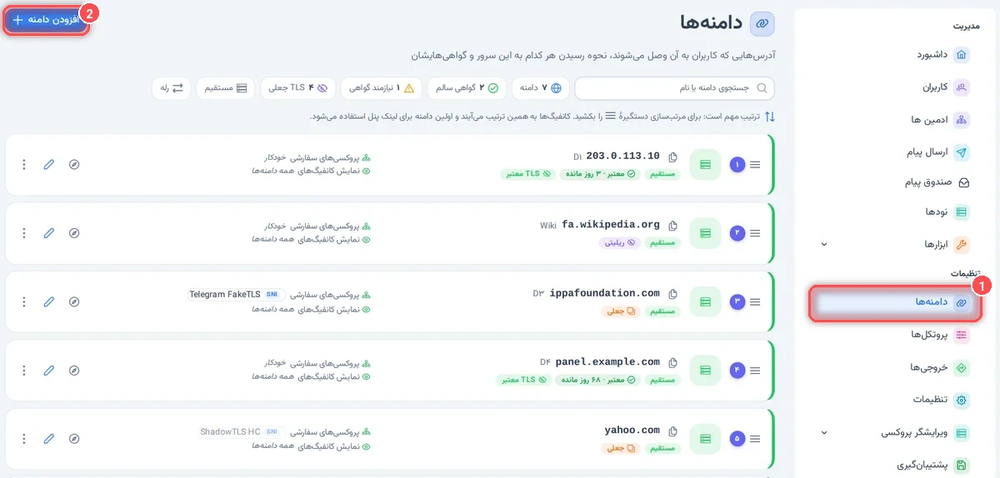
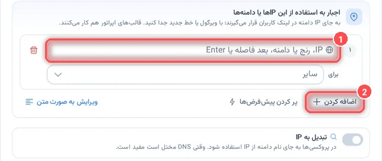
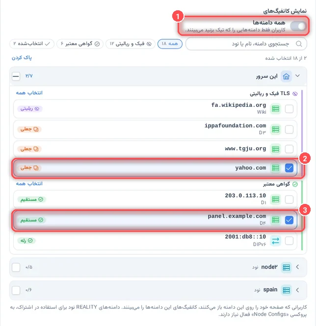
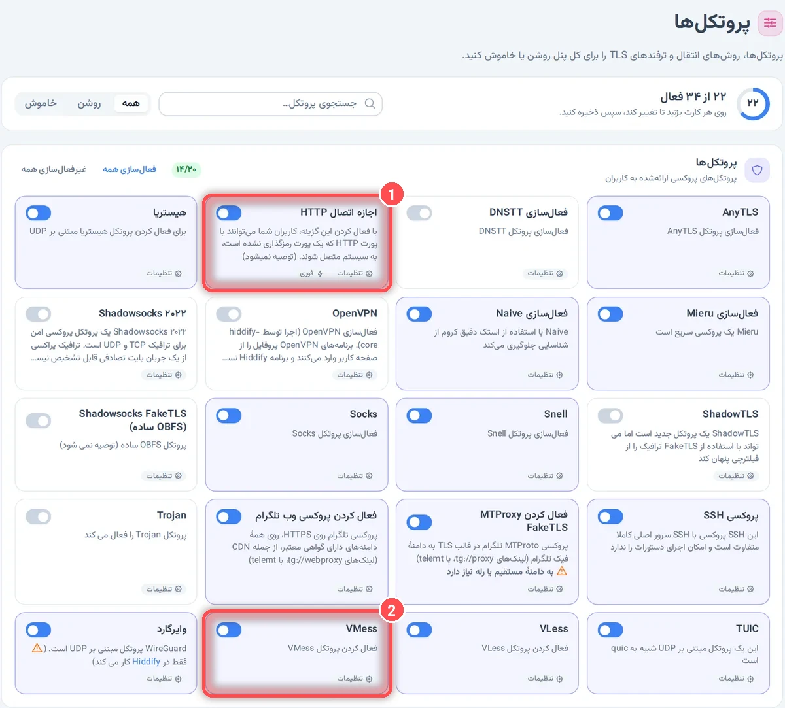
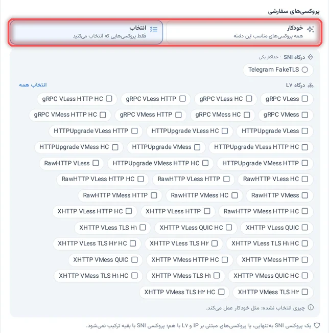

# نحوه ایجاد و استفاده از دامنه فیک

دامنه فیک (Fake) دامنه یک سایت دیگر است، مثلا `yahoo.com`، که فقط نامش در کانفیگ‌ها به عنوان SNI قرار می‌گیرد. ترافیک کاربر همچنان به IP سرور شما می‌رود، ولی از دید فیلترینگ این‌طور به نظر می‌رسد که کاربر به آن سایت وصل شده است. این روش برای عبور از «لیست سفید SNI» به کار می‌آید؛ یعنی وقتی فقط اتصال به سایت‌های مشخصی مجاز است.

چون دامنه مال شما نیست، لازم نیست آن را بخرید یا DNS آن را تنظیم کنید. کافی است آن را در پنل اضافه کنید.

!!! warning "توجه"
    خود پنل TLS جعلی را «پیشنهاد نمی‌شود» علامت زده است. اگر می‌خواهید از دامنه یک سایت دیگر استفاده کنید، معمولا [ریالتی](/fa/manager/configuration-and-advanced-settings/How-to-use-Reality-on-Hiddify/) گزینه امن‌تر و پایدارتری است. دامنه فیک را فقط وقتی استفاده کنید که روش‌های دیگر جواب نمی‌دهند.

## افزودن دامنه فیک

1. از منوی کناری، در گروه **تنظیمات**، صفحه **دامنه‌ها** را باز کنید.

    

2. روی **افزودن دامنه** بزنید. یک راهنمای چهارمرحله‌ای باز می‌شود: **دامنه**، **حالت**، **نام** و **گواهی**.
3. در مرحله **دامنه**، دامنه سایتی را که می‌خواهید وارد کنید و **بررسی** را بزنید. چون این دامنه مال شما نیست، DNS آن به سرور شما اشاره نمی‌کند؛ این طبیعی است و مشکلی ندارد.

    

4. در مرحله **حالت**، زیر **چطور تنظیم شده است؟** گزینه **مستقیم** و زیر **کدام TLS؟** گزینه **جعلی** را انتخاب کنید و **بعدی** را بزنید.

    

5. مراحل **نام** و **گواهی** را تمام کنید. دامنه در لیست دامنه‌ها با برچسب‌های **مستقیم** و **جعلی** نمایش داده می‌شود.

!!! tip "کدام سایت را انتخاب کنم؟"
    سایتی را انتخاب کنید که در کشور کاربران شما باز است و روی پورت ۴۴۳ پاسخ می‌دهد. [این لیست](https://gist.github.com/ofou/654efe67e173a6bff5c64ba26c09d058) چند نمونه از سایت‌ها و پورت‌ها را نشان می‌دهد.

## استفاده از IP یا دامنه دیگر در کانفیگ‌ها (اختیاری)

کانفیگ‌های دامنه فیک به طور پیش‌فرض به IP سرور وصل می‌شوند. اگر می‌خواهید به جای آن یک IP دیگر یا دامنه مستقیم سرورتان در کانفیگ‌ها قرار بگیرد:

1. در صفحه **دامنه‌ها**، روی آیکون مداد کنار دامنه فیک بزنید.
2. بخش **پیشرفته** را باز کنید.
3. در کارت **اجبار به استفاده از این IPها یا دامنه‌ها**، IP یا دامنه مستقیم سرور خود را بنویسید و Enter بزنید. با **اضافه کردن** می‌توانید چند مورد وارد کنید.
4. **ذخیره** را بزنید.

    

## آوردن کانفیگ‌های فیک به لینک اشتراک

کاربران کانفیگ‌ها را از صفحه کاربری‌شان می‌گیرند و این صفحه روی یکی از دامنه‌های واقعی شما باز می‌شود. تنظیم **نمایش کانفیگ‌های** همان دامنه مشخص می‌کند کانفیگ‌های کدام دامنه‌ها در لینک اشتراک باشد.

- اگر **همه دامنه‌ها** روشن باشد (پیش‌فرض)، کانفیگ‌های دامنه فیک خودکار به لینک اشتراک اضافه می‌شوند و کار دیگری لازم نیست.
- اگر فقط دامنه‌های مشخصی را نشان می‌دهید:
    1. دامنه‌ای را که کاربران با آن صفحه کاربری را باز می‌کنند ویرایش کنید.
    2. در بخش **نمایش کانفیگ‌های**، دامنه فیک را تیک بزنید.
    3. **ذخیره** را بزنید.

    

در آخر از کاربران بخواهید لینک اشتراک را در برنامه خود به‌روزرسانی کنند تا کانفیگ‌های جدید را دریافت کنند.

## بررسی پروکسی‌ها

### پروتکل‌ها

1. از منوی کناری، در گروه **تنظیمات**، صفحه **پروتکل‌ها** را باز کنید.
2. مطمئن شوید **اجازه اتصال HTTP** روشن است.
3. اگر می‌خواهید از VMess هم استفاده کنید، **VMess** را روشن کنید.

    

### پروکسی‌های دامنه فیک

در پنجره ویرایش دامنه فیک، بخش **پروکسی‌های سفارشی** تعیین می‌کند کدام پروکسی‌ها برای این دامنه ساخته شوند:

- **خودکار** (پیشنهادی): همه پروکسی‌هایی که با این دامنه کار می‌کنند ساخته می‌شوند.
- **انتخاب**: فقط پروکسی‌هایی که تیک می‌زنید ساخته می‌شوند. یک پروکسی از **درگاه SNI** (مثل Telegram FakeTLS) به‌تنهایی کار می‌کند و با پروکسی‌های **درگاه L7** ترکیب نمی‌شود. اگر هیچ پروکسی‌ای تیک نزنید، مثل **خودکار** رفتار می‌کند.

## مقاله‌های مرتبط

- [انواع دامنه و ثبت آن‌ها](/fa/manager/domain-worker-cdn-and-tunneling/Domain-types-and-how-to-register-them/)
- [زیردامنه‌های متغیر (wildcard)](/fa/manager/domain-worker-cdn-and-tunneling/Tutorial-for-using-wildcard-subdomains-on-Hiddify/)
- [ساخت خودکار زیردامنه در کلادفلر](/fa/manager/domain-worker-cdn-and-tunneling/Get-Cloudflare-API/)
- [دامین فرانتینگ](/fa/manager/domain-worker-cdn-and-tunneling/Guide-for-domain-fronting/)

