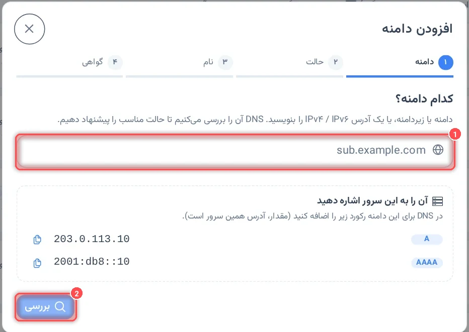
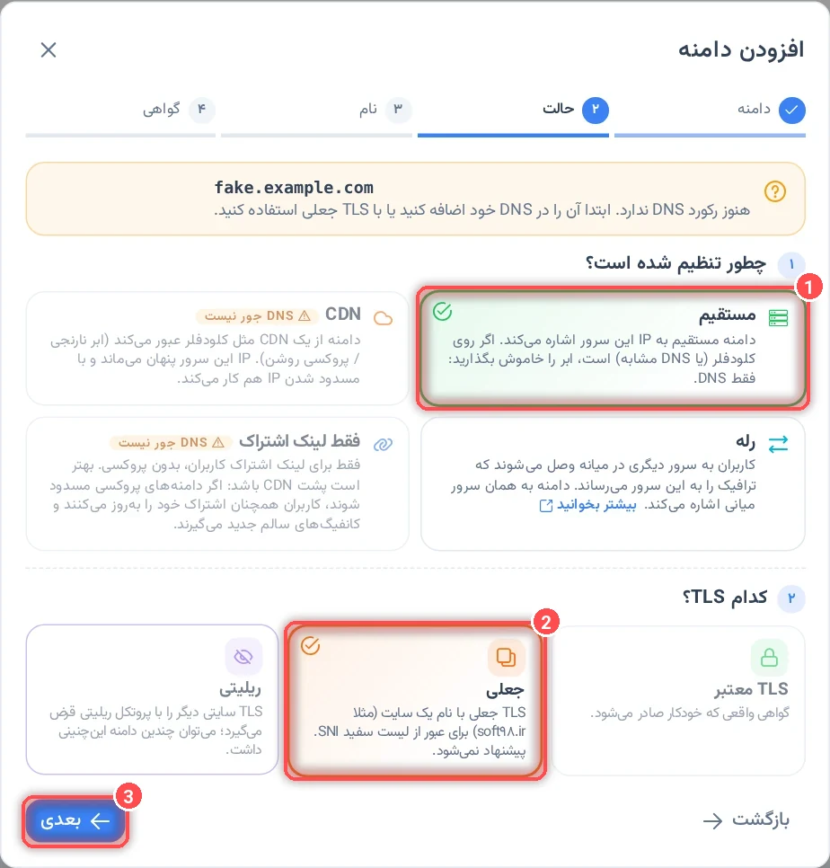

# نحوه ایجاد و استفاده از دامنه فیک

## ثبت دامنه گمراه‌کننده (Fake)
همانطور که از اسمش مشخص است ما میخواهیم از یک دامنه جعلی که مربوط به خودمان نیست استفاده کنیم بنابراین نیاز نیست آن را از قبل ثبت نماییم. بلکه فقط می‌توانیم آن را در پنل استفاده کنیم.
* برای ایجاد دامنه گمراه‌کننده یا فیک، از منوی کناری بخش `دامنه‌ها` (در گروه `تنظیمات`) را باز کنید.

* روی `افزودن دامنه` کلیک کنید. یک راهنمای چهارمرحله‌ای باز می‌شود: `دامنه`، `حالت`، `نام` و `گواهی`.

* در مرحله `دامنه`، دامنه فیک مورد نظر خود را وارد کنید و روی `بررسی` بزنید. چون دامنه فیک مال شما نیست، DNS آن به سرور شما اشاره نمی‌کند و این طبیعی است.

* در مرحله `حالت`، زیر `چطور تنظیم شده است؟` گزینه `مستقیم` و زیر `کدام TLS؟` گزینه `جعلی` (TLS جعلی با نام یک سایت) را انتخاب کنید و روی `بعدی` بزنید.

* در صورت نیاز به استفاده از دامنه سرور به جای آیپی، فیلد `اجبار به استفاد` را به دامنه دایرکت سرور خود تکمیل نمایید.

در [اینجا](https://gist.github.com/ofou/654efe67e173a6bff5c64ba26c09d058) می‌توانید لیستی از سایت‌ها و پورت‌ها جهت استفاده به عنوان دامنه فیک را مشاهده کنید.

* در آخر، مراحل `نام` و `گواهی` را طی کنید تا دامنه فیک شما ثبت شود. در لیست دامنه‌ها، این دامنه با برچسب‌های `مستقیم` و `جعلی` نمایش داده می‌شود.

## اتصال دامنه فیک به دامنه سابسکریپشن
* برای استفاده از کانفیگ‌های دامنه فیک ثبت شده می‌بایست دامنه سابسکریپشن خود را ویرایش نمایید و  در فیلد `نمایش کانفیگ‌های` آن، دامنه فیک را اضافه نمایید.

* کار تمام است کانفیگ‌های فیک به لینک سابسکریپشن اضافه شدند. کافیه لینک سابسکریپشن را آپدیت نمایید.

## تنظیمات بخش پروکسی
* برای اطمینان از فعال بودن پروکسی‌های فیک ایجاد شده، از منوی کناری بخش `پروتکل‌ها` (در گروه `تنظیمات`) را باز کنید.
* چک کنید که `اجازه اتصال HTTP` فعال باشد.
* در صورتی که بخواهید از VMess استفاده نمایید، چک کنید که `VMess` فعال باشد.

* در بخش پروکسی‌های دایرکت هم چک کنید که پروکسی‌های زیر روشن باشند.

