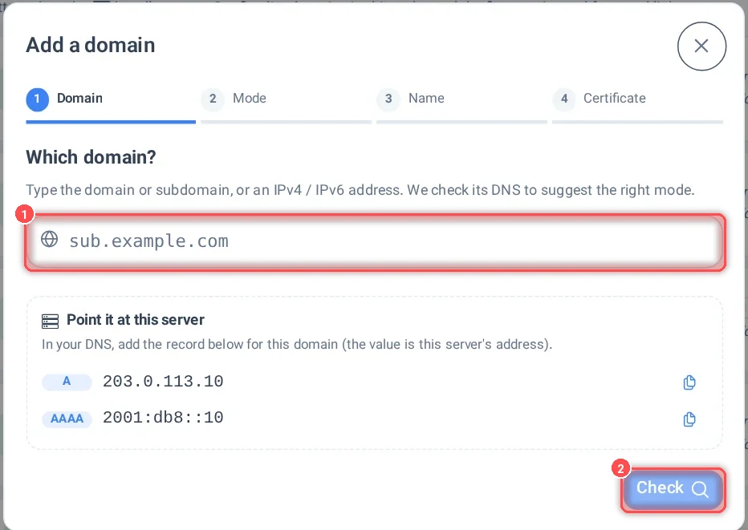
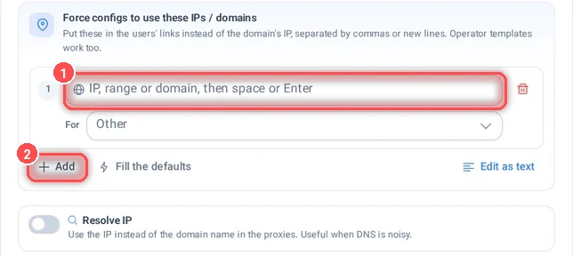
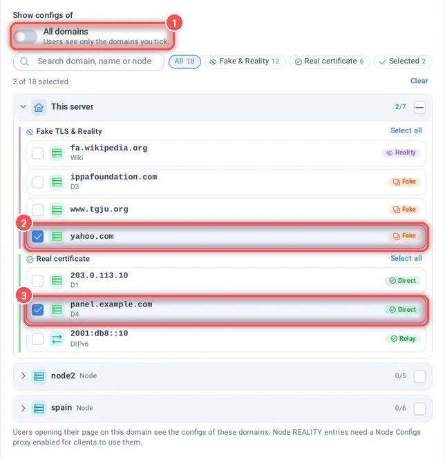
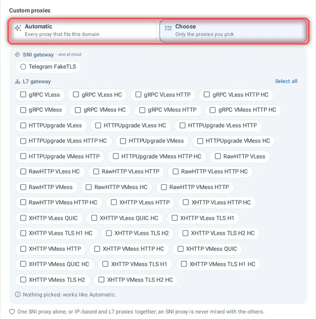

# How to create and use fake domain

A fake domain is another website's domain, for example `yahoo.com`, whose name is only put in the configs as the SNI. The user's traffic still goes to your server's IP, but to the filtering system it looks as if the user is connecting to that website. This helps to get past an "SNI whitelist", where only connections to certain websites are allowed.

The domain is not yours, so you don't buy it or set up its DNS. You only add it in the panel.

!!! warning "Note"
    The panel itself marks fake TLS as "Not recommended". If you want to use another website's domain, [Reality](/manager/configuration-and-advanced-settings/How-to-use-Reality-on-Hiddify/) is usually the safer and more stable choice. Use a fake domain only when other methods do not work.

## Add a fake domain

1. In the side menu, in the **Settings** group, open **Domains**.

    

2. Click **Add domain**. A wizard opens with four steps: **Domain**, **Mode**, **Name** and **Certificate**.
3. In the **Domain** step, enter the website's domain you want and click **Check**. The domain is not yours, so its DNS does not point to your server. This is expected.

    

4. In the **Mode** step, under **How is it set up?** choose **Direct**, and under **Which TLS?** choose **Fake**. Then click **Next**.

    

5. Finish the **Name** and **Certificate** steps. The domain shows in the domains list with the **Direct** and **Fake** badges.

!!! tip "Which website should I pick?"
    Pick a website that is open in your users' country and answers on port 443. [This list](https://gist.github.com/ofou/654efe67e173a6bff5c64ba26c09d058) shows some websites and ports you can use.

## Use another IP or domain in the configs (optional)

By default, the fake domain's configs connect to your server's IP. To put another IP, or your server's direct domain, in the configs instead:

1. On the **Domains** page, click the pencil icon next to the fake domain.
2. Open **Advanced**.
3. In the **Force configs to use these IPs / domains** card, type the IP or your server's direct domain and press Enter. Click **Add** to enter more than one.
4. Click **Save**.

    

## Bring the fake configs into the subscription link

Users get their configs from their user page, which opens on one of your real domains. The **Show configs of** setting of that domain decides which domains' configs are in the subscription link.

- If **All domains** is on (the default), the fake domain's configs are added to the subscription link by themselves. Nothing else is needed.
- If you show only some domains:
    1. Edit the domain your users open their user page with.
    2. Under **Show configs of**, tick the fake domain.
    3. Click **Save**.

    

Then ask your users to update the subscription in their app to get the new configs.

## Check the proxies

### Protocols

1. In the side menu, in the **Settings** group, open **Protocols**.
2. Make sure **Allow HTTP Connection** is on.
3. If you also want to use VMess, turn on **VMess**.

    

### The fake domain's proxies

In the fake domain's edit window, **Custom proxies** decides which proxies are made for this domain:

- **Automatic** (recommended): every proxy that works with this domain is made.
- **Choose**: only the proxies you tick are made. A proxy from the **SNI gateway** group (such as Telegram FakeTLS) works alone and is never mixed with the **L7 gateway** proxies. If you tick nothing, it works like **Automatic**.

