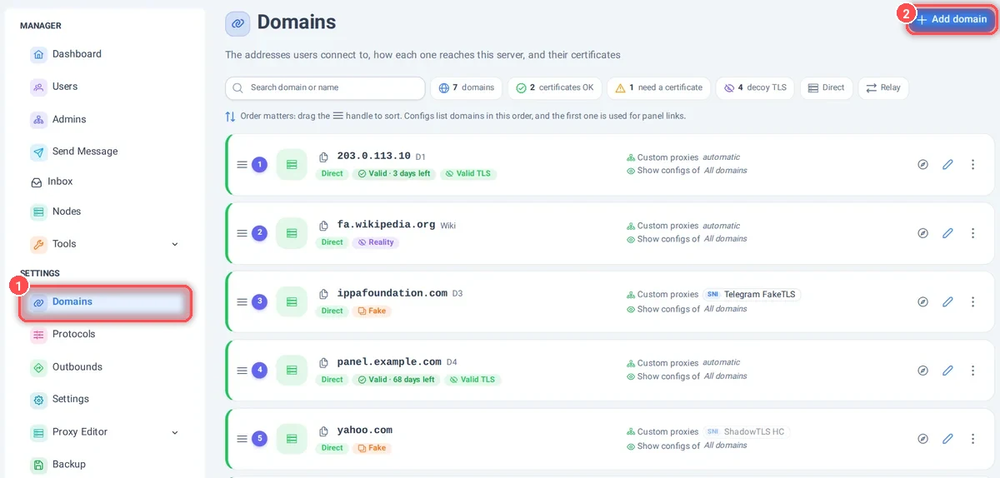
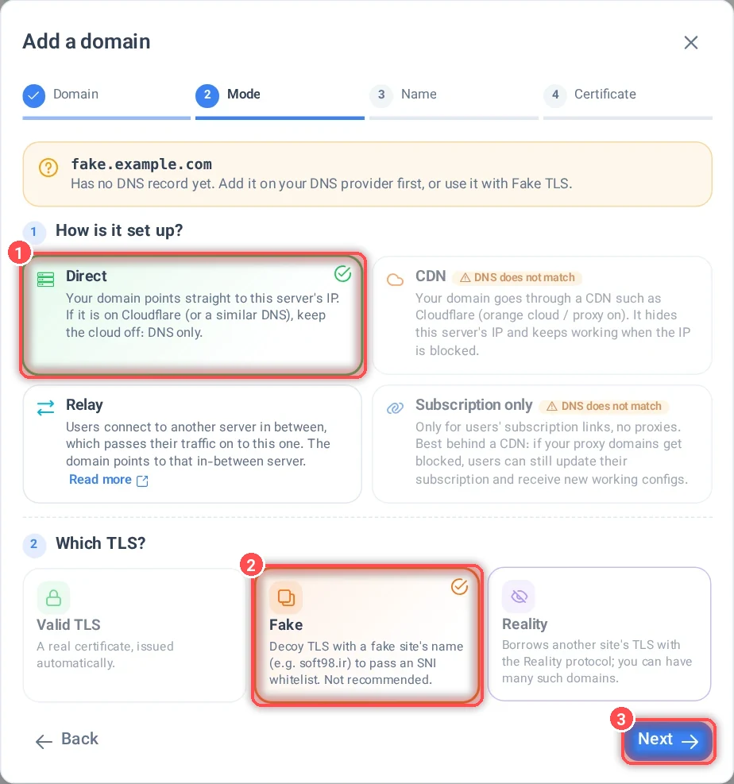
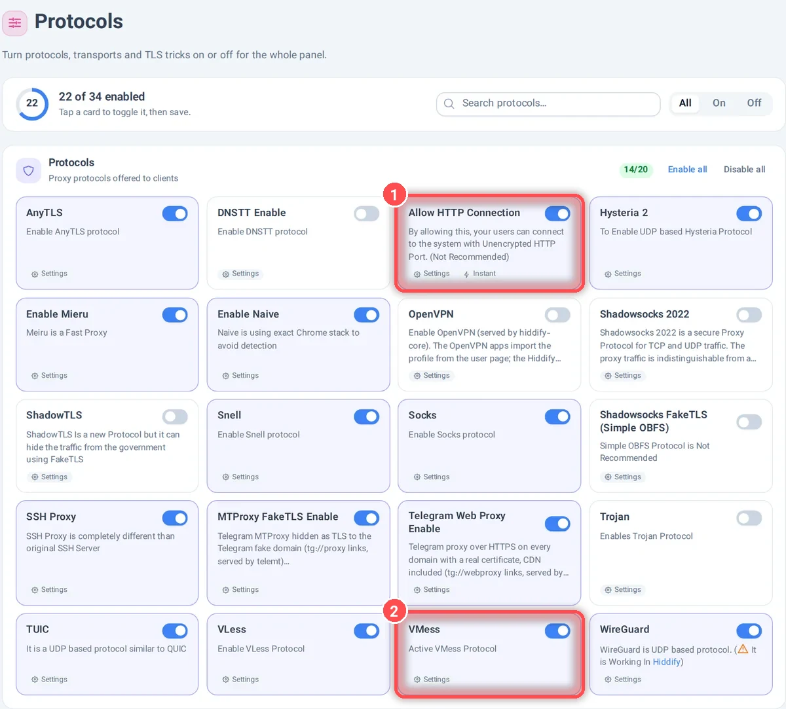

# How to create and use fake domain

## Creating fake domain
As the name suggests, we want to use a fake domain that is not related to us, so we don't need to register it in advance. But we can only use it in the panel.

* To create a misleading or fake domain, open `Domains` in the side menu (in the `Settings` group).

* Click `Add domain`. A wizard opens with four steps: `Domain`, `Mode`, `Name` and `Certificate`.

* In the `Domain` step, put the fake domain you want and click `Check`. Since the fake domain is not yours, its DNS does not point to your server, and that is expected.

* In the `Mode` step, under `How is it set up?` choose `Direct`, and under `Which TLS?` choose `Fake` (decoy TLS with a fake site's name). Then click `Next`.

* If you need to use the server domain instead of the IP, complete the `Force Config to Use Following IPs` field to the domain of your direct server.

[here](https://gist.github.com/ofou/654efe67e173a6bff5c64ba26c09d058) you can see a list of sites and ports to use as fake domains.

* Finally, go through the `Name` and `Certificate` steps to register your fake domain. In the domains list it shows the `Direct` and `Fake` badges.

## Connecting the fake domain to the subscription domain
* To use the registered fake domain configurations, you need to edit your subscription domain and add the fake domain in its `Show configs of` field.

* The work is done, the fake configs have been added to the subscription link. Just update the subscription link on your client application.

## Proxy section settings
* To make sure that the created fake proxies are active, open `Protocols` in the side menu (in the `Settings` group).
* Check that `Allow HTTP Connection` is enabled.
*  If you want to use VMess, check that `VMess` is enabled.

* In `Direct` section, check that the following proxies are enabled.

