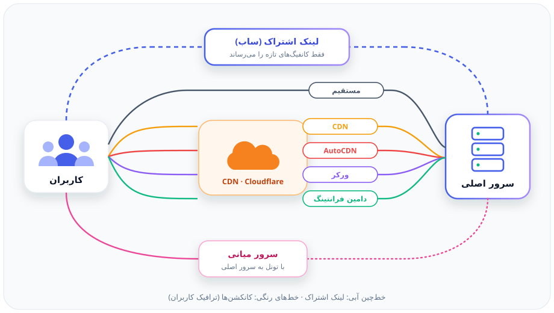
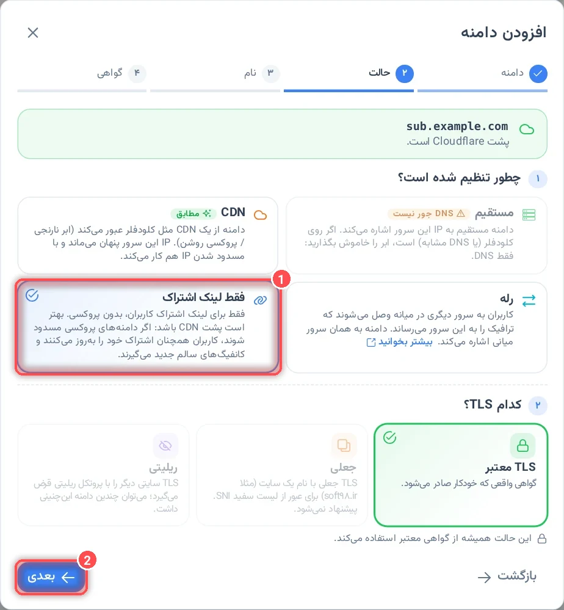
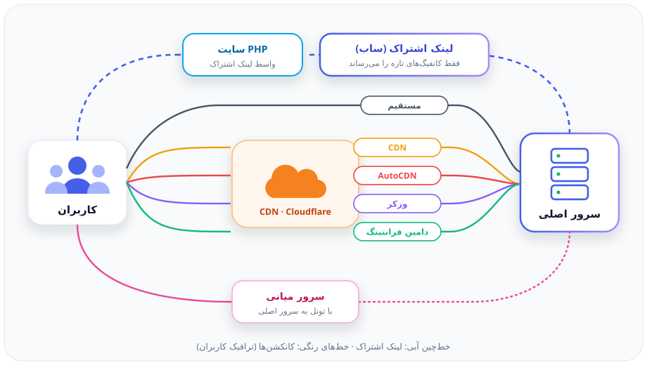

# آموزش ایجاد لینک سابسکریپشن در هیدیفای‌منیجر
هیدیفای‌منیجر بر این اساس پایه‌گذاری شده است که احتمال فیلتر شدن سرور را تا جای ممکن کاهش یابد. یکی از راه‌های کاربردی در این زمینه، جدا کردن کانفیگ‌ها از لینک‌های سابسکریپشن یا اشتراک است. در این صورت همیشه کلاینت شما آخرین اطلاعات کانفیگ‌ها را از طریق لینک سابسکریپشن دریافت می‌کند. شماتیک مربوط به این کار به شکل زیر است.

همانطور که در شکل بالا می‌بینید، لینک سابسکریپشن به صورت مجزا از سرور به سمت کاربران ارتباط دارد و وظیفه این لینک، انتقال اطلاعات مربوط کانکشن‌های مختلف از جمله CDN، AutoCDN، Relay و ... می‌باشد. یعنی خود کانکشن‌ها به صورت جداگانه ارتباط بین سرور و کلاینت را برقرار می‌کنند و لینک سابسکریپشن اطلاعات مربوط به این کانکشن‌ها را از سرور به کلاینت منتقل می‌کند. مثلا اگر آی‌پی تمیز جدیدی در کانکشن CDN قرار می‌گیرد، اطلاعات مربوط به این آی‌پی جدید از طریق لینک سابسکریپشن به کلاینت شما منتقل می‌گردد. از طرف دیگر، کلاینت‌ها توسط کانکشن‌های مختلف که جدا از لینک سابسکریپشن هستند، به سمت اینترنت آزاد می‌روند. با این روش اطلاعات لینک‌های سابسکریپشن (اشتراک) از کانکشن‌ها (کانفیگ‌ها) جدا می‌شود و چون ترافیک کانفیگ‌ها روی این لینک‌ها قرار نمی‌گیرد، بنابراین استفاده از لینک‌های سابسکریپشن در هیچ صورت فیلتر نمی‌شوند و همواره در دسترس خواهند بود.

## چگونگی ایجاد دامنه برای لینک سابسکریپشن در هیدیفای‌منیجر
برای این کار در منوی کناری پنل، زیر `تنظیمات`، روی `دامنه‌ها` بزنید و بعد روی `افزودن دامنه` کلیک کنید.

- در مرحله `دامنه`، دامنه لینک سابسکریپشن را بنویسید و روی `بررسی` بزنید.
- در مرحله `حالت`، زیر `چطور تنظیم شده است؟`، گزینه `فقط لینک اشتراک` را انتخاب کنید. همان‌طور که پنل توضیح می‌دهد، این حالت بهتر است پشت CDN باشد: اگر دامنه‌های پروکسی مسدود شوند، کاربران همچنان اشتراک خود را به‌روز می‌کنند و کانفیگ‌های سالم جدید می‌گیرند.

- در مرحله `نام` هم در صورت تمایل یک نام انتخاب کنید. این نام صرفا جهت نمایش استفاده می‌شود. 
> دقت شود که از کاراکترهای استاندارد مثل حروف و اعداد استفاده شود.
- مراحل را تمام کنید.
- و در آخر در فهرست `دامنه‌ها`، مقدار `نمایش کانفیگ‌های` دامنه جدید را ببینید. پیش‌فرض آن `همه دامنه‌ها` است، یعنی لینک سابسکریپشن کانفیگ‌های همه دامنه‌هایی را که برای کانکشن‌های مختلف ساخته‌اید (مثلا چند دامنه برای CDN یا ورکر) منتقل می‌کند. اگر فقط بعضی از آن‌ها را می‌خواهید، روی آیکون مداد (ویرایش) دامنه سابسکریپشن بزنید، در فیلد `نمایش کانفیگ‌های` همان دامنه‌ها را انتخاب کنید و `ذخیره` را بزنید.
- سپس اگر پنل خواست، تغییرات را اعمال کنید (یا در منوی کناری روی `اقدامات` بزنید و `الان اعمال کن` را بزنید).
کار تمام است. یک دامنه مجزا برای لینک‌های اشتراک ایجاد نمودید و آن را به کانفیگ‌ها نیز متصل کردید.

همچنین می‌توانید از یک سایت PHP برای لینک سابسکریپشن استفاده کنید که در این صورت شماتیک آن به این شکل خواهد بود

برای آموزش آن، [اینجا](/fa/manager/domain-worker-cdn-and-tunneling/How-to-use-a-PHP-site-for-sub-links/) بروید.

## مقاله‌های مرتبط

- [لینک ساب با سایت PHP](/fa/manager/domain-worker-cdn-and-tunneling/How-to-use-a-PHP-site-for-sub-links/)
- [انواع دامنه و ثبت آن‌ها](/fa/manager/domain-worker-cdn-and-tunneling/Domain-types-and-how-to-register-them/)
- [دامنهٔ فیک](/fa/manager/domain-worker-cdn-and-tunneling/How-to-create-and-use-fake-domain/)
- [زیردامنه‌های متغیر (wildcard)](/fa/manager/domain-worker-cdn-and-tunneling/Tutorial-for-using-wildcard-subdomains-on-Hiddify/)

