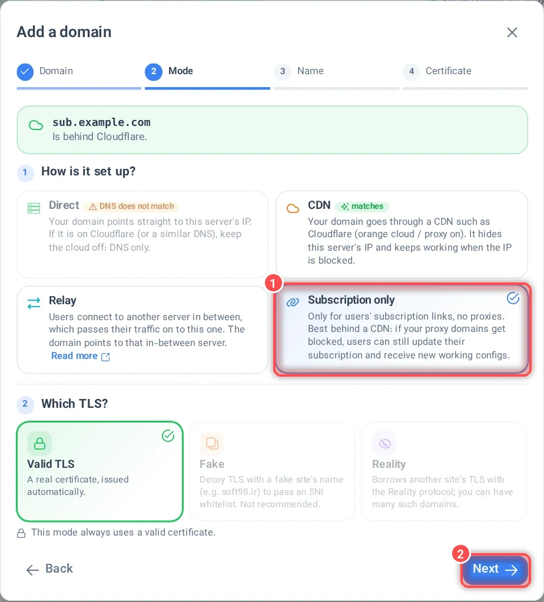

# How to create subscription link on Hiddify
Hiddify is based on the principle of reducing the possibility of server filtering as much as possible. One of the practical ways in this field is to separate the configs from the subscription links. In this case, your client will always receive the latest configuration information through the subscription link. The schematic related to this work is as follows.

As you can see in the figure above, the subscription link is connected separately from the server to the users, and the task of this link is to transfer information about various connections such as CDN, AutoCDN, Relay, etc. That is, the connections themselves establish the connection between the server and the client separately, and the subscription link transfers the information related to these connections from the server to the client. For example, if a new clean IP is placed in the CDN connection, the information about this new IP is transferred to your client through the subscription link. On the other hand, clients go to the free Internet through different connections that are separate from the subscription link. With this method, the information of the subscription links (subscription) is separated from the connections (configs) and because the traffic of the configs is not placed on these links, the use of the subscription links will not be filtered in any way and will always be available.

## How to create domain for subscription link on Hiddify
To do this, in the panel's sidebar, under `Settings`, click `Domains`, and then click `Add domain`.

- In the `Domain` step, type your subscription domain and click `Check`.
- In the `Mode` step, under `How is it set up?`, choose `Subscription only`. As the panel says, this mode is best behind a CDN: if your proxy domains get blocked, users can still update their subscription and receive new working configs.

- In the `Name` step, choose a name if you wish. This name is used for display only.

> Make sure to use standard characters such as letters and numbers.

- Finish the wizard.
- And finally, check `Show configs of` for the new domain in the `Domains` list. By default it is `All domains`, so the subscription link carries the configs of all the domains you created for different connections (for example, several domains for CDN or worker). If you want only some of them, click the pencil (edit) icon of the subscription domain and select those domains in the `Show configs of` field, then press `Save`.
- Then apply the changes if the panel asks you to (or click `Actions` in the sidebar and press `Apply now`). The work is done. You created a separate domain for subscription links and attached it to the configs.

You can also use a PHP site for the subscription link, in which case the schematic will look like this.

For its tutorial, go [here](/manager/domain-worker-cdn-and-tunneling/How-to-use-a-PHP-site-for-sub-links/).

