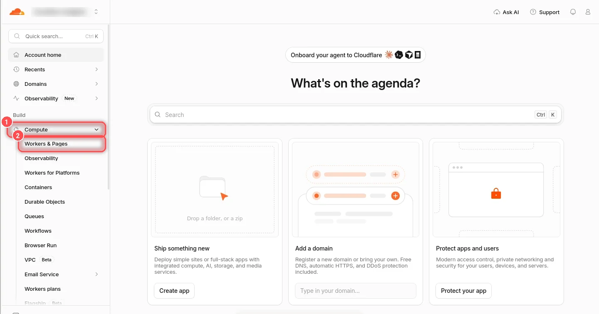
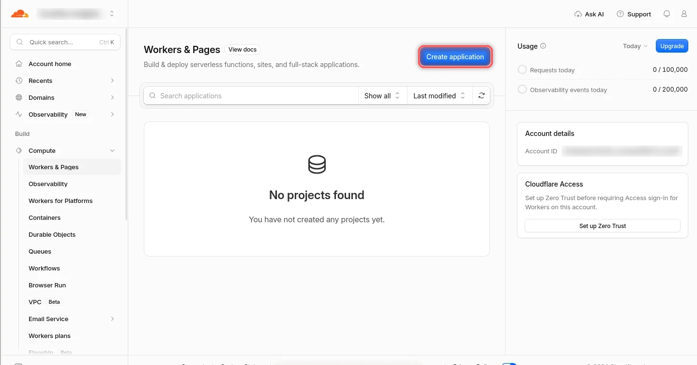
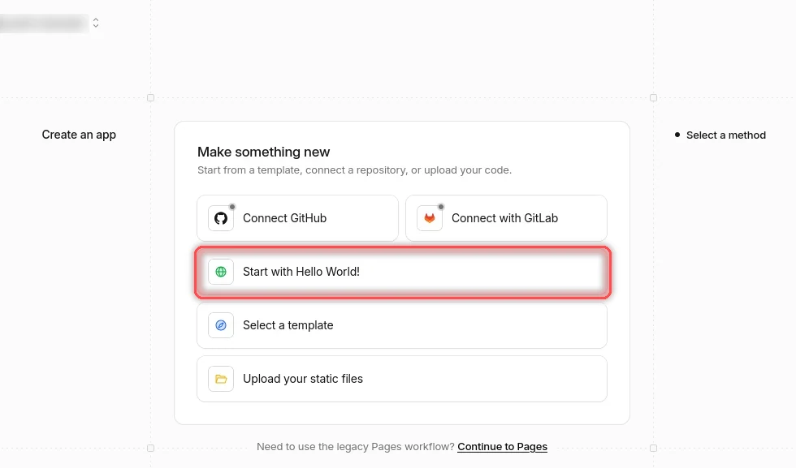
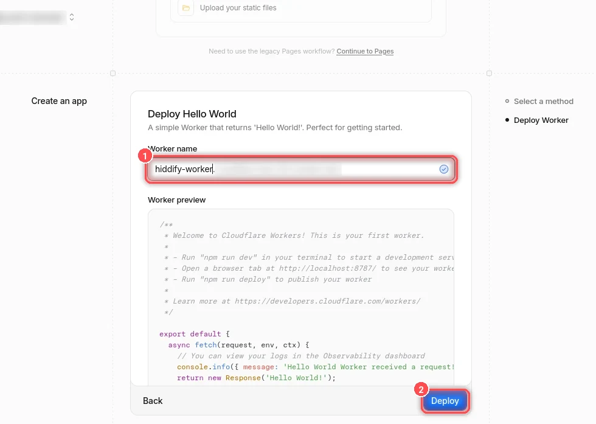
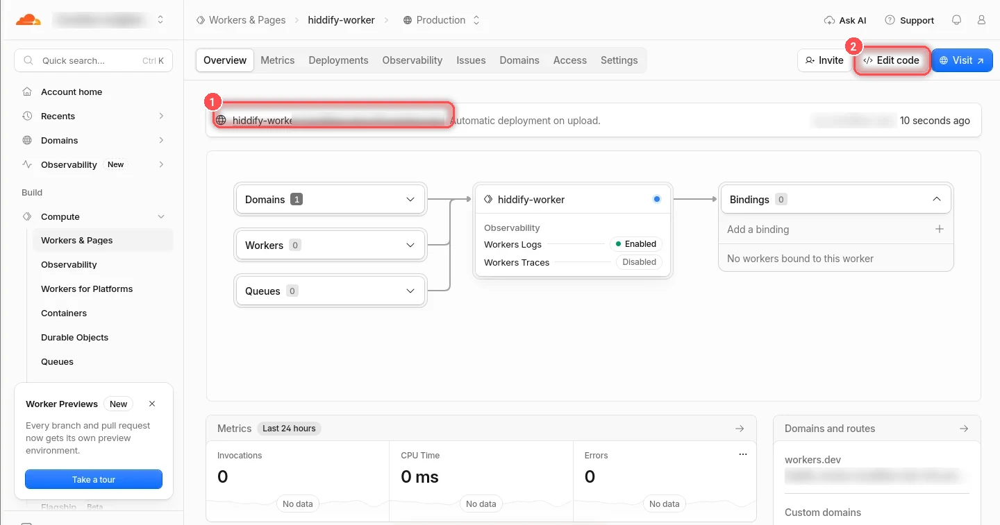
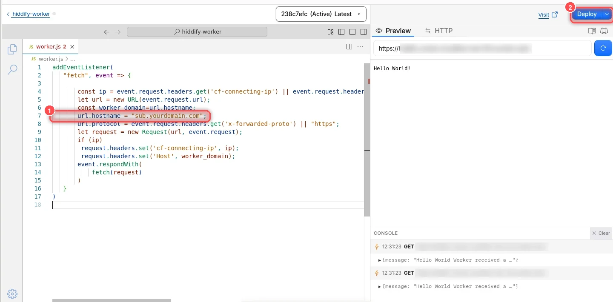
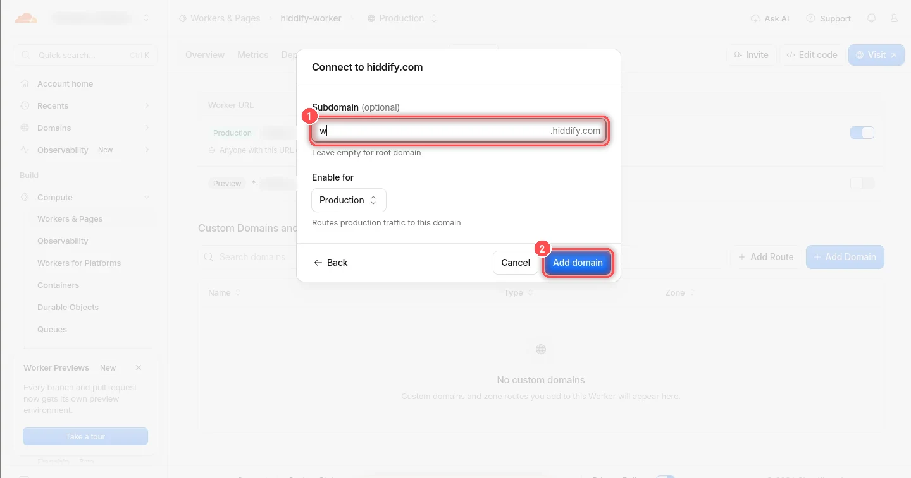
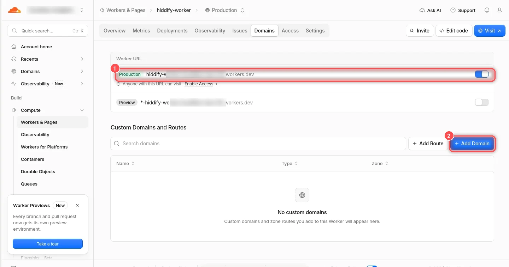
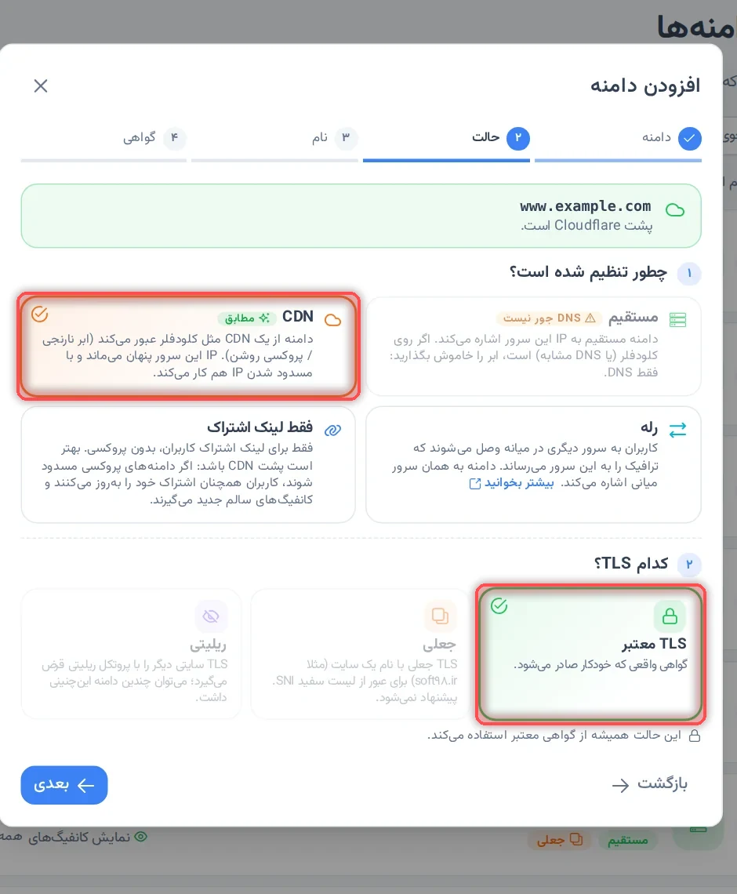
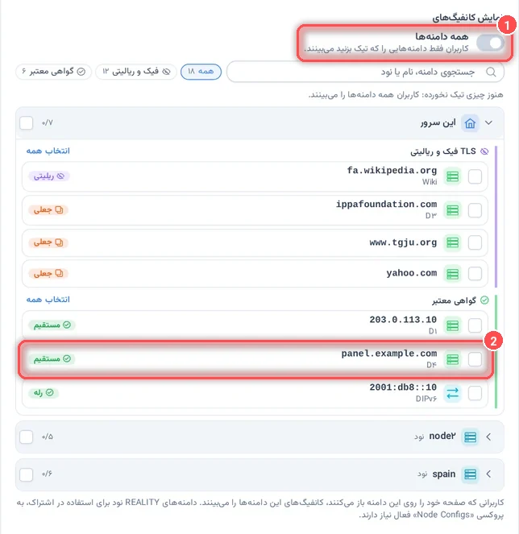

<div dir="rtl" markdown=1>

# آموزش تنظیم و استفاده از ورکرز در هیدیفای‌منیجر (روش دستی)

## ورکرز چیست؟

ورکرز (Cloudflare Workers) سرویسی از کلادفلر است که یک قطعه کد کوچک را روی سرورهای کلادفلر اجرا می‌کند. در این آموزش، ورکر درخواست‌های کاربران را می‌گیرد و به سرور هیدیفای‌منیجر شما می‌فرستد. کاربران فقط آدرس ورکر را می‌بینند و دامنه و IP سرور شما پشت آن پنهان می‌ماند.


!!! note "محدودیت پلن رایگان"
    ورکرز در پلن رایگان کلادفلر روزانه ۱۰۰ هزار درخواست را پردازش می‌کند. برای سرورهایی با کاربران زیاد این مقدار کافی نیست.

## ۱. پیش‌نیازها در کلادفلر

1. یک دامنه فعال در کلادفلر داشته باشید. اگر ندارید، [آموزش استفاده از CDN کلادفلر](/fa/manager/domain-worker-cdn-and-tunneling/How-to-use-Cloudflare-CDN/) را ببینید.
2. یک زیردامنه برای سرور خود بسازید (مثلا `sub.yourdomain.com`)؛ در **DNS** > **Records** یک رکورد `A` با آی‌پی سرور. ورکر با پروکسی روشن یا خاموش این رکورد کار می‌کند.
3. در **SSL/TLS** > **Overview** حالت رمزگذاری را روی **Full** بگذارید.
4. همین زیردامنه را در پنل هیدیفای‌منیجر به عنوان دامنه اضافه کنید تا پنل برایش گواهی بگیرد.

## ۲. ساخت ورکر

1. در داشبورد کلادفلر، از منوی کناری **Compute** > **Workers & Pages** را باز کنید.

    

2. **Create application** را بزنید. در همین صفحه سهمیه روزانه پلن رایگان (۱۰۰ هزار درخواست) را هم می‌بینید.

    

3. **Start with Hello World!** را انتخاب کنید.

    

4. در فیلد **Worker name** یک نام برای ورکر بنویسید (مثلا `hiddify-worker`). آدرس ورکر از همین نام ساخته می‌شود: `نام-ورکر.زیردامنه-حساب.workers.dev`. سپس **Deploy** را بزنید.

    

5. صفحه ورکر باز می‌شود و آدرس `workers.dev` آن بالای صفحه نمایش داده می‌شود. **Edit code** را بزنید تا ویرایشگر کد باز شود.

    

6. در ویرایشگر، کد پیش‌فرض فایل `worker.js` را کامل پاک کنید و این کد را جای آن بگذارید:

    ```js
    addEventListener(
       "fetch", event => {

           const ip = event.request.headers.get('cf-connecting-ip') || event.request.headers.get('x-forwarded-for') || (event.request.socket && event.request.socket.remoteAddress);
           let url = new URL(event.request.url);
           const worker_domain=url.hostname;
           url.hostname = "sub.yourdomain.com";
           url.protocol = event.request.headers.get('x-forwarded-proto') || "https";
           let request = new Request(url, event.request);
           if (ip)
            request.headers.set('cf-connecting-ip', ip);
            request.headers.set('Host', worker_domain);
           event.respondWith(
               fetch(request)
           )
       }
    )
    ```

7. در خط ۷، به جای `sub.yourdomain.com` زیردامنه سرور خود را که در بخش ۱ ساختید بنویسید.
8. **Deploy** بالای ویرایشگر را بزنید. پیام **Version saved** یعنی کد ذخیره و منتشر شد.

    

!!! tip "خطا در پیش‌نمایش"
    اگر بخش پیش‌نمایش ویرایشگر (سمت راست) خطا نشان داد، نگران نباشید و کد را منتشر کنید.

!!! info "قالب کد"
    این کد با قالب قدیمی ورکرز (`addEventListener`) نوشته شده است. کلادفلر این قالب را هنوز پشتیبانی می‌کند، ولی آن را منسوخ اعلام کرده و قالب جدید (Module) را پیشنهاد می‌دهد.

## ۳. آدرس ورکر

آدرس `workers.dev` ورکر را در زبانه **Domains** صفحه ورکر، بخش **Worker URL** می‌بینید. بهتر است به جای آن یک دامنه سفارشی روی دامنه خودتان به ورکر بدهید، چون آدرس‌های `workers.dev` ممکن است مسدود شوند:

1. در صفحه ورکر، زبانه **Domains** را باز کنید.
2. در بخش **Custom Domains and Routes**، **Add Domain** را بزنید.
3. در پنجره **Connect domain** دامنه خود را انتخاب کنید، در فیلد **Subdomain** یک زیردامنه جدید (مثلا `w`) بنویسید و **Add domain** را بزنید. کلادفلر رکورد DNS و گواهی آن را خودش می‌سازد. این زیردامنه نباید از قبل رکورد `CNAME` داشته باشد.

    


    


## ۴. افزودن آدرس ورکر به هیدیفای‌منیجر

1. از منوی کناری پنل، در گروه **تنظیمات**، صفحه **دامنه‌ها** را باز کنید و **افزودن دامنه** را بزنید.
2. در مرحله **دامنه**، آدرس ورکر (دامنه سفارشی یا آدرس `workers.dev`) را بدون `https://` وارد کنید و **بررسی** را بزنید.
3. در مرحله **حالت**، گزینه **CDN** را انتخاب کنید، **TLS معتبر** را نگه دارید و **بعدی** را بزنید.

    

4. مراحل **نام** و **گواهی** را تمام کنید تا دامنه اضافه شود.

## ۵. آوردن کانفیگ‌های ورکر به لینک اشتراک

اگر **نمایش کانفیگ‌های** دامنه‌ای که کاربران صفحه کاربری را با آن باز می‌کنند روی **همه دامنه‌ها** باشد (پیش‌فرض)، کانفیگ‌های ورکر خودکار اضافه می‌شوند. اگر فقط دامنه‌های مشخصی را نشان می‌دهید، آن دامنه را ویرایش کنید و در بخش **نمایش کانفیگ‌های** دامنه ورکر را تیک بزنید.

<div align=center markdown=1>

</div>

در آخر از کاربران بخواهید لینک اشتراک را در برنامه خود به‌روزرسانی کنند.

</div>
