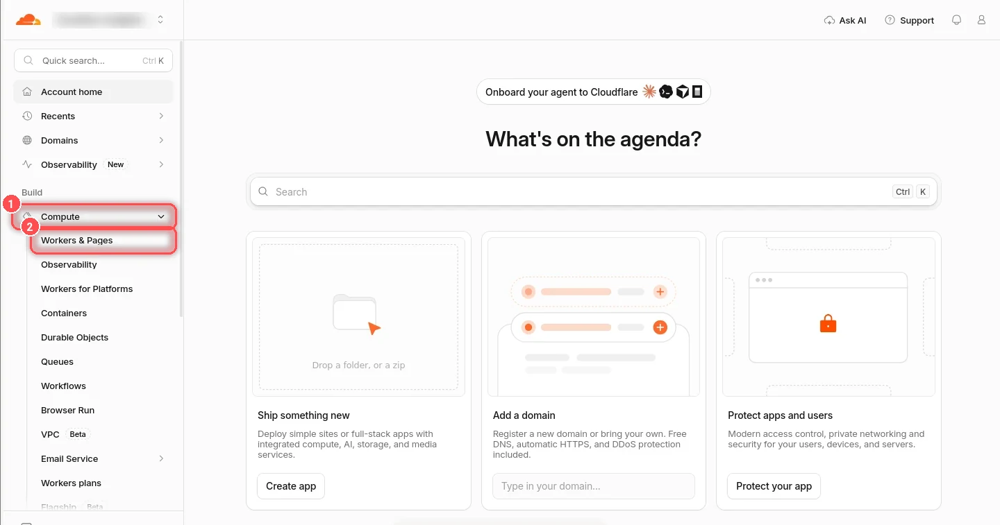
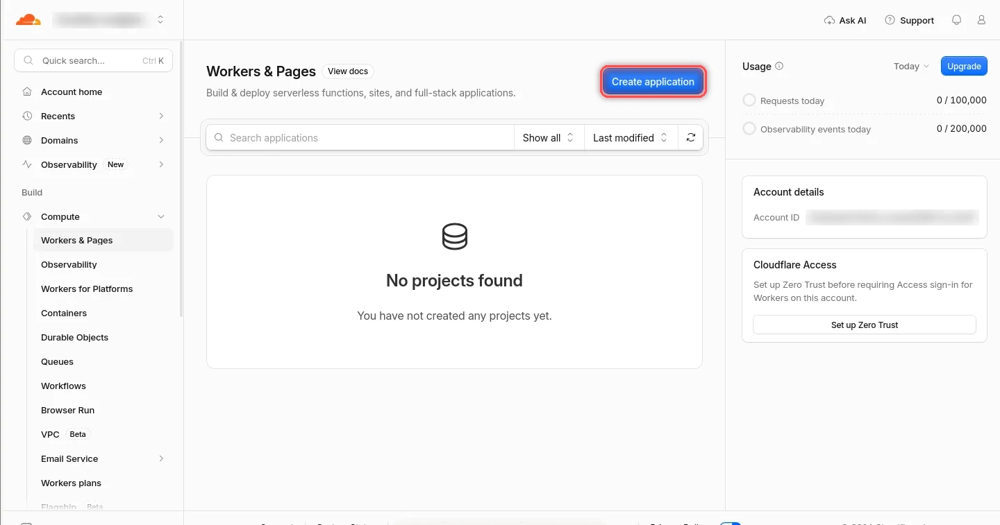
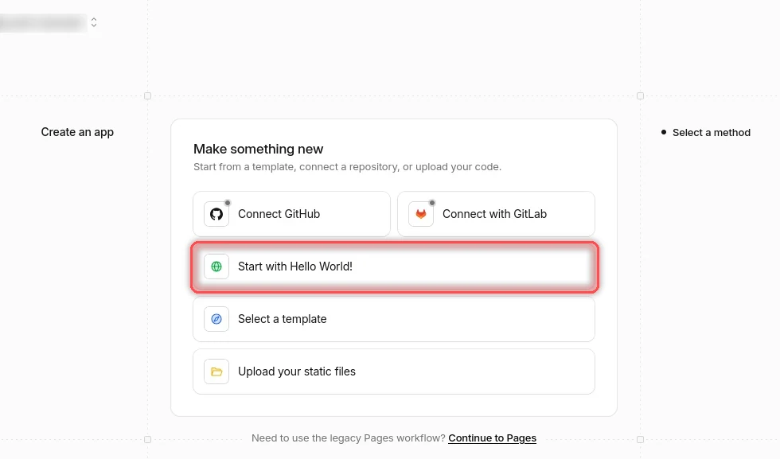
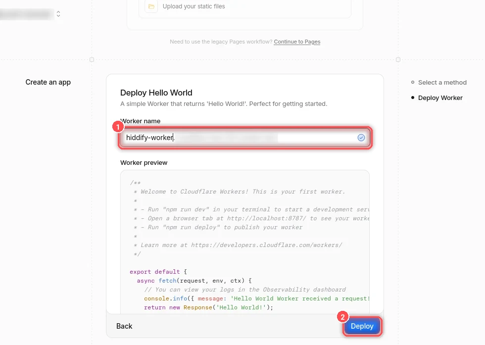
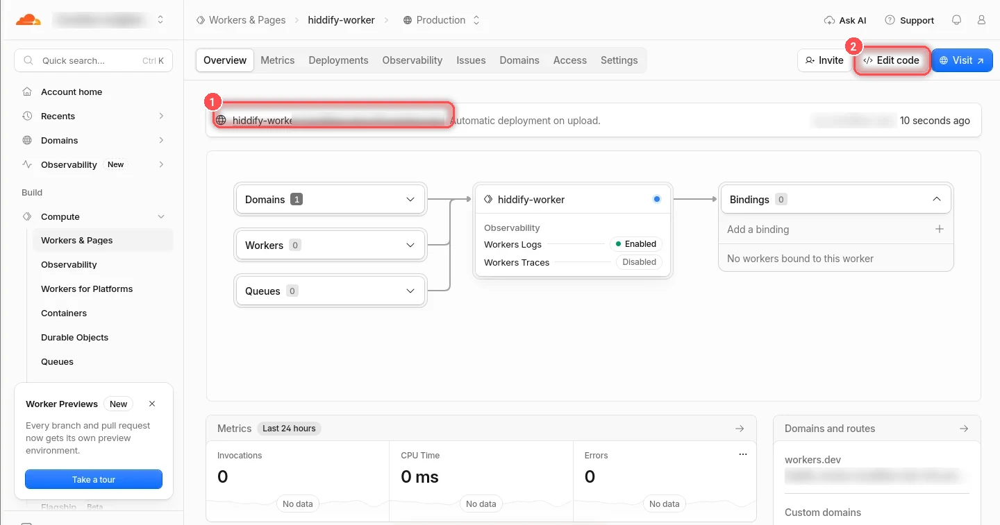
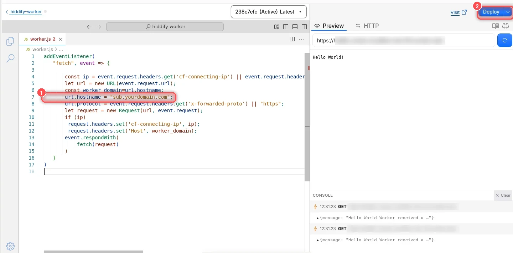
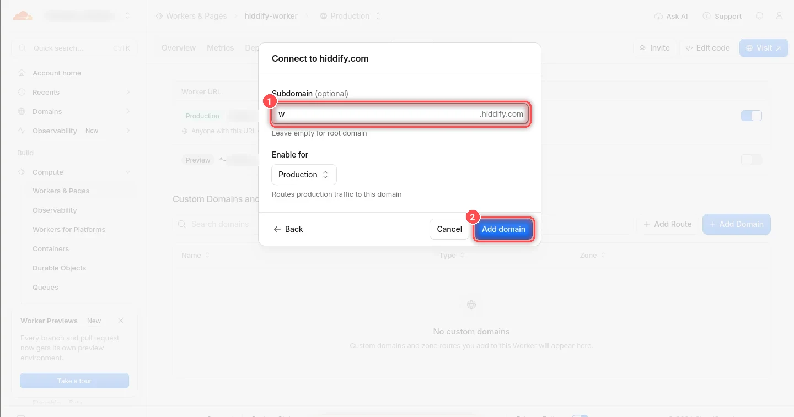
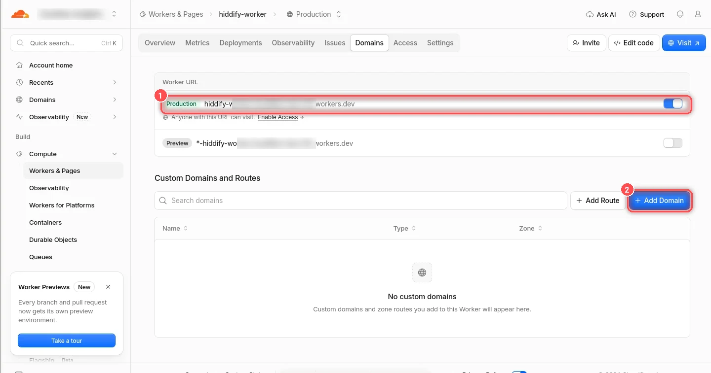
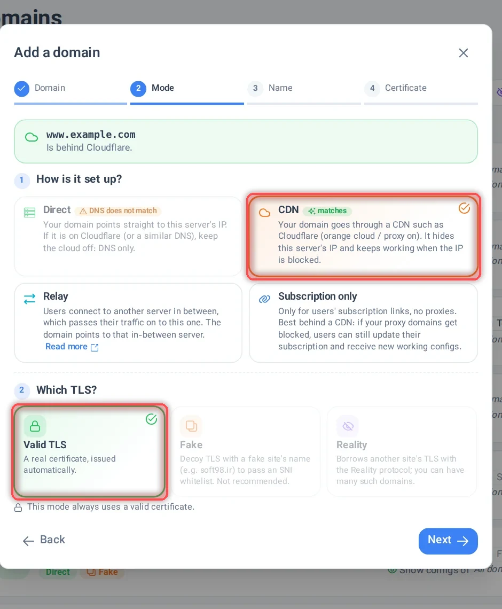
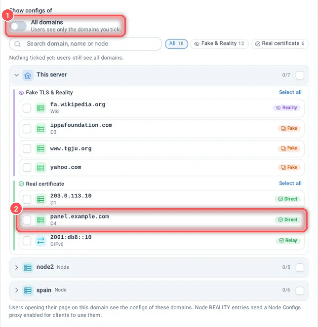

<div dir="ltr" markdown="1">

# How to set up and use Cloudflare workers (Manual way)

## What are Workers?

Cloudflare Workers runs a small piece of code on Cloudflare's servers. In this tutorial the worker takes your users' requests and sends them on to your HiddifyManager server. Users only see the worker's address; your server's domain and IP stay hidden behind it.


!!! note "Free plan limit"
    On Cloudflare's free plan, Workers handle 100,000 requests a day. This is not enough for a server with many users.

## 1. Requirements on Cloudflare

1. Have an active domain on Cloudflare. If you don't, see [How to use Cloudflare CDN](/manager/domain-worker-cdn-and-tunneling/How-to-use-Cloudflare-CDN/).
2. Make a subdomain for your server (for example `sub.yourdomain.com`): in **DNS** > **Records**, an `A` record with your server's IP. The worker works with this record's proxy on or off.
3. In **SSL/TLS** > **Overview**, set the encryption mode to **Full**.
4. Add the same subdomain to your HiddifyManager panel as a domain, so the panel gets a certificate for it.

## 2. Make the worker

1. In the Cloudflare dashboard side menu, open **Compute** > **Workers & Pages**.

    

2. Click **Create application**. This page also shows the free plan's daily quota (100,000 requests).

    

3. Choose **Start with Hello World!**.

    

4. In **Worker name**, type a name for the worker (for example `hiddify-worker`). The worker's address is made from it: `worker-name.account-subdomain.workers.dev`. Then click **Deploy**.

    

5. The worker's page opens with its `workers.dev` address at the top. Click **Edit code** to open the code editor.

    

6. In the editor, delete all the default code in `worker.js` and put this code in its place:

    ```js
    addEventListener(
       "fetch", event => {

           const ip = event.request.headers.get('cf-connecting-ip') || event.request.headers.get('x-forwarded-for') || (event.request.socket && event.request.socket.remoteAddress);
           let url = new URL(event.request.url);
           const worker_domain=url.hostname;
           url.hostname = "sub.yourdomain.com";
           url.protocol = event.request.headers.get('x-forwarded-proto') || "https";
           let request = new Request(url, event.request);
           if (ip)
            request.headers.set('cf-connecting-ip', ip);
            request.headers.set('Host', worker_domain);
           event.respondWith(
               fetch(request)
           )
       }
    )
    ```

7. On line 7, replace `sub.yourdomain.com` with your server's subdomain from step 1.
8. Click **Deploy** above the editor. **Version saved** means the code is saved and published.

    

!!! tip "Errors in the preview"
    If the editor's preview pane (on the right) shows an error, don't worry: publish the code.

!!! info "Code format"
    This code uses the older Workers format (`addEventListener`). Cloudflare still supports it, but has marked it deprecated and recommends the newer Module format.

## 3. The worker's address

You can see the worker's `workers.dev` address on the worker's **Domains** tab, under **Worker URL**. It is better to give the worker a custom domain on your own domain instead, because `workers.dev` addresses can be blocked:

1. On the worker's page, open the **Domains** tab.
2. Under **Custom Domains and Routes**, click **Add Domain**.
3. In the **Connect domain** window pick your domain, enter a new subdomain in **Subdomain** (for example `w`) and click **Add domain**. Cloudflare makes its DNS record and certificate by itself. The subdomain must not already have a `CNAME` record.

    


    


## 4. Add the worker's address to HiddifyManager

1. In the panel side menu, in the **Settings** group, open **Domains** and click **Add domain**.
2. In the **Domain** step, enter the worker's address (the custom domain or the `workers.dev` address) without `https://` and click **Check**.
3. In the **Mode** step, choose **CDN**, keep **Valid TLS** and click **Next**.

    

4. Finish the **Name** and **Certificate** steps to add the domain.

## 5. Bring the worker configs into the subscription link

If **Show configs of** on the domain your users open their user page with is set to **All domains** (the default), the worker's configs are added by themselves. If you show only some domains, edit that domain and tick the worker domain under **Show configs of**.

<div align=center markdown=1>

</div>

Then ask your users to update the subscription in their app.

</div>
