

# استفاده از CDN کلادفلر

کلادفلر بزرگ‌ترین ارائه‌دهنده CDN است. وقتی دامنه شما پشت کلادفلر باشد، کاربران به جای IP سرور شما به سرورهای کلادفلر وصل می‌شوند و کلادفلر ترافیک را به سرور شما می‌رساند. این‌طور IP سرور پنهان می‌ماند و اگر مسدود شود، اتصال از طریق CDN همچنان کار می‌کند.

در این مقاله:

1. دامنه را به کلادفلر اضافه می‌کنید؛
2. یک رکورد مستقیم و یک رکورد CDN می‌سازید؛
3. دامنه‌ها را به هیدیفای‌منیجر اضافه می‌کنید؛
4. تنظیمات SSL و شبکه کلادفلر را انجام می‌دهید.

اگر می‌خواهید روی دامنه‌ای که در کلادفلر است از CDN GCore استفاده کنید، [این آموزش](/fa/manager/domain-worker-cdn-and-tunneling/How-to-use-GCore-CDN-on-Cloudflare-registered-domain/) را ببینید.

## ۱. اضافه کردن دامنه به کلادفلر

1. در [صفحه ثبت‌نام کلادفلر](https://dash.cloudflare.com/sign-up) یک حساب بسازید و وارد آن شوید.
2. از منوی کناری **Domains** > **Overview** را باز کنید و **Add domain** را بزنید.

    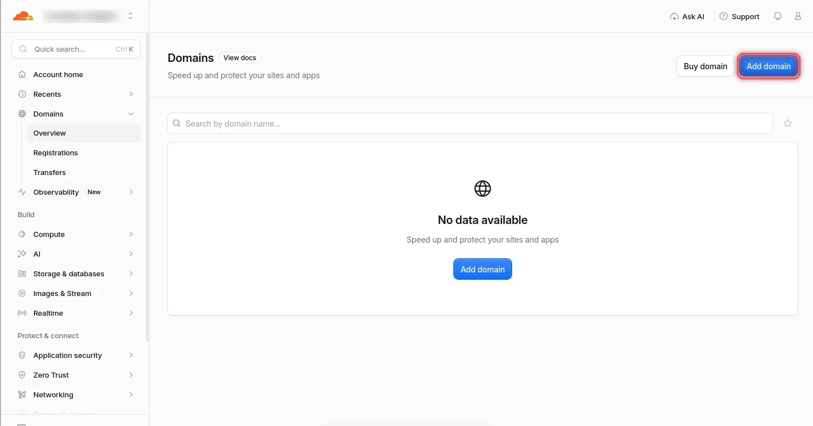

3. **Connect a domain** را انتخاب کنید (برای دامنه‌ای که از جای دیگری خریده‌اید).

    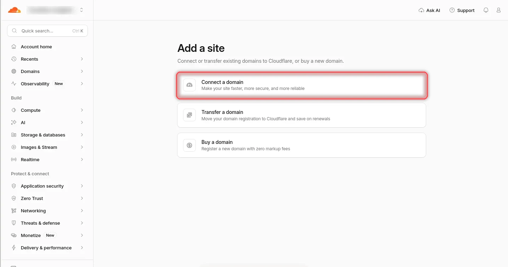

4. در فیلد **Domain name** دامنه اصلی خود را (مثلا `yourdomain.com`، بدون `www`) بنویسید. پایین همین صفحه، بخش **Import DNS records** را روی **Automatic** نگه دارید تا کلادفلر رکوردهای فعلی دامنه را خودش پیدا کند، و **Continue** را بزنید.

    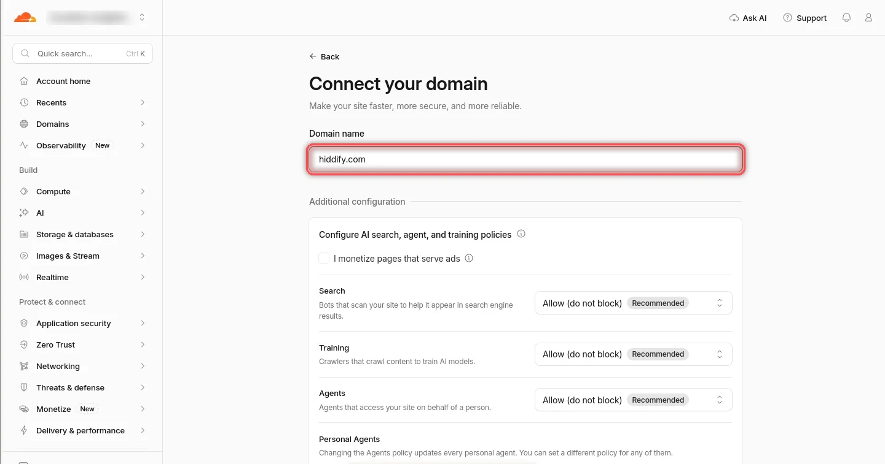

5. در صفحه انتخاب پلن، زیر **Free** دکمه **Select plan** را بزنید. پلن رایگان برای این کار کافی است.

    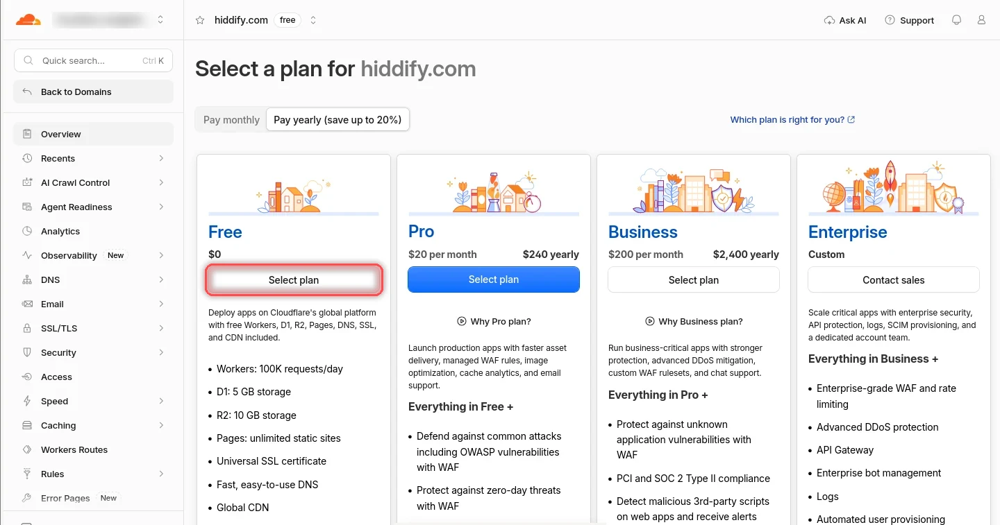

6. صفحه رکوردهای DNS را می‌بینید (بخش ۲ را ببینید). بعد از آن **Continue to activation** را بزنید.
7. در صفحه **Update your nameservers to activate Cloudflare**، دو نیم‌سرور کلادفلر به شما داده می‌شود. در سایتی که دامنه را از آن خریده‌اید، نیم‌سرورهای قبلی را حذف کنید و این دو را دقیقا همان‌طور که نوشته شده‌اند وارد کنید.

    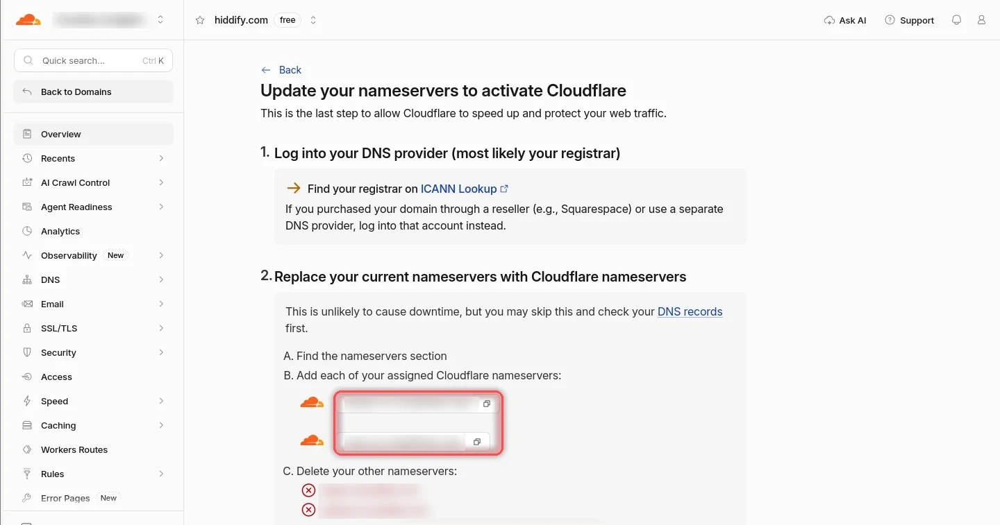

8. صبر کنید (تا ۲۴ ساعت). وقتی دامنه فعال شود، کلادفلر به شما ایمیل می‌دهد و وضعیت دامنه در صفحه **Domains** از **Pending** به **Active** تغییر می‌کند.

## ۲. ساخت رکوردهای DNS

رکوردها را در همان مرحله اضافه کردن دامنه، یا بعدا از منوی کناری دامنه در **DNS** > **Records** می‌سازید. کلادفلر خودش تفاوت دو حالت پروکسی را توضیح می‌دهد:

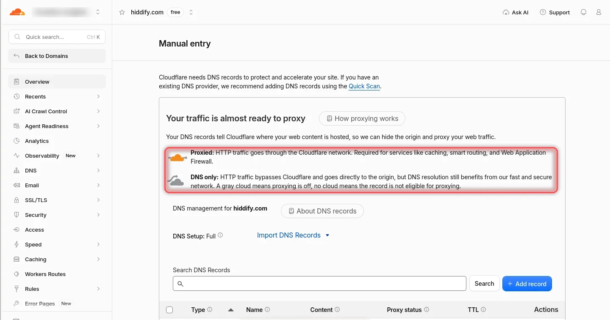

**Add record** را بزنید و برای هر زیردامنه این فیلدها را پر کنید، سپس **Save** را بزنید:

- **Type**: برای IP نسخه ۴ نوع `A` و برای IP نسخه ۶ نوع `AAAA`؛
- **Name**: نام زیردامنه، مثلا `direct` یا `cdn`؛
- **IPv4 address** (یا **IPv6 address**): آی‌پی سرور شما؛
- **Proxy status**: بسته به نوع دامنه، طبق جدول پایین.

| نوع دامنه | Proxy status | ابر |
|---|---|---|
| مستقیم | **DNS only** (خاموش) | خاکستری |
| CDN | **Proxied** (روشن) | نارنجی |

### دامنه مستقیم

پروکسی را خاموش کنید (**DNS only**). کاربران مستقیم به IP سرور وصل می‌شوند. برای رکوردهای **DNS only** می‌توانید TTL را تغییر دهید؛ هر چه کمتر باشد، تغییر IP زودتر به دست کاربران می‌رسد.

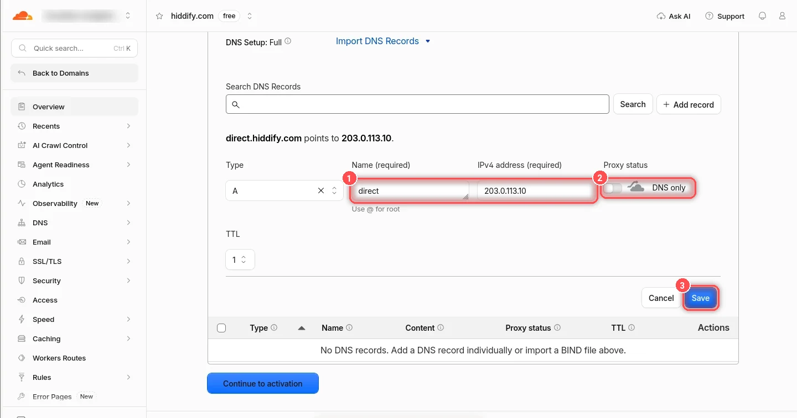

اگر سرور IP نسخه ۶ دارد، همین کار را با یک رکورد `AAAA` انجام دهید.

### دامنه CDN

همین کار را برای یک زیردامنه دیگر انجام دهید، ولی این بار پروکسی را روشن بگذارید (**Proxied**). TTL رکوردهای پروکسی‌شده همیشه **Auto** است و تغییر نمی‌کند.

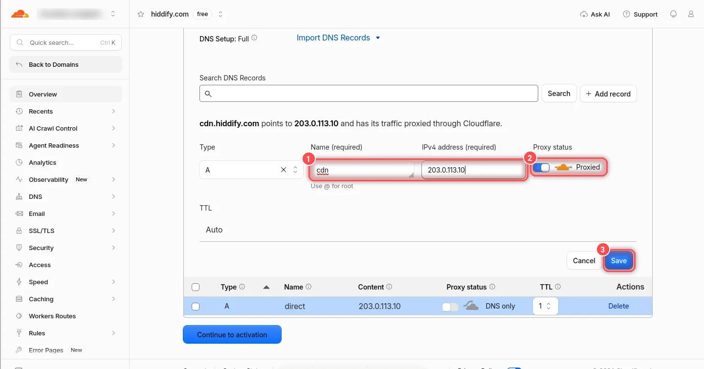

در پایان، رکوردها در لیست دیده می‌شوند:

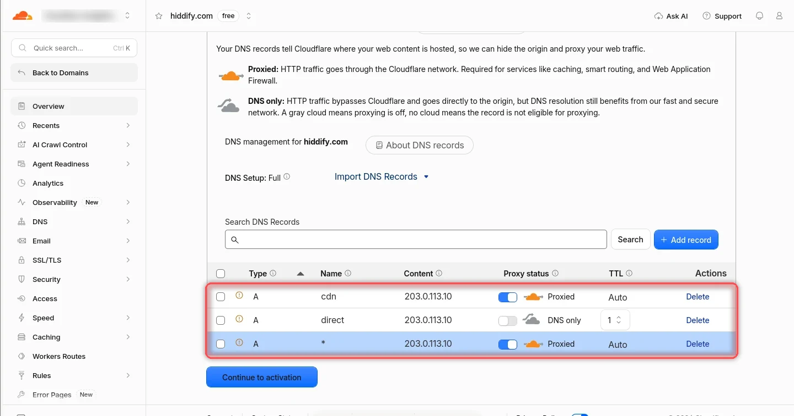

### بررسی دامنه CDN

اگر دامنه CDN را با `ping` یا `nslookup` یا `dig` بررسی کنید، به جای IP سرور شما، IPهای کلادفلر را می‌بینید. این IPها ممکن است با گذشت زمان عوض شوند. گاهی بعضی IPهای کلادفلر در ایران مسدود یا کند هستند؛ در این حالت می‌توانید [از IPهای تمیز استفاده کنید](/fa/manager/domain-worker-cdn-and-tunneling/How-to-use-desired-clean-IPs-based-on-a-specific-format/).

## ۳. افزودن دامنه‌ها به هیدیفای‌منیجر

1. از منوی کناری پنل، در گروه **تنظیمات**، صفحه **دامنه‌ها** را باز کنید و **افزودن دامنه** را بزنید.
2. در مرحله **دامنه**، زیردامنه را بنویسید و **بررسی** را بزنید. کادر **آن را به این سرور اشاره دهید** مقدارهای `A` و `AAAA` (آی‌پی‌های سرور شما) را برای رکورد DNS نشان می‌دهد.

    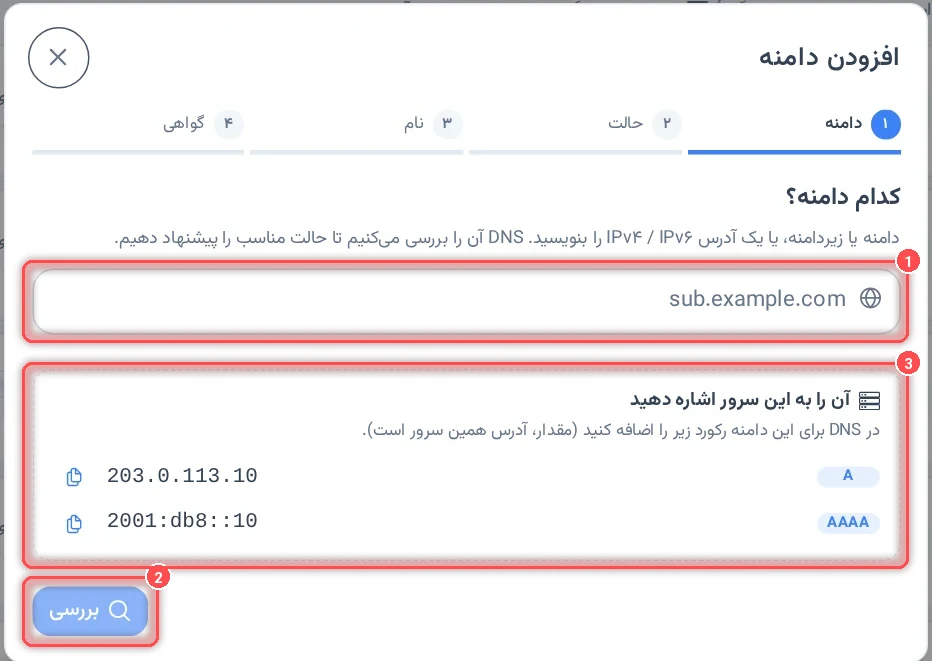

3. در مرحله **حالت**، زیر **چطور تنظیم شده است؟** برای دامنه مستقیم (ابر خاکستری) گزینه **مستقیم** و برای دامنه CDN (ابر نارنجی) گزینه **CDN** را انتخاب کنید. پنل DNS را بررسی می‌کند و کنار حالت درست برچسب **مطابق** می‌گذارد. **TLS معتبر** را نگه دارید و **بعدی** را بزنید.

    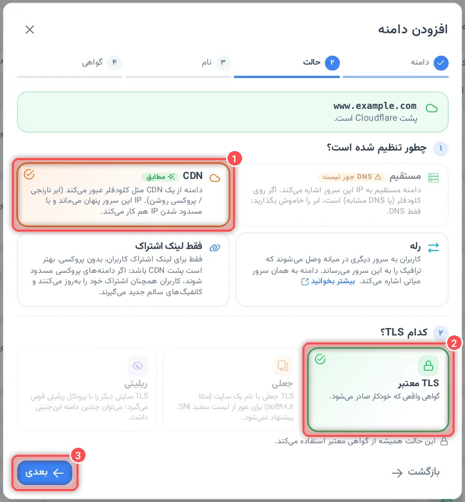

4. مراحل **نام** و **گواهی** را تمام کنید تا دامنه اضافه شود.

## ۴. تنظیم SSL/TLS در کلادفلر

کلادفلر ارتباط کاربر تا کلادفلر و ارتباط کلادفلر تا سرور شما را جدا رمزگذاری می‌کند. حالت رمزگذاری باید **Full** باشد تا کلادفلر با HTTPS به سرور شما وصل شود.

1. از منوی کناری دامنه، **SSL/TLS** > **Overview** را باز کنید. حالت فعلی کنار **Current encryption mode** نوشته شده است. اگر **Full** نیست، **Configure** را بزنید.

    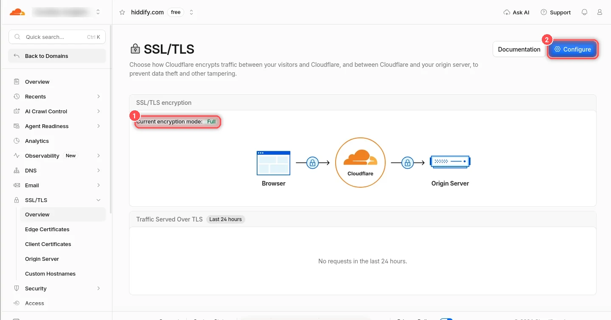

2. در صفحه تنظیم حالت رمزگذاری، **Full** را انتخاب کنید. **Full (Strict)** هم کار می‌کند اگر گواهی سرور شما معتبر باشد. **Flexible** را انتخاب نکنید.

    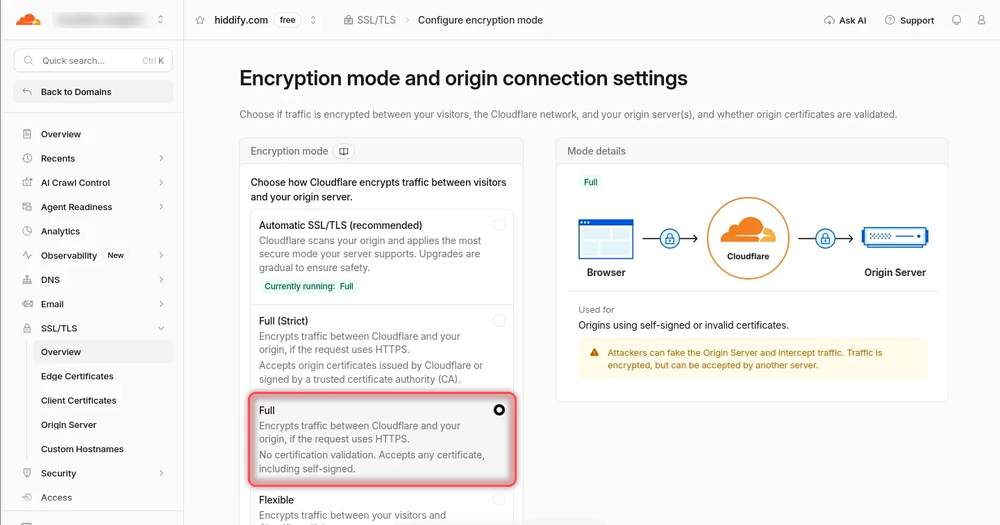

!!! note "Automatic SSL/TLS"
    گزینه پیشنهادی کلادفلر **Automatic SSL/TLS** است که خودش امن‌ترین حالتی را که سرور شما پشتیبانی می‌کند انتخاب می‌کند و هیچ‌وقت آن را پایین‌تر نمی‌برد. برای سرور هیدیفای‌منیجر این گزینه معمولا روی **Full** قرار می‌گیرد؛ اگر نه، دستی **Full** را انتخاب کنید.

## ۵. فعال کردن gRPC، WebSockets و HTTP/3

کانفیگ‌های CDN از gRPC و WebSocket استفاده می‌کنند. این‌ها در همه پلن‌ها، از جمله رایگان، در دسترس‌اند.

1. از منوی کناری دامنه **Network** را باز کنید:
    - **gRPC** را روشن کنید. این گزینه به طور پیش‌فرض خاموش است. gRPC فقط روی پورت ۴۴۳ و وقتی حالت SSL حداقل **Full** باشد کار می‌کند؛ در غیر این صورت کلادفلر خطای `403` برمی‌گرداند.
    - مطمئن شوید **WebSockets** روشن است (به طور پیش‌فرض روشن است).

    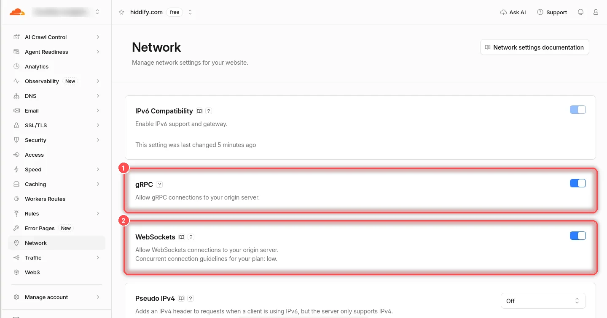

2. **HTTP/3 (QUIC)** به **Speed** > **Settings** و زبانه **Protocol Optimization** منتقل شده است. **HTTP/3 (with QUIC)** را روشن نگه دارید (به طور پیش‌فرض روشن است). HTTP/3 فقط بین کاربر و کلادفلر است؛ کلادفلر هنوز با HTTP/3 به سرور شما وصل نمی‌شود.

    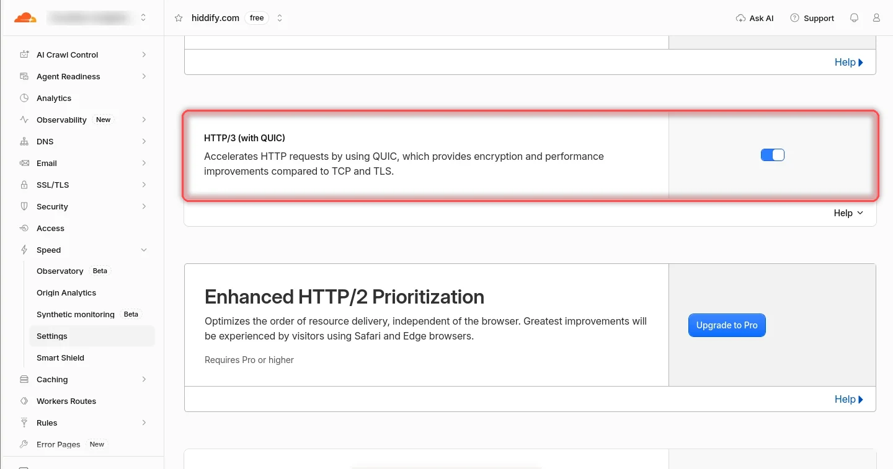

## سرویس‌های دیگر کلادفلر

- **ورکر**: [آموزش تنظیم و استفاده از ورکر](/fa/manager/domain-worker-cdn-and-tunneling/How-to-set-up-and-use-Cloudflare-workers/)
- **دامین فرانتینگ**: [راهنمای دامین فرانتینگ](/fa/manager/domain-worker-cdn-and-tunneling/Guide-for-domain-fronting/). این روش فعلا در کلادفلر کار نمی‌کند.

