

# How to use Cloudflare CDN

Cloudflare is the largest CDN provider. When your domain is behind Cloudflare, users connect to Cloudflare's servers instead of your server's IP, and Cloudflare passes the traffic on to your server. This hides your server's IP, and if the IP is blocked, connections through the CDN keep working.

In this article you:

1. add your domain to Cloudflare;
2. make a direct record and a CDN record;
3. add the domains to HiddifyManager;
4. set Cloudflare's SSL and network settings.

To use GCore CDN on a domain that is on Cloudflare, see [this tutorial](/manager/domain-worker-cdn-and-tunneling/How-to-use-GCore-CDN-on-Cloudflare-registered-domain/).

## 1. Add your domain to Cloudflare

1. Make an account on [Cloudflare's sign-up page](https://dash.cloudflare.com/sign-up) and sign in.
2. In the side menu, open **Domains** > **Overview** and click **Add domain**.

    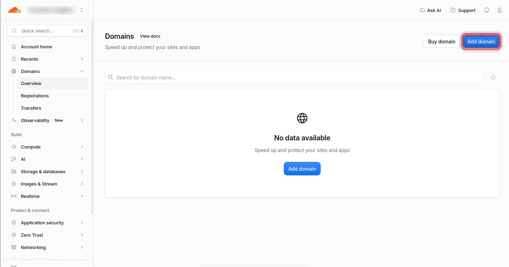

3. Choose **Connect a domain** (for a domain you bought somewhere else).

    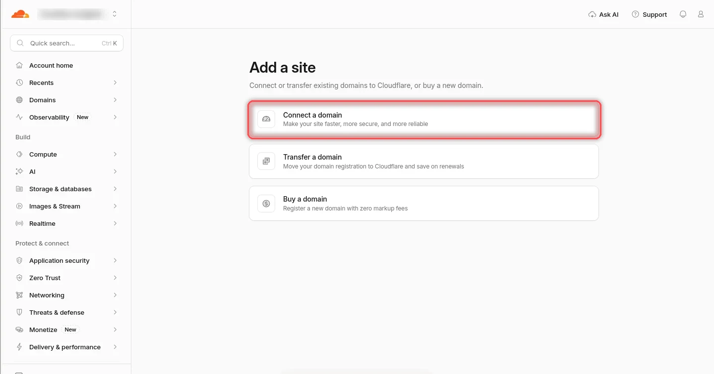

4. In **Domain name**, enter your main domain (for example `yourdomain.com`, without `www`). Lower on the same page, keep **Import DNS records** on **Automatic** so Cloudflare finds the domain's current records by itself, and click **Continue**.

    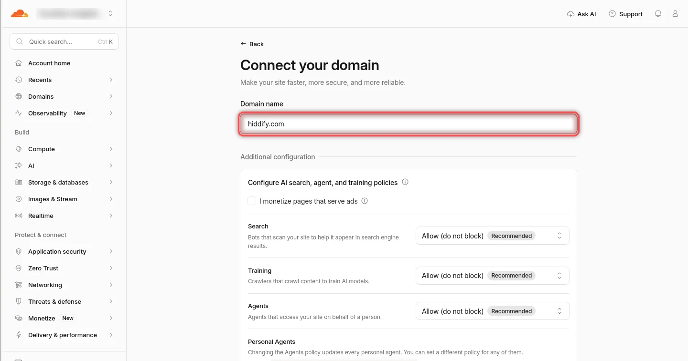

5. On the plan page, click **Select plan** under **Free**. The free plan is enough for this.

    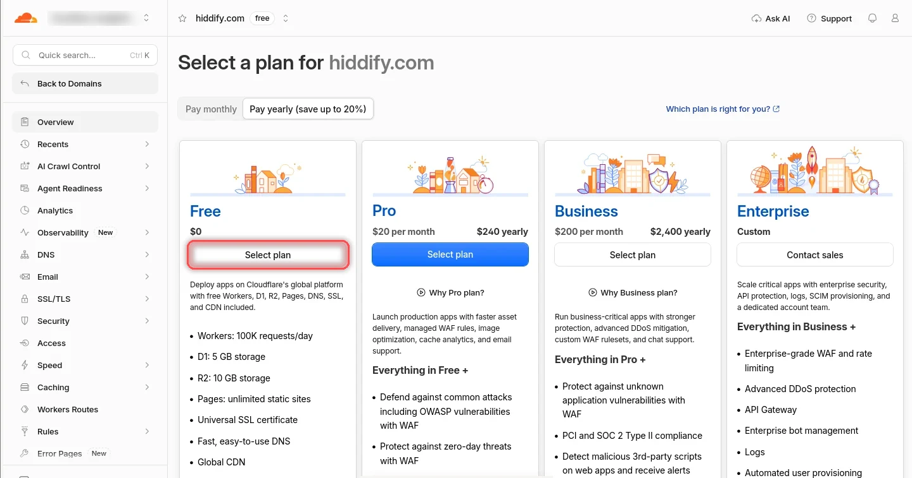

6. You see the DNS records page (see step 2). Then click **Continue to activation**.
7. On **Update your nameservers to activate Cloudflare**, you get two Cloudflare nameservers. On the website you bought the domain from, remove the old nameservers and enter these two exactly as written.

    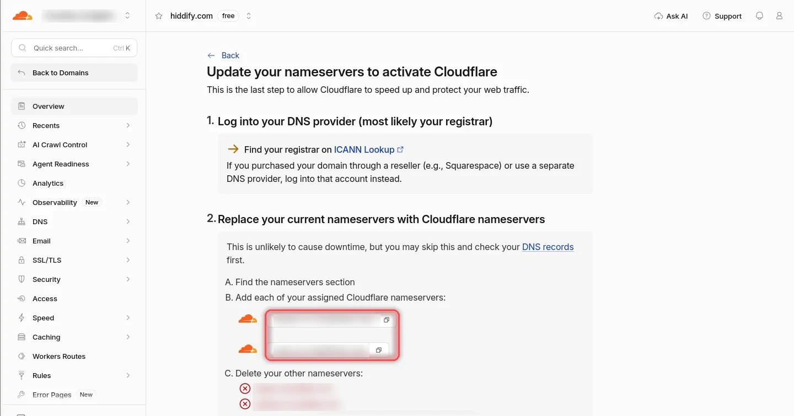

8. Wait (up to 24 hours). When the domain is active, Cloudflare sends you an email and the domain changes from **Pending** to **Active** on the **Domains** page.

## 2. Make the DNS records

You make the records while adding the domain, or later from the domain's **DNS** > **Records**. Cloudflare explains the two proxy modes itself:

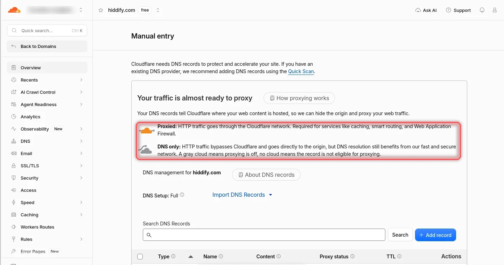

Click **Add record**, fill in these fields for each subdomain, then click **Save**:

- **Type**: `A` for IPv4, `AAAA` for IPv6;
- **Name**: the subdomain, for example `direct` or `cdn`;
- **IPv4 address** (or **IPv6 address**): your server's IP;
- **Proxy status**: depends on the domain type, see the table below.

| Domain type | Proxy status | Cloud |
|---|---|---|
| Direct | **DNS only** (off) | grey |
| CDN | **Proxied** (on) | orange |

### Direct domain

Turn the proxy off (**DNS only**). Users connect straight to your server's IP. For **DNS only** records you can change the TTL; the lower it is, the sooner an IP change reaches your users.

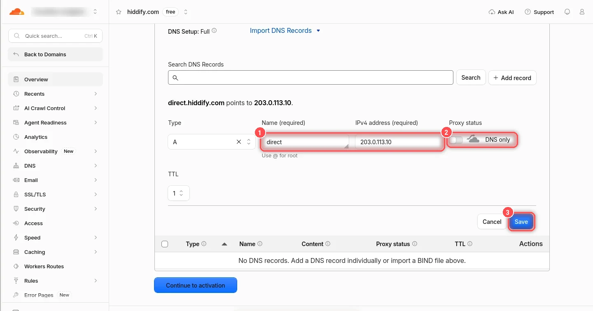

If your server has an IPv6 address, do the same with an `AAAA` record.

### CDN domain

Do the same for another subdomain, but this time leave the proxy on (**Proxied**). The TTL of proxied records is always **Auto** and can't be changed.

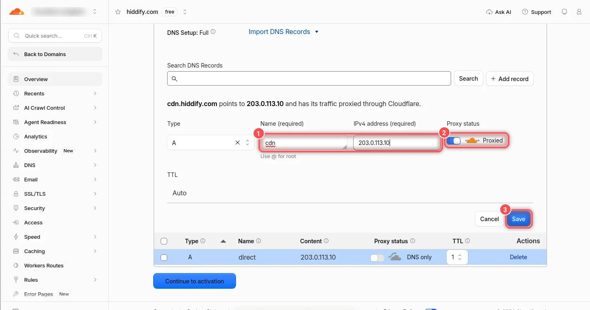

At the end, the records show in the list:

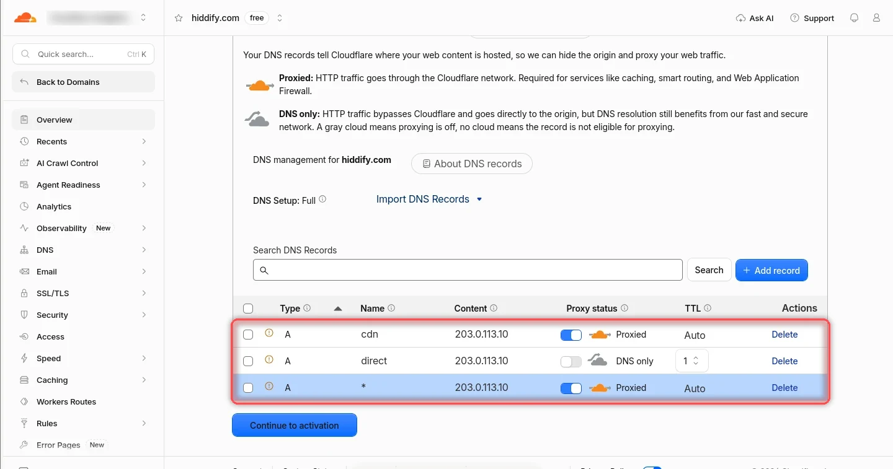

### Check the CDN domain

If you check the CDN domain with `ping`, `nslookup` or `dig`, you see Cloudflare's IPs instead of your server's IP. These IPs can change over time. Some Cloudflare IPs are sometimes blocked or slow in Iran; then you can [use clean IPs](/manager/domain-worker-cdn-and-tunneling/How-to-use-desired-clean-IPs-based-on-a-specific-format/).

## 3. Add the domains to HiddifyManager

1. In the panel side menu, in the **Settings** group, open **Domains** and click **Add domain**.
2. In the **Domain** step, type the subdomain and click **Check**. The **Point it at this server** box shows the `A` and `AAAA` values (your server's IPs) for the DNS record.

    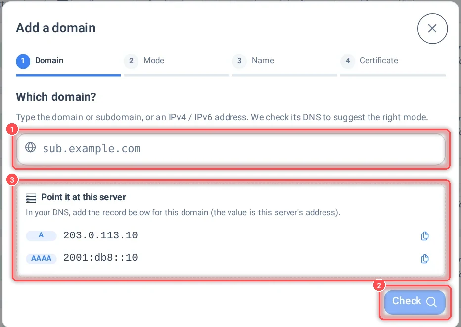

3. In the **Mode** step, under **How is it set up?** choose **Direct** for the direct domain (grey cloud) or **CDN** for the CDN domain (orange cloud). The panel checks the DNS and puts a **matches** badge next to the right mode. Keep **Valid TLS** and click **Next**.

    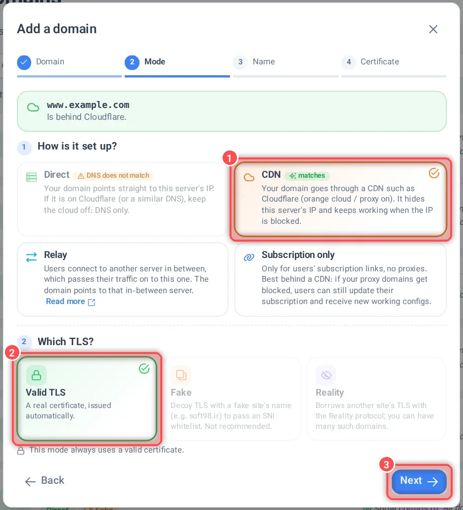

4. Finish the **Name** and **Certificate** steps to add the domain.

## 4. Set SSL/TLS on Cloudflare

Cloudflare encrypts the connection from the user to Cloudflare and the connection from Cloudflare to your server separately. The encryption mode must be **Full** so that Cloudflare connects to your server over HTTPS.

1. In the domain's side menu, open **SSL/TLS** > **Overview**. The current mode is shown next to **Current encryption mode**. If it is not **Full**, click **Configure**.

    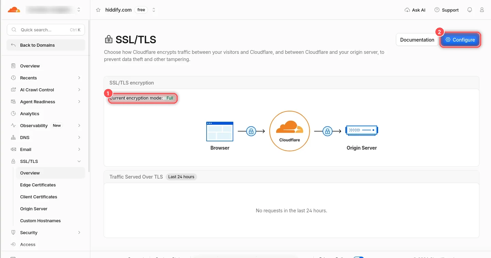

2. On the encryption mode page, choose **Full**. **Full (Strict)** also works if your server's certificate is valid. Don't choose **Flexible**.

    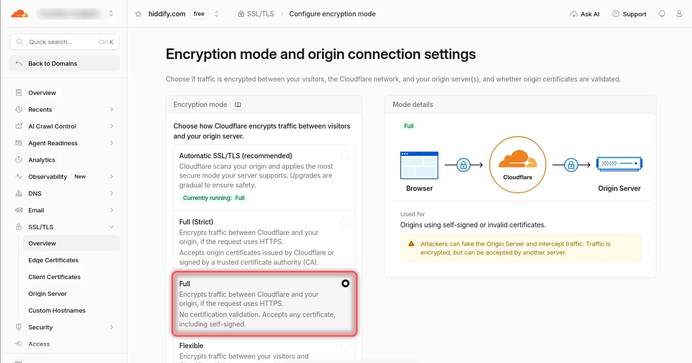

!!! note "Automatic SSL/TLS"
    Cloudflare's recommended option is **Automatic SSL/TLS**, which picks the most secure mode your server supports and never lowers it. For a HiddifyManager server it usually runs as **Full**; if not, choose **Full** yourself.

## 5. Turn on gRPC, WebSockets and HTTP/3

CDN configs use gRPC and WebSocket. These are available on all plans, including Free.

1. Open **Network** in the domain's side menu:
    - Turn on **gRPC**. It is off by default. gRPC only works on port 443 and when the SSL mode is at least **Full**; otherwise Cloudflare answers with a `403` error.
    - Make sure **WebSockets** is on (it is on by default).

    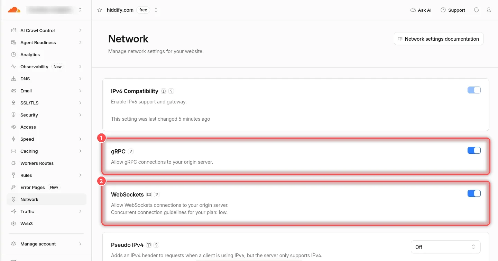

2. **HTTP/3 (QUIC)** moved to **Speed** > **Settings**, **Protocol Optimization** tab. Keep **HTTP/3 (with QUIC)** on (it is on by default). HTTP/3 is only between the user and Cloudflare; Cloudflare does not yet connect to your server over HTTP/3.

    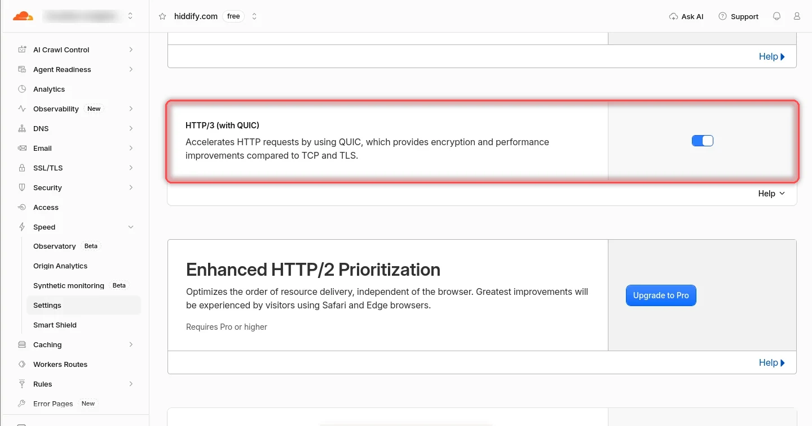

## Other Cloudflare services

- **Worker**: [How to set up and use Cloudflare Workers](/manager/domain-worker-cdn-and-tunneling/How-to-set-up-and-use-Cloudflare-workers/)
- **Domain fronting**: [Guide for domain fronting](/manager/domain-worker-cdn-and-tunneling/Guide-for-domain-fronting/). This method does not currently work on Cloudflare.

