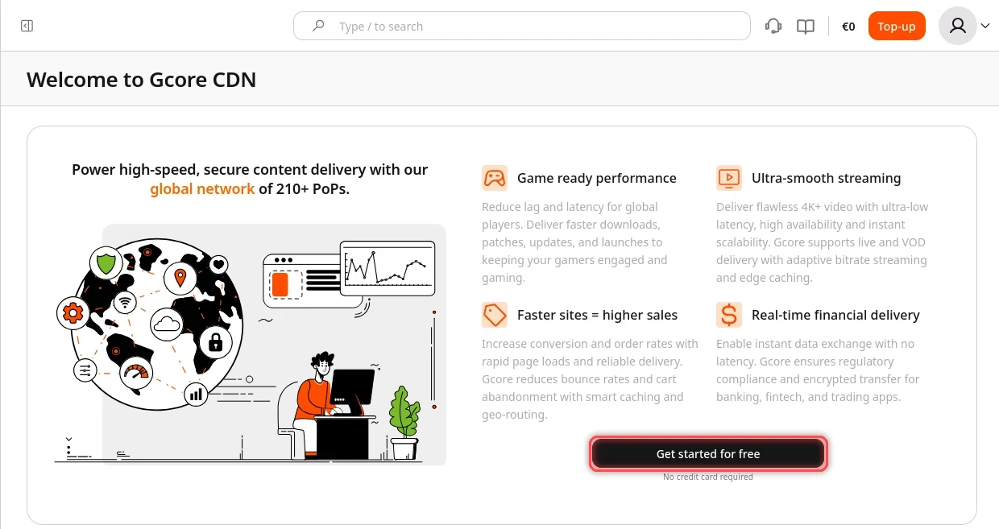
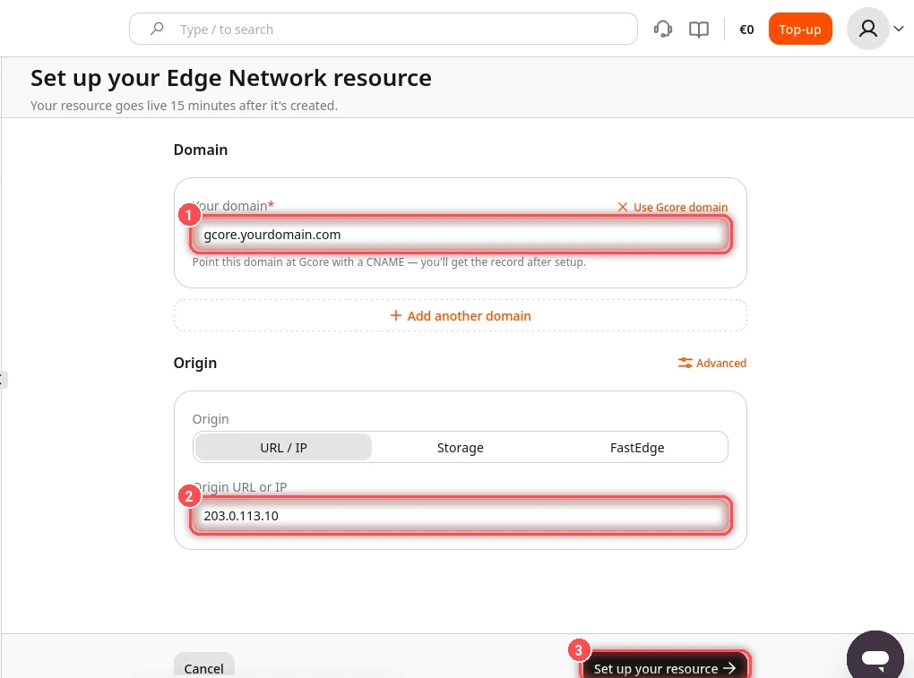
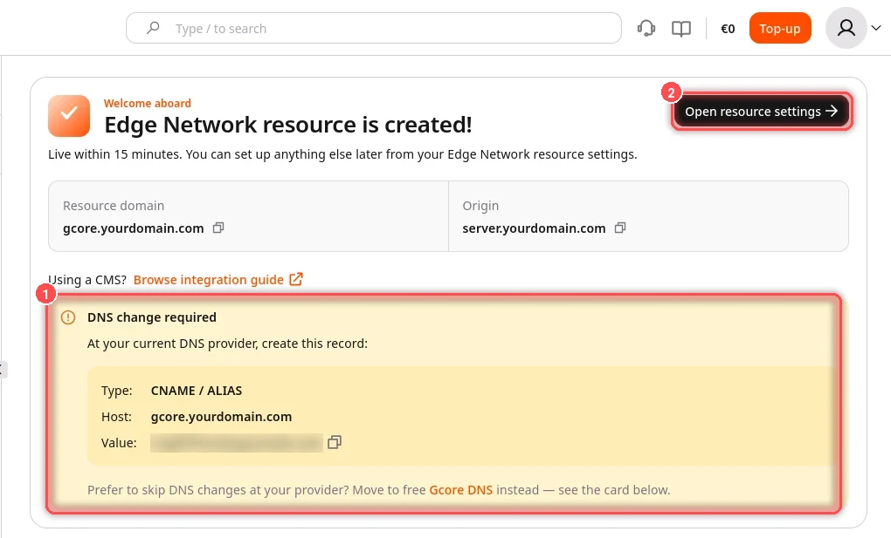
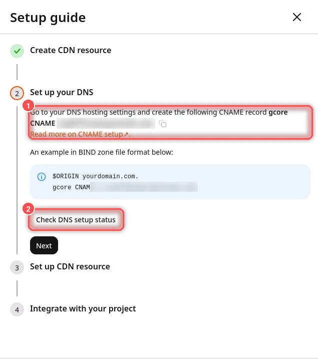
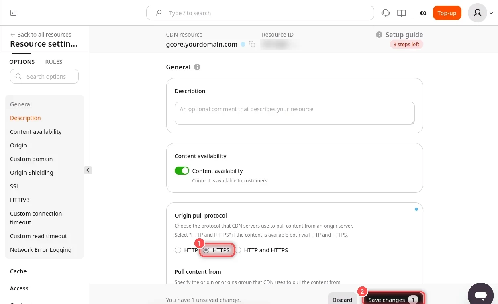
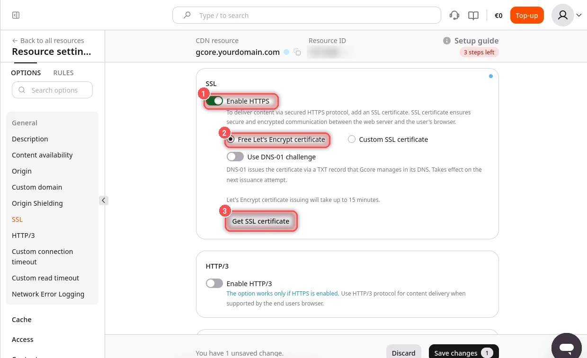
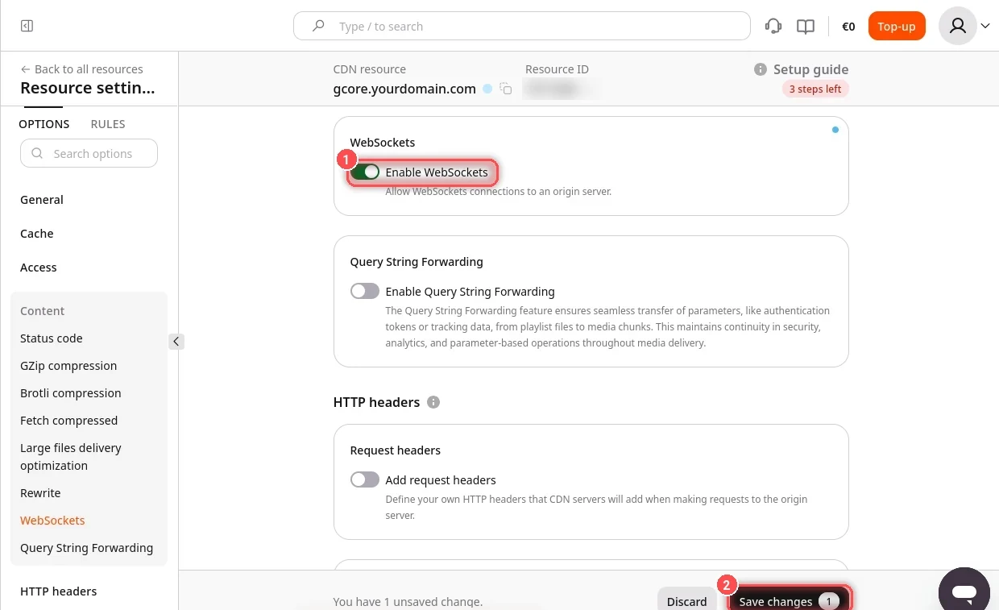
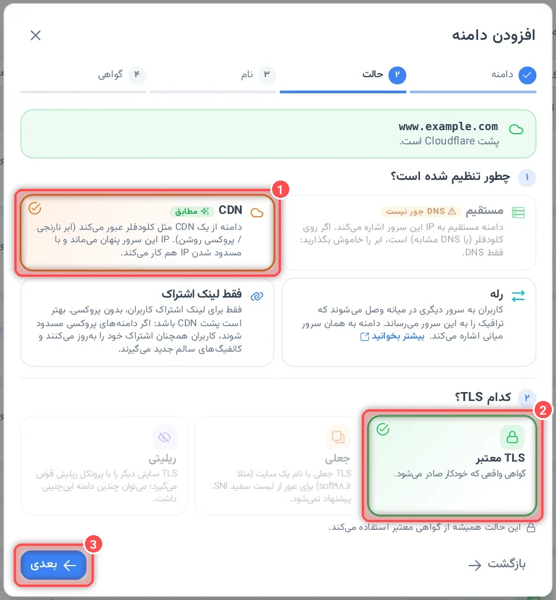

# آموزش استفاده از CDN GCore بر روی دامنه ثبت شده در Cloudflare

کلادفلر گاهی در ایران دچار اختلال می‌شود. یک جایگزین، CDN شرکت Gcore است. در این آموزش DNS دامنه شما در کلادفلر می‌ماند و فقط یک زیردامنه (مثلا `gcore.yourdomain.com`) با یک رکورد `CNAME` به Gcore سپرده می‌شود.

پیش از شروع، باید یک دامنه فعال در کلادفلر داشته باشید. [آموزش استفاده از CDN کلادفلر](/fa/manager/domain-worker-cdn-and-tunneling/How-to-use-Cloudflare-CDN/) را ببینید.

!!! info "هزینه"
    طبق [صفحه قیمت Gcore](https://gcore.com/pricing/edge-network)، پلن پرداخت به ازای مصرف (PAYG) ماهانه ۱ ترابایت ترافیک CDN رایگان دارد و بیشتر از آن هزینه دارد. قیمت‌ها ممکن است تغییر کنند؛ پیش از استفاده آن صفحه را چک کنید.

## ۱. ساخت حساب و منبع CDN در Gcore

1. در [سایت Gcore](https://gcore.com) یک حساب بسازید و وارد داشبورد شوید.
2. از منوی کناری **CDN** را باز کنید. اولین بار صفحه **Welcome to Gcore CDN** را می‌بینید؛ **Get started for free** را بزنید (کارت بانکی لازم نیست).

    

3. فرم **Set up your Edge Network resource** باز می‌شود:
    - در بخش **Domain**، روی **Use your own domain** بزنید و زیردامنه خود را بنویسید، مثلا `gcore.yourdomain.com`.
    - در بخش **Origin**، **URL / IP** را انتخاب کنید و آی‌پی سرور خود را وارد کنید.
4. **Set up your resource** را بزنید.

    

5. پیام **Edge Network resource is created!** را می‌بینید. در کادر **DNS change required** رکورد `CNAME` لازم نمایش داده می‌شود: **Host** زیردامنه شماست و **Value** مقداری شبیه `cl-xxxxxxxx.gcorecdn.com`. مقدار **Value** را کپی کنید.

    

## ۲. ساخت رکورد CNAME در کلادفلر

1. در کلادفلر دامنه را انتخاب کنید و به **DNS** > **Records** بروید و **Add record** را بزنید.
2. این‌طور پر کنید و **Save** را بزنید:
    - **Type**: `CNAME`
    - **Name**: زیردامنه، مثلا `gcore`
    - **Target**: مقداری که از Gcore کپی کردید
    - **Proxy status**: خاموش (**DNS only**، ابر خاکستری). اگر روشن باشد، ترافیک به جای Gcore از کلادفلر عبور می‌کند.

    

3. در Gcore، در بخش **Setup guide** منبع (بالای صفحه تنظیمات منبع)، **Check DNS setup status** را بزنید. وقتی پیام **DNS record has been successfully set up** را دیدید، DNS درست است. این کار ممکن است تا ۲۴ ساعت طول بکشد.

    

## ۳. تنظیمات منبع CDN در Gcore

در همان صفحه **Open resource settings** را بزنید (یا منبع را از **CDN** > **CDN resources** باز کنید) و این سه تنظیم را انجام دهید. بعد از هر تغییر **Save changes** را بزنید؛ اعمال تغییرات روی همه سرورهای Gcore حدود ۱۵ دقیقه طول می‌کشد.

1. **پروتکل اتصال به سرور**: در زبانه **OPTIONS** > **General**، در کارت **Origin pull protocol** گزینه **HTTPS** را انتخاب کنید.

    

2. **گواهی SSL**: در بخش **SSL**، **Enable HTTPS** را روشن کنید، **Free Let's Encrypt certificate** را انتخاب کنید و **Get SSL certificate** را بزنید. صدور گواهی تا ۱۵ دقیقه طول می‌کشد و فقط وقتی کار می‌کند که رکورد `CNAME` بخش ۲ درست باشد.

    

3. **WebSockets**: در بخش **Content** > **WebSockets**، **Enable WebSockets** را روشن کنید و **Save changes** را بزنید. این گزینه به طور پیش‌فرض خاموش است و بدون آن کانفیگ‌های WebSocket وصل نمی‌شوند.

    

!!! note "محافظت WAAP"
    Gcore برای منبع جدید محافظت WAAP را در حالت «فقط نظارت» (monitoring mode) روشن می‌کند. اگر بعدها آن را روی حالت مسدودکردن بگذارید، ممکن است اتصال‌های WebSocket با خطای `403` رد شوند.

## ۴. افزودن زیردامنه به هیدیفای‌منیجر

1. از منوی کناری پنل، در گروه **تنظیمات**، صفحه **دامنه‌ها** را باز کنید و **افزودن دامنه** را بزنید.
2. در مرحله **دامنه**، زیردامنه (مثلا `gcore.yourdomain.com`) را وارد کنید و **بررسی** را بزنید.
3. در مرحله **حالت**، زیر **چطور تنظیم شده است؟** گزینه **CDN** را انتخاب کنید، **TLS معتبر** را نگه دارید و **بعدی** را بزنید.

    

4. مراحل **نام** و **گواهی** را تمام کنید تا دامنه اضافه شود.

اگر **نمایش کانفیگ‌های** دامنه صفحه کاربری شما روی **همه دامنه‌ها** است، کانفیگ‌های جدید خودکار به لینک اشتراک اضافه می‌شوند. از کاربران بخواهید اشتراک خود را در برنامه به‌روزرسانی کنند.

