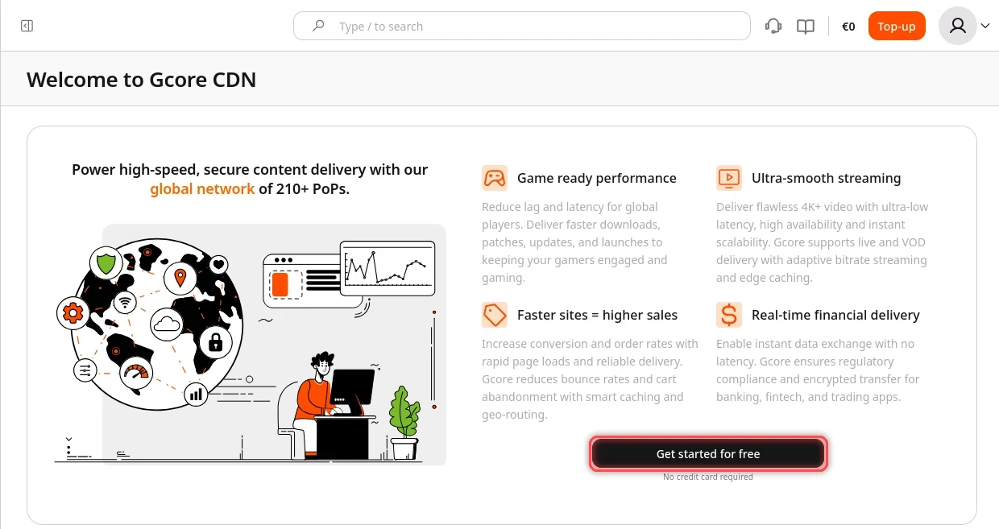
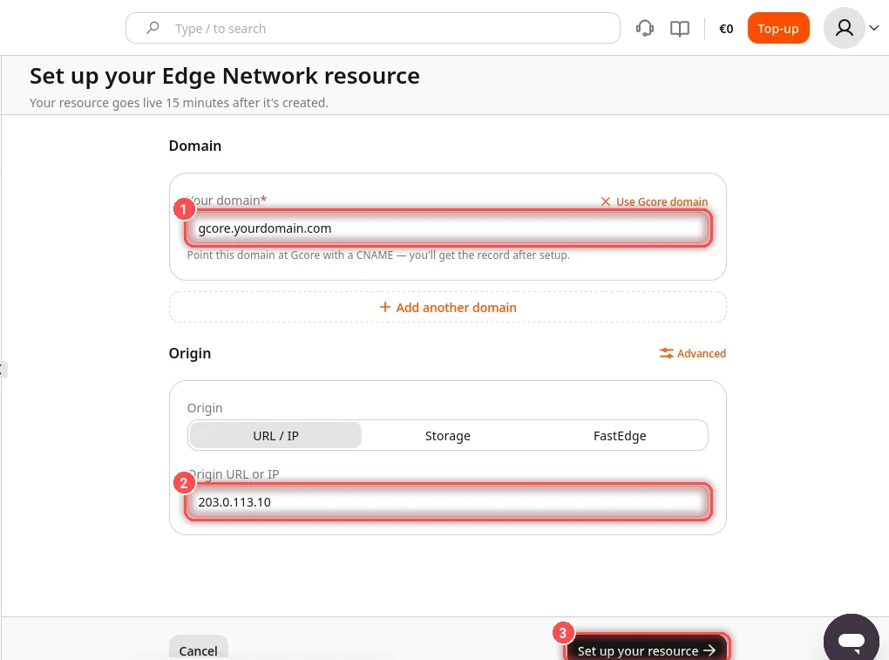
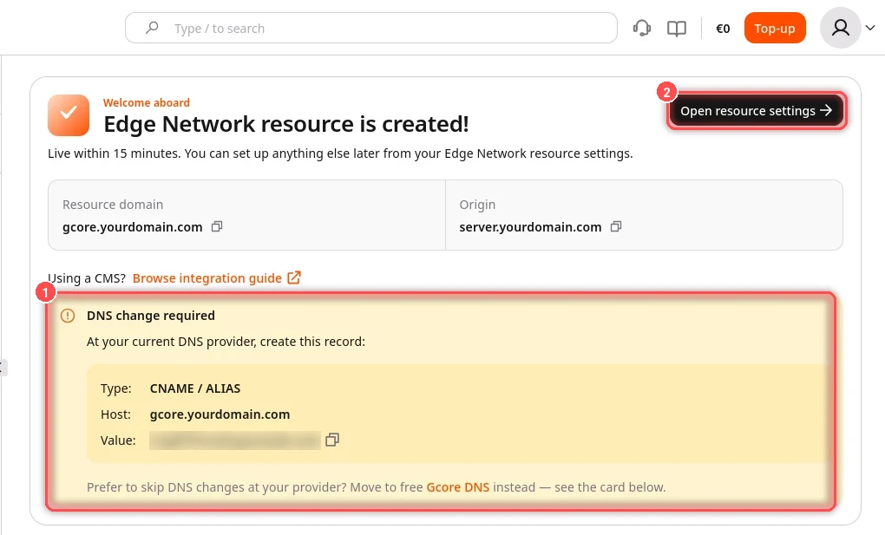
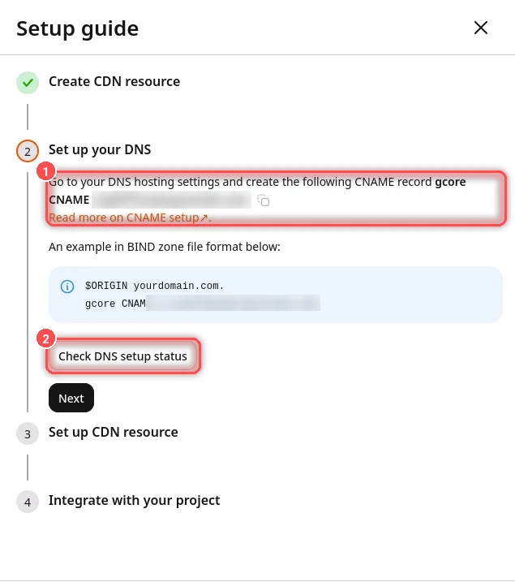
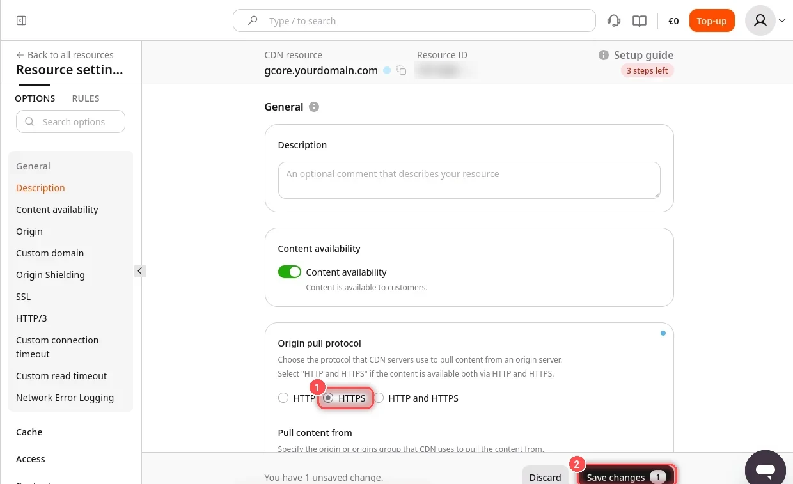
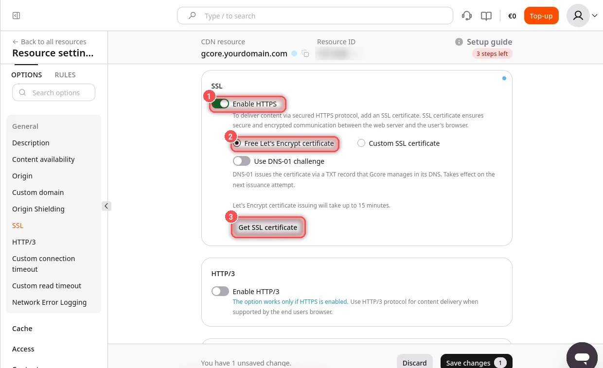
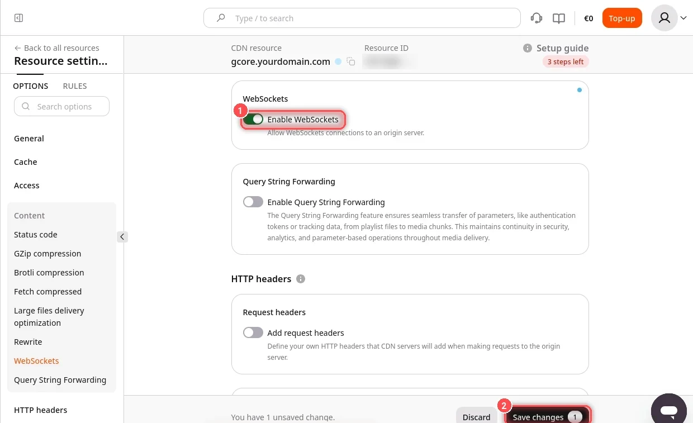
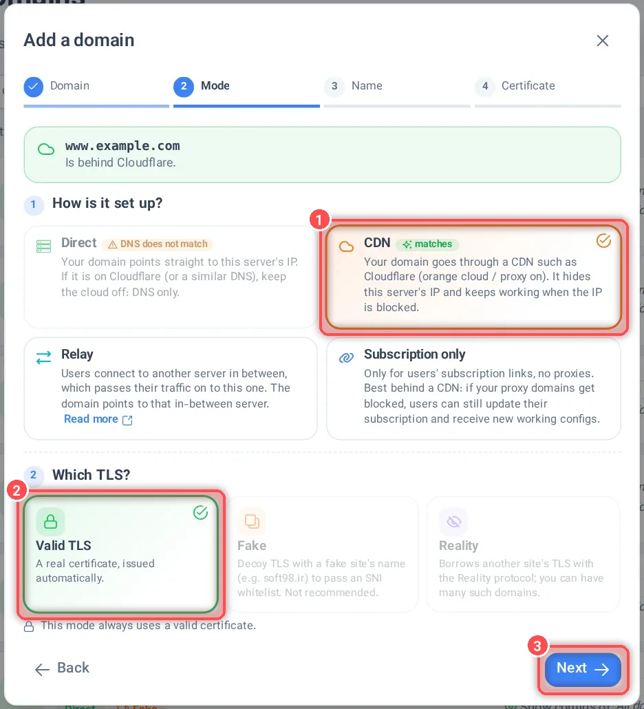

# How to use GCore CDN on Cloudflare registered domain

Cloudflare is sometimes disrupted in Iran. One alternative is Gcore's CDN. In this tutorial your domain's DNS stays on Cloudflare, and only one subdomain (for example `gcore.yourdomain.com`) is handed to Gcore with a `CNAME` record.

Before you start, you need an active domain on Cloudflare. See [How to use Cloudflare CDN](/manager/domain-worker-cdn-and-tunneling/How-to-use-Cloudflare-CDN/).

!!! info "Cost"
    According to [Gcore's pricing page](https://gcore.com/pricing/edge-network), the pay-as-you-go (PAYG) plan includes 1 TB of free CDN traffic a month; more than that is paid. Prices can change, so check that page before you start.

## 1. Make an account and a CDN resource on Gcore

1. Make an account on the [Gcore website](https://gcore.com) and open the dashboard.
2. Open **CDN** in the side menu. The first time, you see **Welcome to Gcore CDN**: click **Get started for free** (no credit card needed).

    

3. The **Set up your Edge Network resource** form opens:
    - Under **Domain**, click **Use your own domain** and type your subdomain, for example `gcore.yourdomain.com`.
    - Under **Origin**, choose **URL / IP** and enter your server's IP.
4. Click **Set up your resource**.

    

5. You see **Edge Network resource is created!**. The **DNS change required** box shows the `CNAME` record you need: **Host** is your subdomain and **Value** looks like `cl-xxxxxxxx.gcorecdn.com`. Copy the **Value**.

    

## 2. Make the CNAME record on Cloudflare

1. On Cloudflare, select the domain, go to **DNS** > **Records** and click **Add record**.
2. Fill it in like this and click **Save**:
    - **Type**: `CNAME`
    - **Name**: the subdomain, for example `gcore`
    - **Target**: the value you copied from Gcore
    - **Proxy status**: off (**DNS only**, grey cloud). If it is on, the traffic goes through Cloudflare instead of Gcore.

    

3. On Gcore, in the resource's **Setup guide** (at the top of the resource settings), click **Check DNS setup status**. When you see **DNS record has been successfully set up**, the DNS is right. This can take up to 24 hours.

    

## 3. Set up the CDN resource on Gcore

On the same page click **Open resource settings** (or open the resource from **CDN** > **CDN resources**) and set these three things. Click **Save changes** after each change; applying it on all Gcore servers takes about 15 minutes.

1. **Protocol to your server**: in the **OPTIONS** tab > **General**, under **Origin pull protocol**, choose **HTTPS**.

    

2. **SSL certificate**: in the **SSL** section, turn on **Enable HTTPS**, choose **Free Let's Encrypt certificate** and click **Get SSL certificate**. Issuing takes up to 15 minutes and only works once the `CNAME` record from step 2 is right.

    

3. **WebSockets**: in **Content** > **WebSockets**, turn on **Enable WebSockets** and click **Save changes**. It is off by default, and WebSocket configs don't connect without it.

    

!!! note "WAAP protection"
    Gcore turns on WAAP protection for a new resource in "monitoring mode". If you later switch it to blocking, WebSocket connections may be refused with a `403` error.

## 4. Add the subdomain to HiddifyManager

1. In the panel side menu, in the **Settings** group, open **Domains** and click **Add domain**.
2. In the **Domain** step, enter the subdomain (for example `gcore.yourdomain.com`) and click **Check**.
3. In the **Mode** step, under **How is it set up?**, choose **CDN**, keep **Valid TLS** and click **Next**.

    

4. Finish the **Name** and **Certificate** steps to add the domain.

If **Show configs of** on your user-page domain is set to **All domains**, the new configs are added to the subscription link by themselves. Ask your users to update the subscription in their app.

