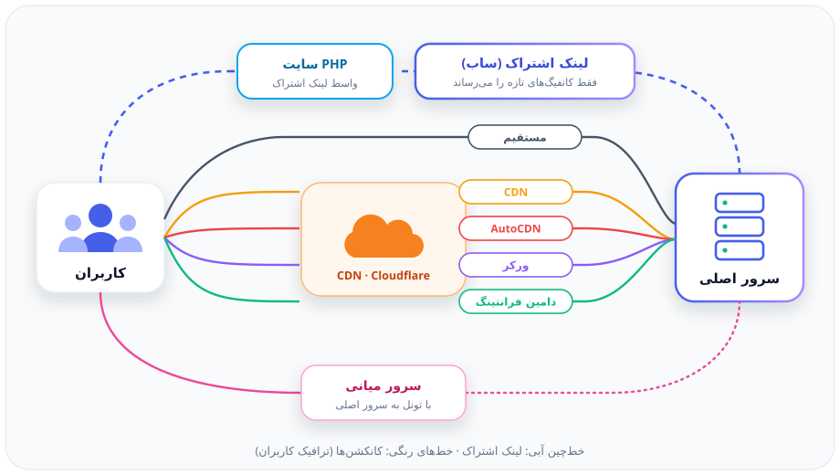
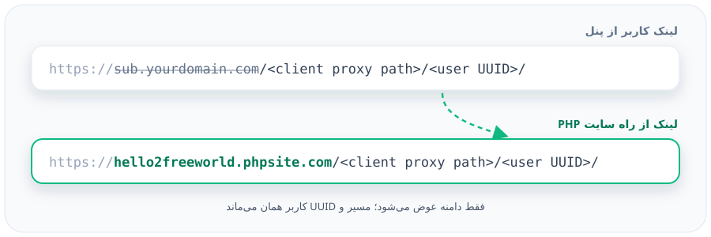

# ایجاد یک سایت PHP برای انتقال اطلاعات مربوط به لینک‌های سابسکریپشن

!!! info "بررسی‌شده برای هیدیفای‌منیجر نسخهٔ ۱۴.۵"
    فایل‌های PHP تغییری نکرده‌اند. بخش پنل (افزودن دامنهٔ PHP به‌عنوان دامنهٔ **فقط لینک اشتراک**) برای نسخهٔ ۱۴.۵ نوشته شده است.

## هدف از ایجاد سایت PHP برای لینک‌های سابسکریپشن
هیدیفای‌منیجر بر این اساس پایه‌گذاری شده است که احتمال فیلتر شدن سرور را تا جای ممکن کاهش یابد. یکی از راه‌های کاربردی در این زمینه، جدا کردن کانفیگ‌ها از لینک‌های سابسکریپشن یا اشتراک است. در این صورت همیشه کلاینت شما آخرین اطلاعات کانفیگ‌ها را از طریق لینک سابسکریپشن دریافت می‌کند. حالا فرض کنید به هر دلیل لینک سابسکریپشن در دسترس نبود، در این صورت می‌توان یک سایت PHP بالا آورد و از آن برای انتقال اطلاعات لینک‌های سابسکریپشن (و نه کانفیگ) استفاده کرد. شماتیک انجام این کار به شکل زیر است.

<div align=center markdown=1>


</div>

## مراحل انجام کار
برای ایجاد یک سایت PHP و استفاده از آن برای لینک سابسکریپشن ابتدا باید در [گوگل سرچ](https://www.google.com/search?q=free+php+hosting) کنید و سایت‌های رایگان ارائه‌دهنده سرویس PHP رایگان را پیدا کنید. 

- یکی از سایت‌ها را انتخاب کنید. 
- در آن اکانت خود را ایجاد کنید. 
- سپس یک سرویس میزبانی PHP را در آن ایجاد کنید. این کار در سایت‌های مختلف مراحل مشابهی دارد و تقریبا ساده است. برای ایجاد این سرویس می‌بایست یک آدرس منحصر به فرد روی یکی از دامنه‌های آن ارائه‌دهنده بسازید. 
- بعد از آن سرویس شما ایجاد می‌گردد. 
- بعد از ایجاد سرویس، روی فایل‌های آن ویرایش بزنید و دو فایل زیر را در مسیر اصلی سرویس خود قرار دهید. 

> - نکته: اگر هر کدام از فایل‌های `htaccess.` و `index.php` را مشاهده نمی‌کنید، باید این فایل‌ها را به صورت دستی ایجاد کنید.

> - دقت شود که فایل `htaccess.` یک نقطه قبل از اسم آن دارد و اگر آن را ایجاد می‌نمایید، این نکته را در نظر بگیرید.

**کد برای فایل `htaccess.`**

```apache
RewriteEngine On
RewriteRule ^(.*)$ index.php?url=$1 [L]
```

**کد برای فایل `index.php`**

```php
<?php

if (!isset($_SERVER['HTTPS']) || $_SERVER['HTTPS'] !== 'on') {
    http_response_code(403);
    exit('Access Forbidden - HTTPS is required.');
}

$server_domain = "https://sub.yourdomain.com";

$domain = $_SERVER['HTTP_HOST'];
$ip = $_SERVER['HTTP_CF_CONNECTING_IP'] ?? $_SERVER['HTTP_X_FORWARDED_FOR'] ?? $_SERVER['REMOTE_ADDR'];
$url = $server_domain . $_SERVER['REQUEST_URI'];
$userAgent = $_SERVER['HTTP_USER_AGENT'];

$ch = curl_init();
curl_setopt_array($ch, [
    CURLOPT_URL => $url,
    CURLOPT_RETURNTRANSFER => true,
    CURLOPT_SSL_VERIFYPEER => false,
    CURLOPT_SSL_VERIFYHOST => 2,
    CURLOPT_HEADERFUNCTION => function($curl, $header) {
        header($header);
        return strlen($header);
    },
]);

$headers = [
    "CF-Connecting-IP: $ip",
    "Host: $domain",
    "User-Agent: $userAgent",
];
foreach ($_SERVER as $key => $value) {
    if (strpos($key, 'HTTP_') === 0) {
        $header = str_replace('_', '-', substr($key, 5));
        $headers[] = "$header: $value";
    }
}
curl_setopt($ch, CURLOPT_HTTPHEADER, $headers);

$response = curl_exec($ch);
if (curl_errno($ch)) {
    http_response_code(500);
    exit('Internal Server Error');
}

curl_close($ch);
echo $response;

?>

```

دقت شود:
>  در کد PHP بالا، `https://sub.yourdomain.com` را با یکی از دامنه‌های **سرور خودتان** در پنل (مثلاً دامنهٔ فقط لینک اشتراک یا دامنهٔ CDN) عوض کنید.

> در تنظیمات سایت PHP، ورژن PHP بر روی 8 به بالا باشد.

> گزینه CURL در تنظیمات PHP هاست شما روشن باشد.


- سپس تنظیمات را ذخیره کنید. 
-  در این مرحله اگر تنظیمات ssl برای دامنه خود در این ارائه‌دهنده PHP را چک کنید؛ احتمالا متوجه خواهید شد که مقداری زمان می‌گیرد تا سرتیفیکت به آن تخصیص داده شود. 
## افزودن آدرس PHP به پنل { #add-the-php-address-to-the-panel }

سایت PHP هر درخواست را با نام خودش (`Host`) به سرور شما می‌فرستد، پس پنل باید این نام را بشناسد:

1. در پنل **دامنه‌ها** › **افزودن دامنه** را باز کنید، آدرس سایت PHP (مثلاً `hello2freeworld.phpsite.com`) را بنویسید و **فقط لینک اشتراک** (Subscription only) را انتخاب کنید.
2. در **نمایش کانفیگ‌های**، دامنه‌هایی را انتخاب کنید که کاربران باید کانفیگ آن‌ها را بگیرند (دامنه‌های مستقیم یا CDN شما).
3. ویزارد را تمام کنید و در صفحهٔ **اقدامات** روی **الان اعمال کن** بزنید. پنل برای این نام گواهی نمی‌گیرد، چون این نام به سرور شما اشاره نمی‌کند؛ این طبیعی است، چون میزبان PHP گواهی خودش را دارد.

[دامنه فقط لینک اشتراک](/fa/manager/configuration-and-advanced-settings/How-to-configure-Hiddify-panel-properly/#subscription-only-domain) را ببینید.

## استفاده { #use-it }

لینک سابسکریپشن (یا لینک صفحهٔ کاربر) یک کاربر را از پنل بردارید و دامنه‌اش را با آدرس سایت PHP عوض کنید.

<div align=center markdown=1>



</div>

برای نمونه: اگر آدرس PHP این باشد:

<div dir="ltr" markdown="1">

`https://hello2freeworld.phpsite.com`
</div>

و لینک کاربر این باشد:

<div dir="ltr" markdown="1">

`https://sub.yourdomain.com/<client proxy path>/<user UUID>/`
</div>

لینک از طریق سایت PHP این می‌شود:

<div dir="ltr" markdown="1">

`https://hello2freeworld.phpsite.com/<client proxy path>/<user UUID>/`
</div>

برای تست آن را در مرورگر باز کنید: باید صفحهٔ کاربر را ببینید. بعد آن را به‌عنوان لینک سابسکریپشن به اپ کاربر اضافه کنید.

> نکتهٔ خیلی مهم: اگر میزبان PHP هنوز برای آدرس شما گواهی صادر نکرده باشد، آدرس با https باز نمی‌شود. برای تست می‌توانید از http استفاده کنید، اما به کاربران فقط آدرس https را بدهید؛ پس منتظر صدور گواهی بمانید.

کار تمام است. حالا کاربران یک آدرس سابسکریپشن دارند که مال سرور شما نیست، پس فیلتر کردنش خیلی سخت‌تر است.

## مقاله‌های مرتبط

- [ساخت لینک سابسکریپشن](/fa/manager/domain-worker-cdn-and-tunneling/How-to-create-subscription-link-on-Hiddify/)
- [انواع دامنه و ثبت آن‌ها](/fa/manager/domain-worker-cdn-and-tunneling/Domain-types-and-how-to-register-them/)
- [دامنهٔ فیک](/fa/manager/domain-worker-cdn-and-tunneling/How-to-create-and-use-fake-domain/)
- [زیردامنه‌های متغیر (wildcard)](/fa/manager/domain-worker-cdn-and-tunneling/Tutorial-for-using-wildcard-subdomains-on-Hiddify/)
