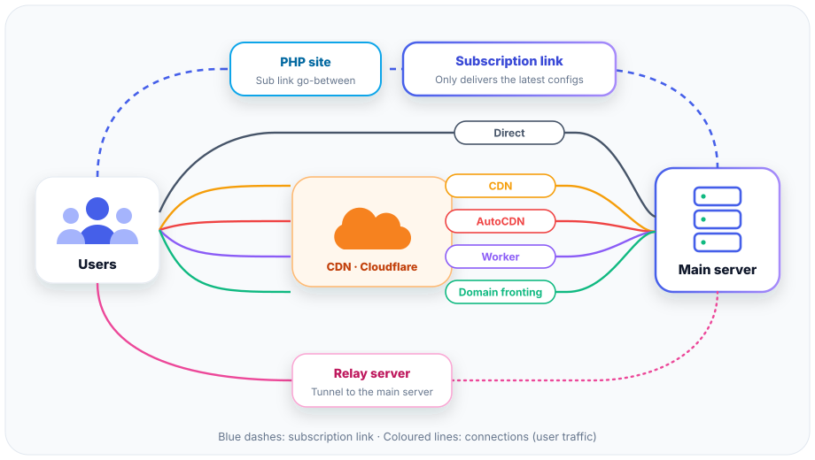
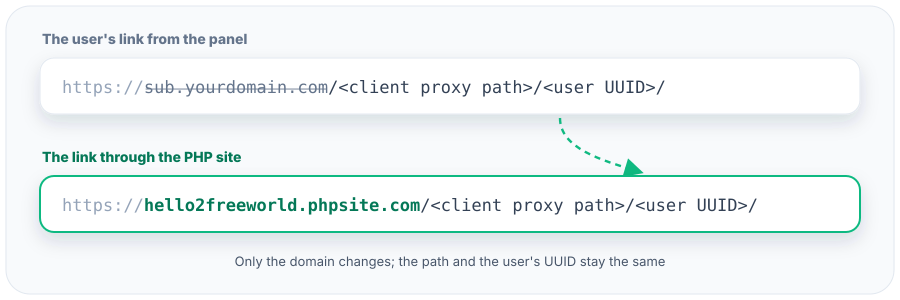

# Create a PHP site to transfer information of subscription links

!!! info "Checked for Hiddify Manager v14.5"
    The PHP files are unchanged. The panel part (adding the PHP domain as a **Subscription only** domain) is written for v14.5.

## The purpose of creating a PHP site for subscription links
HiddifyManager is based on the principle of reducing the possibility of server filtering as much as possible. One of the practical ways in this field is to separate configurations from subscription links. In this case, your client will always receive the latest configuration information through the subscription link. Now suppose the subscription link was not available for any reason, in this case a PHP site can be brought up and used to transfer the subscription link information (and not the config). The schematic for doing this is as follows.

<div align=center markdown=1>
  

</div>

## Steps to do the work
To create a PHP site and use it for the subscription link, you must first do a [Google search](https://www.google.com/search?q=free+php+hosting) and find free sites that provide free PHP service. find.

- Choose one of the sites.
- Create your account there.
- Then create a PHP hosting service in it. This work has similar steps in different sites and is almost simple. To create this service, you must create a unique address on one of the domains of that provider.
- After that, your service will be created.
- After creating the service, edit its files and place the following two files in the main path of your service.

> - Note: If you don't see any `.htaccess` and `index.php` files, you need to create these files manually.

> - Make sure that `.htaccess` file has a dot before its name and if you create it, consider this point.

**Code for `.htaccess` file**

```apache
RewriteEngine On
RewriteRule ^(.*)$ index.php?url=$1 [L]
```

**Code for `index.php` file**

```php
<?php

if (!isset($_SERVER['HTTPS']) || $_SERVER['HTTPS'] !== 'on') {
     http_response_code(403);
     exit('Access Forbidden - HTTPS is required.');
}

$server_domain = "https://sub.yourdomain.com";

$domain = $_SERVER['HTTP_HOST'];
$ip = $_SERVER['HTTP_CF_CONNECTING_IP'] ?? $_SERVER['HTTP_X_FORWARDED_FOR'] ?? $_SERVER['REMOTE_ADDR'];
$url = $server_domain . $_SERVER['REQUEST_URI'];
$userAgent = $_SERVER['HTTP_USER_AGENT'];

$ch = curl_init();
curl_setopt_array($ch, [
     CURLOPT_URL => $url,
     CURLOPT_RETURNTRANSFER => true,
     CURLOPT_SSL_VERIFYPEER => false,
     CURLOPT_SSL_VERIFYHOST => 2,
     CURLOPT_HEADERFUNCTION => function($curl, $header) {
         header($header);
         return strlen($header);
     },
]);

$headers = [
     "CF-Connecting-IP: $ip",
     "Host: $domain",
     "User-Agent: $userAgent",
];
foreach ($_SERVER as $key => $value) {
     if (strpos($key, 'HTTP_') === 0) {
         $header = str_replace('_', '-', substr($key, 5));
         $headers[] = "$header: $value";
     }
}
curl_setopt($ch, CURLOPT_HTTPHEADER, $headers);

$response = curl_exec($ch);
if (curl_errno($ch)) {
     http_response_code(500);
     exit('Internal Server Error');
}

curl_close($ch);
echo $response;

?>

```

Be careful:
> Replace `https://sub.yourdomain.com` with one of **your server's** domains in the panel (for example your subscription-only or CDN domain).

> In the PHP site settings, the PHP version should be 8 or higher.

> The CURL option should be turned on in the PHP settings of your host.


- Then save the settings.
- At this point, if you check the ssl settings for your domain in this PHP provider; You will probably notice that it takes some time for the certificate to be assigned.
## Add the PHP address to the panel

The PHP site sends each request to your server with the PHP site's own name (the `Host`), so the panel must know that name:

1. In the panel, open **Domains** › **Add domain**, type the PHP site's address (for example `hello2freeworld.phpsite.com`) and choose **Subscription only**.
2. In **Show configs of**, pick the domains whose configs your users should get (your direct or CDN domains).
3. Finish the wizard and click **Apply now** on the **Actions** page. The panel cannot get a certificate for this name, because it does not point to your server; that is expected: the PHP host has its own certificate.

See [Subscription-only domain](/manager/configuration-and-advanced-settings/How-to-configure-Hiddify-panel-properly/#subscription-only-domain).

## Use it

Take a user's subscription link (or user page link) from the panel and replace the domain with the PHP site's address.

<div align=center markdown=1>



</div>

For example, if the PHP address is

`https://hello2freeworld.phpsite.com`

and the user's link is

`https://sub.yourdomain.com/<client proxy path>/<user UUID>/`

the link through the PHP site is

`https://hello2freeworld.phpsite.com/<client proxy path>/<user UUID>/`

Open it in a browser to test: you should see the user's page. Then add it to the user's app as their subscription link.

> **Very important note:** if the PHP host has not issued the certificate for your address yet, the address does not open with https. You can test with http, but give users only the https address, so wait for the certificate.

The work is done. Now the users have a subscription address that is not your server's, so it is much harder to filter.

## Related articles

- [Create a subscription link](/manager/domain-worker-cdn-and-tunneling/How-to-create-subscription-link-on-Hiddify/)
- [Domain types and how to add them](/manager/domain-worker-cdn-and-tunneling/Domain-types-and-how-to-register-them/)
- [Fake domain](/manager/domain-worker-cdn-and-tunneling/How-to-create-and-use-fake-domain/)
- [Wildcard subdomains](/manager/domain-worker-cdn-and-tunneling/Tutorial-for-using-wildcard-subdomains-on-Hiddify/)
