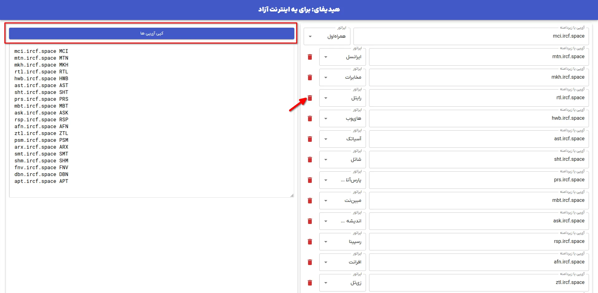

# قرار دادن آی‌پی‌های تمیز دلخواه بر اساس فرمت مشخص (برای فیلد اجبار)

!!! info "نوشته‌شده برای هیدیفای‌منیجر نسخهٔ ۱۴.۵"
    فیلدی که این صفحه درباره‌اش است حالا **اجبار به استفاده از این IPها یا دامنه‌ها** نام دارد و در تنظیمات هر دامنهٔ **CDN** است (**دامنه‌ها** › مداد › **پیشرفته**).

آی‌پی تمیزی که روی یک اپراتور کار می‌کند، اغلب روی اپراتور دیگر کار نمی‌کند. با فیلد **اجبار به استفاده از این IPها یا دامنه‌ها** در دامنهٔ CDN، برای هر اپراتور یک آی‌پی تمیز (یا نام هاست) به پنل می‌دهید و هر کاربر در کانفیگ‌هایش آدرس اپراتور **خودش** را می‌گیرد. این همان چیزی است که قبلاً AutoCDN نامیده می‌شد.

## فرمت

در هر خط یک مورد بنویسید (یا با ویرگول جدا کنید):

- یک **آی‌پی**، یک **رنج** (CIDR، مثل `104.16.0.0/24`) یا یک **نام هاست**،
- بعد یک فاصله و **کد اپراتور**.

```
1.1.1.1 MCI
mtn.yourdomain.com MTN
104.16.0.0/24 RTL
8.8.8.8 OTHER
```

چند کد: `MCI` همراه اول، `MTN` ایرانسل، `RTL` رایتل، `MKH` مخابرات، `HWB` های‌وب، `SHT` شاتل، `AST` آسیاتک، `PRS` پارس‌آنلاین. برای اپراتوری که کد ندارد، شمارهٔ AS آن را بنویسید (مثلاً `AS12345`). `OTHER`، یا آدرسی که کد ندارد، برای همهٔ اپراتورهای دیگر است. اگر فقط آدرس بنویسید و کد نگذارید، همهٔ کاربران همان را می‌گیرند.

پنل اپراتور کاربر را از روی آی‌پی‌ای تشخیص می‌دهد که کاربر با آن سابسکریپشن را به‌روز می‌کند. پس کاربران باید سابسکریپشن را با VPN **خاموش** به‌روز کنند، و بعد از عوض کردن اپراتور (مثلاً از وای‌فای به اینترنت همراه) دوباره به‌روزش کنند.

## آدرس‌ها را از کجا بیاوریم

- **اسکنر خود پنل (ساده‌ترین راه):** زیر همین فیلد، **باز کردن اسکنر** صفحهٔ **ابزارها** › **اسکنر** را باز می‌کند. اسکنر آی‌پی‌های کلادفلر را روی اینترنت خود شما تست می‌کند و بهترین‌ها را با کد اپراتور در همین فیلد ذخیره می‌کند. [ابزارهای پنل](/fa/manager/configuration-and-advanced-settings/How-to-use-the-panel-tools-in-HiddifyManager/) را ببینید.
- **رکوردهای DNS خودتان:** برای هر اپراتور یک رکورد بسازید (پروکسی **خاموش**، فقط DNS) که به یک آی‌پی تمیز اشاره کند، مثلاً `mci.yourdomain.com`. وقتی آی‌پی‌ای مسدود شد، فقط رکورد DNS را عوض می‌کنید و پنل و کانفیگ کاربران همان می‌مانند.
- **فهرست‌های آماده:** نام‌های هاستی که `ircf.space` به‌روز نگه می‌دارد (`mci.ircf.space MCI`، `mtn.ircf.space MTN` و …). فهرست کامل در [آموزش استفاده از دامنه AutoCDN](/fa/manager/domain-worker-cdn-and-tunneling/Guide-for-using-mode-Auto_CDN_IP-on-Hiddify/) آمده است.
- **ابزار ip-format:** [ip-format.hiddify.com](https://ip-format.hiddify.com/) متن را برایتان می‌سازد: اپراتورهایی را که لازم ندارید حذف کنید، اگر آدرس دیگری برایتان بهتر کار می‌کند عوضش کنید، آی‌پی‌های خودتان را با تگ اپراتور اضافه کنید و روی **کپی آی‌پی‌ها** بزنید.

<div align=center>


</div>

## گذاشتن در پنل

1. **دامنه‌ها** را باز کنید و روی مداد کنار دامنهٔ **CDN** خود بزنید.
2. **پیشرفته** را باز کنید و متن را در **اجبار به استفاده از این IPها یا دامنه‌ها** بچسبانید.
3. ذخیره کنید و بعد در صفحهٔ **اقدامات** روی **الان اعمال کن** بزنید.

برای پیدا کردن دستی آی‌پی تمیز، [آی‌پی تمیز کلادفلر چیست و چگونه آن را پیدا کنیم](/fa/manager/domain-worker-cdn-and-tunneling/Guide-for-finding-a-clean-Cloudflare-IP/) را ببینید. برای دادن دامنه‌های CDN جداگانه به گروه‌های مختلف کاربران، [مدیریت بهتر چند دامنه CDN](/fa/manager/domain-worker-cdn-and-tunneling/How-to-use-multiCDN-domains-in-HiddifyManager/) را ببینید.

## مقاله‌های مرتبط

- [پیدا کردن آی‌پی تمیز کلادفلر](/fa/manager/domain-worker-cdn-and-tunneling/Guide-for-finding-a-clean-Cloudflare-IP/)
- [انواع دامنه و ثبت آن‌ها](/fa/manager/domain-worker-cdn-and-tunneling/Domain-types-and-how-to-register-them/)
- [دامنهٔ فیک](/fa/manager/domain-worker-cdn-and-tunneling/How-to-create-and-use-fake-domain/)
- [زیردامنه‌های متغیر (wildcard)](/fa/manager/domain-worker-cdn-and-tunneling/Tutorial-for-using-wildcard-subdomains-on-Hiddify/)
