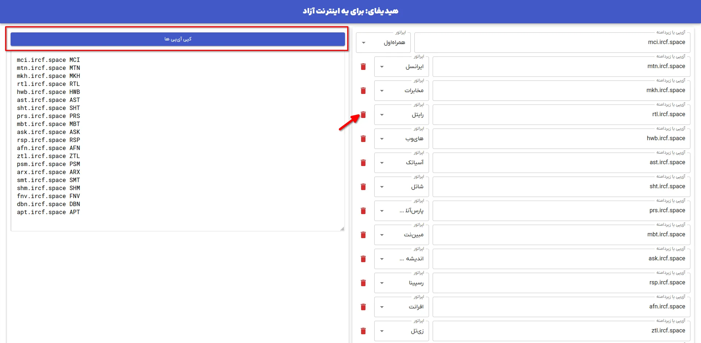

# How to use desired clean IPs based on the specified format (for the forced to use host field)

!!! info "Written for Hiddify Manager v14.5"
    The field this page is about is now called **Force configs to use these IPs / domains**. It is in the settings of each **CDN** domain (**Domains** › pencil › **Advanced**).

A clean IP that works on one operator often does not work on another. With the **Force configs to use these IPs / domains** field of a CDN domain, you give the panel a clean IP (or host name) per operator, and each user gets, in their configs, the address for **their own** operator. This is what used to be called AutoCDN.

## The format

Write one entry per line (or separate them with commas):

- an **IP**, a **range** (CIDR, such as `104.16.0.0/24`) or a **host name**,
- then a space and the **operator code**.

```
1.1.1.1 MCI
mtn.yourdomain.com MTN
104.16.0.0/24 RTL
8.8.8.8 OTHER
```

Some codes: `MCI` Hamrah Aval, `MTN` Irancell, `RTL` RighTel, `MKH` Mokhaberat (TCI), `HWB` HiWeb, `SHT` Shatel, `AST` Asiatech, `PRS` ParsOnline. For an operator without a code, use its AS number (for example `AS12345`). `OTHER`, or an address with no code, is for every other operator. If you write only addresses without codes, every user gets them.

The panel finds a user's operator from the IP they update their subscription from. So users should update the subscription with the VPN **off**, and again after they change operator (for example from Wi-Fi to mobile data).

## Where the addresses come from

- **The panel's scanner (easiest):** under the field, **Open the scanner** opens **Tools** › **Scanner**. It scans Cloudflare IPs on your own internet and saves the best ones in this field, with the operator code. See [the panel tools](/manager/configuration-and-advanced-settings/How-to-use-the-panel-tools-in-HiddifyManager/).
- **Your own DNS records:** make a record per operator (proxy **off**, DNS only) that points to a clean IP, for example `mci.yourdomain.com`. When an IP gets blocked, you only change the DNS record; the panel and the users' configs stay the same.
- **Ready lists:** the host names kept up to date by `ircf.space` (`mci.ircf.space MCI`, `mtn.ircf.space MTN` …). The full list is in [How to use AutoCDN IP domain](/manager/domain-worker-cdn-and-tunneling/Guide-for-using-mode-Auto_CDN_IP-on-Hiddify/#force-configs-to-use-these-ips-domains).
- **The ip-format tool:** [ip-format.hiddify.com](https://ip-format.hiddify.com/) builds the text for you: delete the operators you don't need, change an address if another one works better for you, add your own IPs with the operator's tag, and click **Copy IPs**.

<div align=center>


</div>

## Put it in the panel

1. Open **Domains** and click the pencil next to your **CDN** domain.
2. Open **Advanced** and paste the text into **Force configs to use these IPs / domains**.
3. Save, then click **Apply now** on the **Actions** page.

To find clean IPs by hand, see [Guide for finding a clean Cloudflare IP](/manager/domain-worker-cdn-and-tunneling/Guide-for-finding-a-clean-Cloudflare-IP/). To give groups of users their own CDN domains, see [How to manage multiple CDN domains](/manager/domain-worker-cdn-and-tunneling/How-to-use-multiCDN-domains-in-HiddifyManager/).

## Related articles

- [Find a clean Cloudflare IP](/manager/domain-worker-cdn-and-tunneling/Guide-for-finding-a-clean-Cloudflare-IP/)
- [Domain types and how to add them](/manager/domain-worker-cdn-and-tunneling/Domain-types-and-how-to-register-them/)
- [Fake domain](/manager/domain-worker-cdn-and-tunneling/How-to-create-and-use-fake-domain/)
- [Wildcard subdomains](/manager/domain-worker-cdn-and-tunneling/Tutorial-for-using-wildcard-subdomains-on-Hiddify/)
