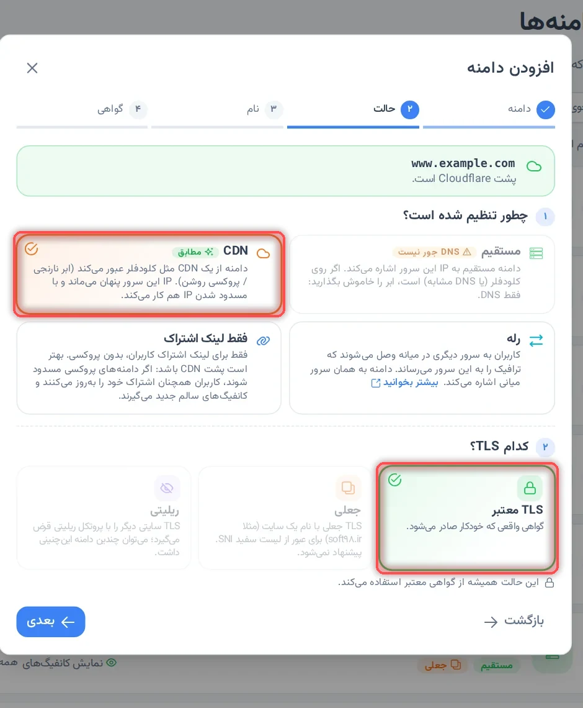
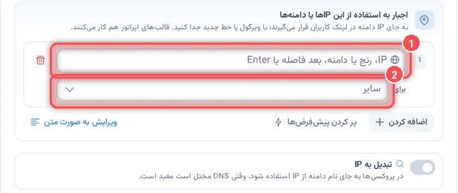
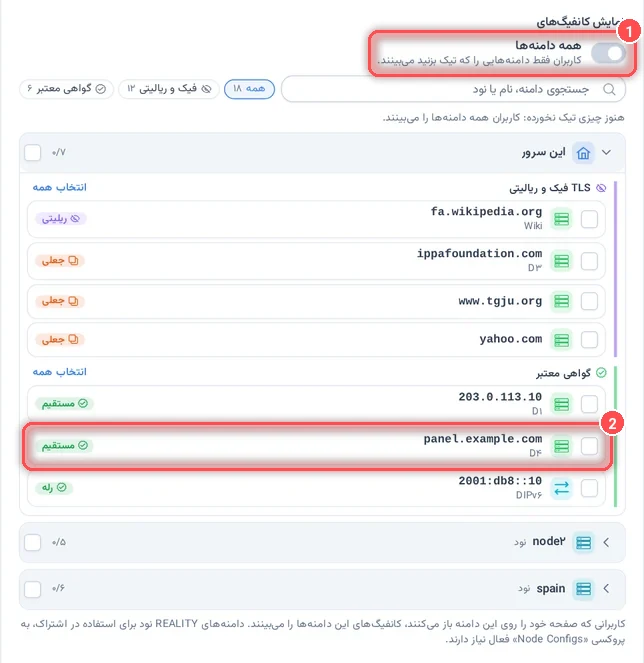

# آموزش استفاده از دامنه ورکر کلادفلر در هیدیفای‌منیجر

ورکر کلادفلر (Cloudflare Worker) درخواست‌های کاربران را از شبکه کلادفلر به سرور شما می‌رساند. این‌طور IP سرور پنهان می‌ماند و اگر IP مسدود شود، اتصال همچنان کار می‌کند.

## چه چیزی تغییر کرده است؟

در نسخه‌های قدیمی پنل، حالتی به نام **ورکر کلادفلر** وجود داشت. در این حالت پنل با کلید API کلادفلر، ورکر را خودکار در حساب شما می‌ساخت.

در پنل جدید هیدیفای‌منیجر (Admin V2) این حالت دیگر برای دامنه‌های جدید نمایش داده نمی‌شود:

- **دامنه‌های ورکری که از قبل اضافه کرده‌اید** همچنان کار می‌کنند و در پنجره ویرایش آن‌ها، حالت ورکر نمایش داده می‌شود.
- **برای یک ورکر جدید**، ورکر را خودتان در کلادفلر بسازید و دامنه آن را با حالت **CDN** به پنل اضافه کنید. مراحل در ادامه آمده است.

## ۱. ساخت ورکر در کلادفلر

ورکر را طبق [آموزش تنظیم و استفاده از ورکر (روش دستی)](/fa/manager/domain-worker-cdn-and-tunneling/How-to-set-up-and-use-Cloudflare-workers/) بسازید. در پایان آن، یک آدرس برای ورکر دارید؛ یا آدرس `workers.dev` یا یک دامنه سفارشی (Custom Domain) روی دامنه خودتان در کلادفلر.

## ۲. افزودن دامنه ورکر به پنل

1. از منوی کناری، در گروه **تنظیمات**، صفحه **دامنه‌ها** را باز کنید و **افزودن دامنه** را بزنید.
2. در مرحله **دامنه**، آدرس ورکر را بدون `https://` وارد کنید و **بررسی** را بزنید.
3. در مرحله **حالت**، زیر **چطور تنظیم شده است؟** گزینه **CDN** را انتخاب کنید. وقتی دامنه پشت کلادفلر است، پنل کنار CDN برچسب **مطابق** را نشان می‌دهد. حالت CDN همیشه از گواهی معتبر استفاده می‌کند. **بعدی** را بزنید.

    

4. در مرحله **نام**، اگر می‌خواهید یک نام کوتاه برای نمایش در برنامه کاربران وارد کنید (مثلا `Worker`).
5. مرحله **گواهی** را تمام کنید تا دامنه اضافه شود.

## ۳. آی‌پی‌های تمیز (اختیاری)

اگر می‌خواهید کانفیگ‌ها به جای آی‌پی‌های پیش‌فرض کلادفلر، به آی‌پی‌های تمیز وصل شوند:

1. در صفحه **دامنه‌ها**، روی آیکون مداد کنار دامنه ورکر بزنید و بخش **پیشرفته** را باز کنید.
2. در کارت **اجبار به استفاده از این IPها یا دامنه‌ها**، آی‌پی‌های تمیز کلادفلر را وارد کنید. با گزینه **برای** می‌توانید برای هر اپراتور آی‌پی جداگانه بگذارید.
3. **ذخیره** را بزنید.

    

برای فرمت ورود آی‌پی‌ها [این مطلب](/fa/manager/domain-worker-cdn-and-tunneling/How-to-use-desired-clean-IPs-based-on-a-specific-format/) را ببینید.

## ۴. آوردن کانفیگ‌های ورکر به لینک اشتراک

تنظیم **نمایش کانفیگ‌های** دامنه‌ای که کاربران صفحه کاربری را با آن باز می‌کنند، مشخص می‌کند کانفیگ‌های کدام دامنه‌ها در لینک اشتراک باشد.

- اگر **همه دامنه‌ها** روشن باشد (پیش‌فرض)، کانفیگ‌های دامنه ورکر خودکار اضافه می‌شوند و کار دیگری لازم نیست.
- اگر فقط دامنه‌های مشخصی را نشان می‌دهید، آن دامنه را ویرایش کنید، در بخش **نمایش کانفیگ‌های** دامنه ورکر را تیک بزنید و **ذخیره** را بزنید.

در آخر از کاربران بخواهید لینک اشتراک را در برنامه خود به‌روزرسانی کنند.

!!! note "محدودیت پلن رایگان"
    ورکر در پلن رایگان کلادفلر روزانه ۱۰۰ هزار درخواست را پردازش می‌کند. برای سرورهایی با کاربران زیاد این مقدار کافی نیست.

## مقاله‌های مرتبط

- [ساخت ورکر به روش دستی](/fa/manager/domain-worker-cdn-and-tunneling/How-to-set-up-and-use-Cloudflare-workers/)
- [انواع دامنه و ثبت آن‌ها](/fa/manager/domain-worker-cdn-and-tunneling/Domain-types-and-how-to-register-them/)
- [دامنهٔ فیک](/fa/manager/domain-worker-cdn-and-tunneling/How-to-create-and-use-fake-domain/)
- [زیردامنه‌های متغیر (wildcard)](/fa/manager/domain-worker-cdn-and-tunneling/Tutorial-for-using-wildcard-subdomains-on-Hiddify/)

