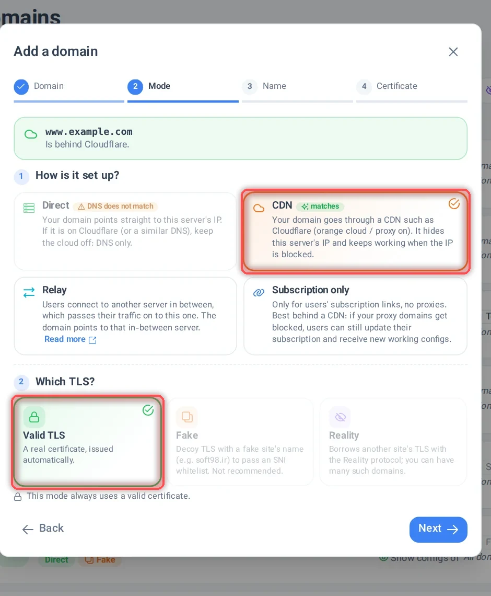
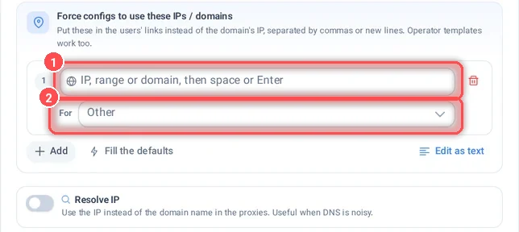
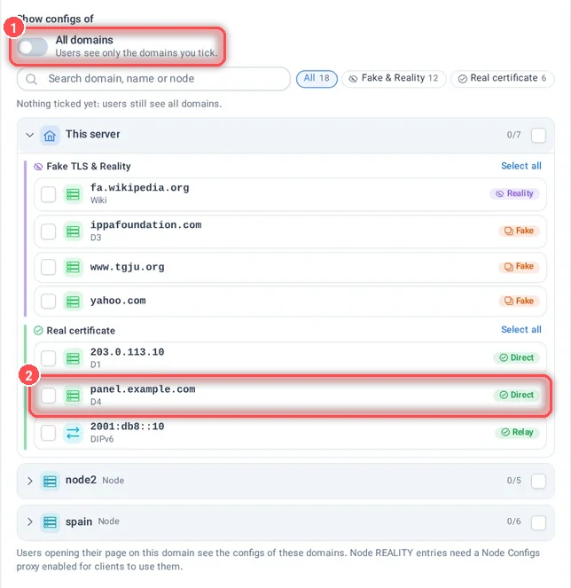

# How to use Cloudflare worker domain on HiddifyManager

A Cloudflare Worker passes your users' requests from Cloudflare's network to your server. This hides your server's IP, and connections keep working when the IP is blocked.

## What has changed?

Older panel versions had a **Cloudflare Worker** domain mode. With your Cloudflare API key, the panel made the worker in your Cloudflare account by itself.

The new HiddifyManager panel (Admin V2) no longer offers this mode for new domains:

- **Worker domains you added before** keep working, and their edit window still shows the worker mode.
- **For a new worker**, make the worker yourself in Cloudflare and add its domain to the panel in **CDN** mode. The steps are below.

## 1. Make the worker in Cloudflare

Make the worker with [How to set up and use Cloudflare Workers (manual way)](/manager/domain-worker-cdn-and-tunneling/How-to-set-up-and-use-Cloudflare-workers/). At the end you have an address for the worker: either its `workers.dev` address, or a Custom Domain on your own domain in Cloudflare.

## 2. Add the worker domain to the panel

1. In the side menu, in the **Settings** group, open **Domains** and click **Add domain**.
2. In the **Domain** step, enter the worker's address without `https://` and click **Check**.
3. In the **Mode** step, under **How is it set up?** choose **CDN**. When the domain is behind Cloudflare, the panel shows a **matches** badge next to CDN. CDN mode always uses a valid certificate. Click **Next**.

    

4. In the **Name** step, you can enter a short name to show in the users' apps (for example `Worker`).
5. Finish the **Certificate** step to add the domain.

## 3. Clean IPs (optional)

To make the configs connect to clean IPs instead of Cloudflare's default IPs:

1. On the **Domains** page, click the pencil icon next to the worker domain and open **Advanced**.
2. In the **Force configs to use these IPs / domains** card, enter your clean Cloudflare IPs. With **For** you can set separate IPs for each operator.
3. Click **Save**.

    

For the format of the IPs, see [this article](/manager/domain-worker-cdn-and-tunneling/How-to-use-desired-clean-IPs-based-on-a-specific-format/).

## 4. Bring the worker configs into the subscription link

The **Show configs of** setting of the domain your users open their user page with decides which domains' configs are in the subscription link.

- If **All domains** is on (the default), the worker domain's configs are added by themselves. Nothing else is needed.
- If you show only some domains, edit that domain, tick the worker domain under **Show configs of**, and click **Save**.

Then ask your users to update the subscription in their app.

!!! note "Free plan limit"
    On Cloudflare's free plan, Workers handle 100,000 requests a day. This is not enough for a server with many users.

## Related articles

- [Set up a worker by hand](/manager/domain-worker-cdn-and-tunneling/How-to-set-up-and-use-Cloudflare-workers/)
- [Domain types and how to add them](/manager/domain-worker-cdn-and-tunneling/Domain-types-and-how-to-register-them/)
- [Fake domain](/manager/domain-worker-cdn-and-tunneling/How-to-create-and-use-fake-domain/)
- [Wildcard subdomains](/manager/domain-worker-cdn-and-tunneling/Tutorial-for-using-wildcard-subdomains-on-Hiddify/)

