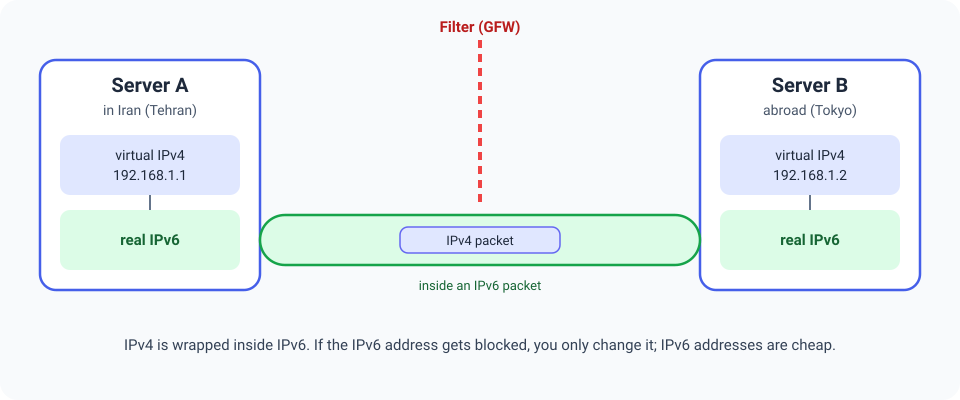

# 4to6 Tunnel

!!! warning "This guide is for an earlier setup"
    The 4to6-tunnel project has had no update since September 2024. It may still work, but it is not maintained. For a relay that is easier to keep running, see [Using the servers' IPv6 for a steadier tunnel](/manager/domain-worker-cdn-and-tunneling/Tutorial-for-setting-up-IPv6-to-improve-Relay-stability/) or [the relay methods](/manager/domain-worker-cdn-and-tunneling/How-to-add-relay-domain-to-Hiddify-manager/). This page is kept for people who already use it.


The 4to6 tunnel is similar to the 6to4 tunnel with the following advantages:

1. Your effective IP address between two servers will be IPv6.
2. IPv6 is inexpensive and can be changed easily if blocked.
3. Your IPv4 addresses on both sides will be protected from blocking.

## Technical Overview

The setup involves two servers: **A** in Iran and **B** abroad. A tunnel is created between them:



IPv4 packets are encapsulated within IPv6 packets and transmitted over an IPv6 network. If an IP is blocked, it will be an IPv6 address and can be easily replaced, as IPv6 addresses are generally more cost-effective than IPv4 addresses.

## How to Use

You will need two servers with IPv6.

#### Server A

```bash
curl -o /tmp/4to6install.sh https://raw.githubusercontent.com/meshya/4to6-tunnel/main/scripts/install.sh; sudo bash /tmp/4to6install.sh; rm /tmp/4to6install.sh
```

| Field | Value |
|-------|-------|
| E0    | Server A IPv6 |
| E2    | Server B IPv6 |
| E4    | 192.168.1.1/24 |

#### Server B

```bash
curl -o /tmp/4to6install.sh https://raw.githubusercontent.com/meshya/4to6-tunnel/main/scripts/install.sh; sudo bash /tmp/4to6install.sh; rm /tmp/4to6install.sh
```

| Field | Value |
|-------|-------|
| E0    | Server B IPv6 |
| E2    | Server A IPv6 |
| E4    | 192.168.1.2/24 |

## Testing

#### On Server A

```bash
ping 192.168.1.2
```

#### On Server B

```bash
ping 192.168.1.1
```

## Warning

If one of your servers is already using a 192.168.x.x network, you may need to use 172.16.x.x/12 (e.g., 172.16.0.1/12 and 172.16.0.2/12) instead. If you are unsure, open an issue and include the output of `ip addr`.

## Use Options

There are three methods to use the tunnel:

1. IP/Port Forwarding
2. Use Xray on Both Servers
3. Use Custom Tunneling Methods

### IP/Port Forwarding

For those unfamiliar with IP/Port forwarding, it is recommended to read more about it and perform the configuration manually.

[This article](https://tecadmin.net/setting-up-a-port-forwarding-using-iptables-in-linux/) provides guidance on setting up port forwarding.

Here is a quick setup guide:

To forward a single port (e.g., port 80), use the following settings (assuming virtual IPs of 192.168.1.1 for Server A and 192.168.1.2 for Server B).

#### Step 1

#Server A
```bash
iptables -t nat -A PREROUTING -p tcp --dport 80 -j DNAT --to-destination 192.168.1.2:80 
iptables -t nat -A POSTROUTING -j MASQUERADE 
```

#### Step 2

If the setup works, add the commands to `local.rc`.

### Use Xray on Both Servers

Install the Xray service on both servers and configure Server A to route data through a proxy on Server B. This configuration can be simplified using 3x-ui. For assistance, contact me (I am available as meshya everywhere and meshyah on Telegram).

Note: Use 192.168.1.2 instead of the real IP of Server B when configuring Xray on Server A.

### Use Custom Tunneling Methods

While not recommended, you can use custom tunneling methods such as [Reverse TLS](https://github.com/radkesvat/ReverseTlsTunnel) or [Fake TLS](https://github.com/radkesvat/FakeTlsTunnel) on top of the 4to6 tunnel if you are familiar with these techniques.

Note: Use virtual IPs (192.168.x.x) instead of real IPs.

## Tip

When using [Method 2](#use-xray-on-both-servers), consider adjusting routing rules and utilizing the [Iran Hosted Domain Project](https://github.com/bootmortis/iran-hosted-domains) to direct traffic for Iran-hosted websites and services, especially Shaparak and payment services, from an Iranian IP. This setup will prevent users from needing to toggle their proxies.


## References

1. [4to6 tunneling - Meshya](https://github.com/meshya/4to6-tunnel)

2. [Linux document project - ip4 in ip6 tunneling](https://tldp.org/HOWTO/Linux+IPv6-HOWTO/ch10.html
)

3. [RFC2437](http://www.faqs.org/rfcs/rfc2473.html)


<br>
<br>
<br>

Article and main repo by [Meshya](https://github.com/meshya/4to6-tunnel)

## Related articles

- [The server's IPv6 for steadier tunnels](/manager/domain-worker-cdn-and-tunneling/Tutorial-for-setting-up-IPv6-to-improve-Relay-stability/)
- [Local IPv6 for the relay server](/manager/domain-worker-cdn-and-tunneling/Tutorial-for-setting-up-local-IPv6/)
- [Domain types and how to add them](/manager/domain-worker-cdn-and-tunneling/Domain-types-and-how-to-register-them/)
- [Fake domain](/manager/domain-worker-cdn-and-tunneling/How-to-create-and-use-fake-domain/)
