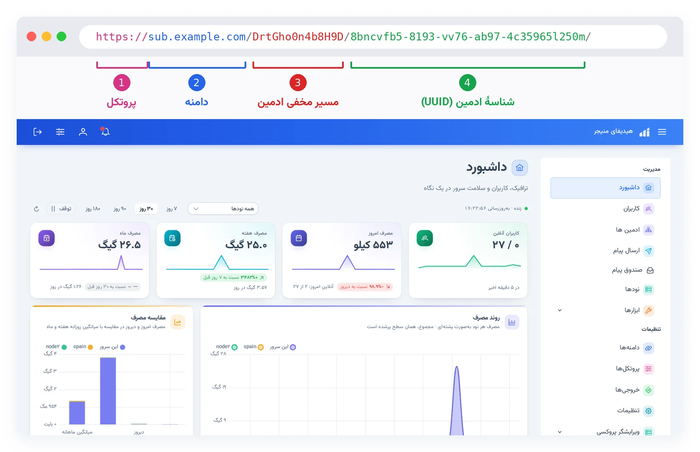
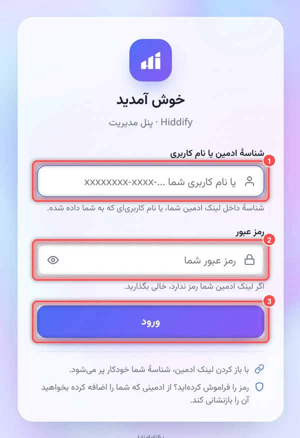
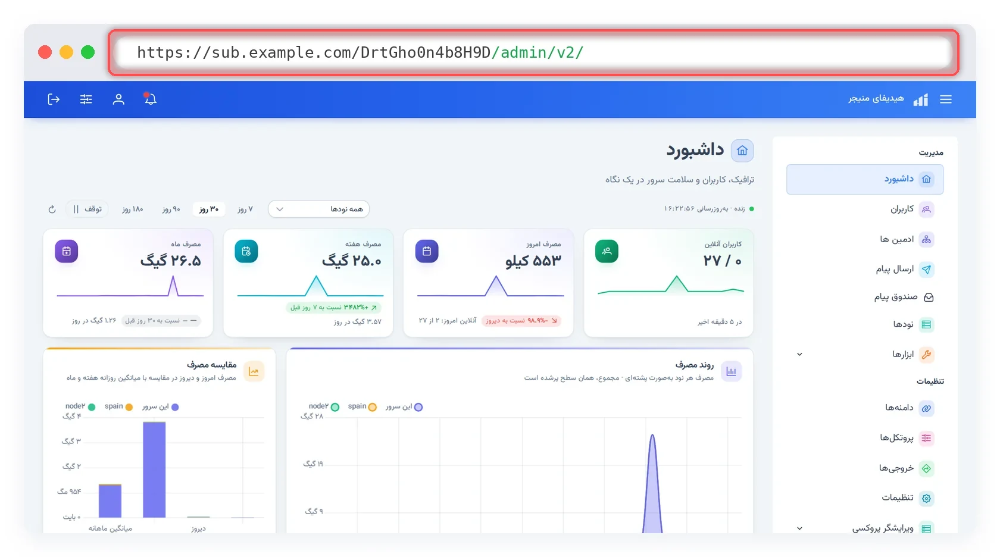

<div dir="rtl" markdown="1">

# لینک ادمین در هیدیفای‌منیجر و فرمت آن

این صفحه توضیح می‌دهد هر بخش از لینک ادمین چه معنایی دارد، وقتی آن را باز می‌کنید چه اتفاقی می‌افتد و اگر آن را گم کردید چطور دوباره پیدایش کنید. این صفحه برای همه کسانی است که یک پنل هیدیفای‌منیجر را مدیریت می‌کنند.

## فرمت لینک ادمین

نصب‌کننده در پایان نصب، لینک ادمین شما را نمایش می‌دهد. شکل آن این‌طور است:

<div dir="ltr" markdown="1">

```text
https://sub.example.com/DrtGho0n4b8H9D/8bncvfb5-8193-vv76-ab97-4c35965l250m/
```

</div>

شکل کلی آن:

<div dir="ltr" markdown="1">

```text
https://<domain>/<admin proxy path>/<admin UUID>/
```



</div>

بخش‌ها با `/` از هم جدا می‌شوند:

1. **`https://`**: ارتباط با TLS رمزگذاری می‌شود. همیشه از لینک‌های `https` استفاده کنید. لینک `http` همه چیز را بدون رمزگذاری می‌فرستد.
2. **دامنه** (`sub.example.com`): یکی از دامنه‌هایی که در پنل اضافه کرده‌اید (مستقیم، CDN یا رله). [انواع دامنه](/fa/manager/domain-worker-cdn-and-tunneling/Domain-types-and-how-to-register-them/) را ببینید.
3. **مسیر پروکسی ادمین** (`DrtGho0n4b8H9D`): یک مسیر مخفی که پنل را از ربات‌ها و سیستم‌های فیلترینگ پنهان می‌کند. این همان تنظیم **مسیر پروکسی برای مدیران** است. کاربران مسیر جداگانه‌ای دارند (**مسیر پروکسی برای کاربران**).
4. **UUID ادمین** (`8bncvfb5-...`): شناسه مخفی شخصی شما. هر ادمین شناسه خودش را دارد. مثل رمز عبور از آن محافظت کنید.

!!! warning "لینک ادمین را به کسی ندهید"
    هر کسی لینک ادمین شما را داشته باشد می‌تواند پنل شما را مدیریت کند، مگر اینکه برای حساب ادمین خود رمز عبور گذاشته باشید.

اگر دامنه، مسیر پروکسی ادمین یا UUID ادمین را تغییر دهید، لینک هم تغییر می‌کند. قبل از تغییر هر کدام، لینک جدید را ذخیره کنید.

## وقتی لینک را باز می‌کنید چه می‌شود

1. لینک ادمین را در مرورگر باز می‌کنید.
2. پنل شما را وارد می‌کند و **Admin V2** یعنی پنل مدیریت جدید را باز می‌کند. آدرس مرورگر به این شکل تغییر می‌کند:

    ```text
    https://sub.example.com/DrtGho0n4b8H9D/admin/v2/
    ```

    UUID از نوار آدرس حذف می‌شود تا روی صفحه نمایش داده نشود.

3. ورود شما در آن مرورگر تا ۱۰ روز معتبر می‌ماند. بعد از آن، یا در یک مرورگر دیگر، صفحه **ورود** را می‌بینید.

در صفحه **ورود**:

- در فیلد **شناسهٔ ادمین یا نام کاربری**، UUID داخل لینک ادمین (یا نام کاربری‌ای که به شما داده شده) را وارد کنید.
- در فیلد **رمز عبور**، رمز خود را وارد کنید. اگر حساب ادمین شما رمز ندارد، آن را خالی بگذارید.
- **ورود** را بزنید.

ساده‌ترین راه این است که لینک کامل ادمین را دوباره باز کنید. شناسه شما خودکار پر می‌شود.

<div align=center>
 
</div>

بعد از باز کردن لینک، پنل **Admin V2** را باز می‌کند و آدرس مرورگر این شکلی می‌شود. UUID دیگر در آدرس نیست:



## اگر لینک ادمین را گم کردید

با SSH به سرور وصل شوید و این دستور را اجرا کنید:

<div dir="ltr" markdown="1">

```bash
hiddify admin
```

</div>

این دستور لینک‌های ادمین را نمایش می‌دهد. از یک لینک **Secure** با `https` و دامنه خود استفاده کنید. لینکی که آی‌پی سرور در آن است «Not Secure» است؛ فقط وقتی از آن استفاده کنید که لینک‌های دامنه کار نمی‌کنند.

اگر رمز عبور گذاشته‌اید و آن را فراموش کرده‌اید، رمز ادمین اصلی (owner) را روی سرور با این دستور بازنشانی کنید:

<div dir="ltr" markdown="1">

```bash
hiddify reset-password
```

</div>

!!! tip "نکته"
    لینک کامل ادمین را جای امنی، مثلاً در یک برنامه مدیریت رمز، ذخیره کنید تا همیشه در دسترس شما باشد.

## تغییر بخش‌های لینک

- **مسیر پروکسی ادمین**: در پنل، **تنظیمات** را باز کنید و عبارت «مسیر پروکسی برای مدیران» را جستجو کنید (در کارت **تنظیمات خیلی پیشرفته** است). آن را تغییر دهید، روی **ذخیره** بزنید و تغییرات را اعمال کنید. پنل آدرس جدید ادمین را نشان می‌دهد.
- **UUID ادمین**: صفحه **ادمین‌ها** را باز کنید، ادمین را ویرایش کنید و فیلد UUID را تغییر دهید. لینک قبلی آن ادمین دیگر کار نمی‌کند.

</div>
