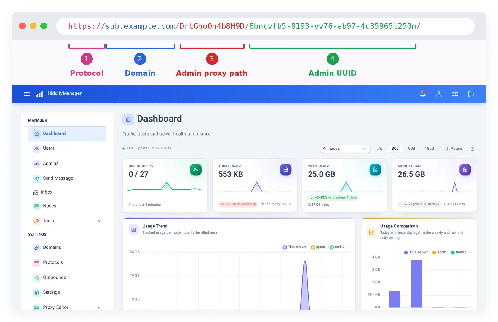
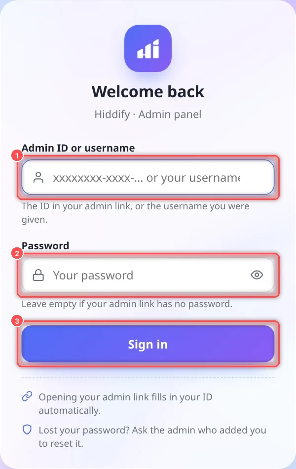
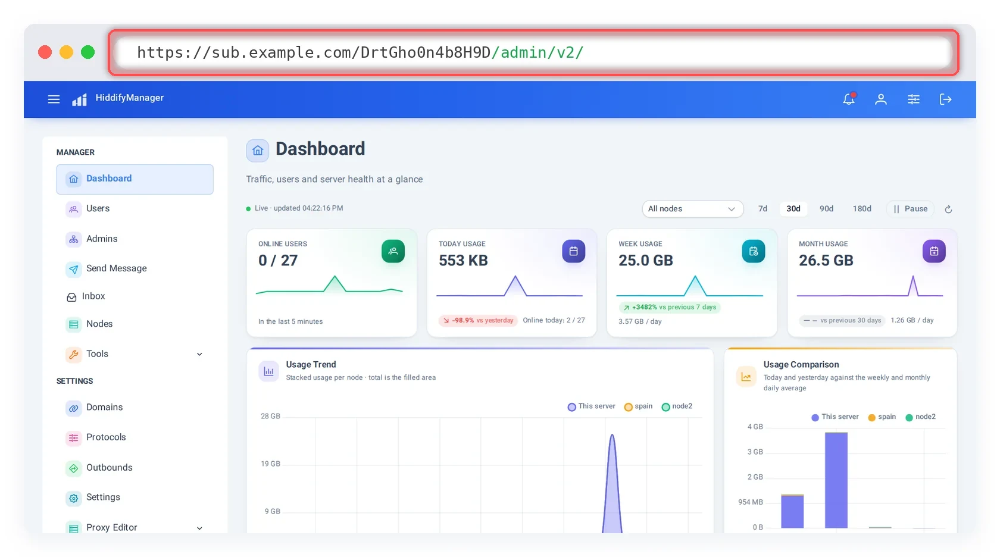

<div dir="ltr" markdown="1">

# The admin link in HiddifyManager and its format

This page explains what each part of your admin link means, what happens when you open it, and how to get it back if you lose it. It is for anyone who manages a HiddifyManager panel.

## The format of the admin link

The installer prints your admin link at the end of the installation. It looks like this:

```text
https://sub.example.com/DrtGho0n4b8H9D/8bncvfb5-8193-vv76-ab97-4c35965l250m/
```

The general form is:

```text
https://<domain>/<admin proxy path>/<admin UUID>/
```



The parts are separated by `/`:

1. **`https://`**: the connection is encrypted with TLS. Always use `https` links. An `http` link sends everything without encryption.
2. **Domain** (`sub.example.com`): one of the domains you added in the panel (Direct, CDN or Relay). See [Domain types](/manager/domain-worker-cdn-and-tunneling/Domain-types-and-how-to-register-them/).
3. **Admin proxy path** (`DrtGho0n4b8H9D`): a secret path that hides the panel from bots and filtering systems. It is the setting **Proxy Path for Admins**. Users have a different path (**Proxy Path for Clients**).
4. **Admin UUID** (`8bncvfb5-...`): your personal secret ID. Each admin has their own. Treat it like a password.

!!! warning "Keep your admin link private"
    Anyone who has your admin link can manage your panel, unless you set a password for your admin account.

The link changes if you change your domain, the admin proxy path, or your admin UUID. Save the new link before you change any of them.

## What happens when you open the link

1. You open the admin link in your browser.
2. The panel signs you in and opens **Admin V2**, the new admin panel. The address in your browser changes to:

    ```text
    https://sub.example.com/DrtGho0n4b8H9D/admin/v2/
    ```

    The UUID is removed from the address bar, so it is not shown on your screen.

3. Your sign-in lasts up to 10 days in that browser. After that, or in a new browser, you see the **Sign in** page.

On the **Sign in** page:

- In **Admin ID or username**, enter the UUID from your admin link (or the username you were given).
- In **Password**, enter your password. Leave it empty if your admin account has no password.
- Select **Sign in**.

The easiest way is to open your full admin link again. It fills in your ID automatically.

<div align=center>
 
</div>

After you open the link, the panel opens **Admin V2** and the address in your browser looks like this. The UUID is no longer in the address:



## If you lost your admin link

Connect to your server over SSH and run:

```bash
hiddify admin
```

It prints your admin links. Use a **Secure** `https` link with your domain. The link with the server's IP is "Not Secure"; use it only if the domain links do not work.

If you set a password and forgot it, reset the owner admin's password on the server with:

```bash
hiddify reset-password
```

!!! tip
    Save your full admin link somewhere safe, such as a password manager, so you always have it when you need it.

## How to change the parts of the link

- **Admin proxy path**: in the panel, open **Settings** and search for "Proxy Path for Admins" (it is in the **Very Advanced Settings** card). Change it, click **Save**, and apply the changes. The panel then shows the new admin address.
- **Admin UUID**: open the **Admins** page, edit the admin, and change the UUID field. The old admin link for that admin stops working.

## Related articles

- [Every part and setting of the panel](/manager/configuration-and-advanced-settings/How-to-configure-Hiddify-panel-properly/)
- [All panel settings, one by one](/manager/configuration-and-advanced-settings/Settings-reference/)
- [The Hiddify Manager menu over SSH](/manager/configuration-and-advanced-settings/How-to-connect-and-troubleshoot-via-SSH/)
- [Import users from X-UI](/manager/configuration-and-advanced-settings/how-to-import-xui-to-hiddifymanager/)

</div>
