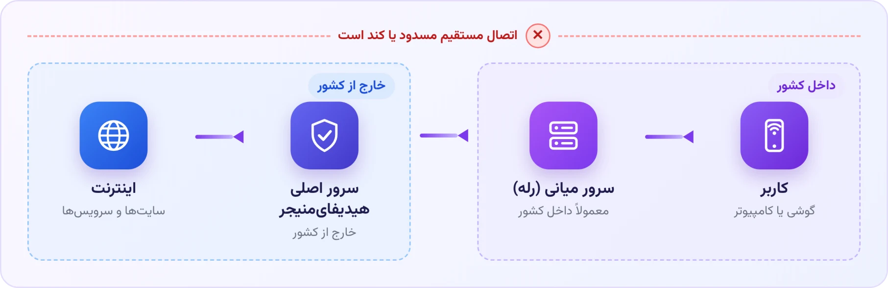

<div dir="rtl" markdown="1">

# آموزش راه‌اندازی سرور میانی با Dokodemo-Door (تونل)

!!! info "دربارهٔ این آموزش"
    این آموزش سرور میانی را به‌صورت دستی با **Xray** راه‌اندازی می‌کند و برای Xray نسخهٔ ۲۶ و هیدیفای‌منیجر نسخهٔ ۱۴.۵ است. برای روشی ساده‌تر که سرور میانی را از یک منو می‌سازد، [سرور میانی‌ساز هیدیفای](/fa/manager/domain-worker-cdn-and-tunneling/How-to-setup-relay-server-using-Hiddify-Relay-Builder/) را ببینید.

**سرور میانی** (ریلی) سرور دومی است، معمولاً در ایران، که کاربران به آن وصل می‌شوند و ترافیکشان را به سرور اصلی شما (هیدیفای‌منیجر) در خارج می‌رساند. ورودی **Dokodemo-Door** در Xray دقیقاً همین کار را می‌کند: هر چه به یک پورت برسد، بدون تغییر به همان پورتِ سرور اصلی فرستاده می‌شود.



!!! note "نام Dokodemo-Door حالا `tunnel` است"
    از سال ۲۰۲۵، Xray به این ورودی `tunnel` می‌گوید. نام قدیمی `dokodemo-door` هنوز کار می‌کند و کانفیگ‌های قدیمی خراب نمی‌شوند. نمونه‌های پایین نام جدید را به کار می‌برند.

## قدم ۱: نصب Xray روی سرور میانی

[با SSH به سرور میانی وصل شوید](/fa/manager/installation-and-setup/How-to-connect-to-server-via-SSH/) و نصب‌کنندهٔ رسمی Xray را اجرا کنید:

<div dir="ltr" markdown="1">

```bash
sudo bash -c "$(curl -L https://github.com/XTLS/Xray-install/raw/main/install-release.sh)" @ install
```

</div>

## قدم ۲: نوشتن کانفیگ

فایل کانفیگ را باز کنید:

<div dir="ltr" markdown="1">

```bash
sudo nano /usr/local/etc/xray/config.json
```

</div>

محتوای آن را با نمونهٔ پایین عوض کنید و دو چیز را تغییر دهید:

- `10.10.10.10`: آی‌پی **سرور اصلی** شما.
- `443` (هر سه جا): پورتی از سرور اصلی که می‌خواهید به آن برسید. هیدیفای‌منیجر به‌طور پیش‌فرض از پورت ۴۴۳ استفاده می‌کند.

<div dir="ltr" markdown="1">

```json
{
  "inbounds": [
    {
      "port": 443,
      "protocol": "tunnel",
      "settings": {
        "address": "10.10.10.10",
        "port": 443,
        "network": "tcp,udp"
      },
      "tag": "to-main-443"
    }
  ],
  "outbounds": [
    { "protocol": "freedom" }
  ]
}
```

</div>

با `Ctrl+S` ذخیره کنید و با `Ctrl+X` خارج شوید.

??? example "چند سرور اصلی روی یک سرور میانی"
    برای هر سرور اصلی یک ورودی، هر کدام روی پورت خودش، اضافه کنید. مثلاً سرور ۱ با آی‌پی `10.10.10.10` و پورت ۴۴۳، و سرور ۲ با آی‌پی `20.20.20.20` و پورت ۸۴۴۳:

    ```json
    {
      "inbounds": [
        {
          "port": 443,
          "protocol": "tunnel",
          "settings": { "address": "10.10.10.10", "port": 443, "network": "tcp,udp" },
          "tag": "to-server-1"
        },
        {
          "port": 8443,
          "protocol": "tunnel",
          "settings": { "address": "20.20.20.20", "port": 8443, "network": "tcp,udp" },
          "tag": "to-server-2"
        }
      ],
      "outbounds": [
        { "protocol": "freedom" }
      ]
    }
    ```

## قدم ۳: اجرای Xray

<div dir="ltr" markdown="1">

```bash
sudo systemctl restart xray
sudo systemctl status xray --no-pager
```

</div>

وضعیت باید `active (running)` باشد. اگر نبود، دستور `sudo journalctl -u xray -n 30` علت را نشان می‌دهد (معمولاً یک اشتباه تایپی در JSON).

## قدم ۴: افزودن سرور میانی به پنل

یک زیردامنه با پروکسی **خاموش** (فقط DNS) بسازید که به آی‌پی **سرور میانی** اشاره کند. در پنل **دامنه‌ها** › **افزودن دامنه** را باز کنید، زیردامنه را بنویسید، در **چطور تنظیم شده است؟** گزینهٔ **رله** (۱) را انتخاب کنید و مراحل را تمام کنید. می‌توانید یک **نام نمایشی** هم بدهید که در اپ کاربران به‌جای دامنه نشان داده شود.


قدم‌به‌قدم و با تصویر: [آموزش افزودن سرور میانی (دامنهٔ رله) به هیدیفای‌منیجر](/fa/manager/domain-worker-cdn-and-tunneling/How-to-add-relay-domain-to-Hiddify-manager/).

## قدم ۵: افزودن کانفیگ‌های سرور میانی به لینک اشتراک

بهتر است لینک اشتراک روی دامنهٔ جداگانه‌ای باشد. در صفحهٔ **دامنه‌ها**، دامنهٔ اشتراک را با مداد باز کنید و دامنهٔ رله را به **نمایش کانفیگ‌های** اضافه کنید. حالا کانفیگ‌های سرور میانی در صفحهٔ کاربر و لینک اشتراک دیده می‌شوند. [آموزش ساخت لینک اشتراک](/fa/manager/domain-worker-cdn-and-tunneling/How-to-create-subscription-link-on-Hiddify/) را ببینید.

## حذف تونل از سرور میانی

<div dir="ltr" markdown="1">

```bash
sudo systemctl disable --now xray
sudo rm /usr/local/etc/xray/config.json
sudo bash -c "$(curl -L https://github.com/XTLS/Xray-install/raw/main/install-release.sh)" @ remove
```

</div>

## مقاله‌های مرتبط

- [آموزش افزودن سرور میانی (دامنهٔ رله)](/fa/manager/domain-worker-cdn-and-tunneling/How-to-add-relay-domain-to-Hiddify-manager/)
- [سرور میانی‌ساز هیدیفای](/fa/manager/domain-worker-cdn-and-tunneling/How-to-setup-relay-server-using-Hiddify-Relay-Builder/)
- [تونل GOST](/fa/manager/domain-worker-cdn-and-tunneling/Tutorial-for-setting-up-GOST-tunnel-as-relay-server/)، [تونل HA-Proxy](/fa/manager/domain-worker-cdn-and-tunneling/Tutorial-for-setting-up-HA-Proxy-tunnel-as-relay-server/)، [تونل WST](/fa/manager/domain-worker-cdn-and-tunneling/Tutorial-for-setting-up-WST-tunnel-as-relay-server/)
- [استفاده از IPv6 برای تونل پایدارتر](/fa/manager/domain-worker-cdn-and-tunneling/Tutorial-for-setting-up-IPv6-to-improve-Relay-stability/)

</div>
