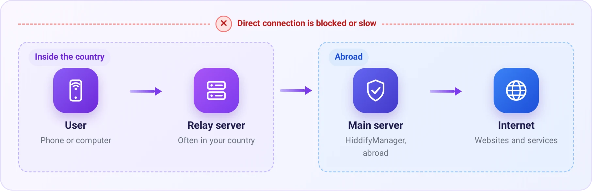

# Tutorial for setting up a Dokodemo-Door (tunnel) relay server

!!! info "About this guide"
    This guide sets up the relay server by hand with **Xray**, for Xray 26 and Hiddify Manager v14.5. For an easier way that builds the relay from a menu, see [Hiddify Relay Builder](/manager/domain-worker-cdn-and-tunneling/How-to-setup-relay-server-using-Hiddify-Relay-Builder/).

A **relay server** is a second server, usually in Iran, that your users connect to. It passes their traffic on to your main server (Hiddify Manager) abroad. Xray's **Dokodemo-Door** inbound does exactly this: whatever arrives on a port is sent on, unchanged, to the same port of the main server.



!!! note "Dokodemo-Door is now called `tunnel`"
    Since 2025, Xray calls this inbound `tunnel`. The old name `dokodemo-door` still works, so older configs keep running. The examples below use the new name.

## Step 1: install Xray on the relay server

[Connect to the relay server over SSH](/manager/installation-and-setup/How-to-connect-to-server-via-SSH/) and run Xray's official installer:

```bash
sudo bash -c "$(curl -L https://github.com/XTLS/Xray-install/raw/main/install-release.sh)" @ install
```

## Step 2: write the config

Open the config file:

```bash
sudo nano /usr/local/etc/xray/config.json
```

Replace its content with the example below. Change two things:

- `10.10.10.10`: the IP of your **main server**.
- `443` (all three): the port of the main server you want to reach. Hiddify Manager uses port 443 by default.

```json
{
  "inbounds": [
    {
      "port": 443,
      "protocol": "tunnel",
      "settings": {
        "address": "10.10.10.10",
        "port": 443,
        "network": "tcp,udp"
      },
      "tag": "to-main-443"
    }
  ],
  "outbounds": [
    { "protocol": "freedom" }
  ]
}
```

Save with `Ctrl+S` and close with `Ctrl+X`.

??? example "Several main servers on one relay"
    Add one inbound per main server, each on its own port. For example, server 1 at `10.10.10.10` port 443 and server 2 at `20.20.20.20` port 8443:

    ```json
    {
      "inbounds": [
        {
          "port": 443,
          "protocol": "tunnel",
          "settings": { "address": "10.10.10.10", "port": 443, "network": "tcp,udp" },
          "tag": "to-server-1"
        },
        {
          "port": 8443,
          "protocol": "tunnel",
          "settings": { "address": "20.20.20.20", "port": 8443, "network": "tcp,udp" },
          "tag": "to-server-2"
        }
      ],
      "outbounds": [
        { "protocol": "freedom" }
      ]
    }
    ```

## Step 3: start Xray

```bash
sudo systemctl restart xray
sudo systemctl status xray --no-pager
```

The status must say `active (running)`. If not, `sudo journalctl -u xray -n 30` shows why (usually a typo in the JSON).

## Step 4: add the relay to the panel

Register a subdomain with the proxy **off** (DNS only) that points to the **relay server's** IP. In the panel, open **Domains** › **Add domain**, type the subdomain, choose **Relay** (1) in **How is it set up?**, and finish the wizard. You can give it a **Display name**, which the users' apps show instead of the domain.


Step by step, with pictures: [How to add a relay server (domain) to HiddifyManager](/manager/domain-worker-cdn-and-tunneling/How-to-add-relay-domain-to-Hiddify-manager/).

## Step 5: add the relay configs to the subscription

It is better to keep the subscription link on its own domain. On the **Domains** page, open the subscription domain with the pencil and add the relay domain to **Show configs of**. The relay configs then appear on the user page and in the subscription. See [How to create a subscription link](/manager/domain-worker-cdn-and-tunneling/How-to-create-subscription-link-on-Hiddify/).

## Remove the tunnel from the relay server

```bash
sudo systemctl disable --now xray
sudo rm /usr/local/etc/xray/config.json
sudo bash -c "$(curl -L https://github.com/XTLS/Xray-install/raw/main/install-release.sh)" @ remove
```

## Related articles

- [How to add a relay server (domain)](/manager/domain-worker-cdn-and-tunneling/How-to-add-relay-domain-to-Hiddify-manager/)
- [Hiddify Relay Builder](/manager/domain-worker-cdn-and-tunneling/How-to-setup-relay-server-using-Hiddify-Relay-Builder/)
- [GOST tunnel](/manager/domain-worker-cdn-and-tunneling/Tutorial-for-setting-up-GOST-tunnel-as-relay-server/), [HA-Proxy tunnel](/manager/domain-worker-cdn-and-tunneling/Tutorial-for-setting-up-HA-Proxy-tunnel-as-relay-server/), [WST tunnel](/manager/domain-worker-cdn-and-tunneling/Tutorial-for-setting-up-WST-tunnel-as-relay-server/)
- [Using IPv6 for a steadier tunnel](/manager/domain-worker-cdn-and-tunneling/Tutorial-for-setting-up-IPv6-to-improve-Relay-stability/)
