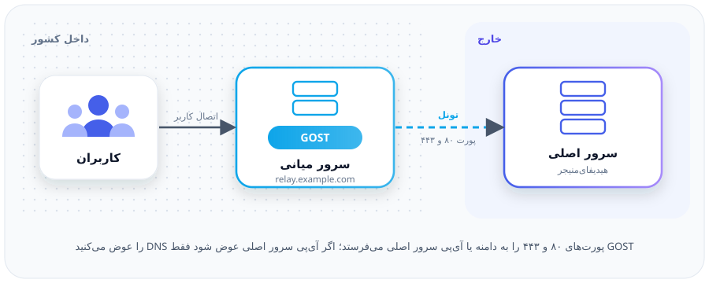

<div dir="rtl" markdown="1">

# آموزش راه‌اندازی تونل GOST به عنوان سرور میانی

این صفحه نشان می‌دهد چطور با **GOST** (GO Simple Tunnel) یک سرور را به سرور میانی برای هیدیفای‌منیجر تبدیل کنید. GOST یک برنامهٔ کوچک و متن‌باز است که پورت‌ها را از یک سرور به سرور دیگر می‌فرستد.

**سرور میانی** (Relay) یک سرور دوم، معمولا داخل کشور خودتان است که کاربران به آن وصل می‌شوند و ترافیکشان را به سرور اصلی هیدیفای‌منیجر در خارج می‌رساند. وقتی آی‌پی سرور اصلی از کشور شما مسدود یا کند است، این کار کمک می‌کند. [دربارهٔ سرور میانی بیشتر بخوانید](/fa/manager/domain-worker-cdn-and-tunneling/How-to-add-relay-domain-to-Hiddify-manager/).

<div align=center markdown=1>



</div>

## چرا GOST به جای فوروارد ساده با IP-Tables؟

- می‌توانید تونل را به **دامنهٔ** سرور اصلی وصل کنید، نه به آی‌پی آن؛ اگر آی‌پی سرور اصلی عوض شود، فقط رکورد DNS را عوض می‌کنید.
- به شکل سرویس سیستم اجرا می‌شود و بعد از ری‌استارت سرور خودبه‌خود دوباره روشن می‌شود.
- با همهٔ پروتکل‌های هیدیفای‌منیجر کار می‌کند، چون ترافیک خام TCP و UDP را جابه‌جا می‌کند. ترافیک پروکسی شما با خود پروتکل پروکسی رمزنگاری شده باقی می‌ماند.

!!! tip "راه ساده‌تر"
    [سرور میانی‌ساز هیدیفای](/fa/manager/domain-worker-cdn-and-tunneling/How-to-setup-relay-server-using-Hiddify-Relay-Builder/) می‌تواند GOST را از طریق منو برای شما نصب کند.

## پیش‌نیازها

- یک سرور اصلی که هیدیفای‌منیجر روی آن نصب است. [راهنمای نصب](/fa/manager/installation-and-setup/guide/) را ببینید.
- یک سرور میانی با Ubuntu یا Debian و دسترسی SSH با کاربر `root`. با SSH آشنا نیستید؟ [اتصال به سرور با SSH](/fa/manager/installation-and-setup/How-to-connect-to-server-via-SSH/) را ببینید.
- دامنه‌ای که **مستقیم** به آی‌پی سرور اصلی اشاره کند (پروکسی خاموش، نه از طریق CDN)، یا فقط آی‌پی سرور اصلی.

## نصب GOST روی سرور میانی

این راهنما **GOST نسخهٔ ۳** را نصب می‌کند (پروژهٔ [go-gost/gost](https://github.com/go-gost/gost))، که نسخهٔ فعالِ GOST است.

1. با SSH به **سرور میانی** وصل شوید.
2. GOST را با اسکریپت رسمی نصب کنید. اسکریپت نسخهٔ مناسب پردازندهٔ سرور (amd64 یا arm64) را خودش انتخاب می‌کند و آن را در `/usr/local/bin/gost` می‌گذارد:

    ```bash
    bash <(curl -fsSL https://github.com/go-gost/gost/raw/master/install.sh) --install
    ```

3. یک فایل سرویس بسازید تا GOST در پس‌زمینه و بعد از هر ری‌استارت اجرا شود:

    ```bash
    sudo nano /etc/systemd/system/gost.service
    ```

4. این متن را در ویرایشگر بگذارید:

    ```ini
    [Unit]
    Description=GOST relay to the Hiddify Manager server
    After=network-online.target
    Wants=network-online.target

    [Service]
    Type=simple
    ExecStart=/usr/local/bin/gost -L tcp://:443/main.example.com:443 -L udp://:443/main.example.com:443 -L tcp://:80/main.example.com:80
    Restart=on-failure
    RestartSec=3

    [Install]
    WantedBy=multi-user.target
    ```

5. هر سه `main.example.com` را با دامنهٔ مستقیم سرور اصلی (یا آی‌پی آن) عوض کنید. با `Ctrl+S` ذخیره کنید و با `Ctrl+X` خارج شوید.
6. سرویس را روشن کنید و طوری تنظیم کنید که با هر بار روشن شدن سرور اجرا شود:

    ```bash
    sudo systemctl daemon-reload
    sudo systemctl enable --now gost
    ```

### بررسی درستی کار

```bash
sudo systemctl status gost
```

باید عبارت `active (running)` را ببینید. برای خروج `q` را بزنید. اگر `failed` دیدید، با `journalctl -u gost -n 30` خطا را ببینید، خط `ExecStart` را درست کنید و دو دستور قدم ۶ را دوباره اجرا کنید.

برای فوروارد پورت‌های بیشتر، یک `-L tcp://:PORT/main.example.com:PORT` دیگر به خط `ExecStart` اضافه کنید؛ برای UDP به‌جای `tcp://` بنویسید `udp://`. اگر فایروال (مثلا ufw) روی سرور میانی روشن است، همین پورت‌ها را در آن باز کنید.

!!! note "اگر قبلا GOST نسخهٔ ۲ نصب کرده‌اید"
    نسخهٔ ۲ (پروژهٔ [ginuerzh/gost](https://github.com/ginuerzh/gost)) فقط نگهداری می‌شود و جایش را نسخهٔ ۳ گرفته است. شکل دستور `-L tcp://...` در هر دو یکی است، پس کافی است دستور نصب بالا را اجرا کنید (فایل `/usr/local/bin/gost` جایگزین می‌شود) و `sudo systemctl restart gost` را بزنید.

## تعریف سرور میانی در هیدیفای‌منیجر

1. با یک رکورد `A`، یک ساب‌دامین (مثلا `relay.example.com`) را به **آی‌پی سرور میانی** وصل کنید. در کلادفلر پروکسی را خاموش بگذارید (**DNS only**).
2. در پنل، از منوی کناری **دامنه‌ها** را باز کنید، روی **افزودن دامنه** بزنید، ساب‌دامین را بنویسید و **بررسی** را بزنید.
3. در مرحلهٔ **حالت**، زیر **چطور تنظیم شده است؟** گزینهٔ **رله** را انتخاب کنید. زیر **کدام TLS؟** معمولا **TLS معتبر** بهترین انتخاب است؛ چون GOST پورت ۸۰ را هم می‌رساند، پنل می‌تواند برای دامنهٔ سرور میانی گواهی بگیرد.

    

4. اگر **ریالتی** یا **جعلی** را انتخاب کردید، آی‌پی سرور میانی را در **پیشرفته** › **اجبار به استفاده از این IPها یا دامنه‌ها** همان دامنه بنویسید.
5. دامنهٔ اشتراک خود را ویرایش کنید، در **نمایش کانفیگ‌های** دامنهٔ سرور میانی را هم انتخاب کنید و تغییرات را اعمال کنید (**اقدامات** › **الان اعمال کن**).

<div class="hi-grid" style="grid-template-columns:1fr">
<a class="hi-card" href="/fa/manager/domain-worker-cdn-and-tunneling/How-to-add-relay-domain-to-Hiddify-manager/"><span class="hi-ic "><svg aria-hidden="true" xmlns="http://www.w3.org/2000/svg" viewBox="0 0 24 24"><path d="M13 19h1a1 1 0 0 1 1 1h7v2h-7a1 1 0 0 1-1 1h-4a1 1 0 0 1-1-1H2v-2h7a1 1 0 0 1 1-1h1v-2H4a1 1 0 0 1-1-1v-4a1 1 0 0 1 1-1h16a1 1 0 0 1 1 1v4a1 1 0 0 1-1 1h-7v2M4 3h16a1 1 0 0 1 1 1v4a1 1 0 0 1-1 1H4a1 1 0 0 1-1-1V4a1 1 0 0 1 1-1m5 4h1V5H9v2m0 8h1v-2H9v2M5 5v2h2V5H5m0 8v2h2v-2H5Z"/></svg></span><span class="tx"><b>مراحل کامل افزودن سرور میانی به پنل</b><small>همهٔ گزینه‌های دامنهٔ رله، با تصویر.</small></span></a>
</div>

## حذف GOST از سرور میانی

این دستورها را روی سرور میانی اجرا کنید:

```bash
sudo systemctl disable --now gost
sudo rm -f /etc/systemd/system/gost.service /usr/lib/systemd/system/gost.service /usr/local/bin/gost
sudo systemctl daemon-reload
```

## مقاله‌های مرتبط

<div class="hi-related" markdown="1">

- [سرور میانی‌ساز هیدیفای (همهٔ روش‌ها)](/fa/manager/domain-worker-cdn-and-tunneling/How-to-setup-relay-server-using-Hiddify-Relay-Builder/)
- [افزودن سرور میانی به پنل](/fa/manager/domain-worker-cdn-and-tunneling/How-to-add-relay-domain-to-Hiddify-manager/)
- [روش IP-Tables](/fa/manager/domain-worker-cdn-and-tunneling/Tutorial-for-setting-up-IP-Tables-tunnel-as-relay-server/)
- [روش WST](/fa/manager/domain-worker-cdn-and-tunneling/Tutorial-for-setting-up-WST-tunnel-as-relay-server/)

</div>

</div>
