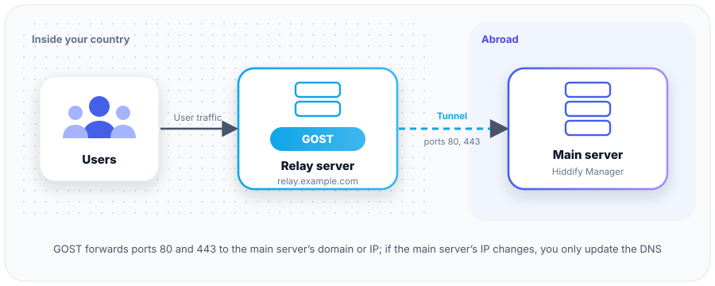

<div markdown="1">

# Tutorial for setting up GOST tunnel as relay server

This page shows how to turn a server into a relay for Hiddify Manager with **GOST** (GO Simple Tunnel). GOST is a small open-source program that forwards ports from one server to another.

A **relay** is a second server, usually inside your own country, that users connect to and that passes their traffic to the main Hiddify Manager server abroad. It helps when the main server’s IP is blocked or slow from your country. [Read more about relays](/manager/domain-worker-cdn-and-tunneling/How-to-add-relay-domain-to-Hiddify-manager/).

<div align=center markdown=1>



</div>

## Why GOST instead of plain IP-Tables forwarding?

- You can point the tunnel at the main server’s **domain** instead of its IP; if the main server’s IP changes, you only update the DNS record.
- It runs as a system service and starts again by itself after a reboot.
- It works with every Hiddify Manager protocol, because it moves raw TCP and UDP traffic. Your proxy traffic stays encrypted by the proxy protocol itself.

!!! tip "An easier way"
    The [Hiddify Relay Builder](/manager/domain-worker-cdn-and-tunneling/How-to-setup-relay-server-using-Hiddify-Relay-Builder/) can install GOST for you from a menu.

## Prerequisites

- A main server with Hiddify Manager installed. See the [installation guide](/manager/installation-and-setup/guide/).
- A relay server with Ubuntu or Debian and SSH access as `root`. New to SSH? See [How to connect to a server with SSH](/manager/installation-and-setup/How-to-connect-to-server-via-SSH/).
- A domain that points **directly** at the main server’s IP (proxy off, not through a CDN), or just the main server’s IP.

## Install GOST on the relay server

This guide installs **GOST v3** (the [go-gost/gost](https://github.com/go-gost/gost) project), the actively developed version of GOST.

1. Connect to the **relay server** with SSH.
2. Install GOST with the official script. It picks the right build for the server’s processor (amd64 or arm64) and puts it in `/usr/local/bin/gost`:

    ```bash
    bash <(curl -fsSL https://github.com/go-gost/gost/raw/master/install.sh) --install
    ```

3. Create a service file, so GOST runs in the background and after every reboot:

    ```bash
    sudo nano /etc/systemd/system/gost.service
    ```

4. Paste this into the editor:

    ```ini
    [Unit]
    Description=GOST relay to the Hiddify Manager server
    After=network-online.target
    Wants=network-online.target

    [Service]
    Type=simple
    ExecStart=/usr/local/bin/gost -L tcp://:443/main.example.com:443 -L udp://:443/main.example.com:443 -L tcp://:80/main.example.com:80
    Restart=on-failure
    RestartSec=3

    [Install]
    WantedBy=multi-user.target
    ```

5. Replace all three `main.example.com` with the main server’s direct domain (or its IP). Save with `Ctrl+S` and exit with `Ctrl+X`.
6. Start the service and make it start at every boot:

    ```bash
    sudo systemctl daemon-reload
    sudo systemctl enable --now gost
    ```

### Check that it works

```bash
sudo systemctl status gost
```

You should see `active (running)`. Press `q` to leave. If you see `failed`, read the error with `journalctl -u gost -n 30`, fix the `ExecStart` line and run the two commands of step 6 again.

To forward more ports, add another `-L tcp://:PORT/main.example.com:PORT` to the `ExecStart` line; for UDP write `udp://` instead of `tcp://`. If a firewall (for example ufw) is on on the relay server, open the same ports in it.

!!! note "If you installed GOST v2 before"
    v2 (the [ginuerzh/gost](https://github.com/ginuerzh/gost) project) is only maintained now; v3 replaces it. The `-L tcp://...` command form is the same in both, so just run the install command above (it replaces `/usr/local/bin/gost`) and then `sudo systemctl restart gost`.

## Add the relay in Hiddify Manager

1. With an `A` record, point a subdomain (for example `relay.example.com`) at the **relay server’s IP**. In Cloudflare keep the proxy off (**DNS only**).
2. In the panel, open **Domains** in the sidebar, click **Add Domain**, type the subdomain and click **Check**.
3. In the **Mode** step, under **How is it set up?**, choose **Relay**. Under **Which TLS?**, **Valid TLS** is usually best; since GOST forwards port 80 too, the panel can get a certificate for the relay domain.

    

4. If you chose **Reality** or **Fake**, enter the relay server’s IP in that domain’s **Advanced** › **Force Configs to Use These IPs / Domains**.
5. Edit your subscription domain, also select the relay domain in **Show configs of**, and apply the changes (**Actions** › **Apply Now**).

<div class="hi-grid" style="grid-template-columns:1fr">
<a class="hi-card" href="/manager/domain-worker-cdn-and-tunneling/How-to-add-relay-domain-to-Hiddify-manager/"><span class="hi-ic "><svg aria-hidden="true" xmlns="http://www.w3.org/2000/svg" viewBox="0 0 24 24"><path d="M13 19h1a1 1 0 0 1 1 1h7v2h-7a1 1 0 0 1-1 1h-4a1 1 0 0 1-1-1H2v-2h7a1 1 0 0 1 1-1h1v-2H4a1 1 0 0 1-1-1v-4a1 1 0 0 1 1-1h16a1 1 0 0 1 1 1v4a1 1 0 0 1-1 1h-7v2M4 3h16a1 1 0 0 1 1 1v4a1 1 0 0 1-1 1H4a1 1 0 0 1-1-1V4a1 1 0 0 1 1-1m5 4h1V5H9v2m0 8h1v-2H9v2M5 5v2h2V5H5m0 8v2h2v-2H5Z"/></svg></span><span class="tx"><b>The full steps to add a relay to the panel</b><small>Every option of the relay domain, with screenshots.</small></span></a>
</div>

## Remove GOST from the relay server

Run these commands on the relay server:

```bash
sudo systemctl disable --now gost
sudo rm -f /etc/systemd/system/gost.service /usr/lib/systemd/system/gost.service /usr/local/bin/gost
sudo systemctl daemon-reload
```

## Related articles

<div class="hi-related" markdown="1">

- [Hiddify Relay Builder (all methods)](/manager/domain-worker-cdn-and-tunneling/How-to-setup-relay-server-using-Hiddify-Relay-Builder/)
- [Add a relay to the panel](/manager/domain-worker-cdn-and-tunneling/How-to-add-relay-domain-to-Hiddify-manager/)
- [The IP-Tables method](/manager/domain-worker-cdn-and-tunneling/Tutorial-for-setting-up-IP-Tables-tunnel-as-relay-server/)
- [The WST method](/manager/domain-worker-cdn-and-tunneling/Tutorial-for-setting-up-WST-tunnel-as-relay-server/)

</div>

</div>
