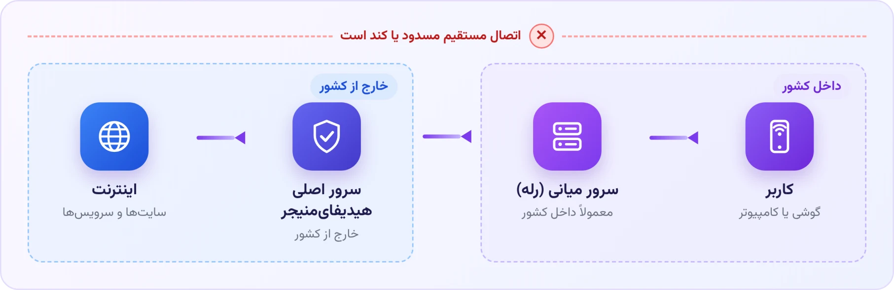

<div dir="rtl" markdown="1">

# آموزش راه‌اندازی سرور میانی با HA-Proxy

!!! info "دربارهٔ این آموزش"
    این آموزش سرور میانی را به‌صورت دستی با **HAProxy** راه‌اندازی می‌کند و برای اوبونتو ۲۲.۰۴ / ۲۴.۰۴ یا دبیان ۱۲ / ۱۳ و هیدیفای‌منیجر نسخهٔ ۱۴.۵ است. برای روشی ساده‌تر که سرور میانی را از یک منو می‌سازد، [سرور میانی‌ساز هیدیفای](/fa/manager/domain-worker-cdn-and-tunneling/How-to-setup-relay-server-using-Hiddify-Relay-Builder/) را ببینید.

**سرور میانی** (ریلی) سرور دومی است، معمولاً در ایران، که کاربران به آن وصل می‌شوند و ترافیکشان را به سرور اصلی شما (هیدیفای‌منیجر) در خارج می‌رساند. **HAProxy** برنامهٔ سریع و شناخته‌شده‌ای است که این کار را برای اتصال‌های TCP انجام می‌دهد.



!!! warning "فقط TCP"
    HAProxy فقط **TCP** را عبور می‌دهد. کانفیگ‌هایی که از UDP استفاده می‌کنند، مثل Hysteria2 و TUIC، از این سرور میانی کار نمی‌کنند. اگر UDP لازم دارید، از [Dokodemo-Door](/fa/manager/domain-worker-cdn-and-tunneling/Tutorial-for-setting-up-Dokodemo-Door-tunnel-as-relay-server/) یا [GOST](/fa/manager/domain-worker-cdn-and-tunneling/Tutorial-for-setting-up-GOST-tunnel-as-relay-server/) استفاده کنید.

## قدم ۱: نصب HAProxy روی سرور میانی

[با SSH به سرور میانی وصل شوید](/fa/manager/installation-and-setup/How-to-connect-to-server-via-SSH/) و HAProxy را نصب کنید:

<div dir="ltr" markdown="1">

```bash
sudo apt-get update && sudo apt-get install -y haproxy
```

</div>

## قدم ۲: نوشتن کانفیگ

فایل کانفیگ را باز کنید:

<div dir="ltr" markdown="1">

```bash
sudo nano /etc/haproxy/haproxy.cfg
```

</div>

به **انتهای** فایل بروید (بخش‌های `global` و `defaults` که از قبل هست را نگه دارید) و خطوط زیر را اضافه کنید. دو چیز را تغییر دهید:

- `10.10.10.10`: آی‌پی **سرور اصلی** شما.
- `443` (هر دو): پورت. کاربران به اولی روی سرور میانی وصل می‌شوند؛ دومی پورت سرور اصلی است. هیدیفای‌منیجر به‌طور پیش‌فرض از ۴۴۳ استفاده می‌کند.

<div dir="ltr" markdown="1">

```
frontend relay_in
    bind *:443
    mode tcp
    default_backend main_server

backend main_server
    mode tcp
    server main 10.10.10.10:443
```

</div>

با `Ctrl+S` ذخیره کنید و با `Ctrl+X` خارج شوید.

## قدم ۳: بررسی کانفیگ و اجرای دوبارهٔ HAProxy

<div dir="ltr" markdown="1">

```bash
sudo haproxy -c -f /etc/haproxy/haproxy.cfg
sudo systemctl restart haproxy
```

</div>

دستور اول فایل را بررسی می‌کند و باید `Configuration file is valid` را چاپ کند. اگر به‌جایش خطا نشان داد، خطی را که نام می‌برد درست کنید و هر دو دستور را دوباره اجرا کنید.

## قدم ۴: افزودن سرور میانی به پنل

یک زیردامنه با پروکسی **خاموش** (فقط DNS) بسازید که به آی‌پی **سرور میانی** اشاره کند. در پنل **دامنه‌ها** › **افزودن دامنه** را باز کنید، زیردامنه را بنویسید، در **چطور تنظیم شده است؟** گزینهٔ **رله** (۱) را انتخاب کنید و مراحل را تمام کنید.


قدم‌به‌قدم و با تصویر: [آموزش افزودن سرور میانی (دامنهٔ رله) به هیدیفای‌منیجر](/fa/manager/domain-worker-cdn-and-tunneling/How-to-add-relay-domain-to-Hiddify-manager/).

## قدم ۵: افزودن کانفیگ‌های سرور میانی به لینک اشتراک

در صفحهٔ **دامنه‌ها**، دامنهٔ اشتراک را با مداد باز کنید و دامنهٔ رله را به **نمایش کانفیگ‌های** اضافه کنید. حالا کانفیگ‌های سرور میانی در صفحهٔ کاربر و لینک اشتراک دیده می‌شوند. [آموزش ساخت لینک اشتراک](/fa/manager/domain-worker-cdn-and-tunneling/How-to-create-subscription-link-on-Hiddify/) را ببینید.

## حذف HAProxy از سرور میانی

<div dir="ltr" markdown="1">

```bash
sudo systemctl disable --now haproxy
sudo apt-get remove -y haproxy
```

</div>

## مقاله‌های مرتبط

- [آموزش افزودن سرور میانی (دامنهٔ رله)](/fa/manager/domain-worker-cdn-and-tunneling/How-to-add-relay-domain-to-Hiddify-manager/)
- [سرور میانی‌ساز هیدیفای](/fa/manager/domain-worker-cdn-and-tunneling/How-to-setup-relay-server-using-Hiddify-Relay-Builder/)
- [تونل Dokodemo-Door](/fa/manager/domain-worker-cdn-and-tunneling/Tutorial-for-setting-up-Dokodemo-Door-tunnel-as-relay-server/)، [تونل GOST](/fa/manager/domain-worker-cdn-and-tunneling/Tutorial-for-setting-up-GOST-tunnel-as-relay-server/)، [تونل WST](/fa/manager/domain-worker-cdn-and-tunneling/Tutorial-for-setting-up-WST-tunnel-as-relay-server/)

</div>
