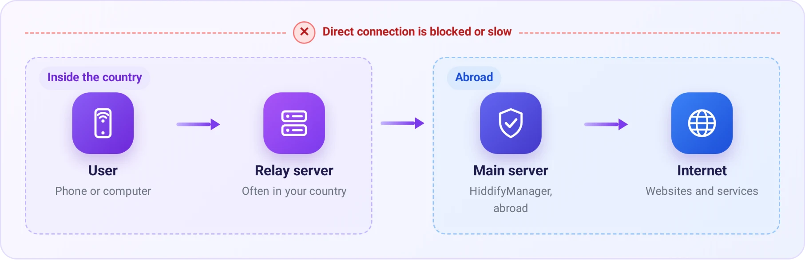
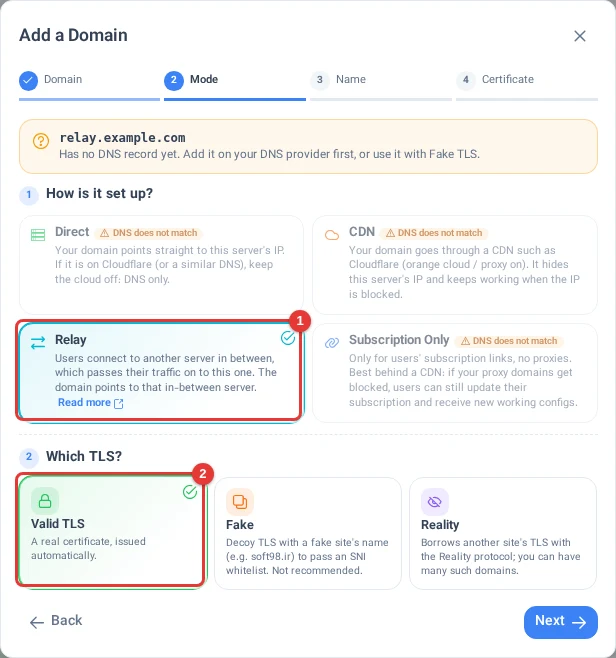

# Tutorial for setting up an HA-Proxy relay server

!!! info "About this guide"
    This guide sets up the relay server by hand with **HAProxy**, for Ubuntu 22.04 / 24.04 or Debian 12 / 13 and Hiddify Manager v14.5. For an easier way that builds the relay from a menu, see [Hiddify Relay Builder](/manager/domain-worker-cdn-and-tunneling/How-to-setup-relay-server-using-Hiddify-Relay-Builder/).

A **relay server** is a second server, usually in Iran, that your users connect to. It passes their traffic on to your main server (Hiddify Manager) abroad. **HAProxy** is a fast, well-known program that does this for TCP connections.



!!! warning "TCP only"
    HAProxy passes **TCP** only. Configs that use UDP, such as Hysteria2 and TUIC, do not work through this relay. If you need UDP, use [Dokodemo-Door](/manager/domain-worker-cdn-and-tunneling/Tutorial-for-setting-up-Dokodemo-Door-tunnel-as-relay-server/) or [GOST](/manager/domain-worker-cdn-and-tunneling/Tutorial-for-setting-up-GOST-tunnel-as-relay-server/).

## Step 1: install HAProxy on the relay server

[Connect to the relay server over SSH](/manager/installation-and-setup/How-to-connect-to-server-via-SSH/) and install HAProxy:

```bash
sudo apt-get update && sudo apt-get install -y haproxy
```

## Step 2: write the config

Open the config file:

```bash
sudo nano /etc/haproxy/haproxy.cfg
```

Go to the **end** of the file (keep the `global` and `defaults` parts that are already there) and add the lines below. Change two things:

- `10.10.10.10`: the IP of your **main server**.
- `443` (both): the port. Users connect to the relay on the first one; the second is the main server's port. Hiddify Manager uses 443 by default.

```
frontend relay_in
    bind *:443
    mode tcp
    default_backend main_server

backend main_server
    mode tcp
    server main 10.10.10.10:443
```

Save with `Ctrl+S` and close with `Ctrl+X`.

## Step 3: check the config and restart HAProxy

```bash
sudo haproxy -c -f /etc/haproxy/haproxy.cfg
sudo systemctl restart haproxy
```

The first command checks the file and must print `Configuration file is valid`. If it prints an error instead, fix the line it names and run both commands again.

## Step 4: add the relay to the panel

Register a subdomain with the proxy **off** (DNS only) that points to the **relay server's** IP. In the panel, open **Domains** › **Add domain**, type the subdomain, choose **Relay** (1) in **How is it set up?**, and finish the wizard.



Step by step, with pictures: [How to add a relay server (domain) to HiddifyManager](/manager/domain-worker-cdn-and-tunneling/How-to-add-relay-domain-to-Hiddify-manager/).

## Step 5: add the relay configs to the subscription

On the **Domains** page, open your subscription domain with the pencil and add the relay domain to **Show configs of**. The relay configs then appear on the user page and in the subscription. See [How to create a subscription link](/manager/domain-worker-cdn-and-tunneling/How-to-create-subscription-link-on-Hiddify/).

## Remove HAProxy from the relay server

```bash
sudo systemctl disable --now haproxy
sudo apt-get remove -y haproxy
```

## Related articles

- [How to add a relay server (domain)](/manager/domain-worker-cdn-and-tunneling/How-to-add-relay-domain-to-Hiddify-manager/)
- [Hiddify Relay Builder](/manager/domain-worker-cdn-and-tunneling/How-to-setup-relay-server-using-Hiddify-Relay-Builder/)
- [Dokodemo-Door tunnel](/manager/domain-worker-cdn-and-tunneling/Tutorial-for-setting-up-Dokodemo-Door-tunnel-as-relay-server/), [GOST tunnel](/manager/domain-worker-cdn-and-tunneling/Tutorial-for-setting-up-GOST-tunnel-as-relay-server/), [WST tunnel](/manager/domain-worker-cdn-and-tunneling/Tutorial-for-setting-up-WST-tunnel-as-relay-server/)

