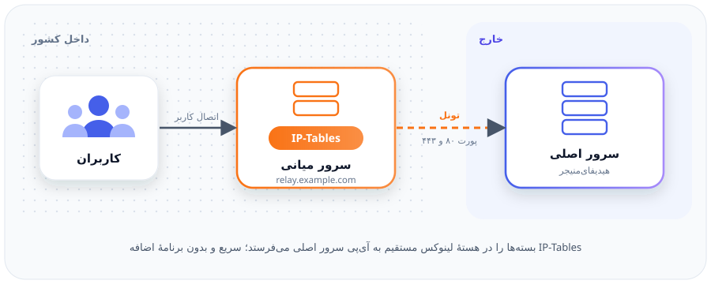

# آموزش راه‌اندازی تونل IP-Tables به عنوان سرور میانی

این صفحه نشان می‌دهد چطور با IP-Tables (فایروال داخلی لینوکس) یک سرور را به سرور میانی برای هیدیفای‌منیجر تبدیل کنید. این ساده‌ترین روش است: یک اسکریپت، بدون نرم‌افزار اضافه‌ای که باید همیشه روشن بماند.

**سرور میانی** (Relay) یک سرور دوم، معمولا داخل کشور خودتان است که کاربران به آن وصل می‌شوند و ترافیکشان را به سرور اصلی هیدیفای‌منیجر در خارج می‌رساند. وقتی IP سرور اصلی از کشور شما مسدود یا کند است، این کار کمک می‌کند. [درباره سرور میانی بیشتر بخوانید](/fa/manager/domain-worker-cdn-and-tunneling/How-to-add-relay-domain-to-Hiddify-manager/).


<div dir="rtl" markdown="1">

<div align=center dir="rtl" markdown="1">


</div>

## پیش‌نیازها

- یک سرور اصلی که هیدیفای‌منیجر روی آن نصب است. [راهنمای نصب](/fa/manager/installation-and-setup/guide/) را ببینید.
- یک سرور میانی با Ubuntu یا Debian که IP سالم و پهنای باند و CPU کافی برای کاربران شما داشته باشد. رم اهمیت زیادی ندارد: یک سرور کوچک و ارزان (مثلا با 256 مگابایت رم) کافی است و می‌توانید چند تا از آن داشته باشید.
- دسترسی SSH به سرور میانی با کاربر `root`. با SSH آشنا نیستید؟ [نحوه اتصال به سرور با SSH](/fa/manager/installation-and-setup/How-to-connect-to-server-via-SSH/) را ببینید.
- IP سرور اصلی.

## راه‌اندازی سرور میانی

1. با SSH به **سرور میانی** وصل شوید.
2. این دستور را اجرا کنید:

    ```bash
    bash <(curl https://gist.githubusercontent.com/hiddify-com/63836c9a158eca29bad6c941610028cf/raw/0e4e2138148ab9d3d678723fd904b1cad461ce62/relay.sh)
    ```

3. وقتی پیام `Enter your main server IP like(1.1.1.1):` را دیدید، IP سرور اصلی را بنویسید و `Enter` بزنید.
4. اسکریپت بسته‌های `iptables` و `iptables-persistent` را نصب می‌کند. اگر صفحه آبی‌رنگی پرسید که قواعد فعلی IPv4 (و IPv6) ذخیره شوند یا نه، **Yes** را انتخاب کنید.

    اسکریپت پورت‌های TCP `80` و `443` و همه ترافیک UDP را به سرور اصلی می‌فرستد و قواعد را ذخیره می‌کند تا بعد از ری‌استارت هم برگردند.

5. اسکریپت IP Forwarding (که برای تونل لازم است) را فقط تا ری‌استارت بعدی روشن می‌کند. آن را دائمی کنید:

    ```bash
    echo "net.ipv4.ip_forward=1" | sudo tee /etc/sysctl.d/99-relay.conf
    sudo sysctl --system
    ```

### بررسی درستی کار

این دستور را روی سرور میانی اجرا کنید:

<div dir="ltr" markdown="1">

```bash
sudo iptables -t nat -L -n
```

</div>

باید خط‌هایی با `DNAT` ببینید که به IP سرور اصلی شما اشاره می‌کنند. اگر ندیدید، اسکریپت را دوباره اجرا کنید و IP واردشده را بررسی کنید.

!!! tip "اگر ufw روشن است"
    اگر فایروال `ufw` روی سرور میانی روشن است، باید اجازهٔ فوروارد را بدهد: در فایل `/etc/default/ufw` مقدار `DEFAULT_FORWARD_POLICY` را `"ACCEPT"` کنید و `sudo ufw reload` را بزنید. فایروال ارائه‌دهندهٔ سرور هم باید پورت‌های ۸۰ و ۴۴۳ را باز بگذارد.

## تعریف سرور میانی در هیدیفای‌منیجر

1. با یک رکورد `A`، یک ساب‌دامین (مثلا `relay.example.com`) را به **آی‌پی سرور میانی** وصل کنید. در کلادفلر پروکسی را خاموش بگذارید (**DNS only**).
2. در پنل، از منوی کناری **دامنه‌ها** را باز کنید، روی **افزودن دامنه** بزنید، ساب‌دامین را بنویسید و **بررسی** را بزنید.
3. در مرحلهٔ **حالت**، زیر **چطور تنظیم شده است؟** گزینهٔ **رله** را انتخاب کنید. زیر **کدام TLS؟** معمولا **TLS معتبر** بهترین انتخاب است؛ چون این اسکریپت پورت ۸۰ را هم به سرور اصلی می‌فرستد، پنل می‌تواند برای دامنهٔ سرور میانی گواهی بگیرد.

    

4. اگر **ریالتی** یا **جعلی** را انتخاب کردید، آی‌پی سرور میانی را در **پیشرفته** › **اجبار به استفاده از این IPها یا دامنه‌ها** همان دامنه بنویسید.
5. دامنهٔ اشتراک خود را ویرایش کنید، در **نمایش کانفیگ‌های** دامنهٔ سرور میانی را هم انتخاب کنید و تغییرات را اعمال کنید (**اقدامات** › **الان اعمال کن**).

<div class="hi-grid" style="grid-template-columns:1fr">
<a class="hi-card" href="/fa/manager/domain-worker-cdn-and-tunneling/How-to-add-relay-domain-to-Hiddify-manager/"><span class="hi-ic"><svg aria-hidden="true" xmlns="http://www.w3.org/2000/svg" viewBox="0 0 24 24"><path d="M13 19h1a1 1 0 0 1 1 1h7v2h-7a1 1 0 0 1-1 1h-4a1 1 0 0 1-1-1H2v-2h7a1 1 0 0 1 1-1h1v-2H4a1 1 0 0 1-1-1v-4a1 1 0 0 1 1-1h16a1 1 0 0 1 1 1v4a1 1 0 0 1-1 1h-7v2M4 3h16a1 1 0 0 1 1 1v4a1 1 0 0 1-1 1H4a1 1 0 0 1-1-1V4a1 1 0 0 1 1-1m5 4h1V5H9v2m0 8h1v-2H9v2M5 5v2h2V5H5m0 8v2h2v-2H5Z"/></svg></span><span class="tx"><b>مراحل کامل افزودن سرور میانی به پنل</b><small>همهٔ گزینه‌های دامنهٔ رله، با تصویر.</small></span></a>
</div>

## حذف قواعد سرور میانی

قواعد فوروارد در جدول `nat` ذخیره شده‌اند. برای پاک کردن آن‌ها و ذخیره مجموعه خالی، این دستورها را روی سرور میانی اجرا کنید:

<div dir="ltr" markdown="1">

```bash
sudo iptables -t nat -F
sudo netfilter-persistent save
```

</div>

!!! warning "هشدار"
    این کار **همه** قواعد جدول `nat` را پاک می‌کند، از جمله قواعدی که خودتان اضافه کرده‌اید.

برای خاموش کردن IP Forwarding هم فایلی را که ساختید پاک کنید:

<div dir="ltr" markdown="1">

```bash
sudo rm /etc/sysctl.d/99-relay.conf
```

</div>

## مقاله‌های مرتبط

<div class="hi-related" markdown="1">

- [سرور میانی‌ساز هیدیفای (همهٔ روش‌ها)](/fa/manager/domain-worker-cdn-and-tunneling/How-to-setup-relay-server-using-Hiddify-Relay-Builder/)
- [افزودن سرور میانی به پنل](/fa/manager/domain-worker-cdn-and-tunneling/How-to-add-relay-domain-to-Hiddify-manager/)
- [روش GOST](/fa/manager/domain-worker-cdn-and-tunneling/Tutorial-for-setting-up-GOST-tunnel-as-relay-server/)
- [روش WST](/fa/manager/domain-worker-cdn-and-tunneling/Tutorial-for-setting-up-WST-tunnel-as-relay-server/)

</div>

</div>
