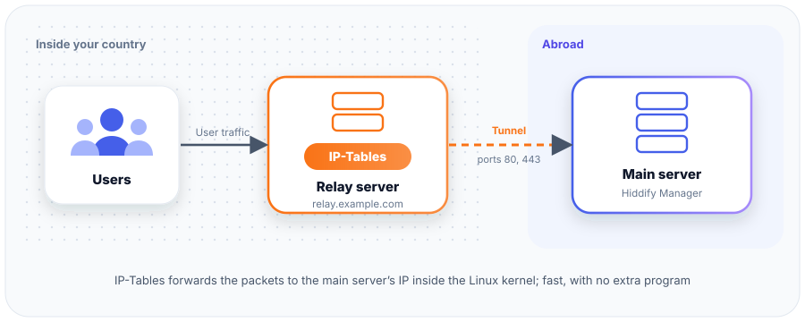

# Tutorial for setting up IP-Table tunnel as relay server

This page shows you how to turn a server into a relay for your Hiddify Manager server using IP-Tables, the firewall built into Linux. It is the simplest method: one script, no extra software to keep running.

A **relay server** is a second server, usually inside your own country, that your users connect to. It forwards their traffic to your main HiddifyManager server abroad. This helps when the main server's IP is blocked or slow from your country. [Read more about relay servers](/manager/domain-worker-cdn-and-tunneling/How-to-add-relay-domain-to-Hiddify-manager/#what-is-a-relay-server-and-why-use-one).

<div align=center markdown="1">


</div>

## Prerequisites

- A main server with Hiddify Manager installed. See the [installation guide](/manager/installation-and-setup/guide/).
- A relay server running Ubuntu or Debian, with a clean IP and enough bandwidth and CPU for your users. RAM matters little: a small, cheap server (for example 256 MB of RAM) is enough, and you can run several of them.
- SSH access to the relay server as `root`. New to SSH? See [how to connect to a server via SSH](/manager/installation-and-setup/How-to-connect-to-server-via-SSH/).
- The IP address of your main server.

## Set up the relay server

1. Connect to your **relay server** over SSH.
2. Run this command:

    ```bash
    bash <(curl https://gist.githubusercontent.com/hiddify-com/63836c9a158eca29bad6c941610028cf/raw/0e4e2138148ab9d3d678723fd904b1cad461ce62/relay.sh)
    ```

3. When asked `Enter your main server IP like(1.1.1.1):`, type your main server's IP and press `Enter`.
4. The script installs `iptables` and `iptables-persistent`. If a blue screen asks whether to save the current IPv4 (and IPv6) rules, choose **Yes**.

    The script forwards TCP ports `80` and `443`, and all UDP traffic, to your main server, and saves the rules so they come back after a reboot.

5. The script turns on IP forwarding (needed for the tunnel) only until the next reboot. Make it permanent:

    ```bash
    echo "net.ipv4.ip_forward=1" | sudo tee /etc/sysctl.d/99-relay.conf
    sudo sysctl --system
    ```

### Check that it worked

Run this on the relay server:

```bash
sudo iptables -t nat -L -n
```

You should see `DNAT` lines that point to your main server's IP. If you do not, run the script again and check the IP you typed.

!!! tip "If ufw is on"
    If the `ufw` firewall is on on the relay server, it must allow forwarding: in `/etc/default/ufw` set `DEFAULT_FORWARD_POLICY` to `"ACCEPT"` and run `sudo ufw reload`. Your provider’s firewall must also leave ports 80 and 443 open.

## Add the relay server to Hiddify Manager

1. With an `A` record, point a subdomain (for example `relay.example.com`) at the **relay server’s IP**. In Cloudflare keep the proxy off (**DNS only**).
2. In the panel, open **Domains** in the sidebar, click **Add Domain**, type the subdomain and click **Check**.
3. In the **Mode** step, under **How is it set up?**, choose **Relay**. Under **Which TLS?**, **Valid TLS** is usually best; since this script forwards port 80 to the main server too, the panel can get a certificate for the relay domain.

    

4. If you chose **Reality** or **Fake**, enter the relay server’s IP in that domain’s **Advanced** › **Force Configs to Use These IPs / Domains**.
5. Edit your subscription domain, also select the relay domain in **Show configs of**, and apply the changes (**Actions** › **Apply Now**).

<div class="hi-grid" style="grid-template-columns:1fr">
<a class="hi-card" href="/manager/domain-worker-cdn-and-tunneling/How-to-add-relay-domain-to-Hiddify-manager/"><span class="hi-ic"><svg aria-hidden="true" xmlns="http://www.w3.org/2000/svg" viewBox="0 0 24 24"><path d="M13 19h1a1 1 0 0 1 1 1h7v2h-7a1 1 0 0 1-1 1h-4a1 1 0 0 1-1-1H2v-2h7a1 1 0 0 1 1-1h1v-2H4a1 1 0 0 1-1-1v-4a1 1 0 0 1 1-1h16a1 1 0 0 1 1 1v4a1 1 0 0 1-1 1h-7v2M4 3h16a1 1 0 0 1 1 1v4a1 1 0 0 1-1 1H4a1 1 0 0 1-1-1V4a1 1 0 0 1 1-1m5 4h1V5H9v2m0 8h1v-2H9v2M5 5v2h2V5H5m0 8v2h2v-2H5Z"/></svg></span><span class="tx"><b>The full steps to add a relay to the panel</b><small>Every option of the relay domain, with screenshots.</small></span></a>
</div>

## Remove the relay rules

The forwarding rules live in the `nat` table. To delete them and save the empty rule set, run this on the relay server:

```bash
sudo iptables -t nat -F
sudo netfilter-persistent save
```

!!! warning
    This deletes **every** rule in the `nat` table, including any you added yourself.

To also turn IP forwarding off, delete the file you created:

```bash
sudo rm /etc/sysctl.d/99-relay.conf
```

## Related articles

<div class="hi-related" markdown="1">

- [Hiddify Relay Builder (every method)](/manager/domain-worker-cdn-and-tunneling/How-to-setup-relay-server-using-Hiddify-Relay-Builder/)
- [Add a relay to the panel](/manager/domain-worker-cdn-and-tunneling/How-to-add-relay-domain-to-Hiddify-manager/)
- [GOST method](/manager/domain-worker-cdn-and-tunneling/Tutorial-for-setting-up-GOST-tunnel-as-relay-server/)
- [WST method](/manager/domain-worker-cdn-and-tunneling/Tutorial-for-setting-up-WST-tunnel-as-relay-server/)

</div>
