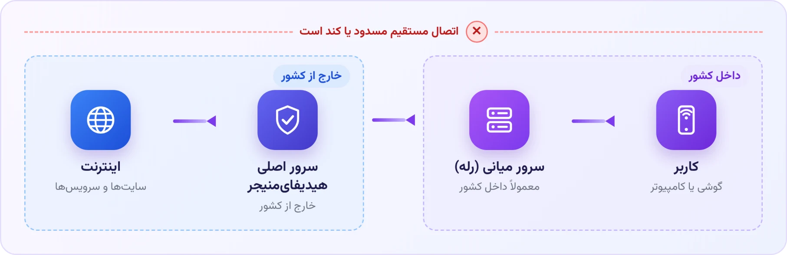
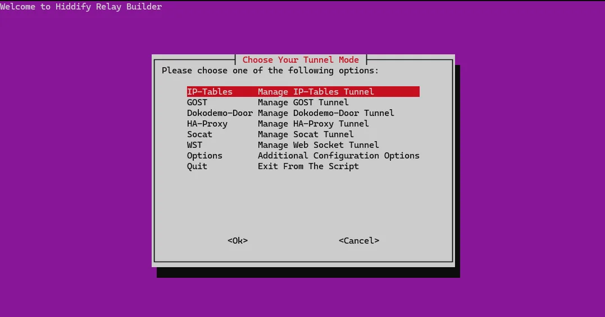
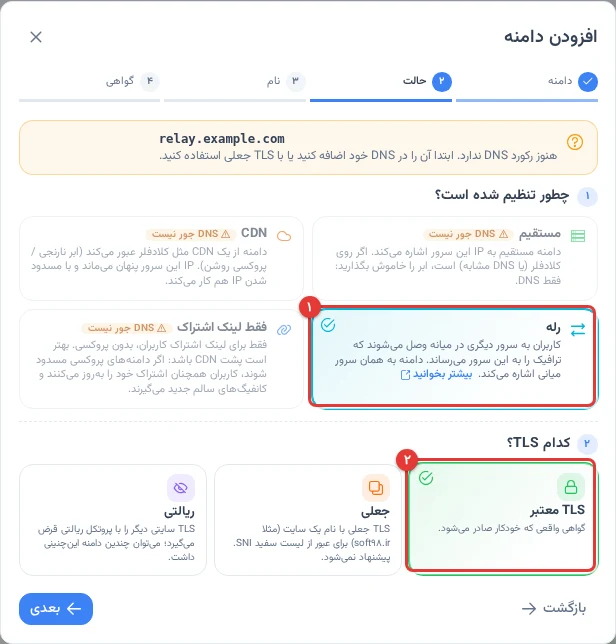

# استفاده از IPv6 سرورها برای تونل پایدارتر

!!! info "بررسی‌شده برای هیدیفای‌منیجر نسخهٔ ۱۴.۵"
    سرور میانی با [سرور میانی‌ساز هیدیفای](/fa/manager/domain-worker-cdn-and-tunneling/How-to-setup-relay-server-using-Hiddify-Relay-Builder/) ساخته می‌شود؛ بخش هیدیفای‌منیجر برای نسخهٔ ۱۴.۵ نوشته شده است.

استفاده از تونل با آی‌پی ورژن ۶ (IPv6) بین سرور میانی (معمولاً در ایران) و سرور اصلی، به راهی مؤثر برای اتصال پایدارتر تبدیل شده است: مسیرهای IPv6 معمولاً کمتر از IPv4 دچار اختلال می‌شوند.

## دو روش استفاده از IPv6 { #two-ways-to-use-ipv6 }

1. **IPv6 لوکال روی هر دو سرور:** یک شبکهٔ IPv6 خصوصی بین سرور میانی و سرور اصلی می‌سازید و تونل از آن استفاده می‌کند. [آموزش ایجاد IPv6 لوکال برای سرور میانی](/fa/manager/domain-worker-cdn-and-tunneling/Tutorial-for-setting-up-local-IPv6/) را ببینید.
2. **IPv6 واقعی سرور اصلی:** تونل به آدرس IPv6 خود سرور اصلی وصل می‌شود. هر دو سرور باید روی کارت شبکه‌شان IPv6 داشته باشند؛ با دستور `ip a` روی هر سرور بررسی کنید (دنبال آدرس `inet6` بگردید که با `fe80::` شروع نشود).

**نکته:** در عمل، روش‌های **GOST** و **Dokodemo-Door** برای هر دو حالت بهترین نتیجه را داده‌اند.

## مراحل { #steps }

1. **سرور میانی‌ساز هیدیفای** را طبق [آموزش آن](/fa/manager/domain-worker-cdn-and-tunneling/How-to-setup-relay-server-using-Hiddify-Relay-Builder/) روی سرور میانی نصب کنید. وقتی نصب تمام شد، منوی آن باز می‌شود.

    

2. **GOST** یا **Dokodemo-Door** را انتخاب کنید.
3. گزینهٔ اول همان روش را انتخاب کنید، بعد **add inbounds** را بزنید و IPv6 سرور اصلی (یا IPv6 لوکال) را با فرمتی که منو می‌خواهد وارد کنید.
4. یک پورت دلخواه وارد کنید.
5. **سرور میانی را به پنل اضافه کنید.** یک زیردامنه با پروکسی خاموش (فقط DNS) بسازید که به **IPv4** سرور میانی اشاره کند. در پنل **دامنه‌ها** › **افزودن دامنه** را باز کنید، زیردامنه را بنویسید، در **چطور تنظیم شده است؟** گزینهٔ **رله** را انتخاب کنید و ویزارد را تمام کنید. بعد دامنهٔ رله را در **نمایش کانفیگ‌های** دامنهٔ سابسکریپشن خود اضافه کنید. مرحله‌به‌مرحله: [افزودن سرور میانی (دامنه) به هیدیفای‌منیجر](/fa/manager/domain-worker-cdn-and-tunneling/How-to-add-relay-domain-to-Hiddify-manager/).

    در **افزودن دامنه**، **رله** را انتخاب کنید (۱):

    

## پروکسی‌های پیشنهادی { #suggested-proxies }

برای این نوع سرور میانی، این پروکسی‌ها خوب کار می‌کنند. در **ویرایشگر پروکسی** › **پروکسی‌ها** هستند:

- `tcp relay vmess`
- `httpupgrade relay vmess`

این‌ها می‌توانند به پایدار ماندن اتصال کمک کنند، به‌خصوص وقتی فیلترینگ شدید است.

## مقاله‌های مرتبط

- [IPv6 لوکال برای سرور میانی](/fa/manager/domain-worker-cdn-and-tunneling/Tutorial-for-setting-up-local-IPv6/)
- [تونل 4to6](/fa/manager/domain-worker-cdn-and-tunneling/Setup-ip4toip6-tunnel/)
- [انواع دامنه و ثبت آن‌ها](/fa/manager/domain-worker-cdn-and-tunneling/Domain-types-and-how-to-register-them/)
- [دامنهٔ فیک](/fa/manager/domain-worker-cdn-and-tunneling/How-to-create-and-use-fake-domain/)
