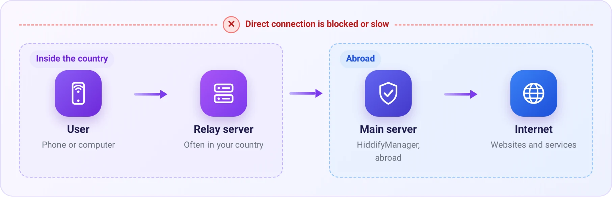
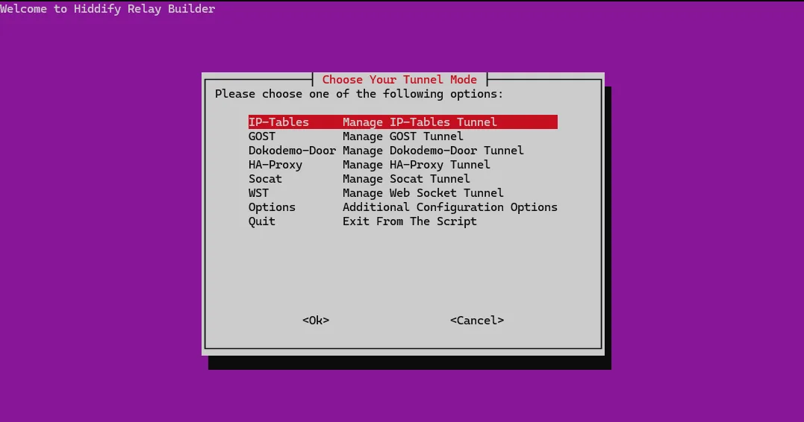

# Using the servers' IPv6 for a steadier tunnel

!!! info "Checked for Hiddify Manager v14.5"
    The relay server is built with [Hiddify Relay Builder](/manager/domain-worker-cdn-and-tunneling/How-to-setup-relay-server-using-Hiddify-Relay-Builder/); the HiddifyManager part is for v14.5.

Running the tunnel between the relay server (usually in Iran) and the main server over IPv6 has become an effective way to get a steadier connection: IPv6 routes are often disrupted less than IPv4 ones.

## Two ways to use IPv6

1. **A local IPv6 on both servers:** you create a private IPv6 network between the relay and the main server, and the tunnel uses it. See [Tutorial for setting up local IPv6 for the relay server](/manager/domain-worker-cdn-and-tunneling/Tutorial-for-setting-up-local-IPv6/).
2. **The main server's real IPv6:** the tunnel connects to the main server's own IPv6 address. Both servers need IPv6 on their network card; check it with `ip a` on each server (look for an `inet6` address that is not `fe80::…`).

**Note:** in practice, the **GOST** and **Dokodemo-Door** methods work best for both ways.

## Steps

1. Install **Hiddify Relay Builder** on the relay server, as described in [its guide](/manager/domain-worker-cdn-and-tunneling/How-to-setup-relay-server-using-Hiddify-Relay-Builder/). When the install finishes, its menu opens.

    

2. Choose **GOST** or **Dokodemo-Door**.
3. Choose the first option of that method, then **add inbounds**, and enter the main server's IPv6 (or the local IPv6) in the format the menu asks for.
4. Enter a port of your choice.
5. **Add the relay to the panel.** Register a subdomain with the proxy off (DNS only) that points to the relay server's **IPv4**. In the panel, open **Domains** › **Add domain**, type the subdomain, choose **Relay** in **How is it set up?** and finish the wizard. Then add the relay domain to **Show configs of** of your subscription domain. Step by step: [How to add a relay server (domain) to HiddifyManager](/manager/domain-worker-cdn-and-tunneling/How-to-add-relay-domain-to-Hiddify-manager/).

    In **Add domain**, choose **Relay** (1):

    

## Suggested proxies

For this kind of relay, these proxies work well. They are in **Proxy Editor** › **Proxies**:

- `tcp relay vmess`
- `httpupgrade relay vmess`

They can help keep the connection stable, especially when filtering is heavy.

## Related articles

- [Local IPv6 for the relay server](/manager/domain-worker-cdn-and-tunneling/Tutorial-for-setting-up-local-IPv6/)
- [4to6 tunnel](/manager/domain-worker-cdn-and-tunneling/Setup-ip4toip6-tunnel/)
- [Domain types and how to add them](/manager/domain-worker-cdn-and-tunneling/Domain-types-and-how-to-register-them/)
- [Fake domain](/manager/domain-worker-cdn-and-tunneling/How-to-create-and-use-fake-domain/)
