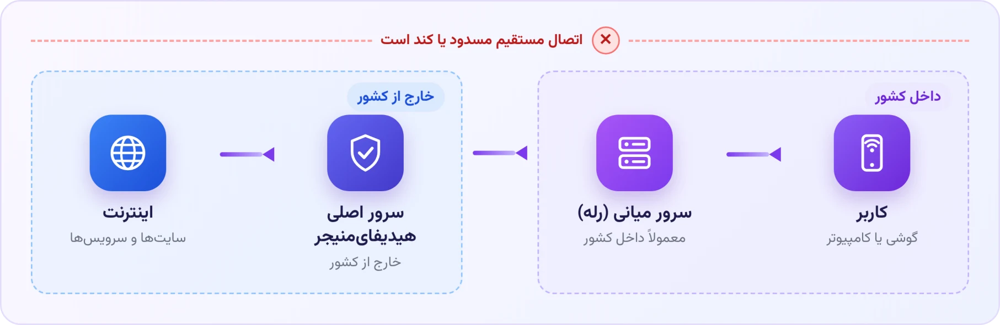

<div dir="rtl" markdown="1">

# آموزش راه‌اندازی سرور میانی با WST (wstunnel)

!!! info "دربارهٔ این آموزش"
    برای **wstunnel نسخهٔ ۱۱.۱** (آبان ۱۴۰۵) و هیدیفای‌منیجر نسخهٔ ۱۴.۵. wstunnel از نسخهٔ ۷ دستورهایش را عوض کرده است؛ اگر نسخهٔ قدیمی این صفحه (v5.0) را دنبال کرده بودید، از دستورهای جدید پایین استفاده کنید. برای روشی ساده‌تر که سرور میانی را از یک منو می‌سازد، [سرور میانی‌ساز هیدیفای](/fa/manager/domain-worker-cdn-and-tunneling/How-to-setup-relay-server-using-Hiddify-Relay-Builder/) را ببینید.

**سرور میانی** (ریلی) سرور دومی است، معمولاً در ایران، که کاربران به آن وصل می‌شوند و ترافیکشان را به سرور اصلی شما (هیدیفای‌منیجر) در خارج می‌رساند. **wstunnel** این ترافیک را داخل یک اتصال WebSocket می‌برد که شبیه ترافیک معمولی وب است و از CDN مثل کلادفلر هم عبور می‌کند.



## چه چیزهایی لازم است

- سرور اصلی که هیدیفای‌منیجر روی آن نصب است: [آموزش نصب](/fa/manager/installation-and-setup/guide/).
- یک سرور میانی (اوبونتو ۲۲.۰۴ / ۲۴.۰۴ یا دبیان ۱۲ / ۱۳)، معمولاً در ایران.
- یک دامنه یا زیردامنه برای سرور اصلی، مثلاً `tunnel.example.com`: مستقیم (فقط DNS) یا پشت کلادفلر. پورت ۸۰۸۰ از کلادفلر هم عبور می‌کند.

## قدم ۱: نصب wstunnel روی هر دو سرور

[با SSH](/fa/manager/installation-and-setup/How-to-connect-to-server-via-SSH/) به سرور اصلی وصل شوید و این دستورها را اجرا کنید، بعد همین کار را روی سرور میانی هم انجام دهید:

<div dir="ltr" markdown="1">

```bash
wget https://github.com/erebe/wstunnel/releases/download/v11.1.0/wstunnel_11.1.0_linux_amd64.tar.gz
tar xzf wstunnel_11.1.0_linux_amd64.tar.gz wstunnel
sudo install -m 755 wstunnel /usr/local/bin/wstunnel
wstunnel --version
```

</div>

دستور آخر نسخه را چاپ می‌کند، مثلاً `wstunnel 11.1.0`. روی سرور ARM به‌جای `linux_amd64` از `linux_arm64` استفاده کنید.

## قدم ۲: اجرای سمت سرور روی سرور اصلی

یک سرویس بسازید تا تونل بعد از ری‌استارت خودش اجرا شود:

<div dir="ltr" markdown="1">

```bash
sudo nano /etc/systemd/system/wstunnel.service
```

</div>

این را بچسبانید، با `Ctrl+S` ذخیره کنید و با `Ctrl+X` خارج شوید:

<div dir="ltr" markdown="1">

```ini
[Unit]
Description=wstunnel server
After=network-online.target

[Service]
ExecStart=/usr/local/bin/wstunnel server ws://[::]:8080 --restrict-to 127.0.0.1:443 --restrict-to 127.0.0.1:80
Restart=always

[Install]
WantedBy=multi-user.target
```

</div>

`--restrict-to` اجازه می‌دهد تونل فقط به پورت‌های ۴۴۳ و ۸۰ همین سرور برسد، تا کس دیگری نتواند از آن به‌عنوان پروکسی باز استفاده کند.

بعد آن را اجرا و بررسی کنید:

<div dir="ltr" markdown="1">

```bash
sudo systemctl daemon-reload
sudo systemctl enable --now wstunnel
sudo systemctl status wstunnel --no-pager
```

</div>

وضعیت باید `active (running)` باشد.

## قدم ۳: اجرای سمت کلاینت روی سرور میانی

روی سرور میانی همان فایل را با دستور کلاینت بسازید. به‌جای `tunnel.example.com` دامنهٔ سرور اصلی خود را بگذارید:

<div dir="ltr" markdown="1">

```bash
sudo nano /etc/systemd/system/wstunnel.service
```

</div>

<div dir="ltr" markdown="1">

```ini
[Unit]
Description=wstunnel client (relay)
After=network-online.target

[Service]
ExecStart=/usr/local/bin/wstunnel client -L tcp://0.0.0.0:443:127.0.0.1:443 -L tcp://0.0.0.0:80:127.0.0.1:80 ws://tunnel.example.com:8080
Restart=always

[Install]
WantedBy=multi-user.target
```

</div>

`-L tcp://0.0.0.0:443:127.0.0.1:443` یعنی: روی پورت ۴۴۳ سرور میانی گوش بده و همه چیز را به پورت ۴۴۳ سرور اصلی بفرست. برای پورت‌های بیشتر، `-L`های بیشتری اضافه کنید.

بعد آن را اجرا و بررسی کنید:

<div dir="ltr" markdown="1">

```bash
sudo systemctl daemon-reload
sudo systemctl enable --now wstunnel
sudo systemctl status wstunnel --no-pager
```

</div>

## قدم ۴: افزودن سرور میانی به پنل

یک زیردامنه با پروکسی **خاموش** (فقط DNS) بسازید که به آی‌پی **سرور میانی** اشاره کند. در پنل **دامنه‌ها** › **افزودن دامنه** را باز کنید، زیردامنه را بنویسید، در **چطور تنظیم شده است؟** گزینهٔ **رله** (۱) را انتخاب کنید و مراحل را تمام کنید.


قدم‌به‌قدم و با تصویر: [آموزش افزودن سرور میانی (دامنهٔ رله) به هیدیفای‌منیجر](/fa/manager/domain-worker-cdn-and-tunneling/How-to-add-relay-domain-to-Hiddify-manager/).

## قدم ۵: افزودن کانفیگ‌های سرور میانی به لینک اشتراک

در صفحهٔ **دامنه‌ها**، دامنهٔ اشتراک را با مداد باز کنید و دامنهٔ رله را به **نمایش کانفیگ‌های** اضافه کنید. [آموزش ساخت لینک اشتراک](/fa/manager/domain-worker-cdn-and-tunneling/How-to-create-subscription-link-on-Hiddify/) را ببینید.

## حذف تونل

روی هر دو سرور:

<div dir="ltr" markdown="1">

```bash
sudo systemctl disable --now wstunnel
sudo rm -f /etc/systemd/system/wstunnel.service /usr/local/bin/wstunnel
```

</div>

## مقاله‌های مرتبط

- [آموزش افزودن سرور میانی (دامنهٔ رله)](/fa/manager/domain-worker-cdn-and-tunneling/How-to-add-relay-domain-to-Hiddify-manager/)
- [سرور میانی‌ساز هیدیفای](/fa/manager/domain-worker-cdn-and-tunneling/How-to-setup-relay-server-using-Hiddify-Relay-Builder/)
- [تونل Dokodemo-Door](/fa/manager/domain-worker-cdn-and-tunneling/Tutorial-for-setting-up-Dokodemo-Door-tunnel-as-relay-server/)، [تونل HA-Proxy](/fa/manager/domain-worker-cdn-and-tunneling/Tutorial-for-setting-up-HA-Proxy-tunnel-as-relay-server/)، [تونل GOST](/fa/manager/domain-worker-cdn-and-tunneling/Tutorial-for-setting-up-GOST-tunnel-as-relay-server/)
- [wstunnel در گیت‌هاب](https://github.com/erebe/wstunnel)

</div>
