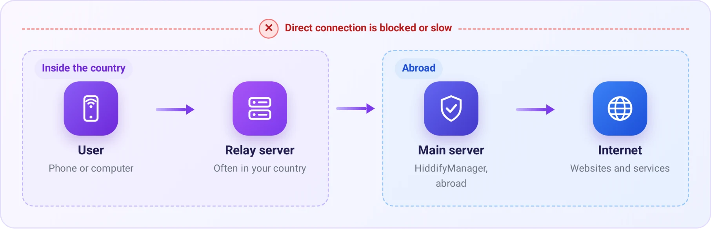

# Tutorial for setting up a WST (wstunnel) relay server

!!! info "About this guide"
    For **wstunnel 11.1** (October 2026) and Hiddify Manager v14.5. wstunnel changed its commands in version 7; if you followed an older version of this page (v5.0), use the new commands below. For an easier way that builds the relay from a menu, see [Hiddify Relay Builder](/manager/domain-worker-cdn-and-tunneling/How-to-setup-relay-server-using-Hiddify-Relay-Builder/).

A **relay server** is a second server, usually in Iran, that your users connect to. It passes their traffic on to your main server (Hiddify Manager) abroad. **wstunnel** carries that traffic inside a WebSocket connection, which looks like normal web traffic and can also pass through a CDN such as Cloudflare.



## What you need

- The main server with Hiddify Manager installed: [installation guide](/manager/installation-and-setup/guide/).
- A relay server (Ubuntu 22.04 / 24.04 or Debian 12 / 13), usually in Iran.
- A domain or subdomain for the main server, for example `tunnel.example.com`: direct (DNS only), or behind Cloudflare. Port 8080 works through Cloudflare too.

## Step 1: install wstunnel on both servers

[Connect over SSH](/manager/installation-and-setup/How-to-connect-to-server-via-SSH/) to the main server, run these commands, and then do the same on the relay server:

```bash
wget https://github.com/erebe/wstunnel/releases/download/v11.1.0/wstunnel_11.1.0_linux_amd64.tar.gz
tar xzf wstunnel_11.1.0_linux_amd64.tar.gz wstunnel
sudo install -m 755 wstunnel /usr/local/bin/wstunnel
wstunnel --version
```

The last command prints the version, for example `wstunnel 11.1.0`. On an ARM server, use `linux_arm64` instead of `linux_amd64`.

## Step 2: run the server side on the main server

Create a service, so the tunnel starts by itself after a reboot:

```bash
sudo nano /etc/systemd/system/wstunnel.service
```

Paste this, save with `Ctrl+S` and close with `Ctrl+X`:

```ini
[Unit]
Description=wstunnel server
After=network-online.target

[Service]
ExecStart=/usr/local/bin/wstunnel server ws://[::]:8080 --restrict-to 127.0.0.1:443 --restrict-to 127.0.0.1:80
Restart=always

[Install]
WantedBy=multi-user.target
```

`--restrict-to` lets the tunnel reach only ports 443 and 80 of this server, so nobody else can use it as an open proxy.

Then start it and check it:

```bash
sudo systemctl daemon-reload
sudo systemctl enable --now wstunnel
sudo systemctl status wstunnel --no-pager
```

The status must say `active (running)`.

## Step 3: run the client side on the relay server

On the relay server, create the same file with the client command. Replace `tunnel.example.com` with your main server's domain:

```bash
sudo nano /etc/systemd/system/wstunnel.service
```

```ini
[Unit]
Description=wstunnel client (relay)
After=network-online.target

[Service]
ExecStart=/usr/local/bin/wstunnel client -L tcp://0.0.0.0:443:127.0.0.1:443 -L tcp://0.0.0.0:80:127.0.0.1:80 ws://tunnel.example.com:8080
Restart=always

[Install]
WantedBy=multi-user.target
```

`-L tcp://0.0.0.0:443:127.0.0.1:443` means: listen on port 443 of the relay server and send everything to port 443 of the main server. Add more `-L` parts for more ports.

Then start it and check it:

```bash
sudo systemctl daemon-reload
sudo systemctl enable --now wstunnel
sudo systemctl status wstunnel --no-pager
```

## Step 4: add the relay to the panel

Register a subdomain with the proxy **off** (DNS only) that points to the **relay server's** IP. In the panel, open **Domains** › **Add domain**, type the subdomain, choose **Relay** (1) in **How is it set up?**, and finish the wizard.


Step by step, with pictures: [How to add a relay server (domain) to HiddifyManager](/manager/domain-worker-cdn-and-tunneling/How-to-add-relay-domain-to-Hiddify-manager/).

## Step 5: add the relay configs to the subscription

On the **Domains** page, open your subscription domain with the pencil and add the relay domain to **Show configs of**. See [How to create a subscription link](/manager/domain-worker-cdn-and-tunneling/How-to-create-subscription-link-on-Hiddify/).

## Remove the tunnel

On both servers:

```bash
sudo systemctl disable --now wstunnel
sudo rm -f /etc/systemd/system/wstunnel.service /usr/local/bin/wstunnel
```

## Related articles

- [How to add a relay server (domain)](/manager/domain-worker-cdn-and-tunneling/How-to-add-relay-domain-to-Hiddify-manager/)
- [Hiddify Relay Builder](/manager/domain-worker-cdn-and-tunneling/How-to-setup-relay-server-using-Hiddify-Relay-Builder/)
- [Dokodemo-Door tunnel](/manager/domain-worker-cdn-and-tunneling/Tutorial-for-setting-up-Dokodemo-Door-tunnel-as-relay-server/), [HA-Proxy tunnel](/manager/domain-worker-cdn-and-tunneling/Tutorial-for-setting-up-HA-Proxy-tunnel-as-relay-server/), [GOST tunnel](/manager/domain-worker-cdn-and-tunneling/Tutorial-for-setting-up-GOST-tunnel-as-relay-server/)
- [wstunnel on GitHub](https://github.com/erebe/wstunnel)

