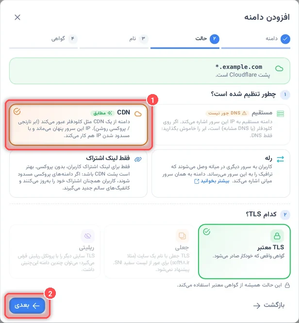

# آموزش استفاده از زیردامنه‌های متغیر در هیدیفای

## ثبت دامنه متغیر در کلادفلر

ابتدا روی دامنه ثبت شده خود در کلادفلر یک رکورد `*` ایجاد کنید. یعنی به قسمت `DNS` بروید و `Add record` را بزنید. سپس در صفحه باز شده، ستاره وارد کنید. نوع فیلد هم که `A` باشد و مقدار فیلد آیپی را هم با آیپی سرور خود پر کنید. تیک پروکسی هم روشن باشه. یعنی اگر مثلا دامنه شما `yourdomain.com` باشد، در نهایت یک فیلد `yourdomain.com.*` ثبت کنید.
[اطلاعات بیشتر درباره نحوه ثبت دامنه](/fa/manager/domain-worker-cdn-and-tunneling/Domain-types-and-how-to-register-them/)

  

برای آیپی ورژن ۶ نیز همین کار را با رکوردی از نوع `AAAA` می‌توانید انجام دهید.

  

## ثبت دامنه متغیر در پنل هیدیفای

برای این کار از منوی کناری پنل، بخش `دامنه‌ها` (در گروه `تنظیمات`) را باز کنید و روی `افزودن دامنه` بزنید. این راهنما چهار مرحله دارد: `دامنه`، `حالت`، `نام` و `گواهی`.

* در مرحله `دامنه`، ساب‌دامینی که مرحله قبل ثبت کرده بودید یعنی `yourdomain.com.*` را وارد کنید و روی `بررسی` بزنید.

* در مرحله `حالت`، زیر `چطور تنظیم شده است؟` گزینه `CDN` را انتخاب کنید. تفاوت دامنه CDN و AutoCDN در نحوه اعمال فیلد آدرس در کانفیگ است که CDN نام دامنه را بر می گرداند و AutoCDN آیپی را بر می گرداند. [اطلاعات بیشتر در این مورد](/fa/manager/domain-worker-cdn-and-tunneling/Guide-for-using-mode-Auto_CDN_IP-on-Hiddify/)

* در مرحله `نام`، یک نام دلخواه بگذارید.

* در آخر مرحله `گواهی` را تمام کنید تا دامنه ثبت شود. اگر پیغام اعمال تغییرات داده شد، حتما دکمه اعمال تغییرات را هم بزنید تا تنظیمات در سرور به صورت کامل اعمال گردد.

## مشاهده کانفیگ‌های دامنه متغیر
ابتدا دامنه سابسکریپشن را ویرایش کنید و تیک دامنه متغیر را در فیلد `نمایش کانفیگ‌های` آن بزنید. یعنی فرض کنید دامنه لینک‌های سابسکریپشن `t1.hiddify.com` باشد، آن را ادیت کنید و مانند شکل زیر تیک دامنه متغیر را بزنید. با این کار کانفیگ‌های دامنه متغیر به لینک سابسکریپشن متصل می‌گردد.

## استفاده از کانفیگ‌های دامنه متغیر
حالا اگر روی سرور یوزرهای مختلف داشته باشید، می‌بینید که کانفیگ‌های ایجاد شده روی دامنه متغیر برای هر یوزر روی یک ساب‌دامین متغیر ایجاد شده است و برای هر یوزر یک ساب‌دامین مجزا ایجاد شده است.

این کار کمک می‌کند که زیر دامنه بلاک نشود.
