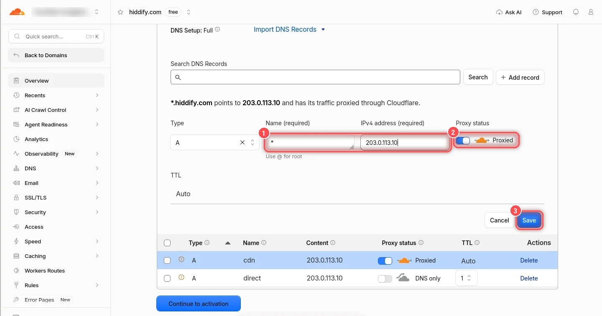
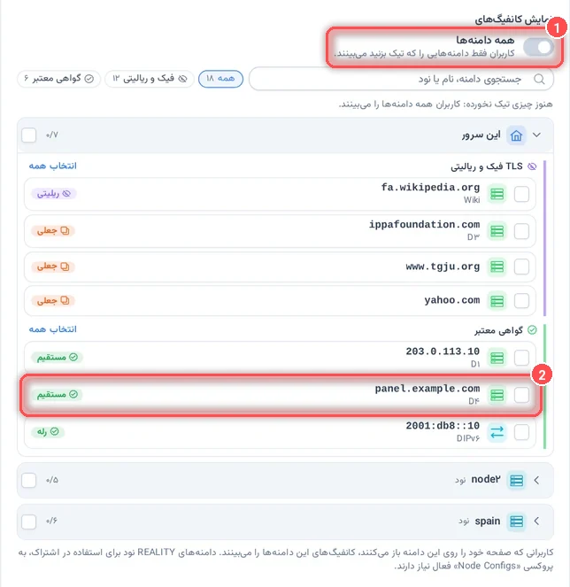

# آموزش استفاده از زیردامنه‌های متغیر در هیدیفای‌منیجر

زیردامنه متغیر (Wildcard) یعنی یک دامنه مثل `*.yourdomain.com` که همه زیردامنه‌های `yourdomain.com` را پوشش می‌دهد. وقتی چنین دامنه‌ای را در هیدیفای‌منیجر اضافه کنید، پنل در هر کانفیگ به جای `*` یک نام تصادفی می‌گذارد؛ مثلا `k3fq9xa.yourdomain.com`. این‌طور کاربران روی زیردامنه‌های متفاوتی وصل می‌شوند و اگر یکی از آن‌ها مسدود شود، بقیه کار می‌کنند.

برای این کار به یک دامنه نیاز دارید که روی کلادفلر باشد. اگر هنوز دامنه ندارید، [انواع دامنه و نحوه ثبت آن‌ها](/fa/manager/domain-worker-cdn-and-tunneling/Domain-types-and-how-to-register-them/) را ببینید.

## ۱. ساخت رکورد `*` در کلادفلر

1. وارد حساب کلادفلر شوید و دامنه خود را انتخاب کنید.
2. از منوی کناری به **DNS** > **Records** بروید و **Add record** را بزنید.
3. فیلدها را این‌طور پر کنید:
    - **Type**: `A`
    - **Name**: `*`
    - **IPv4 address**: آی‌پی سرور خود
    - **Proxy status**: روشن (ابر نارنجی، **Proxied**)
4. **Save** را بزنید.

اگر سرور شما آی‌پی نسخه ۶ دارد، همین کار را با یک رکورد از نوع `AAAA` و آی‌پی نسخه ۶ سرور انجام دهید.

!!! tip "تنظیم SSL در کلادفلر"
    پنل برای دامنه متغیر گواهی جداگانه نمی‌گیرد و گواهی سمت کاربر را کلادفلر می‌دهد. در کلادفلر به **SSL/TLS** > **Overview** بروید و مطمئن شوید حالت رمزگذاری **Full** است (نه **Flexible**).

## ۲. افزودن دامنه متغیر به پنل

1. از منوی کناری پنل، در گروه **تنظیمات**، صفحه **دامنه‌ها** را باز کنید و **افزودن دامنه** را بزنید.
2. در مرحله **دامنه**، `*.yourdomain.com` را وارد کنید و **بررسی** را بزنید.
3. در مرحله **حالت**، پنل تشخیص می‌دهد دامنه پشت کلادفلر است و گزینه **CDN** را با برچسب **مطابق** انتخاب می‌کند. **بعدی** را بزنید.

    

4. در مرحله **نام**، یک نام کوتاه برای نمایش در برنامه کاربران بگذارید.
5. مرحله **گواهی** را تمام کنید تا دامنه اضافه شود.

!!! note "به جای AutoCDN"
    در نسخه‌های قدیمی پنل حالت جداگانه‌ای به نام AutoCDN وجود داشت که در کانفیگ‌ها به جای نام دامنه، آی‌پی می‌گذاشت. در پنل جدید این حالت وجود ندارد. اگر می‌خواهید کانفیگ‌ها به آی‌پی‌های تمیز کلادفلر وصل شوند، دامنه را ویرایش کنید و در بخش **پیشرفته**، آی‌پی‌ها را در کارت **اجبار به استفاده از این IPها یا دامنه‌ها** وارد کنید. [اطلاعات بیشتر](/fa/manager/domain-worker-cdn-and-tunneling/Guide-for-using-mode-Auto_CDN_IP-on-Hiddify/)

## ۳. آوردن کانفیگ‌ها به لینک اشتراک

تنظیم **نمایش کانفیگ‌های** دامنه‌ای که کاربران صفحه کاربری را با آن باز می‌کنند، مشخص می‌کند کانفیگ‌های کدام دامنه‌ها در لینک اشتراک باشد.

- اگر **همه دامنه‌ها** روشن باشد (پیش‌فرض)، کانفیگ‌های دامنه متغیر خودکار اضافه می‌شوند.
- اگر فقط دامنه‌های مشخصی را نشان می‌دهید، آن دامنه را ویرایش کنید، در بخش **نمایش کانفیگ‌های** دامنه متغیر را تیک بزنید و **ذخیره** را بزنید.

## نتیجه

از این به بعد، هر بار که کاربر لینک اشتراک را به‌روزرسانی می‌کند، کانفیگ‌های دامنه متغیر روی زیردامنه‌های تصادفی جدید ساخته می‌شوند. چون همه این زیردامنه‌ها از رکورد `*` در کلادفلر استفاده می‌کنند، لازم نیست هیچ‌کدام را جداگانه در کلادفلر بسازید.

