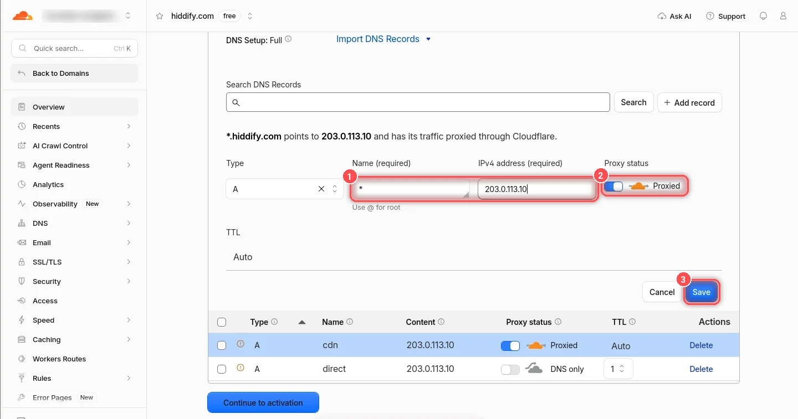
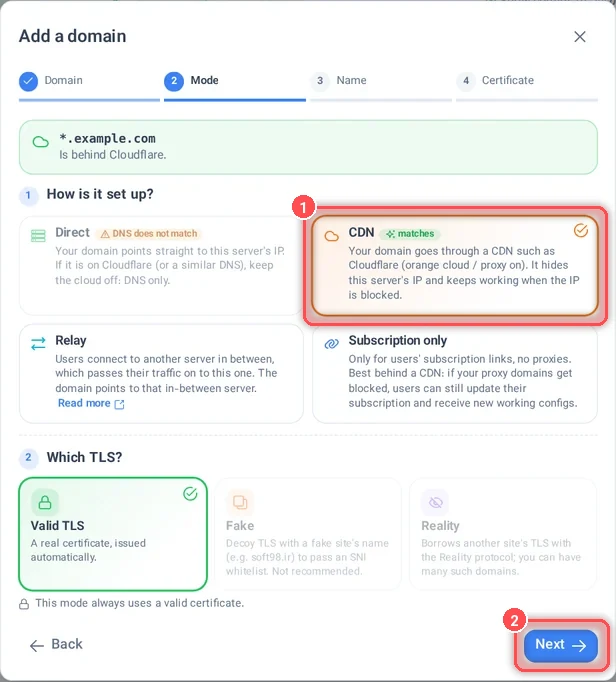
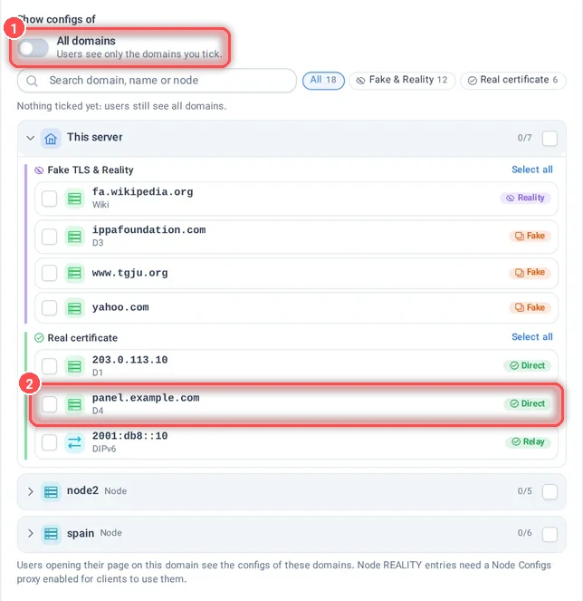

# How to use wildcard subdomains on HiddifyManager

A wildcard domain is a domain such as `*.yourdomain.com` that covers every subdomain of `yourdomain.com`. When you add one to HiddifyManager, the panel puts a random name in place of `*` in each config, for example `k3fq9xa.yourdomain.com`. Users then connect on different subdomains, and if one of them is blocked, the others keep working.

You need a domain on Cloudflare for this. If you don't have one yet, see [Domain types and how to register them](/manager/domain-worker-cdn-and-tunneling/Domain-types-and-how-to-register-them/).

## 1. Make a `*` record on Cloudflare

1. Sign in to Cloudflare and select your domain.
2. In the side menu, go to **DNS** > **Records** and click **Add record**.
3. Fill in the fields:
    - **Type**: `A`
    - **Name**: `*`
    - **IPv4 address**: your server's IP
    - **Proxy status**: on (orange cloud, **Proxied**)
4. Click **Save**.

If your server has an IPv6 address, do the same with an `AAAA` record and your server's IPv6 address.

!!! tip "SSL setting on Cloudflare"
    The panel does not get a separate certificate for a wildcard domain; Cloudflare gives the certificate users see. On Cloudflare, go to **SSL/TLS** > **Overview** and make sure the encryption mode is **Full** (not **Flexible**).

## 2. Add the wildcard domain to the panel

1. In the panel side menu, in the **Settings** group, open **Domains** and click **Add domain**.
2. In the **Domain** step, enter `*.yourdomain.com` and click **Check**.
3. In the **Mode** step, the panel sees that the domain is behind Cloudflare and selects **CDN** with a **matches** badge. Click **Next**.

    

4. In the **Name** step, give it a short name to show in the users' apps.
5. Finish the **Certificate** step to add the domain.

!!! note "Instead of AutoCDN"
    Older panel versions had a separate AutoCDN mode, which put an IP instead of the domain name in the configs. The new panel no longer has it. To make the configs connect to clean Cloudflare IPs, edit the domain, open **Advanced**, and enter the IPs in the **Force configs to use these IPs / domains** card. [More information](/manager/domain-worker-cdn-and-tunneling/Guide-for-using-mode-Auto_CDN_IP-on-Hiddify/)

## 3. Bring the configs into the subscription link

The **Show configs of** setting of the domain your users open their user page with decides which domains' configs are in the subscription link.

- If **All domains** is on (the default), the wildcard domain's configs are added by themselves.
- If you show only some domains, edit that domain, tick the wildcard domain under **Show configs of**, and click **Save**.

## Result

From now on, each time a user updates the subscription, the wildcard domain's configs are made on new random subdomains. All of them use the `*` record on Cloudflare, so you don't need to make any of them on Cloudflare one by one.

## Related articles

- [Domain types and how to add them](/manager/domain-worker-cdn-and-tunneling/Domain-types-and-how-to-register-them/)
- [Fake domain](/manager/domain-worker-cdn-and-tunneling/How-to-create-and-use-fake-domain/)
- [Automatic subdomains on Cloudflare](/manager/domain-worker-cdn-and-tunneling/Get-Cloudflare-API/)
- [Domain fronting](/manager/domain-worker-cdn-and-tunneling/Guide-for-domain-fronting/)

