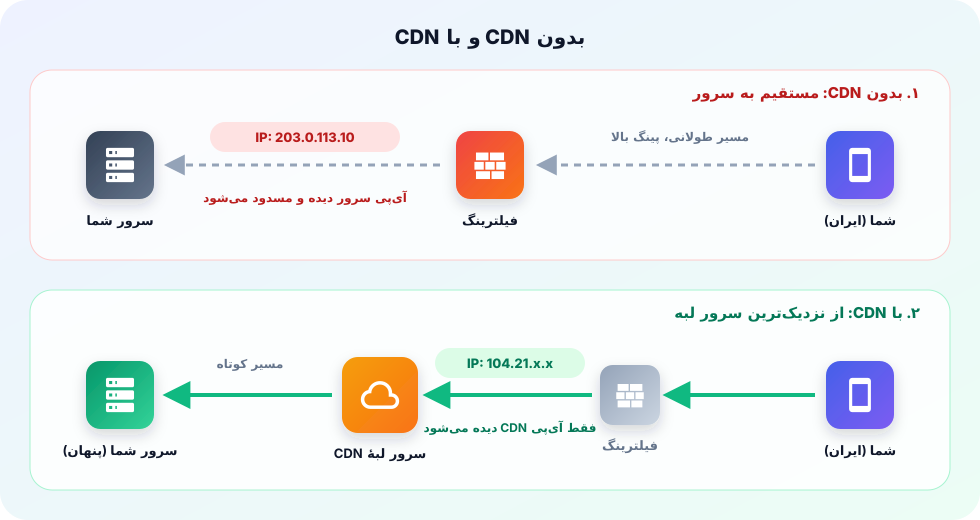
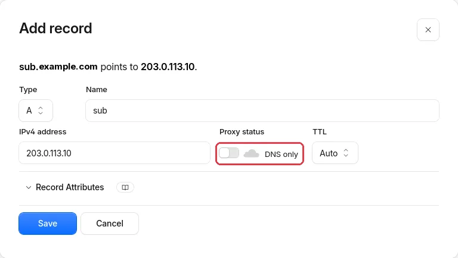
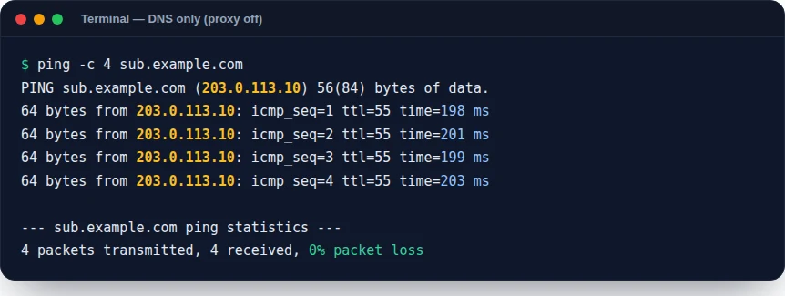
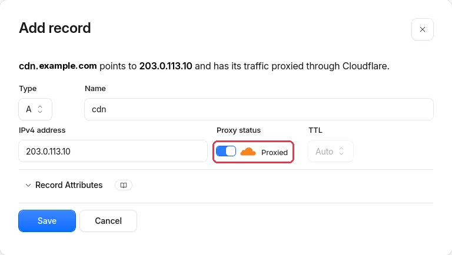
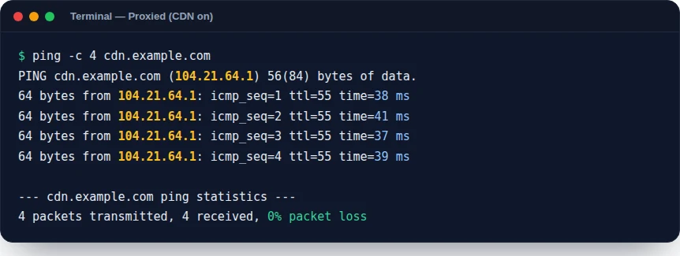
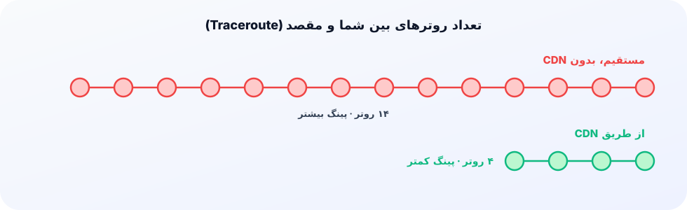
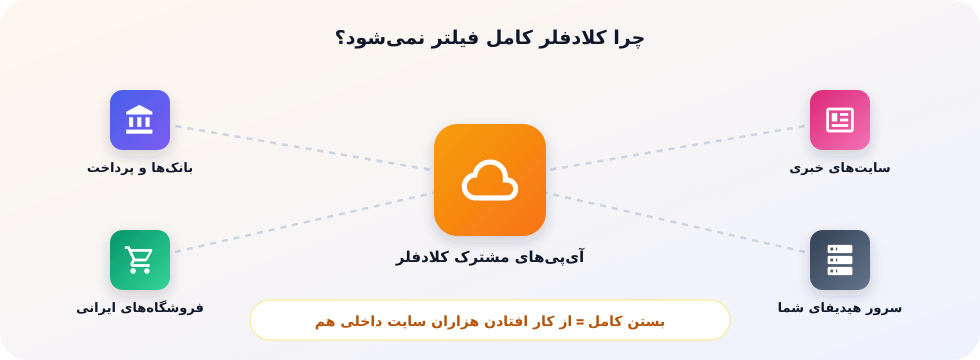
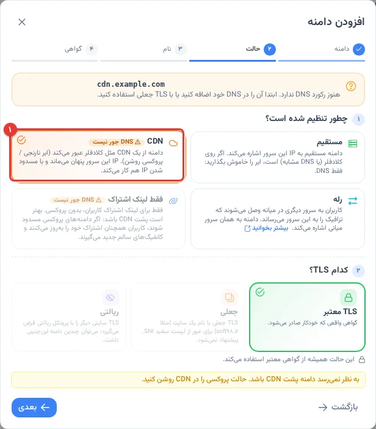

# سی‌دی‌ان چیست و چه کمکی به ما می‌کند؟

!!! info "بررسی‌شده برای هیدیفای‌منیجر نسخهٔ ۱۴.۵"
    ایدهٔ CDN تغییری نکرده است. روش استفاده از آن در پنل امروزی در بخش [استفاده از CDN در هیدیفای‌منیجر](#using-a-cdn-with-hiddify-manager) در انتهای همین صفحه آمده است.

تا به حال به این مورد فکر کرده‌اید که `CDN` چیست و چرا برای پیاده‌سازی برخی فیلترشکن‌ها به آن نیاز داریم؟ در کل `CDN` برای دور زدن فیلترینگ چه کمکی به ما می‌کند؟
در این مطلب قصد داریم نگاه کلی به ساختار `CDN` و نحوه‌ی عملکرد آن بیندازیم و در پایان به این سوال پاسخ دهیم تا با دید بازتری برای پیکربندی و پیاده‌سازی آن اقدام کنید. پس اگر آشنایی با نحوه‌ی کارکرد آن ندارید تا آخر این پست همراه ما باشید.

## نگاه کلی به عملکرد CDN
سی‌دی‌ان یا شبکه‌ی توزیع محتوا `Content Delivery Network` مجموعه‌ای از سرورهای به هم متصل شده در سراسر دنیا است که وظیفه‌ی انتقال سریع داده‎ها را بر عهده دارند. در شبکه‌ی توزیع محتوا داده‌های قرار گرفته شده بر روی وب‌سایت یا برنامه‌ها در سرورهای `CDN` کش یا ذخیره شده و به کاربران سراسر دنیا اجازه می‌دهد با سرعت بیشتری با آن وب‌سایت یا برنامه تبادل اطلاعات داشته باشند. همچنین به دلیل ماهیت آن پینگ و جیتر را نیز کاهش می‌دهد، اما این امر چگونه میسر می‌شود؟ فرض کنید شما در ایران نیاز به بازدید از یک وب‌سایت یا تبادل اطلاعات از طریق برنامه‌ای خاص با آمریکا را دارید. در صورتی که پلتفرم مقصد شما از `CDN` استفاده نکند، برای تبادل اطلاعات می‌بایست پکت ارسال شده کل مسیر شبکه تا مقصد را طی کرده تا درخواست را تحویل دهد و این پروسه مجددا برای برگشت پکت‌ها هم بایستی انجام شود. طبیعتا در این سناریو به دلیل طولانی بودن مسافت و فاصله‌ی کاربر تا سرور اصلی، امکان ارسال و دریافت با سرعت بالا وجود نخواهد داشت و تاخیر در بارگذاری و لود شدن صفحات بوضوح قابل مشاهده‌ست.
با این‌حال اگر در سناریو فوق از شبکه‌ی توزیع محتوا استفاده شود، داده‌های آن پلتفرم در سرورهای لبهٔ CDN ذخیره (کش) می‌شوند و کاربر بر اساس منطقه‌ی جغرافیایی خود به نزدیک‌ترین سرور لبه متصل شده و با سرعت بیشتر و تاخیر کمتر، نسبت به تبادل اطلاعات با مقصد اقدام می‌کند. در تصویر زیر شمای کلی از این سناریو را مشاهده می‌کنید.

  

حال ممکن است این سوال برای شما مطرح شود که با این حساب در راه‌اندازی فیلترشکن چه نیازی به استفاده از این شبکه‌ی توزیع محتواست؟
در بالا به یکی از فواید استفاده از این تکنولوژی اشاره کردیم، اما ماجرا به همینجا ختم نمی‌شود. نکته مهم و حیاتی که برای راه‌اندازی سرورهای فیلترشکن در این بستر از آن استفاده می‌شود، عدم مشخص شدن آی‌پی سرور شما از دید نهادهای نظارتی و سامانه‌های فیلترینگ است. همانطور که در بالا اشاره شد کاربر در حین تبادل اطلاعات با سرور مقصد به جای ارتباط مستقیم با سرور شما، به سرورهای لبهٔ CDN متصل شده و این سرورهای لبه مسئولیت تبادل اطلاعات با سرور اصلی را به عهده می‌گیرند. با این حساب آی‌پی سرور شما از دید نهادهای نظاره‌گر دولتی مخفی مانده و فیلتر شدن آن به طرز چشمگیری غیر ممکن می‌شود!
بیایید به‌صورت عملی هم تست و نتیجه را مشاهده کنیم. در اینجا ما یک رکورد A در کلادفلر ایجاد کرده و پروکسی (قابلیت استفاده از CDN) برای آن را خاموش می‌کنیم تا ساب‌دامین ایجاد شده از قابلیت `CDN` استفاده نکرده و مستقیما با سرور اصلی در ارتباط باشد.

  

سپس از سابدامین ایجاد شده پینگ بگیرید:

  

همانطور که در تصویر بالا مشاهده می‌کنید، آی‌پی اصلی سرور در این حالت مشخص و فیلتر کردن آن به راحتی امکان‌پذیر است.
در تست بعدی گزینه‌ی پروکسی را برای سابدامین ایجاد شده فعال کرده و نتایج را با هم مقایسه می‌کنیم:

  

حالا `ping` از یک آی‌پی کلادفلر جواب می‌دهد، نه از آی‌پی خود سرور:

  

در این حالت خروجی تست دیگر آی‌پی سرور اصلی نیست، بلکه آی‌پی سرورهای لبه‌ای را مشاهده می‌کنید که نزدیک‌ترین فاصله را به شما داشته و به آن متصل شده‌اید.
همچنین برای درک بهتر چگونگی کاهش پینگ و جیتر و افزایش سرعت در حالت استفاده از سی‌دی‌ان، اقدام به بررسی مسیر طی شده پکت‌ها `Tracing Route` کردیم. تصاویر زیر گویای این مسأله است که در هنگام استفاده از CDN مسیر دسترسی به سرور بسیار کوتاه‌تر شده، به‌طوری که در این مثال پکت‌ها در حالت مستقیم از ۱۰ روتر بیشتر عبور می‌کنند و همین مسئله باعث تاخیر بیشتر و کاهش سرعت و عملکرد آن می‌باشد.

## دلیل فیلتر نشدن کامل کلادفلر
حال ممکن است این سوال برایتان پیش بیاید که با این وجود چرا نهادهای دولتی اقدام به فیلترینگ کامل کلادفلر نکرده‌اند و اختلالات دیگری در آی‌پی‌های تحت نظر آن اعمال شده است؟ لازم به ذکر است کلادفلر یکی از بزرگترین و بی‌نظیرترین شبکه‌های توزیع محتوا در جهان است که خدمات و ابزارهای زیادی را در اختیار کاربران قرار می‌دهد. بسیاری از وب‌سایت‌ها و سرویس‌دهنده‌های ایرانی نیز از خدمات آن استفاده می‌کنند و در صورت فیلتر شدن کامل کلادفلر، دسترسی به بخش عظیمی از خدمات و سرویس‌های ایرانی نیز مسدود می‌شود. به همین دلیل نهادهای نظارتی از طریق روشهای دیگر برای ایجاد اختلال بر روی این بستر اقدام می‌کنند.

## استفاده از CDN در هیدیفای‌منیجر { #using-a-cdn-with-hiddify-manager }

1. **دامنه‌تان را روی یک CDN ببرید** و پروکسی آن را روشن کنید (در کلادفلر: ابر نارنجی). آموزش CDNهای رایج:
    - [آموزش استفاده از CDN کلادفلر](/fa/manager/domain-worker-cdn-and-tunneling/How-to-use-Cloudflare-CDN/)
    - [آموزش استفاده از CDN جی‌کور](/fa/manager/domain-worker-cdn-and-tunneling/How-to-use-GCore-CDN-on-Cloudflare-registered-domain/)
    - [آموزش استفاده از CDN آمازون](/fa/manager/domain-worker-cdn-and-tunneling/How-to-use-Amazon-CDN/)
2. **آن را به‌عنوان دامنهٔ CDN به پنل اضافه کنید:** **دامنه‌ها** › **افزودن دامنه**، بعد **CDN** با **TLS معتبر**. [دامنهٔ CDN](/fa/manager/configuration-and-advanced-settings/How-to-configure-Hiddify-panel-properly/#cdn-domain) را ببینید.

    

3. **به کاربران آی‌پی تمیز بدهید.** اسکنر خود پنل (**ابزارها** › **اسکنر**) آی‌پی‌های سالم را برای هر اپراتور پیدا و در دامنه ذخیره می‌کند. آی‌پی‌های CDN گاهی روی بعضی اپراتورها اختلال دارند. در فیلد **اجبار به استفاده از این IPها یا دامنه‌ها** در دامنهٔ CDN می‌توانید برای هر اپراتور آی‌پی تمیز جدا بدهید: [قرار دادن آی‌پی‌های تمیز دلخواه](/fa/manager/domain-worker-cdn-and-tunneling/How-to-use-desired-clean-IPs-based-on-a-specific-format/) و [پیدا کردن آی‌پی تمیز کلادفلر](/fa/manager/domain-worker-cdn-and-tunneling/Guide-for-finding-a-clean-Cloudflare-IP/) را ببینید.

فقط ترنسپورت‌هایی از CDN رد می‌شوند که CDN بتواند حملشان کند، مثل WebSocket، gRPC، HTTPUpgrade و XHTTP؛ پنل کانفیگ‌های مناسب دامنهٔ CDN را خودش می‌سازد.

بیشتر: [دامین فرانتینگ](/fa/manager/domain-worker-cdn-and-tunneling/Guide-for-domain-fronting/)، [ورکرهای کلادفلر](/fa/manager/domain-worker-cdn-and-tunneling/How-to-set-up-and-use-Cloudflare-workers/)، [مدیریت چند دامنهٔ CDN](/fa/manager/domain-worker-cdn-and-tunneling/How-to-use-multiCDN-domains-in-HiddifyManager/).

## مقاله‌های مرتبط

- [CDN کلادفلر](/fa/manager/domain-worker-cdn-and-tunneling/How-to-use-Cloudflare-CDN/)
- [CDN جی‌کور](/fa/manager/domain-worker-cdn-and-tunneling/How-to-use-GCore-CDN-on-Cloudflare-registered-domain/)
- [CDN آمازون (CloudFront)](/fa/manager/domain-worker-cdn-and-tunneling/How-to-use-Amazon-CDN/)
- [دامنهٔ CDN (آی‌پی خودکار)](/fa/manager/domain-worker-cdn-and-tunneling/Guide-for-using-mode-Auto_CDN_IP-on-Hiddify/)

