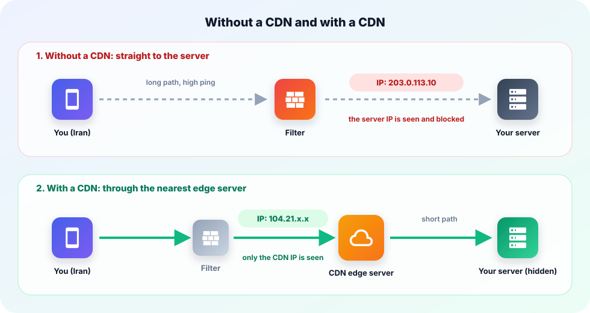
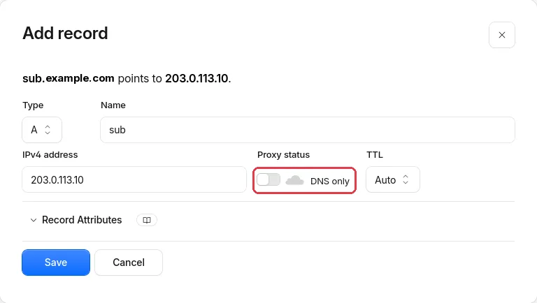
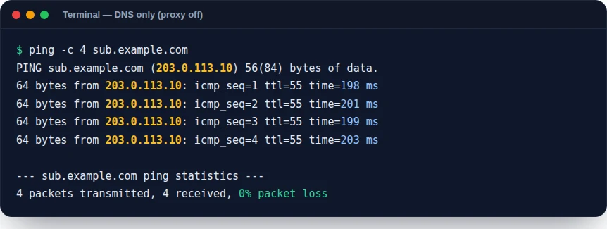
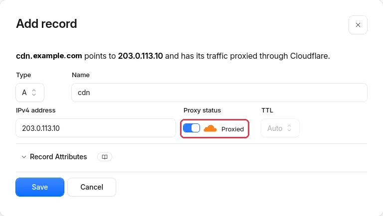
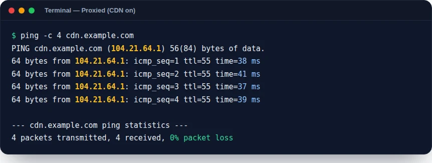
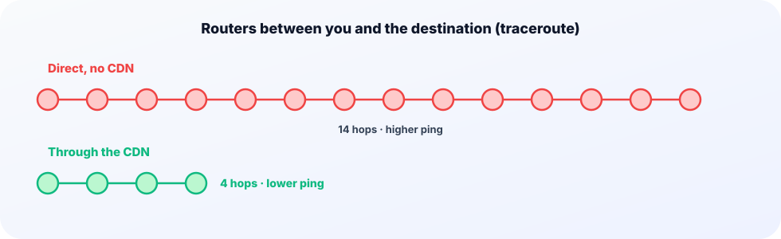
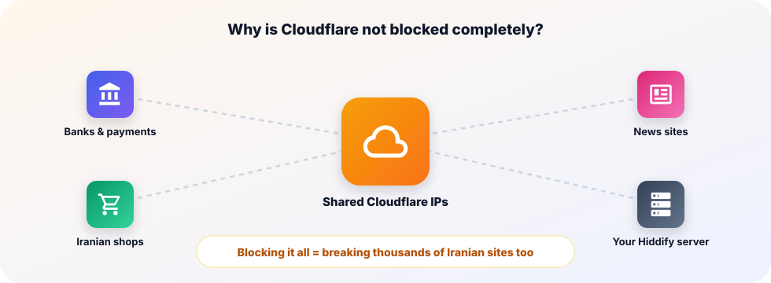
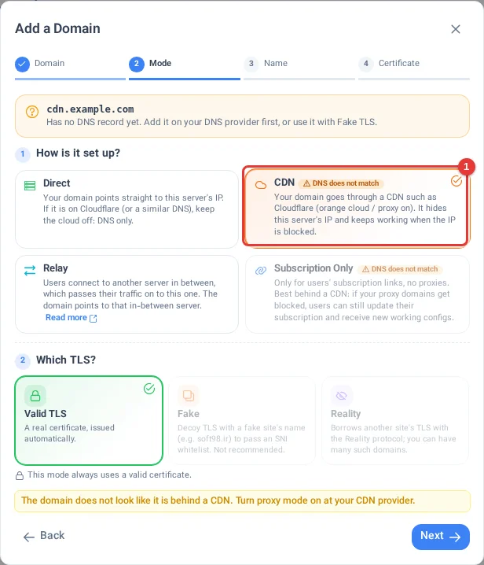

# What is CDN and how does it help us?

!!! info "Checked for Hiddify Manager v14.5"
    The idea of a CDN has not changed. How to use one in today's panel is in [Using a CDN with Hiddify Manager](#using-a-cdn-with-hiddify-manager) at the end of this page.

Ever wondered what a `CDN` is and why we need it to implement some filter breakers? In general, what does `CDN` help us to bypass filtering? In this article, we are going to take a general look at the `CDN` structure and how it works and at the end answer this question so that you can configure and implement it with a more open mind. So if you are not familiar with how it works, stay with us until the end of this post.

## CDN performance overview
CDN or `Content Delivery Network` is a set of connected servers around the world that are responsible for fast data transfer. In the content distribution network, the data placed on the website or applications is cached or stored in the `CDN` servers and allows users around the world to exchange information with that website or application at a faster rate. It also reduces ping and jitter by its very nature, but how is this possible? Suppose you need to visit a website in Iran or exchange information through a special program with America. If your destination platform does not use a `CDN`, to exchange information, the sent packet must travel the entire network path to the destination to deliver the request, and this process must be done again to return the packets. Naturally, in this scenario, due to the long distance between the user and the main server, it will not be possible to send and receive at high speed, and the delay in loading and loading pages is clearly visible. However, if the content distribution network is used in the above scenario, the data of that platform is cached on the CDN's edge servers and the user is connected to the nearest edge server based on their geographical area and with faster speed and less delay than exchanging information with The destination takes action. In the picture below, you can see the overview of this scenario.

  

Now the question may be raised to you, what is the need to use this content distribution network in setting up the filter breaker with this account? Above we mentioned one of the benefits of using this technology, but the story does not end here. The important and vital thing that is used to set up filtering servers on this platform is that your server's IP is not identified from the point of view of regulatory bodies and filtering systems. As mentioned above, during the exchange of information with the destination server, the user is connected to the CDN's edge servers instead of your server, and these edge servers are responsible for exchanging information with the main server. With this account, the IP of your server remains hidden from the eyes of government monitoring institutions, and its filtering becomes remarkably impossible! Let's see the test and the result practically. Here we create an A record in Cloudflare and turn off the proxy (the ability to use CDN) for it so that the created subdomain does not use the `CDN` ability and is directly connected to the main server.

  

Then ping the created subdomain:

  

As you can see in the image above, the main IP of the server can be identified and filtered easily. In the next test, we enable the proxy option for the created subdomain and compare the results:

  

Now `ping` answers from a Cloudflare IP, not from the server's own IP:

  

In this case, the test output is no longer the IP of the main server, but the IP of the edge servers that are closest to you and connected to. Also, in order to better understand how to reduce ping and jitter and increase speed when using CDN, we checked the route taken by packets by `Tracing Route`. The images below show that when using a CDN, the access path to the server is much shorter, so that in this example, the packets pass through more than 10 routers in direct mode, and this problem causes more delay and decreases its speed and performance.

## The reason why Cloudflare is not completely filtered
Now, you may be wondering why government institutions have not completely filtered Cloudflare and other disruptions have been applied to the IPs under its control? It should be noted that Cloudflare is one of the largest and most unique content distribution networks in the world, which provides many services and tools to users. Many Iranian websites and service providers also use its services, and if Cloudflare is completely filtered, access to a large part of Iranian services will be blocked. For this reason, regulatory bodies act through other methods to disrupt this platform.

## Using a CDN with Hiddify Manager

1. **Put your domain on a CDN** and turn its proxy on (for Cloudflare: the orange cloud). The guides for the common CDNs:
    - [How to use Cloudflare CDN](/manager/domain-worker-cdn-and-tunneling/How-to-use-Cloudflare-CDN/)
    - [How to use GCore CDN](/manager/domain-worker-cdn-and-tunneling/How-to-use-GCore-CDN-on-Cloudflare-registered-domain/)
    - [How to use Amazon CDN](/manager/domain-worker-cdn-and-tunneling/How-to-use-Amazon-CDN/)
2. **Add it to the panel as a CDN domain:** **Domains** › **Add domain**, then **CDN** with **Valid TLS**. See [CDN domain](/manager/configuration-and-advanced-settings/How-to-configure-Hiddify-panel-properly/#cdn-domain).

    

3. **Give users clean IPs.** The panel's own scanner (**Tools** › **Scanner**) finds working IPs for each ISP and saves them to the domain. The CDN's IPs are sometimes disrupted on some operators. In the CDN domain's **Force configs to use these IPs / domains** field you can give each operator its own clean IP: see [How to use desired clean IPs](/manager/domain-worker-cdn-and-tunneling/How-to-use-desired-clean-IPs-based-on-a-specific-format/) and [Guide for finding a clean Cloudflare IP](/manager/domain-worker-cdn-and-tunneling/Guide-for-finding-a-clean-Cloudflare-IP/).

Only transports that a CDN can carry work through it, such as WebSocket, gRPC, HTTPUpgrade and XHTTP; the panel makes the right configs for a CDN domain by itself.

More: [Domain fronting](/manager/domain-worker-cdn-and-tunneling/Guide-for-domain-fronting/), [Cloudflare workers](/manager/domain-worker-cdn-and-tunneling/How-to-set-up-and-use-Cloudflare-workers/), [multiple CDN domains](/manager/domain-worker-cdn-and-tunneling/How-to-use-multiCDN-domains-in-HiddifyManager/).

## Related articles

- [Cloudflare CDN](/manager/domain-worker-cdn-and-tunneling/How-to-use-Cloudflare-CDN/)
- [GCore CDN](/manager/domain-worker-cdn-and-tunneling/How-to-use-GCore-CDN-on-Cloudflare-registered-domain/)
- [Amazon CDN (CloudFront)](/manager/domain-worker-cdn-and-tunneling/How-to-use-Amazon-CDN/)
- [CDN domain (automatic IP)](/manager/domain-worker-cdn-and-tunneling/Guide-for-using-mode-Auto_CDN_IP-on-Hiddify/)

