<style>
@media screen and (min-width: 76.1875em) {.md-sidebar{display:none;}}
  .md-content__button {
    display: none;
  }
</style>

<p class="hi-eyebrow">راهنمای هیدیفای‌منیجر</p>

# سرور خودتان. با قاعدهٔ خودتان.

<p class="hi-lede">هیدیفای‌منیجر رایگان و متن‌باز است و روی سرور خودتان (یک VPS، یعنی کامپیوتری که در یک دیتاسنتر اجاره می‌کنید) نصب می‌شود؛ یک سرور VPN و پروکسی، برای خودتان و کاربرانتان. از نخستین فرمان تا ظریف‌ترین تنظیم، همه‌چیز در همین صفحه است.</p>

همهٔ آموزش‌ها به تفکیک موضوع آمده‌اند. اگر تازه‌کار هستید، از [راهنمای نصب اصلی](/fa/manager/installation-and-setup/guide/) شروع کنید.

!!! info "هیدیفای‌منیجر در یک نگاه"
    - **آخرین نسخه:** v14.2.0 (۱۵ آبان ۱۴۰۵ / 6 نوامبر 2026). همه [نسخه‌ها در گیت‌هاب](https://github.com/hiddify/Hiddify-Manager/releases).
    - **سرورهای پشتیبانی‌شده:** Ubuntu 26.04 یا 24.04 (پیشنهادی؛ 22.04 فقط اگر نسخهٔ جدیدتری در دسترس نبود)، با پردازنده amd64 (x86_64) یا arm64. از Ubuntu 20.04 دیگر پشتیبانی نمی‌شود. نصب با [Docker](/fa/manager/installation-and-setup/Install-Hiddify-using-Docker/) هم ممکن است.
    - **پروتکل‌ها:** VLESS، VMess، Trojan، Reality، Shadowsocks، Hysteria2، TUIC، WireGuard، AnyTLS، Snell، Naive، Mieru، xHTTP، تونل‌های DNS (VayDNS، Slipstream، MasterDnsVPN)، پروکسی تلگرام و موارد دیگر.
    - **کد منبع و جزئیات:** [مخزن هیدیفای‌منیجر در گیت‌هاب](https://github.com/hiddify/Hiddify-Manager).

برای نصب آخرین نسخه، از طریق SSH به سرورتان وصل شوید و این دستور را روی سرور اجرا کنید:

```bash
bash <(curl https://i.hiddify.com/release)
```

همه مراحل در [راهنمای نصب اصلی](/fa/manager/installation-and-setup/guide/) توضیح داده شده است. اگر از نسخه ۱۲ یا قدیمی‌تر به‌روزرسانی می‌کنید، اول پشتیبان بگیرید: [آموزش پشتیبان‌گیری و بازیابی](/fa/manager/configuration-and-advanced-settings/How-to-backup-and-restore-panel-on-Hiddify/) و [آموزش به‌روزرسانی](/fa/manager/configuration-and-advanced-settings/How-to-update-Hiddify-panel/) را ببینید.

برای اتصال به سرور از گوشی یا کامپیوتر، [اپلیکیشن هیدیفای](/fa/app/) را پیشنهاد می‌کنیم.

<!-- guide:start -->
<div class="hg" data-l-new="جدید" data-l-upd="به‌روز شد">
<h2 class="hg-h">از اینجا شروع کنید</h2><div class="hg-start">
<a class="hg-card" href="/fa/manager/installation-and-setup/guide/"><span class="hg-ic"><svg aria-hidden="true" xmlns="http://www.w3.org/2000/svg" viewBox="0 0 24 24"><path d="m13.13 22.19-1.63-3.83c1.57-.58 3.04-1.36 4.4-2.27l-2.77 6.1M5.64 12.5l-3.83-1.63 6.1-2.77C7 9.46 6.22 10.93 5.64 12.5M19.22 4c.28 0 .53 0 .74.05.17 1.39-.02 4.25-3.3 7.53-1.7 1.71-3.73 3.02-6.01 3.89l-2.15-2.1c.92-2.31 2.23-4.34 3.92-6.03C15.18 4.58 17.64 4 19.22 4m0-2c-1.98 0-4.98.69-8.22 3.93-2.19 2.19-3.5 4.6-4.35 6.71-.28.75-.09 1.57.46 2.13l2.13 2.12c.38.38.89.61 1.42.61.23 0 .47-.06.7-.15A19.1 19.1 0 0 0 18.07 13c5.66-5.66 3.54-10.61 3.54-10.61S20.7 2 19.22 2m-4.68 7.46c-.78-.78-.78-2.05 0-2.83s2.05-.78 2.83 0c.77.78.78 2.05 0 2.83-.78.78-2.05.78-2.83 0m-5.66 7.07-1.41-1.41 1.41 1.41M6.24 22l3.64-3.64c-.34-.09-.67-.24-.97-.45L4.83 22h1.41M2 22h1.41l4.77-4.76-1.42-1.41L2 20.59V22m0-2.83 4.09-4.08c-.21-.3-.36-.62-.45-.97L2 17.76v1.41Z"/></svg></span><span><b>نصب هیدیفای‌منیجر</b><small>با یک دستور روی سرور اوبونتو</small></span></a>
<a class="hg-card" href="/fa/manager/installation-and-setup/Guide-for-setting-up-the-domain-and-finalizing-the-installation/"><span class="hg-ic"><svg aria-hidden="true" xmlns="http://www.w3.org/2000/svg" viewBox="0 0 24 24"><path d="M16.5 12c0-.68-.06-1.34-.14-2h3.38c.16.64.26 1.31.26 2 0 .37-.03.73-.08 1.08.69.1 1.33.32 1.92.64.1-.56.16-1.13.16-1.72 0-5.5-4.5-10-10-10C6.47 2 2 6.5 2 12s4.5 10 10 10c.59 0 1.16-.06 1.72-.16A5.9 5.9 0 0 1 13 19c0-.29.03-.57.07-.85-.32.63-.67 1.24-1.07 1.81-.83-1.2-1.5-2.53-1.91-3.96h3.72a5.95 5.95 0 0 1 2.59-2.4c.06-.53.1-1.06.1-1.6M12 4.03c.83 1.2 1.5 2.54 1.91 3.97h-3.82c.41-1.43 1.08-2.77 1.91-3.97M4.26 14C4.1 13.36 4 12.69 4 12s.1-1.36.26-2h3.38c-.08.66-.14 1.32-.14 2s.06 1.34.14 2H4.26m.82 2H8c.35 1.25.8 2.45 1.4 3.56A8.008 8.008 0 0 1 5.08 16M8 8H5.08A7.923 7.923 0 0 1 9.4 4.44C8.8 5.55 8.35 6.75 8 8m6.34 6H9.66c-.1-.66-.16-1.32-.16-2s.06-1.35.16-2h4.68c.09.65.16 1.32.16 2s-.07 1.34-.16 2m.25-9.56c1.84.63 3.37 1.9 4.33 3.56h-2.95a15.65 15.65 0 0 0-1.38-3.56m7.91 12.81L17.75 22 15 19l1.16-1.16 1.59 1.59 3.59-3.59 1.16 1.41Z"/></svg></span><span><b>تنظیمات بعد از نصب</b><small>ثبت دامنه و آماده کردن پنل</small></span></a>
<a class="hg-card" href="/fa/manager/configuration-and-advanced-settings/How-to-configure-Hiddify-panel-properly/"><span class="hg-ic"><svg aria-hidden="true" xmlns="http://www.w3.org/2000/svg" viewBox="0 0 24 24"><path d="M8 13c-1.86 0-3.41 1.28-3.86 3H2v2h2.14c.45 1.72 2 3 3.86 3s3.41-1.28 3.86-3H22v-2H11.86c-.45-1.72-2-3-3.86-3m0 6c-1.1 0-2-.9-2-2s.9-2 2-2 2 .9 2 2-.9 2-2 2M19.86 6c-.45-1.72-2-3-3.86-3s-3.41 1.28-3.86 3H2v2h10.14c.45 1.72 2 3 3.86 3s3.41-1.28 3.86-3H22V6h-2.14M16 9c-1.1 0-2-.9-2-2s.9-2 2-2 2 .9 2 2-.9 2-2 2Z"/></svg></span><span><b>آشنایی با پنل</b><small>همهٔ بخش‌ها و تنظیمات پنل</small></span></a>
<a class="hg-card" href="/fa/app/"><span class="hg-ic"><svg aria-hidden="true" xmlns="http://www.w3.org/2000/svg" viewBox="0 0 24 24"><path d="M22 17h-4v-7h4m1-2h-6a1 1 0 0 0-1 1v10a1 1 0 0 0 1 1h6a1 1 0 0 0 1-1V9a1 1 0 0 0-1-1M4 6h18V4H4a2 2 0 0 0-2 2v11H0v3h14v-3H4V6Z"/></svg></span><span><b>اتصال کاربران</b><small>با اپ هیدیفای روی هر دستگاه</small></span></a>
</div>
<nav class="hg-nav" aria-label="دسته‌ها">
<a href="#install" style="--c:#5b63f6">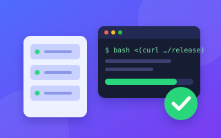<span>نصب و راه‌اندازی</span><small>۱۳</small></a>
<a href="#config" style="--c:#a855f7">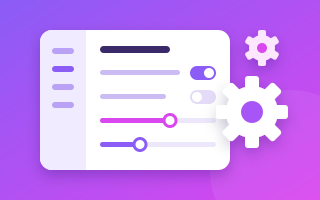<span>پیکربندی و تنظیمات</span><small>۲۳</small></a>
<a href="#domain" style="--c:#0ea5e9">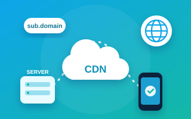<span>دامنه، CDN، ورکر و سرور میانی</span><small>۲۷</small></a>
<a href="#troubleshoot" style="--c:#f97316"><span>مفاهیم پایه، عیب‌یابی و امنیت</span><small>۱۹</small></a>
<a href="#clients" style="--c:#10b981"><span>اتصال کاربران</span><small>۱۴</small></a>
<a href="#developers" style="--c:#6366f1">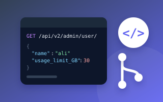<span>برای توسعه‌دهندگان</span><small>۲</small></a>
</nav>
<section class="hg-cat" id="install" style="--c:#5b63f6"><header><div><h2>نصب و راه‌اندازی</h2><p>از خرید سرور تا اولین اتصال</p><span class="hg-meta">۱۳ مقاله · ۱۵ ویدیو</span></div></header>
<div class="hg-groups">
<div class="hg-g"><h3>قدم‌به‌قدم</h3><ul><li><a class="hg-a" href="/fa/manager/installation-and-setup/Installation-prerequisites/" data-k="manager/installation-and-setup/Installation-prerequisites" data-n="2024-02-08" data-u="2026-11-16">پیش‌نیازهای نصب</a></li><li><a class="hg-a" href="/fa/manager/installation-and-setup/How-to-connect-to-server-via-SSH/" data-k="manager/installation-and-setup/How-to-connect-to-server-via-SSH" data-n="2024-02-08" data-u="2026-10-22">اتصال به سرور با SSH</a></li><li><a class="hg-a" href="/fa/manager/installation-and-setup/guide/" data-k="manager/installation-and-setup/guide" data-n="2024-02-08" data-u="2026-11-16">راهنمای نصب اصلی</a></li><li><a class="hg-a" href="/fa/manager/installation-and-setup/Guide-for-setting-up-the-domain-and-finalizing-the-installation/" data-k="manager/installation-and-setup/Guide-for-setting-up-the-domain-and-finalizing-the-installation" data-n="2024-02-08" data-u="2026-11-16">ثبت دامنه و تنظیمات بعد از نصب</a></li></ul></div>
<div class="hg-g"><h3>روش‌های دیگر نصب</h3><ul><li><a class="hg-a" href="/fa/manager/installation-and-setup/How-to-install-different-versions-of-Hiddify-Manager/" data-k="manager/installation-and-setup/How-to-install-different-versions-of-Hiddify-Manager" data-n="2024-02-08" data-u="2026-11-16">نصب نسخه‌های مختلف</a></li><li><a class="hg-a" href="/fa/manager/installation-and-setup/Install-Hiddify-using-Docker/" data-k="manager/installation-and-setup/Install-Hiddify-using-Docker" data-n="2024-02-08" data-u="2026-11-16">نصب روی داکر</a></li><li><a class="hg-a" href="/fa/manager/installation-and-setup/Cloud-init-installation/" data-k="manager/installation-and-setup/Cloud-init-installation" data-n="2024-02-08" data-u="2026-11-16">نصب خودکار از پنل دیتاسنتر (Cloud-init)</a></li><li><a class="hg-a hg-old" href="/fa/manager/installation-and-setup/How-to-install-HiddifManager-Version-8/">نصب نسخه ۸</a><span class="hg-ver">تا نسخهٔ ۸</span></li></ul></div>
<div class="hg-g"><h3>نصب سریع در دیتاسنترها</h3><ul><li><a class="hg-a" href="/fa/manager/installation-and-setup/Quick-installation-on-Hetzner-Servers/" data-k="manager/installation-and-setup/Quick-installation-on-Hetzner-Servers" data-n="2024-02-08" data-u="2026-11-16">Hetzner</a></li><li><a class="hg-a" href="/fa/manager/installation-and-setup/Quick-installation-on-Vultr-Servers/" data-k="manager/installation-and-setup/Quick-installation-on-Vultr-Servers" data-n="2024-02-08" data-u="2026-11-16">Vultr</a></li><li><a class="hg-a" href="/fa/manager/installation-and-setup/Quick-Installation-on-OVH-Servers/" data-k="manager/installation-and-setup/Quick-Installation-on-OVH-Servers" data-n="2024-02-08" data-u="2026-11-16">OVH</a></li><li><a class="hg-a" href="/fa/manager/installation-and-setup/Quick-Installation-on-Oracle-Cloud/" data-k="manager/installation-and-setup/Quick-Installation-on-Oracle-Cloud" data-n="2024-02-08" data-u="2026-11-16">Oracle Cloud</a></li><li><a class="hg-a" href="/fa/manager/installation-and-setup/Quick-Installation-on-Microsoft-Azure/" data-k="manager/installation-and-setup/Quick-Installation-on-Microsoft-Azure" data-n="2024-02-08" data-u="2026-11-16">Microsoft Azure</a></li></ul></div>
</div>
<div class="hg-videos"><div class="hg-vhead"><h3>ویدیوها <span class="hg-count">۱۵</span></h3><span class="hg-arrows"><button type="button" class="hg-prev" aria-label="قبلی"><svg aria-hidden="true" xmlns="http://www.w3.org/2000/svg" viewBox="0 0 24 24"><path d="M15.41 16.58 10.83 12l4.58-4.59L14 6l-6 6 6 6 1.41-1.42Z"/></svg></button><button type="button" class="hg-next" aria-label="بعدی"><svg aria-hidden="true" xmlns="http://www.w3.org/2000/svg" viewBox="0 0 24 24"><path d="M8.59 16.58 13.17 12 8.59 7.41 10 6l6 6-6 6-1.41-1.42Z"/></svg></button></span></div><div class="hg-vrow"><a class="hg-v hg-v-new" href="https://www.youtube.com/watch?v=xNzgSsBVZAs" target="_blank" rel="noopener" title="ویدیوی جدید، برای نسخهٔ فعلی"><span class="hg-thumb">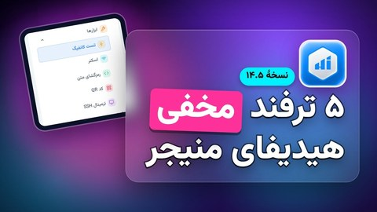<span class="hg-play"></span><span class="hg-vbadge" data-label="جدید"></span></span><h4 class="hg-vt" id="video-xNzgSsBVZAs">۵ قابلیت مخفی هیدیفای‌منیجر ۱۴.۵ که نمی‌دونستی 🕵️ سلامت کانفیگ، تست کانفیگ، اسکنر آی‌پی و SNI</h4><span class="hg-sr">ویدیوی یوتیوب. </span></a><a class="hg-v hg-v-old" href="https://www.youtube.com/watch?v=iJPj30yc2ag" target="_blank" rel="noopener" title="این ویدیو برای نسخهٔ قبلی است (برای نسخهٔ ۱۰ منیجر · سال ۱۴۰۳). ممکن است بخشی یا همهٔ آن با نسخهٔ فعلی فرق داشته باشد."><span class="hg-thumb">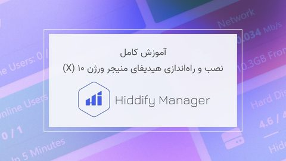<span class="hg-play"></span><span class="hg-vbadge" data-label="نسخهٔ پیشین"></span></span><h4 class="hg-vt" id="video-iJPj30yc2ag">آموزش کامل نصب و راه‌اندازی هیدیفای‌منیجر ورژن ۱۰ (X)</h4><span class="hg-sr">ویدیوی یوتیوب. </span><span class="hg-vmeta">برای نسخهٔ ۱۰ منیجر · سال ۱۴۰۳</span></a><a class="hg-v hg-v-old" href="https://www.youtube.com/watch?v=sZzXI7BGClI" target="_blank" rel="noopener" title="این ویدیو برای نسخهٔ قبلی است (ضبط‌شده در سال ۱۴۰۲). ممکن است بخشی یا همهٔ آن با نسخهٔ فعلی فرق داشته باشد."><span class="hg-thumb">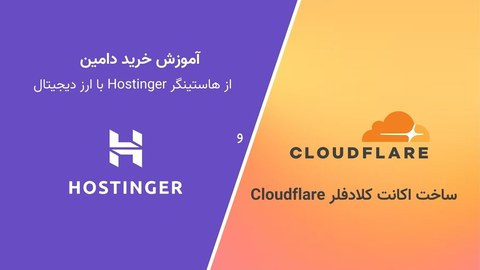<span class="hg-play"></span><span class="hg-vbadge" data-label="نسخهٔ پیشین"></span></span><h4 class="hg-vt" id="video-sZzXI7BGClI">آموزش خرید دامین (دامنه) از هاستینگر Hostinger با ارز دیجیتال و ساخت اکانت کلادفلر</h4><span class="hg-sr">ویدیوی یوتیوب. </span><span class="hg-vmeta">ضبط‌شده در سال ۱۴۰۲</span></a><a class="hg-v hg-v-old" href="https://www.youtube.com/watch?v=pydED363X-o" target="_blank" rel="noopener" title="این ویدیو برای نسخهٔ قبلی است (برای نسخهٔ ۸ منیجر · سال ۱۴۰۲). ممکن است بخشی یا همهٔ آن با نسخهٔ فعلی فرق داشته باشد."><span class="hg-thumb">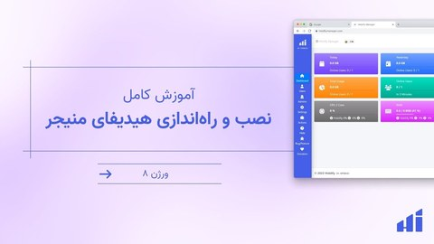<span class="hg-play"></span><span class="hg-vbadge" data-label="نسخهٔ پیشین"></span></span><h4 class="hg-vt" id="video-pydED363X-o">آموزش کامل نصب و راه‌اندازی هیدیفای‌منیجر Hiddify Manager (ورژن ۸)</h4><span class="hg-sr">ویدیوی یوتیوب. </span><span class="hg-vmeta">برای نسخهٔ ۸ منیجر · سال ۱۴۰۲</span></a><a class="hg-v hg-v-old" href="https://www.youtube.com/watch?v=tRrulSA8rZU" target="_blank" rel="noopener" title="این ویدیو برای نسخهٔ قبلی است (ضبط‌شده در سال ۱۴۰۲). ممکن است بخشی یا همهٔ آن با نسخهٔ فعلی فرق داشته باشد."><span class="hg-thumb">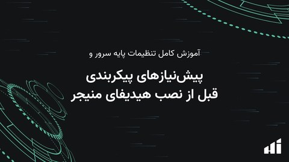<span class="hg-play"></span><span class="hg-vbadge" data-label="نسخهٔ پیشین"></span></span><h4 class="hg-vt" id="video-tRrulSA8rZU">آموزش کامل تنظیمات پایه سرور و پیش‌نیازهای پیکربندی قبل از نصب هیدیفای‌منیجر</h4><span class="hg-sr">ویدیوی یوتیوب. </span><span class="hg-vmeta">ضبط‌شده در سال ۱۴۰۲</span></a><a class="hg-v hg-v-old" href="https://www.youtube.com/watch?v=GVEHJUOojUY" target="_blank" rel="noopener" title="این ویدیو برای نسخهٔ قبلی است (ضبط‌شده در سال ۱۴۰۲). ممکن است بخشی یا همهٔ آن با نسخهٔ فعلی فرق داشته باشد."><span class="hg-thumb">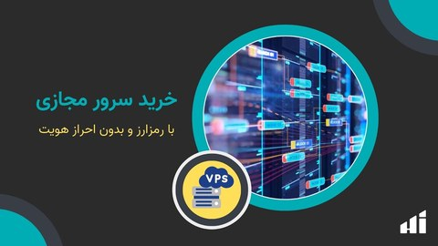<span class="hg-play"></span><span class="hg-vbadge" data-label="نسخهٔ پیشین"></span></span><h4 class="hg-vt" id="video-GVEHJUOojUY">آموزش خرید سرور مجازی (VPS) با رمزارز و بدون احراز هویت</h4><span class="hg-sr">ویدیوی یوتیوب. </span><span class="hg-vmeta">ضبط‌شده در سال ۱۴۰۲</span></a><a class="hg-v hg-v-old" href="https://www.youtube.com/watch?v=h0yk3Vm3hcI" target="_blank" rel="noopener" title="این ویدیو برای نسخهٔ قبلی است (برای نسخهٔ ۷ منیجر · سال ۱۴۰۲). ممکن است بخشی یا همهٔ آن با نسخهٔ فعلی فرق داشته باشد."><span class="hg-thumb"><span class="hg-play"></span><span class="hg-vbadge" data-label="نسخهٔ پیشین"></span></span><h4 class="hg-vt" id="video-h0yk3Vm3hcI">نصب تا استفاده از هیدیفای‌منیجر نسخه ۷ ( کل مراحل از صفر تا صد)</h4><span class="hg-sr">ویدیوی یوتیوب. </span><span class="hg-vmeta">برای نسخهٔ ۷ منیجر · سال ۱۴۰۲</span></a><a class="hg-v hg-v-old" href="https://www.youtube.com/watch?v=DunP8wfctyA" target="_blank" rel="noopener" title="این ویدیو برای نسخهٔ قبلی است (برای نسخهٔ ۱۰ منیجر · سال ۱۴۰۲). ممکن است بخشی یا همهٔ آن با نسخهٔ فعلی فرق داشته باشد."><span class="hg-thumb"><span class="hg-play"></span><span class="hg-vbadge" data-label="نسخهٔ پیشین"></span></span><h4 class="hg-vt" id="video-DunP8wfctyA">جدیدترین قابلیت‌های هیدیفای‌منیجر (صفر تا صد)</h4><span class="hg-sr">ویدیوی یوتیوب. </span><span class="hg-vmeta">برای نسخهٔ ۱۰ منیجر · سال ۱۴۰۲</span></a><a class="hg-v hg-v-old" href="https://www.youtube.com/watch?v=_LYFqrXVupI" target="_blank" rel="noopener" title="این ویدیو برای نسخهٔ قبلی است (برای نسخهٔ ۸ منیجر · سال ۱۴۰۱). ممکن است بخشی یا همهٔ آن با نسخهٔ فعلی فرق داشته باشد."><span class="hg-thumb"><span class="hg-play"></span><span class="hg-vbadge" data-label="نسخهٔ پیشین"></span></span><h4 class="hg-vt" id="video-_LYFqrXVupI">راهنمای نصب و راه اندازی هیدیفای‌منیجر از صفر تا صد بهترین جایگزین x-ui v2ray panel</h4><span class="hg-sr">ویدیوی یوتیوب. </span><span class="hg-vmeta">برای نسخهٔ ۸ منیجر · سال ۱۴۰۱</span></a><a class="hg-v hg-v-old" href="https://www.youtube.com/watch?v=tcd1wBUR3cY" target="_blank" rel="noopener" title="این ویدیو برای نسخهٔ قبلی است (ضبط‌شده در سال ۱۴۰۱). ممکن است بخشی یا همهٔ آن با نسخهٔ فعلی فرق داشته باشد."><span class="hg-thumb"><span class="hg-play"></span><span class="hg-vbadge" data-label="نسخهٔ پیشین"></span></span><h4 class="hg-vt" id="video-tcd1wBUR3cY">آموزش خرید سرور از ایران برای فیلترشکن v2ray xui Hiddify</h4><span class="hg-sr">ویدیوی یوتیوب. </span><span class="hg-vmeta">ضبط‌شده در سال ۱۴۰۱</span></a><a class="hg-v hg-v-old" href="https://www.youtube.com/watch?v=-a4tfRUsrNY" target="_blank" rel="noopener" title="این ویدیو برای نسخهٔ قبلی است (برای نسخهٔ ۷ منیجر · سال ۱۴۰۱). ممکن است بخشی یا همهٔ آن با نسخهٔ فعلی فرق داشته باشد."><span class="hg-thumb"><span class="hg-play"></span><span class="hg-vbadge" data-label="نسخهٔ پیشین"></span></span><h4 class="hg-vt" id="video--a4tfRUsrNY">بهترین و کامل ترین پنل v2ray xray، امکانات پنل هیدیفای جایگزین مطمئن x-ui xui</h4><span class="hg-sr">ویدیوی یوتیوب. </span><span class="hg-vmeta">برای نسخهٔ ۷ منیجر · سال ۱۴۰۱</span></a><a class="hg-v hg-v-old" href="https://www.youtube.com/watch?v=s1QZD1Ujdds" target="_blank" rel="noopener" title="این ویدیو برای نسخهٔ قبلی است (برای نسخهٔ ۵ منیجر · سال ۱۴۰۱). ممکن است بخشی یا همهٔ آن با نسخهٔ فعلی فرق داشته باشد."><span class="hg-thumb"><span class="hg-play"></span><span class="hg-vbadge" data-label="نسخهٔ پیشین"></span></span><h4 class="hg-vt" id="video-s1QZD1Ujdds">آموزش صفر تا صد نصب پروکسی رایگان هیدیفای‌منیجر بدون هیچ دانش فنی در اوراکل</h4><span class="hg-sr">ویدیوی یوتیوب. </span><span class="hg-vmeta">برای نسخهٔ ۵ منیجر · سال ۱۴۰۱</span></a><a class="hg-v hg-v-old" href="https://www.youtube.com/watch?v=hRRg10BURJI" target="_blank" rel="noopener" title="این ویدیو برای نسخهٔ قبلی است (برای نسخهٔ ۵ منیجر · سال ۱۴۰۱). ممکن است بخشی یا همهٔ آن با نسخهٔ فعلی فرق داشته باشد."><span class="hg-thumb"><span class="hg-play"></span><span class="hg-vbadge" data-label="نسخهٔ پیشین"></span></span><h4 class="hg-vt" id="video-hRRg10BURJI">آموزش صفر تا صد نصب هیدیفای‌منیجر بدون هیچ دانش فنی در ولتر</h4><span class="hg-sr">ویدیوی یوتیوب. </span><span class="hg-vmeta">برای نسخهٔ ۵ منیجر · سال ۱۴۰۱</span></a><a class="hg-v hg-v-old" href="https://www.youtube.com/watch?v=l-KKRus2KS0" target="_blank" rel="noopener" title="این ویدیو برای نسخهٔ قبلی است (ضبط‌شده در سال ۱۴۰۱). ممکن است بخشی یا همهٔ آن با نسخهٔ فعلی فرق داشته باشد."><span class="hg-thumb">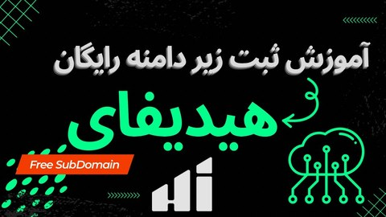<span class="hg-play"></span><span class="hg-vbadge" data-label="نسخهٔ پیشین"></span></span><h4 class="hg-vt" id="video-l-KKRus2KS0">آموزش ثبت زیردامنه رایگان جهت گرفتن سرتیفیکیت رایگان با certbot در پنل هیدیفای</h4><span class="hg-sr">ویدیوی یوتیوب. </span><span class="hg-vmeta">ضبط‌شده در سال ۱۴۰۱</span></a><a class="hg-v hg-v-old" href="https://www.youtube.com/watch?v=06fMizOb-DE" target="_blank" rel="noopener" title="این ویدیو برای نسخهٔ قبلی است (برای نسخهٔ ۵ منیجر · سال ۱۴۰۱). ممکن است بخشی یا همهٔ آن با نسخهٔ فعلی فرق داشته باشد."><span class="hg-thumb"><span class="hg-play"></span><span class="hg-vbadge" data-label="نسخهٔ پیشین"></span></span><h4 class="hg-vt" id="video-06fMizOb-DE">آموزش نصب پروکسی Bypass Internet with Hiddify on OVH Cloud نصب هیدیفای</h4><span class="hg-sr">ویدیوی یوتیوب. </span><span class="hg-vmeta">برای نسخهٔ ۵ منیجر · سال ۱۴۰۱</span></a></div></div>
</section>
<section class="hg-cat" id="config" style="--c:#a855f7"><header><div><h2>پیکربندی و تنظیمات</h2><p>پنل، ریالتی، تلگرام، وارپ و نگهداری سرور</p><span class="hg-meta">۲۳ مقاله · ۱۰ ویدیو</span></div></header>
<div class="hg-groups">
<div class="hg-g"><h3>پنل</h3><ul><li><a class="hg-a" href="/fa/manager/configuration-and-advanced-settings/How-to-configure-Hiddify-panel-properly/" data-k="manager/configuration-and-advanced-settings/How-to-configure-Hiddify-panel-properly" data-n="2024-02-08" data-u="2026-11-16">آشنایی کامل با پنل و تنظیمات آن</a></li><li><a class="hg-a" href="/fa/manager/configuration-and-advanced-settings/Settings-reference/" data-k="manager/configuration-and-advanced-settings/Settings-reference" data-n="2026-11-16">همهٔ تنظیمات پنل، یکی‌یکی</a></li><li><a class="hg-a" href="/fa/manager/configuration-and-advanced-settings/How-to-connect-and-troubleshoot-via-SSH/" data-k="manager/configuration-and-advanced-settings/How-to-connect-and-troubleshoot-via-SSH" data-n="2024-02-08" data-u="2026-10-22">منوی هیدیفای‌منیجر در SSH</a></li><li><a class="hg-a" href="/fa/manager/configuration-and-advanced-settings/how-to-import-xui-to-hiddifymanager/" data-k="manager/configuration-and-advanced-settings/how-to-import-xui-to-hiddifymanager" data-n="2024-03-27" data-u="2026-11-16">انتقال کاربران از پنل X-UI</a></li><li><a class="hg-a" href="/fa/manager/domain-worker-cdn-and-tunneling/The-correct-format-of-admin-link/" data-k="manager/domain-worker-cdn-and-tunneling/The-correct-format-of-admin-link" data-n="2024-02-08" data-u="2026-10-22">لینک ادمین و فرمت آن</a></li><li><a class="hg-a" href="/fa/manager/configuration-and-advanced-settings/Inbox-free-test-and-messages-on-HiddifyManager/" data-k="manager/configuration-and-advanced-settings/Inbox-free-test-and-messages-on-HiddifyManager" data-n="2026-11-16">صندوق پیام، تست رایگان و پیام به کاربران</a></li><li><a class="hg-a" href="/fa/manager/configuration-and-advanced-settings/Automatic-config-health-checks-on-HiddifyManager/" data-k="manager/configuration-and-advanced-settings/Automatic-config-health-checks-on-HiddifyManager" data-n="2026-11-16">بررسی خودکار سلامت کانفیگ‌ها</a></li></ul></div>
<div class="hg-g"><h3>چندسروره و خروجی‌ها</h3><ul><li><a class="hg-a" href="/fa/manager/configuration-and-advanced-settings/Multi-server-with-nodes-on-HiddifyManager/" data-k="manager/configuration-and-advanced-settings/Multi-server-with-nodes-on-HiddifyManager" data-n="2026-11-16">چندسروره با نودها</a></li><li><a class="hg-a" href="/fa/manager/configuration-and-advanced-settings/How-to-use-Outbounds-on-HiddifyManager/" data-k="manager/configuration-and-advanced-settings/How-to-use-Outbounds-on-HiddifyManager" data-n="2026-11-16">خروجی‌ها (WARP، Socks، Tor و …)</a></li></ul></div>
<div class="hg-g"><h3>ابزارها و پیشرفته</h3><ul><li><a class="hg-a" href="/fa/manager/configuration-and-advanced-settings/How-to-use-the-panel-tools-in-HiddifyManager/" data-k="manager/configuration-and-advanced-settings/How-to-use-the-panel-tools-in-HiddifyManager" data-n="2026-11-16">ابزارهای پنل (تست کانفیگ، اسکنر، SSH و …)</a></li><li><a class="hg-a" href="/fa/manager/configuration-and-advanced-settings/How-to-use-the-Proxy-Editor-in-HiddifyManager/" data-k="manager/configuration-and-advanced-settings/How-to-use-the-Proxy-Editor-in-HiddifyManager" data-n="2026-11-16">ویرایشگر پروکسی</a></li><li><a class="hg-a" href="/fa/manager/configuration-and-advanced-settings/My-account-and-admin-security-in-HiddifyManager/" data-k="manager/configuration-and-advanced-settings/My-account-and-admin-security-in-HiddifyManager" data-n="2026-11-16">حساب من و امنیت ادمین</a></li></ul></div>
<div class="hg-g"><h3>ریالتی</h3><ul><li><a class="hg-a" href="/fa/manager/configuration-and-advanced-settings/How-to-use-Reality-on-Hiddify/" data-k="manager/configuration-and-advanced-settings/How-to-use-Reality-on-Hiddify" data-n="2024-02-08" data-u="2026-11-12">تنظیم ریالتی</a></li><li><a class="hg-a hg-old" href="/fa/manager/configuration-and-advanced-settings/How-to-use-Hiddify-Reality-Scanner/">اسکنر ریالتی هیدیفای</a><span class="hg-ver">نسخهٔ پیشین</span></li><li><a class="hg-a" href="/fa/manager/configuration-and-advanced-settings/How-to-use-subdomains-of-a-website-in-Reality/" data-k="manager/configuration-and-advanced-settings/How-to-use-subdomains-of-a-website-in-Reality" data-n="2024-02-08" data-u="2026-10-22">چند زیردامنهٔ یک سایت در ریالتی</a></li></ul></div>
<div class="hg-g"><h3>تلگرام و وارپ</h3><ul><li><a class="hg-a" href="/fa/manager/configuration-and-advanced-settings/How-to-set-up-Telegram-proxy-on-Hiddify/" data-k="manager/configuration-and-advanced-settings/How-to-set-up-Telegram-proxy-on-Hiddify" data-n="2024-02-08" data-u="2026-11-11">پروکسی تلگرام</a></li><li><a class="hg-a" href="/fa/manager/configuration-and-advanced-settings/How-to-set-up-and-use-Telegram-bot-on-Hiddify-panel/" data-k="manager/configuration-and-advanced-settings/How-to-set-up-and-use-Telegram-bot-on-Hiddify-panel" data-n="2024-02-08" data-u="2026-11-13">بات تلگرام پنل</a></li><li><a class="hg-a" href="/fa/manager/configuration-and-advanced-settings/How-to-activate-WARP-on-the-Hiddify-panel/" data-k="manager/configuration-and-advanced-settings/How-to-activate-WARP-on-the-Hiddify-panel" data-n="2024-02-08" data-u="2026-11-16">فعال‌سازی وارپ</a></li><li><a class="hg-a" href="/fa/manager/configuration-and-advanced-settings/IPv6-usage-guide/" data-k="manager/configuration-and-advanced-settings/IPv6-usage-guide" data-n="2024-12-18" data-u="2026-10-22">استفاده از IPv6</a></li></ul></div>
<div class="hg-g"><h3>نگهداری</h3><ul><li><a class="hg-a" href="/fa/manager/configuration-and-advanced-settings/How-to-update-Hiddify-panel/" data-k="manager/configuration-and-advanced-settings/How-to-update-Hiddify-panel" data-n="2024-02-08" data-u="2026-11-16">به‌روزرسانی</a></li><li><a class="hg-a" href="/fa/manager/configuration-and-advanced-settings/How-to-backup-and-restore-panel-on-Hiddify/" data-k="manager/configuration-and-advanced-settings/How-to-backup-and-restore-panel-on-Hiddify" data-n="2024-02-08" data-u="2026-11-16">پشتیبان‌گیری و بازیابی</a></li><li><a class="hg-a" href="/fa/manager/configuration-and-advanced-settings/How-to-Reset-Hiddify-panel-to-default/" data-k="manager/configuration-and-advanced-settings/How-to-Reset-Hiddify-panel-to-default" data-n="2024-02-08" data-u="2026-11-16">برگرداندن تنظیمات به حالت اولیه</a></li><li><a class="hg-a" href="/fa/manager/configuration-and-advanced-settings/SSH-proxy-setting-on-Hiddify-panel/" data-k="manager/configuration-and-advanced-settings/SSH-proxy-setting-on-Hiddify-panel" data-n="2024-02-08" data-u="2026-11-12">پروکسی SSH</a></li></ul></div>
</div>
<div class="hg-videos"><div class="hg-vhead"><h3>ویدیوها <span class="hg-count">۱۰</span></h3><span class="hg-arrows"><button type="button" class="hg-prev" aria-label="قبلی"><svg aria-hidden="true" xmlns="http://www.w3.org/2000/svg" viewBox="0 0 24 24"><path d="M15.41 16.58 10.83 12l4.58-4.59L14 6l-6 6 6 6 1.41-1.42Z"/></svg></button><button type="button" class="hg-next" aria-label="بعدی"><svg aria-hidden="true" xmlns="http://www.w3.org/2000/svg" viewBox="0 0 24 24"><path d="M8.59 16.58 13.17 12 8.59 7.41 10 6l6 6-6 6-1.41-1.42Z"/></svg></button></span></div><div class="hg-vrow"><a class="hg-v hg-v-new" href="https://www.youtube.com/watch?v=aVrb1pjQbGU" target="_blank" rel="noopener" title="ویدیوی جدید، برای نسخهٔ فعلی"><span class="hg-thumb"><span class="hg-play"></span><span class="hg-vbadge" data-label="جدید"></span></span><h4 class="hg-vt" id="video-aVrb1pjQbGU">تلگرام بدون فیلتر با کلادفلر 🔥 آموزش کامل وب‌پروکسی جدید تلگرام در هیدیفای‌منیجر ۱۴ (صفر تا صد)</h4><span class="hg-sr">ویدیوی یوتیوب. </span></a><a class="hg-v hg-v-new" href="https://www.youtube.com/watch?v=x5Tb6GUVvI0" target="_blank" rel="noopener" title="ویدیوی جدید، برای نسخهٔ فعلی"><span class="hg-thumb">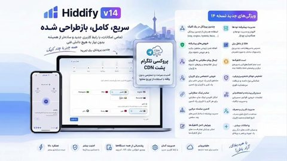<span class="hg-play"></span><span class="hg-vbadge" data-label="جدید"></span></span><h4 class="hg-vt" id="video-x5Tb6GUVvI0">بزرگترین آپدیت هیدیفای‌منیجر نسخه ۱۴ راحت و پیشرفته بازطراحی کامل با پروکسی تلگرام در کلادفلر</h4><span class="hg-sr">ویدیوی یوتیوب. </span></a><a class="hg-v hg-v-old" href="https://www.youtube.com/watch?v=aZEkJ54LIao" target="_blank" rel="noopener" title="این ویدیو برای نسخهٔ قبلی است (برای نسخهٔ ۱۰ منیجر · سال ۱۴۰۳). ممکن است بخشی یا همهٔ آن با نسخهٔ فعلی فرق داشته باشد."><span class="hg-thumb">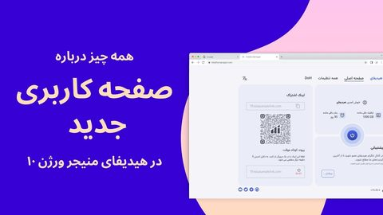<span class="hg-play"></span><span class="hg-vbadge" data-label="نسخهٔ پیشین"></span></span><h4 class="hg-vt" id="video-aZEkJ54LIao">همه چیز درباره صفحه کاربری جدید هیدیفای در هیدیفای‌منیجر ورژن ۱۰</h4><span class="hg-sr">ویدیوی یوتیوب. </span><span class="hg-vmeta">برای نسخهٔ ۱۰ منیجر · سال ۱۴۰۳</span></a><a class="hg-v hg-v-old" href="https://www.youtube.com/watch?v=ui0PCRfF9v4" target="_blank" rel="noopener" title="این ویدیو برای نسخهٔ قبلی است (برای نسخهٔ ۱۰ منیجر · سال ۱۴۰۳). ممکن است بخشی یا همهٔ آن با نسخهٔ فعلی فرق داشته باشد."><span class="hg-thumb"><span class="hg-play"></span><span class="hg-vbadge" data-label="نسخهٔ پیشین"></span></span><h4 class="hg-vt" id="video-ui0PCRfF9v4">تنظیمات هیدیفای‌منیجر و آپدیت‌های جدید ورژن ۱۰</h4><span class="hg-sr">ویدیوی یوتیوب. </span><span class="hg-vmeta">برای نسخهٔ ۱۰ منیجر · سال ۱۴۰۳</span></a><a class="hg-v hg-v-old" href="https://www.youtube.com/watch?v=T1SKHk6HDks" target="_blank" rel="noopener" title="این ویدیو برای نسخهٔ قبلی است (برای نسخهٔ ۱۰ منیجر · سال ۱۴۰۲). ممکن است بخشی یا همهٔ آن با نسخهٔ فعلی فرق داشته باشد."><span class="hg-thumb"><span class="hg-play"></span><span class="hg-vbadge" data-label="نسخهٔ پیشین"></span></span><h4 class="hg-vt" id="video-T1SKHk6HDks">آموزش استفاده از اسکنر ریالتی Reality هیدیفای</h4><span class="hg-sr">ویدیوی یوتیوب. </span><span class="hg-vmeta">برای نسخهٔ ۱۰ منیجر · سال ۱۴۰۲</span></a><a class="hg-v hg-v-old" href="https://www.youtube.com/watch?v=Pzk2Y9Q4n_s" target="_blank" rel="noopener" title="این ویدیو برای نسخهٔ قبلی است (برای نسخهٔ ۱۰ منیجر · سال ۱۴۰۲). ممکن است بخشی یا همهٔ آن با نسخهٔ فعلی فرق داشته باشد."><span class="hg-thumb"><span class="hg-play"></span><span class="hg-vbadge" data-label="نسخهٔ پیشین"></span></span><h4 class="hg-vt" id="video-Pzk2Y9Q4n_s">آموزش کار با منوی هیدیفای در اتصال SSH به سرور</h4><span class="hg-sr">ویدیوی یوتیوب. </span><span class="hg-vmeta">برای نسخهٔ ۱۰ منیجر · سال ۱۴۰۲</span></a><a class="hg-v hg-v-old" href="https://www.youtube.com/watch?v=4o4lDfOtpRw" target="_blank" rel="noopener" title="این ویدیو برای نسخهٔ قبلی است (برای نسخهٔ ۹ منیجر · سال ۱۴۰۲). ممکن است بخشی یا همهٔ آن با نسخهٔ فعلی فرق داشته باشد."><span class="hg-thumb"><span class="hg-play"></span><span class="hg-vbadge" data-label="نسخهٔ پیشین"></span></span><h4 class="hg-vt" id="video-4o4lDfOtpRw">آموزش راه‌اندازی بات تلگرام در هیدیفای‌منیجر</h4><span class="hg-sr">ویدیوی یوتیوب. </span><span class="hg-vmeta">برای نسخهٔ ۹ منیجر · سال ۱۴۰۲</span></a><a class="hg-v hg-v-old" href="https://www.youtube.com/watch?v=QtS7595cH30" target="_blank" rel="noopener" title="این ویدیو برای نسخهٔ قبلی است (برای نسخهٔ ۹ منیجر · سال ۱۴۰۲). ممکن است بخشی یا همهٔ آن با نسخهٔ فعلی فرق داشته باشد."><span class="hg-thumb"><span class="hg-play"></span><span class="hg-vbadge" data-label="نسخهٔ پیشین"></span></span><h4 class="hg-vt" id="video-QtS7595cH30">آموزش تنظیم ریالتی Reality در هیدیفای</h4><span class="hg-sr">ویدیوی یوتیوب. </span><span class="hg-vmeta">برای نسخهٔ ۹ منیجر · سال ۱۴۰۲</span></a><a class="hg-v hg-v-old" href="https://www.youtube.com/watch?v=N819QPAtkrk" target="_blank" rel="noopener" title="این ویدیو برای نسخهٔ قبلی است (برای نسخهٔ ۹ منیجر · سال ۱۴۰۲). ممکن است بخشی یا همهٔ آن با نسخهٔ فعلی فرق داشته باشد."><span class="hg-thumb"><span class="hg-play"></span><span class="hg-vbadge" data-label="نسخهٔ پیشین"></span></span><h4 class="hg-vt" id="video-N819QPAtkrk">آموزش ریالتی در هیدیفای‌منیجر</h4><span class="hg-sr">ویدیوی یوتیوب. </span><span class="hg-vmeta">برای نسخهٔ ۹ منیجر · سال ۱۴۰۲</span></a><a class="hg-v hg-v-old" href="https://www.youtube.com/watch?v=OfvKL9CaOQU" target="_blank" rel="noopener" title="این ویدیو برای نسخهٔ قبلی است (برای نسخهٔ ۸ منیجر · سال ۱۴۰۲). ممکن است بخشی یا همهٔ آن با نسخهٔ فعلی فرق داشته باشد."><span class="hg-thumb"><span class="hg-play"></span><span class="hg-vbadge" data-label="نسخهٔ پیشین"></span></span><h4 class="hg-vt" id="video-OfvKL9CaOQU">آموزش کامل و جامع پیکربندی پنل هیدیفای از مبتدی تا حرفه ای</h4><span class="hg-sr">ویدیوی یوتیوب. </span><span class="hg-vmeta">برای نسخهٔ ۸ منیجر · سال ۱۴۰۲</span></a></div></div>
</section>
<section class="hg-cat" id="domain" style="--c:#0ea5e9"><header><div><h2>دامنه، CDN، ورکر و سرور میانی</h2><p>پنهان کردن سرور پشت CDN و رساندن کاربران از مسیرهای دیگر</p><span class="hg-meta">۲۷ مقاله · ۱۳ ویدیو</span></div></header>
<div class="hg-groups">
<div class="hg-g"><h3>دامنه</h3><ul><li><a class="hg-a" href="/fa/manager/domain-worker-cdn-and-tunneling/Domain-types-and-how-to-register-them/" data-k="manager/domain-worker-cdn-and-tunneling/Domain-types-and-how-to-register-them" data-n="2024-02-08" data-u="2026-11-16">انواع دامنه و ثبت آن‌ها</a></li><li><a class="hg-a" href="/fa/manager/domain-worker-cdn-and-tunneling/How-to-create-and-use-fake-domain/" data-k="manager/domain-worker-cdn-and-tunneling/How-to-create-and-use-fake-domain" data-n="2024-02-08" data-u="2026-11-12">دامنهٔ فیک</a></li><li><a class="hg-a" href="/fa/manager/domain-worker-cdn-and-tunneling/Tutorial-for-using-wildcard-subdomains-on-Hiddify/" data-k="manager/domain-worker-cdn-and-tunneling/Tutorial-for-using-wildcard-subdomains-on-Hiddify" data-n="2024-02-08" data-u="2026-11-12">زیردامنه‌های متغیر (wildcard)</a></li><li><a class="hg-a" href="/fa/manager/domain-worker-cdn-and-tunneling/Get-Cloudflare-API/" data-k="manager/domain-worker-cdn-and-tunneling/Get-Cloudflare-API" data-n="2024-02-08" data-u="2026-11-16">ساخت خودکار زیردامنه در کلادفلر</a></li><li><a class="hg-a" href="/fa/manager/domain-worker-cdn-and-tunneling/Guide-for-domain-fronting/" data-k="manager/domain-worker-cdn-and-tunneling/Guide-for-domain-fronting" data-n="2024-02-08" data-u="2026-11-16">دامین فرانتینگ</a></li></ul></div>
<div class="hg-g"><h3>CDN</h3><ul><li><a class="hg-a" href="/fa/manager/domain-worker-cdn-and-tunneling/What-is-CDN-and-how-does-it-help-us%3F/" data-k="manager/domain-worker-cdn-and-tunneling/What-is-CDN-and-how-does-it-help-us?" data-n="2024-09-19" data-u="2026-11-16">CDN چیست و چه کمکی می‌کند؟</a></li><li><a class="hg-a" href="/fa/manager/domain-worker-cdn-and-tunneling/How-to-use-Cloudflare-CDN/" data-k="manager/domain-worker-cdn-and-tunneling/How-to-use-Cloudflare-CDN" data-n="2024-02-08" data-u="2026-11-12">CDN کلادفلر</a></li><li><a class="hg-a" href="/fa/manager/domain-worker-cdn-and-tunneling/How-to-use-GCore-CDN-on-Cloudflare-registered-domain/" data-k="manager/domain-worker-cdn-and-tunneling/How-to-use-GCore-CDN-on-Cloudflare-registered-domain" data-n="2024-02-08" data-u="2026-11-12">CDN جی‌کور</a></li><li><a class="hg-a" href="/fa/manager/domain-worker-cdn-and-tunneling/How-to-use-Amazon-CDN/" data-k="manager/domain-worker-cdn-and-tunneling/How-to-use-Amazon-CDN" data-n="2024-02-08" data-u="2026-11-16">CDN آمازون (CloudFront)</a></li><li><a class="hg-a" href="/fa/manager/domain-worker-cdn-and-tunneling/Guide-for-using-mode-Auto_CDN_IP-on-Hiddify/" data-k="manager/domain-worker-cdn-and-tunneling/Guide-for-using-mode-Auto_CDN_IP-on-Hiddify" data-n="2024-02-08" data-u="2026-11-16">دامنهٔ CDN (آی‌پی خودکار)</a></li><li><a class="hg-a" href="/fa/manager/domain-worker-cdn-and-tunneling/How-to-use-multiCDN-domains-in-HiddifyManager/" data-k="manager/domain-worker-cdn-and-tunneling/How-to-use-multiCDN-domains-in-HiddifyManager" data-n="2024-03-25" data-u="2026-11-16">مدیریت چند دامنهٔ CDN</a></li></ul></div>
<div class="hg-g"><h3>آی‌پی تمیز</h3><ul><li><a class="hg-a" href="/fa/manager/domain-worker-cdn-and-tunneling/Guide-for-finding-a-clean-Cloudflare-IP/" data-k="manager/domain-worker-cdn-and-tunneling/Guide-for-finding-a-clean-Cloudflare-IP" data-n="2024-02-08" data-u="2026-11-16">پیدا کردن آی‌پی تمیز کلادفلر</a></li><li><a class="hg-a" href="/fa/manager/domain-worker-cdn-and-tunneling/How-to-use-desired-clean-IPs-based-on-a-specific-format/" data-k="manager/domain-worker-cdn-and-tunneling/How-to-use-desired-clean-IPs-based-on-a-specific-format" data-n="2024-04-02" data-u="2026-11-16">گذاشتن آی‌پی تمیز دلخواه</a></li></ul></div>
<div class="hg-g"><h3>ورکر کلادفلر</h3><ul><li><a class="hg-a" href="/fa/manager/domain-worker-cdn-and-tunneling/How-to-use-the-Cloudflare-worker-domain-on-Hiddify/" data-k="manager/domain-worker-cdn-and-tunneling/How-to-use-the-Cloudflare-worker-domain-on-Hiddify" data-n="2024-02-08" data-u="2026-11-12">دامنهٔ ورکر</a></li><li><a class="hg-a" href="/fa/manager/domain-worker-cdn-and-tunneling/How-to-set-up-and-use-Cloudflare-workers/" data-k="manager/domain-worker-cdn-and-tunneling/How-to-set-up-and-use-Cloudflare-workers" data-n="2024-02-08" data-u="2026-11-12">ساخت ورکر به روش دستی</a></li></ul></div>
<div class="hg-g"><h3>لینک سابسکریپشن</h3><ul><li><a class="hg-a" href="/fa/manager/domain-worker-cdn-and-tunneling/How-to-create-subscription-link-on-Hiddify/" data-k="manager/domain-worker-cdn-and-tunneling/How-to-create-subscription-link-on-Hiddify" data-n="2024-02-08" data-u="2026-11-16">ساخت لینک سابسکریپشن</a></li><li><a class="hg-a" href="/fa/manager/domain-worker-cdn-and-tunneling/How-to-use-a-PHP-site-for-sub-links/" data-k="manager/domain-worker-cdn-and-tunneling/How-to-use-a-PHP-site-for-sub-links" data-n="2024-03-24" data-u="2026-11-16">لینک ساب با سایت PHP</a></li></ul></div>
<div class="hg-g"><h3>سرور میانی (ریلی)</h3><ul><li><a class="hg-a hg-old" href="/fa/manager/domain-worker-cdn-and-tunneling/How-to-setup-relay-server-using-Hiddify-Relay-Builder/">سرور میانی‌ساز هیدیفای (همهٔ روش‌ها)</a><span class="hg-ver">نسخهٔ پیشین</span></li><li><a class="hg-a" href="/fa/manager/domain-worker-cdn-and-tunneling/How-to-add-relay-domain-to-Hiddify-manager/" data-k="manager/domain-worker-cdn-and-tunneling/How-to-add-relay-domain-to-Hiddify-manager" data-n="2024-02-08" data-u="2026-11-11">افزودن سرور میانی به پنل</a></li><li><a class="hg-a" href="/fa/manager/domain-worker-cdn-and-tunneling/Tutorial-for-setting-up-IP-Tables-tunnel-as-relay-server/" data-k="manager/domain-worker-cdn-and-tunneling/Tutorial-for-setting-up-IP-Tables-tunnel-as-relay-server" data-n="2024-04-10" data-u="2026-11-16">روش IP-Tables</a></li><li><a class="hg-a" href="/fa/manager/domain-worker-cdn-and-tunneling/Tutorial-for-setting-up-GOST-tunnel-as-relay-server/" data-k="manager/domain-worker-cdn-and-tunneling/Tutorial-for-setting-up-GOST-tunnel-as-relay-server" data-n="2024-04-10" data-u="2026-11-16">روش GOST</a></li><li><a class="hg-a" href="/fa/manager/domain-worker-cdn-and-tunneling/Tutorial-for-setting-up-WST-tunnel-as-relay-server/" data-k="manager/domain-worker-cdn-and-tunneling/Tutorial-for-setting-up-WST-tunnel-as-relay-server" data-n="2024-04-10" data-u="2026-11-16">روش WST</a></li><li><a class="hg-a" href="/fa/manager/domain-worker-cdn-and-tunneling/Tutorial-for-setting-up-Dokodemo-Door-tunnel-as-relay-server/" data-k="manager/domain-worker-cdn-and-tunneling/Tutorial-for-setting-up-Dokodemo-Door-tunnel-as-relay-server" data-n="2024-04-11" data-u="2026-11-16">روش Dokodemo-Door</a></li><li><a class="hg-a" href="/fa/manager/domain-worker-cdn-and-tunneling/Tutorial-for-setting-up-HA-Proxy-tunnel-as-relay-server/" data-k="manager/domain-worker-cdn-and-tunneling/Tutorial-for-setting-up-HA-Proxy-tunnel-as-relay-server" data-n="2024-04-11" data-u="2026-11-16">روش HA-Proxy</a></li></ul></div>
<div class="hg-g"><h3>IPv6 برای تونل</h3><ul><li><a class="hg-a" href="/fa/manager/domain-worker-cdn-and-tunneling/Tutorial-for-setting-up-IPv6-to-improve-Relay-stability/" data-k="manager/domain-worker-cdn-and-tunneling/Tutorial-for-setting-up-IPv6-to-improve-Relay-stability" data-n="2024-12-20" data-u="2026-11-16">IPv6 اصلی سرور برای تونل پایدارتر</a></li><li><a class="hg-a" href="/fa/manager/domain-worker-cdn-and-tunneling/Tutorial-for-setting-up-local-IPv6/" data-k="manager/domain-worker-cdn-and-tunneling/Tutorial-for-setting-up-local-IPv6" data-n="2024-05-09" data-u="2024-05-13">IPv6 لوکال برای سرور میانی</a></li><li><a class="hg-a hg-old" href="/fa/manager/domain-worker-cdn-and-tunneling/Setup-ip4toip6-tunnel/">تونل 4to6</a><span class="hg-ver">نسخهٔ پیشین</span></li></ul></div>
</div>
<div class="hg-videos"><div class="hg-vhead"><h3>ویدیوها <span class="hg-count">۱۳</span></h3><span class="hg-arrows"><button type="button" class="hg-prev" aria-label="قبلی"><svg aria-hidden="true" xmlns="http://www.w3.org/2000/svg" viewBox="0 0 24 24"><path d="M15.41 16.58 10.83 12l4.58-4.59L14 6l-6 6 6 6 1.41-1.42Z"/></svg></button><button type="button" class="hg-next" aria-label="بعدی"><svg aria-hidden="true" xmlns="http://www.w3.org/2000/svg" viewBox="0 0 24 24"><path d="M8.59 16.58 13.17 12 8.59 7.41 10 6l6 6-6 6-1.41-1.42Z"/></svg></button></span></div><div class="hg-vrow"><a class="hg-v hg-v-old" href="https://www.youtube.com/watch?v=YPDMFU2nJK0" target="_blank" rel="noopener" title="این ویدیو برای نسخهٔ قبلی است (برای نسخهٔ ۱۰ منیجر · سال ۱۴۰۳). ممکن است بخشی یا همهٔ آن با نسخهٔ فعلی فرق داشته باشد."><span class="hg-thumb"><span class="hg-play"></span><span class="hg-vbadge" data-label="نسخهٔ پیشین"></span></span><h4 class="hg-vt" id="video-YPDMFU2nJK0">چگونه می‌تونیم با استفاده از آی‌پی وی۶ لوکال، تونل‌ها را مقاوم‌تر کنیم؟</h4><span class="hg-sr">ویدیوی یوتیوب. </span><span class="hg-vmeta">برای نسخهٔ ۱۰ منیجر · سال ۱۴۰۳</span></a><a class="hg-v hg-v-old" href="https://www.youtube.com/watch?v=G7uB_xSQc3Y" target="_blank" rel="noopener" title="این ویدیو برای نسخهٔ قبلی است (برای نسخهٔ ۱۰ منیجر · سال ۱۴۰۳). ممکن است بخشی یا همهٔ آن با نسخهٔ فعلی فرق داشته باشد."><span class="hg-thumb"><span class="hg-play"></span><span class="hg-vbadge" data-label="نسخهٔ پیشین"></span></span><h4 class="hg-vt" id="video-G7uB_xSQc3Y">تنظیم دامنه‌ها و پروکسی‌های مختلف در هیدیفای‌منیجر ورژن ۱۰</h4><span class="hg-sr">ویدیوی یوتیوب. </span><span class="hg-vmeta">برای نسخهٔ ۱۰ منیجر · سال ۱۴۰۳</span></a><a class="hg-v hg-v-old" href="https://www.youtube.com/watch?v=Xn9qwxpWmWQ" target="_blank" rel="noopener" title="این ویدیو برای نسخهٔ قبلی است (ضبط‌شده در سال ۱۴۰۲). ممکن است بخشی یا همهٔ آن با نسخهٔ فعلی فرق داشته باشد."><span class="hg-thumb"><span class="hg-play"></span><span class="hg-vbadge" data-label="نسخهٔ پیشین"></span></span><h4 class="hg-vt" id="video-Xn9qwxpWmWQ">لینک ساب پروکسی چیست و چگونه آن را رایگان ضد فیلتر کنیم؟ بخش اول: سایت میانی PHP</h4><span class="hg-sr">ویدیوی یوتیوب. </span><span class="hg-vmeta">ضبط‌شده در سال ۱۴۰۲</span></a><a class="hg-v hg-v-old" href="https://www.youtube.com/watch?v=rdzYoOK6j2U" target="_blank" rel="noopener" title="این ویدیو برای نسخهٔ قبلی است (برای نسخهٔ ۱۰ منیجر · سال ۱۴۰۲). ممکن است بخشی یا همهٔ آن با نسخهٔ فعلی فرق داشته باشد."><span class="hg-thumb"><span class="hg-play"></span><span class="hg-vbadge" data-label="نسخهٔ پیشین"></span></span><h4 class="hg-vt" id="video-rdzYoOK6j2U">آموزش نحوه ایجاد لینک سابسکریپشن Subscription Link در هیدیفای‌منیجر</h4><span class="hg-sr">ویدیوی یوتیوب. </span><span class="hg-vmeta">برای نسخهٔ ۱۰ منیجر · سال ۱۴۰۲</span></a><a class="hg-v hg-v-old" href="https://www.youtube.com/watch?v=zq2sq43R1i0" target="_blank" rel="noopener" title="این ویدیو برای نسخهٔ قبلی است (برای نسخهٔ ۱۰ منیجر · سال ۱۴۰۲). ممکن است بخشی یا همهٔ آن با نسخهٔ فعلی فرق داشته باشد."><span class="hg-thumb">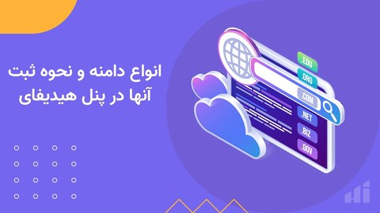<span class="hg-play"></span><span class="hg-vbadge" data-label="نسخهٔ پیشین"></span></span><h4 class="hg-vt" id="video-zq2sq43R1i0">انواع دامنه و نحوه ثبت آنها در پنل هیدیفای</h4><span class="hg-sr">ویدیوی یوتیوب. </span><span class="hg-vmeta">برای نسخهٔ ۱۰ منیجر · سال ۱۴۰۲</span></a><a class="hg-v hg-v-old" href="https://www.youtube.com/watch?v=vBrD9iYeIrM" target="_blank" rel="noopener" title="این ویدیو برای نسخهٔ قبلی است (ضبط‌شده در سال ۱۴۰۲). ممکن است بخشی یا همهٔ آن با نسخهٔ فعلی فرق داشته باشد."><span class="hg-thumb">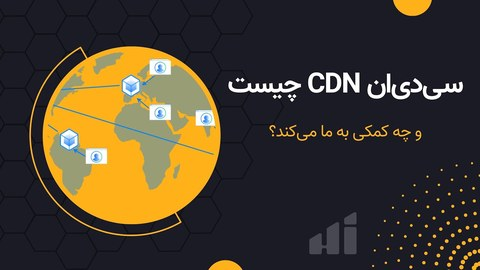<span class="hg-play"></span><span class="hg-vbadge" data-label="نسخهٔ پیشین"></span></span><h4 class="hg-vt" id="video-vBrD9iYeIrM">سی‌دی‌ان CDN چیست و برای گذر از فیلتر چه کمکی به ما می‌کند؟</h4><span class="hg-sr">ویدیوی یوتیوب. </span><span class="hg-vmeta">ضبط‌شده در سال ۱۴۰۲</span></a><a class="hg-v hg-v-old" href="https://www.youtube.com/watch?v=HHq4EQoUHXY" target="_blank" rel="noopener" title="این ویدیو برای نسخهٔ قبلی است (ضبط‌شده در سال ۱۴۰۲). ممکن است بخشی یا همهٔ آن با نسخهٔ فعلی فرق داشته باشد."><span class="hg-thumb"><span class="hg-play"></span><span class="hg-vbadge" data-label="نسخهٔ پیشین"></span></span><h4 class="hg-vt" id="video-HHq4EQoUHXY">آموزش پیدا کردن آی‌پی تمیز Cloudflare با استفاده از اسکنر مرتضی باشسیز</h4><span class="hg-sr">ویدیوی یوتیوب. </span><span class="hg-vmeta">ضبط‌شده در سال ۱۴۰۲</span></a><a class="hg-v hg-v-old" href="https://www.youtube.com/watch?v=r2dlt19OybM" target="_blank" rel="noopener" title="این ویدیو برای نسخهٔ قبلی است (برای نسخهٔ ۹ منیجر · سال ۱۴۰۲). ممکن است بخشی یا همهٔ آن با نسخهٔ فعلی فرق داشته باشد."><span class="hg-thumb"><span class="hg-play"></span><span class="hg-vbadge" data-label="نسخهٔ پیشین"></span></span><h4 class="hg-vt" id="video-r2dlt19OybM">آموزش راه‌اندازی WS Tunnel و ایجاد سرور میانی در هیدیفای</h4><span class="hg-sr">ویدیوی یوتیوب. </span><span class="hg-vmeta">برای نسخهٔ ۹ منیجر · سال ۱۴۰۲</span></a><a class="hg-v hg-v-old" href="https://www.youtube.com/watch?v=147nyGlTuuA" target="_blank" rel="noopener" title="این ویدیو برای نسخهٔ قبلی است (برای نسخهٔ ۹ منیجر · سال ۱۴۰۲). ممکن است بخشی یا همهٔ آن با نسخهٔ فعلی فرق داشته باشد."><span class="hg-thumb"><span class="hg-play"></span><span class="hg-vbadge" data-label="نسخهٔ پیشین"></span></span><h4 class="hg-vt" id="video-147nyGlTuuA">آموزش راه‌اندازی سرویس Cloudflare Workers در پنل هیدیفای</h4><span class="hg-sr">ویدیوی یوتیوب. </span><span class="hg-vmeta">برای نسخهٔ ۹ منیجر · سال ۱۴۰۲</span></a><a class="hg-v hg-v-old" href="https://www.youtube.com/watch?v=T3yfTqqQqJQ" target="_blank" rel="noopener" title="این ویدیو برای نسخهٔ قبلی است (برای نسخهٔ ۹ منیجر · سال ۱۴۰۲). ممکن است بخشی یا همهٔ آن با نسخهٔ فعلی فرق داشته باشد."><span class="hg-thumb"><span class="hg-play"></span><span class="hg-vbadge" data-label="نسخهٔ پیشین"></span></span><h4 class="hg-vt" id="video-T3yfTqqQqJQ">آموزش ایجاد تونل به روش GOST و افزودن سرور میانی به پنل هیدیفای</h4><span class="hg-sr">ویدیوی یوتیوب. </span><span class="hg-vmeta">برای نسخهٔ ۹ منیجر · سال ۱۴۰۲</span></a><a class="hg-v hg-v-old" href="https://www.youtube.com/watch?v=MiD8FYWwHIc" target="_blank" rel="noopener" title="این ویدیو برای نسخهٔ قبلی است (برای نسخهٔ ۹ منیجر · سال ۱۴۰۲). ممکن است بخشی یا همهٔ آن با نسخهٔ فعلی فرق داشته باشد."><span class="hg-thumb"><span class="hg-play"></span><span class="hg-vbadge" data-label="نسخهٔ پیشین"></span></span><h4 class="hg-vt" id="video-MiD8FYWwHIc">آموزش راه‌اندازی تونل به روش IP Tables و اتصال آن به عنوان سرور میانی یا relay به هیدیفای</h4><span class="hg-sr">ویدیوی یوتیوب. </span><span class="hg-vmeta">برای نسخهٔ ۹ منیجر · سال ۱۴۰۲</span></a><a class="hg-v hg-v-old" href="https://www.youtube.com/watch?v=x44qGcnpBSE" target="_blank" rel="noopener" title="این ویدیو برای نسخهٔ قبلی است (برای نسخهٔ ۸ منیجر · سال ۱۴۰۲). ممکن است بخشی یا همهٔ آن با نسخهٔ فعلی فرق داشته باشد."><span class="hg-thumb"><span class="hg-play"></span><span class="hg-vbadge" data-label="نسخهٔ پیشین"></span></span><h4 class="hg-vt" id="video-x44qGcnpBSE">زیر دامنه‌های متغیر CDN/AutoCDN در هیدیفای</h4><span class="hg-sr">ویدیوی یوتیوب. </span><span class="hg-vmeta">برای نسخهٔ ۸ منیجر · سال ۱۴۰۲</span></a><a class="hg-v hg-v-old" href="https://www.youtube.com/watch?v=kz_Ih__jS9c" target="_blank" rel="noopener" title="این ویدیو برای نسخهٔ قبلی است (برای نسخهٔ ۸ منیجر · سال ۱۴۰۲). ممکن است بخشی یا همهٔ آن با نسخهٔ فعلی فرق داشته باشد."><span class="hg-thumb">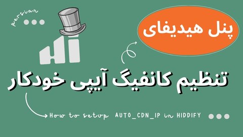<span class="hg-play"></span><span class="hg-vbadge" data-label="نسخهٔ پیشین"></span></span><h4 class="hg-vt" id="video-kz_Ih__jS9c">آموزش تنظیم کانفیگ آی‌پی خودکار در پنل هیدیفای</h4><span class="hg-sr">ویدیوی یوتیوب. </span><span class="hg-vmeta">برای نسخهٔ ۸ منیجر · سال ۱۴۰۲</span></a></div></div>
</section>
<section class="hg-cat" id="troubleshoot" style="--c:#f97316"><header><div><h2>مفاهیم پایه، عیب‌یابی و امنیت</h2><p>وقتی وصل نمی‌شود، و برای سرور امن‌تر</p><span class="hg-meta">۱۹ مقاله · ۳ ویدیو</span></div></header>
<div class="hg-groups">
<div class="hg-g"><h3>مفاهیم</h3><ul><li><a class="hg-a" href="/fa/manager/basic-concepts-and-troubleshooting/Basic-Concepts/" data-k="manager/basic-concepts-and-troubleshooting/Basic-Concepts" data-n="2024-02-08" data-u="2026-11-16">مفاهیم پایهٔ اینترنت و پروکسی</a></li><li><a class="hg-a" href="/fa/manager/basic-concepts-and-troubleshooting/How-the-TLS-Trick-works-and-its-usage/" data-k="manager/basic-concepts-and-troubleshooting/How-the-TLS-Trick-works-and-its-usage" data-n="2024-02-08" data-u="2026-11-16">ترفند TLS چیست</a></li><li><a class="hg-a" href="/fa/manager/basic-concepts-and-troubleshooting/A-good-way-to-find-TLS-trick-values/" data-k="manager/basic-concepts-and-troubleshooting/A-good-way-to-find-TLS-trick-values" data-n="2024-12-20" data-u="2026-11-16">پیدا کردن مقادیر ترفند TLS</a></li><li><a class="hg-a" href="/fa/manager/basic-concepts-and-troubleshooting/How-MUX-works-and-its-usage/" data-k="manager/basic-concepts-and-troubleshooting/How-MUX-works-and-its-usage" data-n="2024-03-25" data-u="2026-11-16">MUX چیست</a></li></ul></div>
<div class="hg-g"><h3>عیب‌یابی</h3><ul><li><a class="hg-a" href="/fa/manager/basic-concepts-and-troubleshooting/Troubleshooting-connectivity-issues-with-HiddifyManager-and-proxies/" data-k="manager/basic-concepts-and-troubleshooting/Troubleshooting-connectivity-issues-with-HiddifyManager-and-proxies" data-n="2024-04-19" data-u="2026-11-16">عیب‌یابی مشکلات اتصال</a></li><li><a class="hg-a" href="/fa/manager/basic-concepts-and-troubleshooting/How-to-make-sure-the-server&#x27;s-IP-or-domain-is-clean/" data-k="manager/basic-concepts-and-troubleshooting/How-to-make-sure-the-server&#x27;s-IP-or-domain-is-clean" data-n="2024-02-08" data-u="2026-11-14">تمیز بودن آی‌پی یا دامنه</a></li><li><a class="hg-a" href="/fa/manager/basic-concepts-and-troubleshooting/How-to-check-and-prevent-DNS-leaks/" data-k="manager/basic-concepts-and-troubleshooting/How-to-check-and-prevent-DNS-leaks" data-n="2024-04-02" data-u="2026-10-22">نشتی DNS</a></li><li><a class="hg-a" href="/fa/manager/basic-concepts-and-troubleshooting/How-to-check-and-prevent-TimeZone-leaks/" data-k="manager/basic-concepts-and-troubleshooting/How-to-check-and-prevent-TimeZone-leaks" data-n="2024-11-12" data-u="2026-10-22">نشتی تایم‌زون</a></li><li><a class="hg-a" href="/fa/manager/basic-concepts-and-troubleshooting/How-to-do-speed-test-on-server/" data-k="manager/basic-concepts-and-troubleshooting/How-to-do-speed-test-on-server" data-n="2024-02-08" data-u="2026-11-12">تست سرعت سرور</a></li><li><a class="hg-a" href="/fa/manager/basic-concepts-and-troubleshooting/How-to-monitor-server-resources-on-Hiddify/" data-k="manager/basic-concepts-and-troubleshooting/How-to-monitor-server-resources-on-Hiddify" data-n="2024-02-08" data-u="2026-11-12">پایش منابع سرور</a></li><li><a class="hg-a" href="/fa/manager/basic-concepts-and-troubleshooting/How-to-address-VPS-abuse-issue/" data-k="manager/basic-concepts-and-troubleshooting/How-to-address-VPS-abuse-issue" data-n="2024-12-19" data-u="2026-10-22">رفع مشکل ابیوز سرور</a></li></ul></div>
<div class="hg-g"><h3>سرور و امنیت</h3><ul><li><a class="hg-a" href="/fa/manager/basic-concepts-and-troubleshooting/How-to-setup-Firewall-on-Hiddify-panel/" data-k="manager/basic-concepts-and-troubleshooting/How-to-setup-Firewall-on-Hiddify-panel" data-n="2024-02-08" data-u="2026-11-12">فایروال</a></li><li><a class="hg-a" href="/fa/manager/basic-concepts-and-troubleshooting/How-to-change-SSH-port-on-your-server/" data-k="manager/basic-concepts-and-troubleshooting/How-to-change-SSH-port-on-your-server" data-n="2024-02-08" data-u="2026-10-22">تغییر پورت SSH</a></li><li><a class="hg-a" href="/fa/manager/basic-concepts-and-troubleshooting/Disable-SSH-Password-Authentication/" data-k="manager/basic-concepts-and-troubleshooting/Disable-SSH-Password-Authentication" data-n="2024-02-08" data-u="2026-10-22">بستن ورود با رمز در SSH</a></li><li><a class="hg-a" href="/fa/manager/basic-concepts-and-troubleshooting/TLS-setting-for-increased-security/" data-k="manager/basic-concepts-and-troubleshooting/TLS-setting-for-increased-security" data-n="2024-02-08" data-u="2026-10-22">تنظیم TLS برای امنیت بیشتر</a></li><li><a class="hg-a" href="/fa/manager/basic-concepts-and-troubleshooting/How-to-set-DNS-server/" data-k="manager/basic-concepts-and-troubleshooting/How-to-set-DNS-server" data-n="2024-02-08" data-u="2026-10-22">تنظیم DNS سرور</a></li><li><a class="hg-a" href="/fa/manager/basic-concepts-and-troubleshooting/How-to-disable-IP-version-6-on-Hiddify/" data-k="manager/basic-concepts-and-troubleshooting/How-to-disable-IP-version-6-on-Hiddify" data-n="2024-02-08" data-u="2026-10-22">غیرفعال کردن IPv6</a></li><li><a class="hg-a" href="/fa/manager/basic-concepts-and-troubleshooting/How-to-enable-Swap-on-Linux/" data-k="manager/basic-concepts-and-troubleshooting/How-to-enable-Swap-on-Linux" data-n="2024-12-27" data-u="2026-10-22">فعال کردن Swap</a></li><li><a class="hg-a" href="/fa/manager/basic-concepts-and-troubleshooting/How-to-transfer-files-between-a-server-and-a-computer/" data-k="manager/basic-concepts-and-troubleshooting/How-to-transfer-files-between-a-server-and-a-computer" data-n="2024-02-08" data-u="2026-10-22">انتقال فایل بین سرور و کامپیوتر</a></li></ul></div>
</div>
<div class="hg-videos"><div class="hg-vhead"><h3>ویدیوها <span class="hg-count">۳</span></h3><span class="hg-arrows"><button type="button" class="hg-prev" aria-label="قبلی"><svg aria-hidden="true" xmlns="http://www.w3.org/2000/svg" viewBox="0 0 24 24"><path d="M15.41 16.58 10.83 12l4.58-4.59L14 6l-6 6 6 6 1.41-1.42Z"/></svg></button><button type="button" class="hg-next" aria-label="بعدی"><svg aria-hidden="true" xmlns="http://www.w3.org/2000/svg" viewBox="0 0 24 24"><path d="M8.59 16.58 13.17 12 8.59 7.41 10 6l6 6-6 6-1.41-1.42Z"/></svg></button></span></div><div class="hg-vrow"><a class="hg-v hg-v-old" href="https://www.youtube.com/watch?v=MRI3HYfayb4" target="_blank" rel="noopener" title="این ویدیو برای نسخهٔ قبلی است (ضبط‌شده در سال ۱۴۰۲). ممکن است بخشی یا همهٔ آن با نسخهٔ فعلی فرق داشته باشد."><span class="hg-thumb">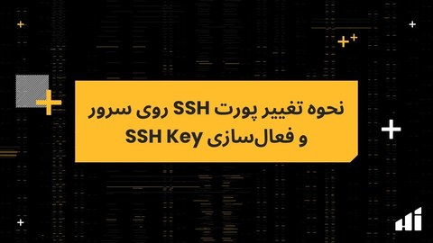<span class="hg-play"></span><span class="hg-vbadge" data-label="نسخهٔ پیشین"></span></span><h4 class="hg-vt" id="video-MRI3HYfayb4">نحوه تغییر پورت SSH روی سرور  و فعال‌سازی SSH Key</h4><span class="hg-sr">ویدیوی یوتیوب. </span><span class="hg-vmeta">ضبط‌شده در سال ۱۴۰۲</span></a><a class="hg-v hg-v-old" href="https://www.youtube.com/watch?v=vN5sInIIOpU" target="_blank" rel="noopener" title="این ویدیو برای نسخهٔ قبلی است (ضبط‌شده در سال ۱۴۰۲). ممکن است بخشی یا همهٔ آن با نسخهٔ فعلی فرق داشته باشد."><span class="hg-thumb"><span class="hg-play"></span><span class="hg-vbadge" data-label="نسخهٔ پیشین"></span></span><h4 class="hg-vt" id="video-vN5sInIIOpU">معرفی سه روش برای تست تمیز بودن آی‌پی (IP) یا دامنه</h4><span class="hg-sr">ویدیوی یوتیوب. </span><span class="hg-vmeta">ضبط‌شده در سال ۱۴۰۲</span></a><a class="hg-v hg-v-old" href="https://www.youtube.com/watch?v=UujtFy8YuB4" target="_blank" rel="noopener" title="این ویدیو برای نسخهٔ قبلی است (ضبط‌شده در سال ۱۴۰۲). ممکن است بخشی یا همهٔ آن با نسخهٔ فعلی فرق داشته باشد."><span class="hg-thumb"><span class="hg-play"></span><span class="hg-vbadge" data-label="نسخهٔ پیشین"></span></span><h4 class="hg-vt" id="video-UujtFy8YuB4">چطور یک فیلترشکن خوب می‌تونه در برابر سیستم فیلترینگ مقاوم باشه و از شما محافظت کنه؟</h4><span class="hg-sr">ویدیوی یوتیوب. </span><span class="hg-vmeta">ضبط‌شده در سال ۱۴۰۲</span></a></div></div>
</section>
<section class="hg-cat" id="clients" style="--c:#10b981"><header><div><h2>اتصال کاربران</h2><p>با چه اپی به سرورتان وصل شوند</p><span class="hg-meta">۱۴ مقاله · ۱۵ ویدیو</span></div></header>
<p class="hg-note">پیشنهاد ما <b>اپ هیدیفای</b> است: رایگان، روی اندروید، iOS، ویندوز، مک و لینوکس، و سازگار با همهٔ قابلیت‌های هیدیفای‌منیجر. <a href="/fa/app/">آموزش‌های اپ هیدیفای ←</a></p>
<div class="hg-groups">
<div class="hg-g"><h3>اندروید</h3><ul><li><a class="hg-a" href="/fa/manager/client-software-on-android/Tutorial-for-V2rayNG-app/" data-k="manager/client-software-on-android/Tutorial-for-V2rayNG-app" data-n="2024-02-08" data-u="2026-11-16">V2rayNG</a></li><li><a class="hg-a" href="/fa/manager/client-software-on-android/Tutorial-for-Nekobox-app/" data-k="manager/client-software-on-android/Tutorial-for-Nekobox-app" data-n="2024-02-08" data-u="2026-11-16">NekoBox</a></li><li><a class="hg-a hg-old" href="/fa/manager/client-software-on-android/Tutorial-for-HiddifyNG-app/">HiddifyNG</a><span class="hg-ver">نسخهٔ پیشین</span></li><li><a class="hg-a hg-old" href="/fa/manager/client-software-on-android/Tutorial-for-HiddifyClashAndroid-app/">HiddifyClashAndroid</a><span class="hg-ver">نسخهٔ پیشین</span></li></ul></div>
<div class="hg-g"><h3>آیفون و آیپد</h3><ul><li><a class="hg-a" href="/fa/manager/client-software-on-ios/Tutorial-for-SingBox-app/" data-k="manager/client-software-on-ios/Tutorial-for-SingBox-app" data-n="2024-02-08" data-u="2026-11-16">sing-box</a></li><li><a class="hg-a" href="/fa/manager/client-software-on-ios/Tutorial-for-Streisand/" data-k="manager/client-software-on-ios/Tutorial-for-Streisand" data-n="2024-02-08" data-u="2026-11-16">Streisand</a></li><li><a class="hg-a" href="/fa/manager/client-software-on-ios/Tutorial-for-V2Box-app/" data-k="manager/client-software-on-ios/Tutorial-for-V2Box-app" data-n="2024-02-08" data-u="2026-11-16">V2Box</a></li><li><a class="hg-a hg-old" href="/fa/manager/client-software-on-ios/Tutorial-for-FoXray-app/">FoXray</a><span class="hg-ver">نسخهٔ پیشین</span></li><li><a class="hg-a" href="/fa/manager/client-software-on-ios/Tutorial-for-ShadowRocket-app/" data-k="manager/client-software-on-ios/Tutorial-for-ShadowRocket-app" data-n="2024-02-08" data-u="2026-11-16">Shadowrocket</a></li><li><a class="hg-a" href="/fa/manager/client-software-on-ios/Tutorial-for-Stash-app/" data-k="manager/client-software-on-ios/Tutorial-for-Stash-app" data-n="2024-02-08" data-u="2026-11-16">Stash</a></li><li><a class="hg-a" href="/fa/manager/client-software-on-ios/Tutorial-for-Fair-VPN-app/" data-k="manager/client-software-on-ios/Tutorial-for-Fair-VPN-app" data-n="2024-02-08" data-u="2026-11-16">Fair VPN</a></li></ul></div>
<div class="hg-g"><h3>کامپیوتر</h3><ul><li><a class="hg-a hg-old" href="/fa/manager/client-software-on-desktop/Tutorial-for-HiddifyN-software/">HiddifyN</a><span class="hg-ver">نسخهٔ پیشین</span></li><li><a class="hg-a hg-old" href="/fa/manager/client-software-on-desktop/Tutorial-for-HiddifyClashDesktop-software/">HiddifyClashDesktop</a><span class="hg-ver">نسخهٔ پیشین</span></li><li><a class="hg-a hg-old" href="/fa/manager/client-software-on-desktop/Tutorial-for-QV2ray-software/">Qv2ray</a><span class="hg-ver">نسخهٔ پیشین</span></li></ul></div>
</div>
<div class="hg-videos"><div class="hg-vhead"><h3>ویدیوها <span class="hg-count">۱۵</span></h3><span class="hg-arrows"><button type="button" class="hg-prev" aria-label="قبلی"><svg aria-hidden="true" xmlns="http://www.w3.org/2000/svg" viewBox="0 0 24 24"><path d="M15.41 16.58 10.83 12l4.58-4.59L14 6l-6 6 6 6 1.41-1.42Z"/></svg></button><button type="button" class="hg-next" aria-label="بعدی"><svg aria-hidden="true" xmlns="http://www.w3.org/2000/svg" viewBox="0 0 24 24"><path d="M8.59 16.58 13.17 12 8.59 7.41 10 6l6 6-6 6-1.41-1.42Z"/></svg></button></span></div><div class="hg-vrow"><a class="hg-v hg-v-old" href="https://www.youtube.com/watch?v=knOxCtgvaDA" target="_blank" rel="noopener" title="این ویدیو برای نسخهٔ قبلی است (نسخهٔ قدیمی برنامه · سال ۱۴۰۲). ممکن است بخشی یا همهٔ آن با نسخهٔ فعلی فرق داشته باشد."><span class="hg-thumb">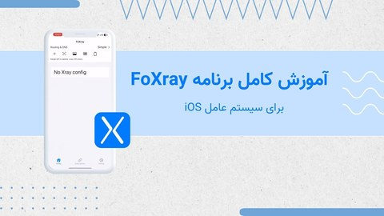<span class="hg-play"></span><span class="hg-vbadge" data-label="نسخهٔ پیشین"></span></span><h4 class="hg-vt" id="video-knOxCtgvaDA">آموزش کامل برنامه FoXray برای سیستم عامل iOS</h4><span class="hg-sr">ویدیوی یوتیوب. </span><span class="hg-vmeta">نسخهٔ قدیمی برنامه · سال ۱۴۰۲</span></a><a class="hg-v hg-v-old" href="https://www.youtube.com/watch?v=jaMkZTLH2QY" target="_blank" rel="noopener" title="این ویدیو برای نسخهٔ قبلی است (نسخهٔ قدیمی برنامه · سال ۱۴۰۲). ممکن است بخشی یا همهٔ آن با نسخهٔ فعلی فرق داشته باشد."><span class="hg-thumb">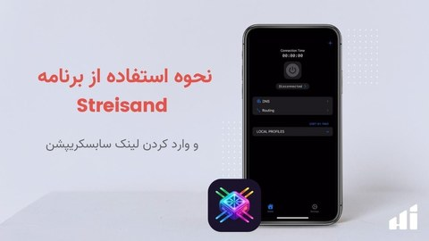<span class="hg-play"></span><span class="hg-vbadge" data-label="نسخهٔ پیشین"></span></span><h4 class="hg-vt" id="video-jaMkZTLH2QY">آموزش استفاده از برنامه Streisand</h4><span class="hg-sr">ویدیوی یوتیوب. </span><span class="hg-vmeta">نسخهٔ قدیمی برنامه · سال ۱۴۰۲</span></a><a class="hg-v hg-v-old" href="https://www.youtube.com/watch?v=qDbI72J-INM" target="_blank" rel="noopener" title="این ویدیو برای نسخهٔ قبلی است (اپ قدیمی، دیگر به‌روز نمی‌شود · سال ۱۴۰۲). ممکن است بخشی یا همهٔ آن با نسخهٔ فعلی فرق داشته باشد."><span class="hg-thumb"><span class="hg-play"></span><span class="hg-vbadge" data-label="نسخهٔ پیشین"></span></span><h4 class="hg-vt" id="video-qDbI72J-INM">راهنمای استفاده از اپ HiddifyNG</h4><span class="hg-sr">ویدیوی یوتیوب. </span><span class="hg-vmeta">اپ قدیمی، دیگر به‌روز نمی‌شود · سال ۱۴۰۲</span></a><a class="hg-v hg-v-old" href="https://www.youtube.com/watch?v=omGIz97mbzM" target="_blank" rel="noopener" title="این ویدیو برای نسخهٔ قبلی است (اپ قدیمی، دیگر به‌روز نمی‌شود · سال ۱۴۰۲). ممکن است بخشی یا همهٔ آن با نسخهٔ فعلی فرق داشته باشد."><span class="hg-thumb"><span class="hg-play"></span><span class="hg-vbadge" data-label="نسخهٔ پیشین"></span></span><h4 class="hg-vt" id="video-omGIz97mbzM">آموزش کامل نرم‌افزار هیدیفای کلش دسکتاپ</h4><span class="hg-sr">ویدیوی یوتیوب. </span><span class="hg-vmeta">اپ قدیمی، دیگر به‌روز نمی‌شود · سال ۱۴۰۲</span></a><a class="hg-v hg-v-old" href="https://www.youtube.com/watch?v=Pqactnz_PdU" target="_blank" rel="noopener" title="این ویدیو برای نسخهٔ قبلی است (اپ قدیمی، دیگر به‌روز نمی‌شود · سال ۱۴۰۲). ممکن است بخشی یا همهٔ آن با نسخهٔ فعلی فرق داشته باشد."><span class="hg-thumb"><span class="hg-play"></span><span class="hg-vbadge" data-label="نسخهٔ پیشین"></span></span><h4 class="hg-vt" id="video-Pqactnz_PdU">معرفی برنامه HiddifyNG</h4><span class="hg-sr">ویدیوی یوتیوب. </span><span class="hg-vmeta">اپ قدیمی، دیگر به‌روز نمی‌شود · سال ۱۴۰۲</span></a><a class="hg-v hg-v-old" href="https://www.youtube.com/watch?v=01m7w-I4JXE" target="_blank" rel="noopener" title="این ویدیو برای نسخهٔ قبلی است (نسخهٔ قدیمی برنامه · سال ۱۴۰۲). ممکن است بخشی یا همهٔ آن با نسخهٔ فعلی فرق داشته باشد."><span class="hg-thumb"><span class="hg-play"></span><span class="hg-vbadge" data-label="نسخهٔ پیشین"></span></span><h4 class="hg-vt" id="video-01m7w-I4JXE">آموزش استفاده از نرم‌افزار Fair VPN سیستم عامل iOS در پنل هیدیفای</h4><span class="hg-sr">ویدیوی یوتیوب. </span><span class="hg-vmeta">نسخهٔ قدیمی برنامه · سال ۱۴۰۲</span></a><a class="hg-v hg-v-old" href="https://www.youtube.com/watch?v=F2bC_mtbYmQ" target="_blank" rel="noopener" title="این ویدیو برای نسخهٔ قبلی است (نسخهٔ قدیمی برنامه · سال ۱۴۰۲). ممکن است بخشی یا همهٔ آن با نسخهٔ فعلی فرق داشته باشد."><span class="hg-thumb">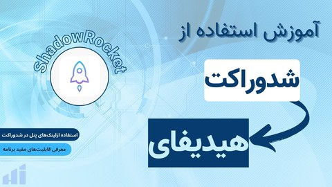<span class="hg-play"></span><span class="hg-vbadge" data-label="نسخهٔ پیشین"></span></span><h4 class="hg-vt" id="video-F2bC_mtbYmQ">آموزش استفاده از برنامه شدوراکت در پنل هیدیفای</h4><span class="hg-sr">ویدیوی یوتیوب. </span><span class="hg-vmeta">نسخهٔ قدیمی برنامه · سال ۱۴۰۲</span></a><a class="hg-v hg-v-old" href="https://www.youtube.com/watch?v=o9L2sI2T53Q" target="_blank" rel="noopener" title="این ویدیو برای نسخهٔ قبلی است (اپ قدیمی، دیگر به‌روز نمی‌شود · سال ۱۴۰۲). ممکن است بخشی یا همهٔ آن با نسخهٔ فعلی فرق داشته باشد."><span class="hg-thumb"><span class="hg-play"></span><span class="hg-vbadge" data-label="نسخهٔ پیشین"></span></span><h4 class="hg-vt" id="video-o9L2sI2T53Q">HiddifyN آموزش کار با نرم‌افزار دسکتاپ</h4><span class="hg-sr">ویدیوی یوتیوب. </span><span class="hg-vmeta">اپ قدیمی، دیگر به‌روز نمی‌شود · سال ۱۴۰۲</span></a><a class="hg-v hg-v-old" href="https://www.youtube.com/watch?v=7B0PO3HM6Vg" target="_blank" rel="noopener" title="این ویدیو برای نسخهٔ قبلی است (اپ قدیمی، دیگر به‌روز نمی‌شود · سال ۱۴۰۲). ممکن است بخشی یا همهٔ آن با نسخهٔ فعلی فرق داشته باشد."><span class="hg-thumb"><span class="hg-play"></span><span class="hg-vbadge" data-label="نسخهٔ پیشین"></span></span><h4 class="hg-vt" id="video-7B0PO3HM6Vg">آموزش کار با نرم‌افزار HiddifyNG</h4><span class="hg-sr">ویدیوی یوتیوب. </span><span class="hg-vmeta">اپ قدیمی، دیگر به‌روز نمی‌شود · سال ۱۴۰۲</span></a><a class="hg-v hg-v-old" href="https://www.youtube.com/watch?v=8P887E-KMls" target="_blank" rel="noopener" title="این ویدیو برای نسخهٔ قبلی است (اپ قدیمی، دیگر به‌روز نمی‌شود · سال ۱۴۰۲). ممکن است بخشی یا همهٔ آن با نسخهٔ فعلی فرق داشته باشد."><span class="hg-thumb"><span class="hg-play"></span><span class="hg-vbadge" data-label="نسخهٔ پیشین"></span></span><h4 class="hg-vt" id="video-8P887E-KMls">آموزش استفاده از نرم‌افزار هیدیفای اندروید (نسخه بر پایه کِلش)</h4><span class="hg-sr">ویدیوی یوتیوب. </span><span class="hg-vmeta">اپ قدیمی، دیگر به‌روز نمی‌شود · سال ۱۴۰۲</span></a><a class="hg-v hg-v-old" href="https://www.youtube.com/watch?v=6HncctDHXVs" target="_blank" rel="noopener" title="این ویدیو برای نسخهٔ قبلی است (نسخهٔ قدیمی برنامه · سال ۱۴۰۲). ممکن است بخشی یا همهٔ آن با نسخهٔ فعلی فرق داشته باشد."><span class="hg-thumb">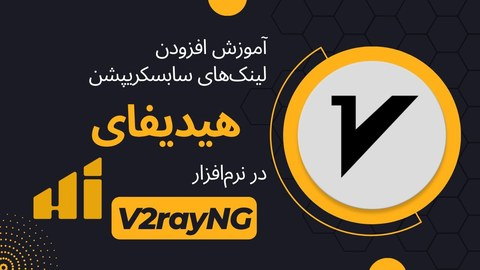<span class="hg-play"></span><span class="hg-vbadge" data-label="نسخهٔ پیشین"></span></span><h4 class="hg-vt" id="video-6HncctDHXVs">آموزش اضافه کردن لینک‌های سابسکریپشن پنل هیدیفای در نرم‌افزار V2rayNG</h4><span class="hg-sr">ویدیوی یوتیوب. </span><span class="hg-vmeta">نسخهٔ قدیمی برنامه · سال ۱۴۰۲</span></a><a class="hg-v hg-v-old" href="https://www.youtube.com/watch?v=7kqprO7M4eM" target="_blank" rel="noopener" title="این ویدیو برای نسخهٔ قبلی است (نسخهٔ قدیمی برنامه · سال ۱۴۰۲). ممکن است بخشی یا همهٔ آن با نسخهٔ فعلی فرق داشته باشد."><span class="hg-thumb">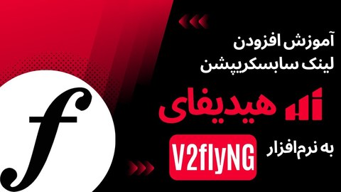<span class="hg-play"></span><span class="hg-vbadge" data-label="نسخهٔ پیشین"></span></span><h4 class="hg-vt" id="video-7kqprO7M4eM">آموزش اضافه کردن لینک‌های سابسکریپشن پنل هیدیفای در نرم‌افزار V2flyNG</h4><span class="hg-sr">ویدیوی یوتیوب. </span><span class="hg-vmeta">نسخهٔ قدیمی برنامه · سال ۱۴۰۲</span></a><a class="hg-v hg-v-old" href="https://www.youtube.com/watch?v=ORMdAzPNrCA" target="_blank" rel="noopener" title="این ویدیو برای نسخهٔ قبلی است (نسخهٔ قدیمی برنامه · سال ۱۴۰۲). ممکن است بخشی یا همهٔ آن با نسخهٔ فعلی فرق داشته باشد."><span class="hg-thumb"><span class="hg-play"></span><span class="hg-vbadge" data-label="نسخهٔ پیشین"></span></span><h4 class="hg-vt" id="video-ORMdAzPNrCA">آموزش اضافه کردن لینک‌های سابسکریپشن از پنل هیدیفای در نسخه دسکتاپ برنامه نکوری Nekoray</h4><span class="hg-sr">ویدیوی یوتیوب. </span><span class="hg-vmeta">نسخهٔ قدیمی برنامه · سال ۱۴۰۲</span></a><a class="hg-v hg-v-old" href="https://www.youtube.com/watch?v=qFKv4I-MNQc" target="_blank" rel="noopener" title="این ویدیو برای نسخهٔ قبلی است (نسخهٔ قدیمی برنامه · سال ۱۴۰۲). ممکن است بخشی یا همهٔ آن با نسخهٔ فعلی فرق داشته باشد."><span class="hg-thumb"><span class="hg-play"></span><span class="hg-vbadge" data-label="نسخهٔ پیشین"></span></span><h4 class="hg-vt" id="video-qFKv4I-MNQc">آموزش اضافه کردن لینک Subscription در برنامه WingsX</h4><span class="hg-sr">ویدیوی یوتیوب. </span><span class="hg-vmeta">نسخهٔ قدیمی برنامه · سال ۱۴۰۲</span></a><a class="hg-v hg-v-old" href="https://www.youtube.com/watch?v=D0Xv54nRSY8" target="_blank" rel="noopener" title="این ویدیو برای نسخهٔ قبلی است (نسخهٔ قدیمی برنامه · سال ۱۴۰۱). ممکن است بخشی یا همهٔ آن با نسخهٔ فعلی فرق داشته باشد."><span class="hg-thumb"><span class="hg-play"></span><span class="hg-vbadge" data-label="نسخهٔ پیشین"></span></span><h4 class="hg-vt" id="video-D0Xv54nRSY8">آموزش استفاده از برنامه استش در آیفون</h4><span class="hg-sr">ویدیوی یوتیوب. </span><span class="hg-vmeta">نسخهٔ قدیمی برنامه · سال ۱۴۰۱</span></a></div></div>
</section>
<section class="hg-cat" id="developers" style="--c:#6366f1"><header><div><h2>برای توسعه‌دهندگان</h2><p>API پنل و مشارکت در پروژه</p><span class="hg-meta">۲ مقاله</span></div></header>
<div class="hg-groups">
<div class="hg-g"><h3>توسعه</h3><ul><li><a class="hg-a" href="/fa/manager/contribution/How-to-use-API-in-HiddifyManager-project/" data-k="manager/contribution/How-to-use-API-in-HiddifyManager-project" data-n="2024-04-14" data-u="2026-11-16">استفاده از API هیدیفای‌منیجر</a></li><li><a class="hg-a" href="/fa/manager/contribution/How-to-contribute-to-this-project/" data-k="manager/contribution/How-to-contribute-to-this-project" data-n="2024-03-13" data-u="2026-11-16">مشارکت در پروژه</a></li></ul></div>
</div>
</section>
</div>
<script src="/assets/js/guide.js" defer></script>
<!-- guide:end -->
