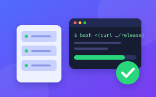
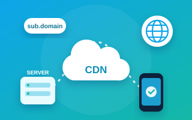
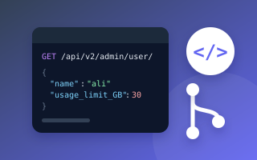
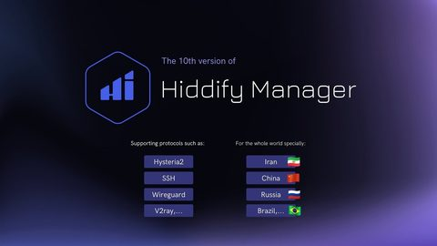
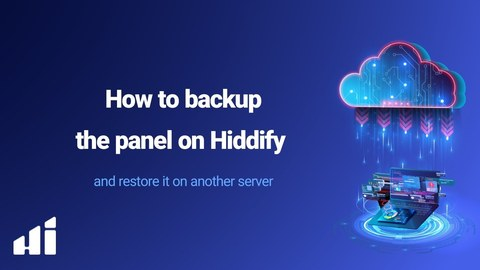
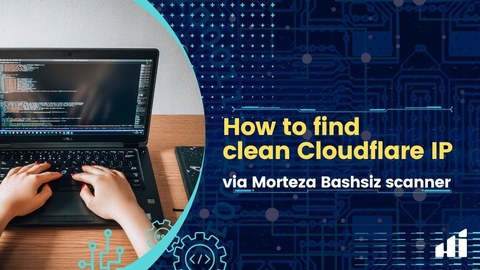
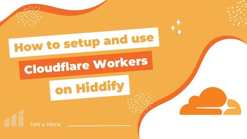
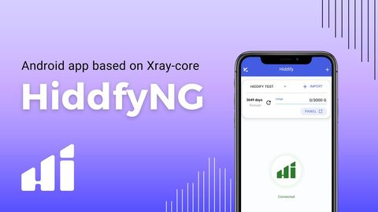

<style>
@media screen and (min-width: 76.1875em) {.md-sidebar{display:none;}}
  .md-content__button {
    display: none;
  }
</style>

<p class="hi-eyebrow">Hiddify Manager guide</p>

# Your server. Your rules.

<p class="hi-lede">Hiddify Manager is free and open source, and runs on your own server (a VPS, a rented computer in a data center): a VPN and proxy server, for you and your users. From the very first command to the finest setting, it is all on this page.</p>

Every tutorial is listed by topic. If you are new, start with the [main installation guide](/manager/installation-and-setup/guide/).

!!! info "Hiddify Manager at a glance"
    - **Latest version:** v14.2.0 (November 6, 2026). See all [releases on GitHub](https://github.com/hiddify/Hiddify-Manager/releases).
    - **Supported servers:** Ubuntu 26.04 or 24.04 (recommended; 22.04 only if nothing newer is offered), on amd64 (x86_64) or arm64 processors. Ubuntu 20.04 is no longer supported. You can also [install with Docker](/manager/installation-and-setup/Install-Hiddify-using-Docker/).
    - **Protocols:** VLESS, VMess, Trojan, Reality, Shadowsocks, Hysteria2, TUIC, WireGuard, AnyTLS, Snell, Naive, Mieru, xHTTP, DNS tunnels (VayDNS, Slipstream, MasterDnsVPN), Telegram proxy and more.
    - **Source code and details:** the [Hiddify Manager repository on GitHub](https://github.com/hiddify/Hiddify-Manager).

To install the latest version, connect to your server over SSH and run this command on the server:

```bash
bash <(curl https://i.hiddify.com/release)
```

The [main installation guide](/manager/installation-and-setup/guide/) explains every step. If you are upgrading from version 12 or older, take a backup first: see [how to back up and restore](/manager/configuration-and-advanced-settings/How-to-backup-and-restore-panel-on-Hiddify/) and [how to update](/manager/configuration-and-advanced-settings/How-to-update-Hiddify-panel/).

To connect to your server from a phone or computer, we recommend the [Hiddify app](/app/).

<!-- guide:start -->
<div class="hg" data-l-new="New" data-l-upd="Updated">
<h2 class="hg-h">Start here</h2><div class="hg-start">
<a class="hg-card" href="/manager/installation-and-setup/guide/"><span class="hg-ic"><svg aria-hidden="true" xmlns="http://www.w3.org/2000/svg" viewBox="0 0 24 24"><path d="m13.13 22.19-1.63-3.83c1.57-.58 3.04-1.36 4.4-2.27l-2.77 6.1M5.64 12.5l-3.83-1.63 6.1-2.77C7 9.46 6.22 10.93 5.64 12.5M19.22 4c.28 0 .53 0 .74.05.17 1.39-.02 4.25-3.3 7.53-1.7 1.71-3.73 3.02-6.01 3.89l-2.15-2.1c.92-2.31 2.23-4.34 3.92-6.03C15.18 4.58 17.64 4 19.22 4m0-2c-1.98 0-4.98.69-8.22 3.93-2.19 2.19-3.5 4.6-4.35 6.71-.28.75-.09 1.57.46 2.13l2.13 2.12c.38.38.89.61 1.42.61.23 0 .47-.06.7-.15A19.1 19.1 0 0 0 18.07 13c5.66-5.66 3.54-10.61 3.54-10.61S20.7 2 19.22 2m-4.68 7.46c-.78-.78-.78-2.05 0-2.83s2.05-.78 2.83 0c.77.78.78 2.05 0 2.83-.78.78-2.05.78-2.83 0m-5.66 7.07-1.41-1.41 1.41 1.41M6.24 22l3.64-3.64c-.34-.09-.67-.24-.97-.45L4.83 22h1.41M2 22h1.41l4.77-4.76-1.42-1.41L2 20.59V22m0-2.83 4.09-4.08c-.21-.3-.36-.62-.45-.97L2 17.76v1.41Z"/></svg></span><span><b>Install Hiddify Manager</b><small>One command on an Ubuntu server</small></span></a>
<a class="hg-card" href="/manager/installation-and-setup/Guide-for-setting-up-the-domain-and-finalizing-the-installation/"><span class="hg-ic"><svg aria-hidden="true" xmlns="http://www.w3.org/2000/svg" viewBox="0 0 24 24"><path d="M16.5 12c0-.68-.06-1.34-.14-2h3.38c.16.64.26 1.31.26 2 0 .37-.03.73-.08 1.08.69.1 1.33.32 1.92.64.1-.56.16-1.13.16-1.72 0-5.5-4.5-10-10-10C6.47 2 2 6.5 2 12s4.5 10 10 10c.59 0 1.16-.06 1.72-.16A5.9 5.9 0 0 1 13 19c0-.29.03-.57.07-.85-.32.63-.67 1.24-1.07 1.81-.83-1.2-1.5-2.53-1.91-3.96h3.72a5.95 5.95 0 0 1 2.59-2.4c.06-.53.1-1.06.1-1.6M12 4.03c.83 1.2 1.5 2.54 1.91 3.97h-3.82c.41-1.43 1.08-2.77 1.91-3.97M4.26 14C4.1 13.36 4 12.69 4 12s.1-1.36.26-2h3.38c-.08.66-.14 1.32-.14 2s.06 1.34.14 2H4.26m.82 2H8c.35 1.25.8 2.45 1.4 3.56A8.008 8.008 0 0 1 5.08 16M8 8H5.08A7.923 7.923 0 0 1 9.4 4.44C8.8 5.55 8.35 6.75 8 8m6.34 6H9.66c-.1-.66-.16-1.32-.16-2s.06-1.35.16-2h4.68c.09.65.16 1.32.16 2s-.07 1.34-.16 2m.25-9.56c1.84.63 3.37 1.9 4.33 3.56h-2.95a15.65 15.65 0 0 0-1.38-3.56m7.91 12.81L17.75 22 15 19l1.16-1.16 1.59 1.59 3.59-3.59 1.16 1.41Z"/></svg></span><span><b>After installing</b><small>Add your domain and finish the setup</small></span></a>
<a class="hg-card" href="/manager/configuration-and-advanced-settings/How-to-configure-Hiddify-panel-properly/"><span class="hg-ic"><svg aria-hidden="true" xmlns="http://www.w3.org/2000/svg" viewBox="0 0 24 24"><path d="M8 13c-1.86 0-3.41 1.28-3.86 3H2v2h2.14c.45 1.72 2 3 3.86 3s3.41-1.28 3.86-3H22v-2H11.86c-.45-1.72-2-3-3.86-3m0 6c-1.1 0-2-.9-2-2s.9-2 2-2 2 .9 2 2-.9 2-2 2M19.86 6c-.45-1.72-2-3-3.86-3s-3.41 1.28-3.86 3H2v2h10.14c.45 1.72 2 3 3.86 3s3.41-1.28 3.86-3H22V6h-2.14M16 9c-1.1 0-2-.9-2-2s.9-2 2-2 2 .9 2 2-.9 2-2 2Z"/></svg></span><span><b>Get to know the panel</b><small>Every part and setting of the panel</small></span></a>
<a class="hg-card" href="/app/"><span class="hg-ic"><svg aria-hidden="true" xmlns="http://www.w3.org/2000/svg" viewBox="0 0 24 24"><path d="M22 17h-4v-7h4m1-2h-6a1 1 0 0 0-1 1v10a1 1 0 0 0 1 1h6a1 1 0 0 0 1-1V9a1 1 0 0 0-1-1M4 6h18V4H4a2 2 0 0 0-2 2v11H0v3h14v-3H4V6Z"/></svg></span><span><b>Connect your users</b><small>With the Hiddify app on any device</small></span></a>
</div>
<nav class="hg-nav" aria-label="Categories">
<a href="#install" style="--c:#5b63f6"><span>Installation and setup</span><small>13</small></a>
<a href="#config" style="--c:#a855f7"><span>Configuration and settings</span><small>23</small></a>
<a href="#domain" style="--c:#0ea5e9"><span>Domains, CDN, workers and relays</span><small>27</small></a>
<a href="#troubleshoot" style="--c:#f97316"><span>Basics, troubleshooting and security</span><small>19</small></a>
<a href="#clients" style="--c:#10b981"><span>Connecting your users</span><small>14</small></a>
<a href="#developers" style="--c:#6366f1"><span>For developers</span><small>2</small></a>
</nav>
<section class="hg-cat" id="install" style="--c:#5b63f6"><header><div><h2>Installation and setup</h2><p>From buying a server to the first connection</p><span class="hg-meta">13 articles · 5 videos</span></div></header>
<div class="hg-groups">
<div class="hg-g"><h3>Step by step</h3><ul><li><a class="hg-a" href="/manager/installation-and-setup/Installation-prerequisites/" data-k="manager/installation-and-setup/Installation-prerequisites" data-n="2024-02-08" data-u="2026-11-16">Installation prerequisites</a></li><li><a class="hg-a" href="/manager/installation-and-setup/How-to-connect-to-server-via-SSH/" data-k="manager/installation-and-setup/How-to-connect-to-server-via-SSH" data-n="2024-02-08" data-u="2026-10-22">Connect to your server with SSH</a></li><li><a class="hg-a" href="/manager/installation-and-setup/guide/" data-k="manager/installation-and-setup/guide" data-n="2024-02-08" data-u="2026-11-16">Main installation guide</a></li><li><a class="hg-a" href="/manager/installation-and-setup/Guide-for-setting-up-the-domain-and-finalizing-the-installation/" data-k="manager/installation-and-setup/Guide-for-setting-up-the-domain-and-finalizing-the-installation" data-n="2024-02-08" data-u="2026-11-16">Add a domain and finish the installation</a></li></ul></div>
<div class="hg-g"><h3>Other ways to install</h3><ul><li><a class="hg-a" href="/manager/installation-and-setup/How-to-install-different-versions-of-Hiddify-Manager/" data-k="manager/installation-and-setup/How-to-install-different-versions-of-Hiddify-Manager" data-n="2024-02-08" data-u="2026-11-16">Install a specific version</a></li><li><a class="hg-a" href="/manager/installation-and-setup/Install-Hiddify-using-Docker/" data-k="manager/installation-and-setup/Install-Hiddify-using-Docker" data-n="2024-02-08" data-u="2026-11-16">Install with Docker</a></li><li><a class="hg-a" href="/manager/installation-and-setup/Cloud-init-installation/" data-k="manager/installation-and-setup/Cloud-init-installation" data-n="2024-02-08" data-u="2026-11-16">Automatic install from the data center (Cloud-init)</a></li><li><a class="hg-a hg-old" href="/manager/installation-and-setup/How-to-install-HiddifManager-Version-8/">Install version 8</a><span class="hg-ver">up to v8</span></li></ul></div>
<div class="hg-g"><h3>Quick install by data center</h3><ul><li><a class="hg-a" href="/manager/installation-and-setup/Quick-installation-on-Hetzner-Servers/" data-k="manager/installation-and-setup/Quick-installation-on-Hetzner-Servers" data-n="2024-02-08" data-u="2026-11-16">Hetzner</a></li><li><a class="hg-a" href="/manager/installation-and-setup/Quick-installation-on-Vultr-Servers/" data-k="manager/installation-and-setup/Quick-installation-on-Vultr-Servers" data-n="2024-02-08" data-u="2026-11-16">Vultr</a></li><li><a class="hg-a" href="/manager/installation-and-setup/Quick-Installation-on-OVH-Servers/" data-k="manager/installation-and-setup/Quick-Installation-on-OVH-Servers" data-n="2024-02-08" data-u="2026-11-16">OVH</a></li><li><a class="hg-a" href="/manager/installation-and-setup/Quick-Installation-on-Oracle-Cloud/" data-k="manager/installation-and-setup/Quick-Installation-on-Oracle-Cloud" data-n="2024-02-08" data-u="2026-11-16">Oracle Cloud</a></li><li><a class="hg-a" href="/manager/installation-and-setup/Quick-Installation-on-Microsoft-Azure/" data-k="manager/installation-and-setup/Quick-Installation-on-Microsoft-Azure" data-n="2024-02-08" data-u="2026-11-16">Microsoft Azure</a></li></ul></div>
</div>
<div class="hg-videos"><div class="hg-vhead"><h3>Videos <span class="hg-count">5</span></h3><span class="hg-arrows"><button type="button" class="hg-prev" aria-label="Previous"><svg aria-hidden="true" xmlns="http://www.w3.org/2000/svg" viewBox="0 0 24 24"><path d="M15.41 16.58 10.83 12l4.58-4.59L14 6l-6 6 6 6 1.41-1.42Z"/></svg></button><button type="button" class="hg-next" aria-label="Next"><svg aria-hidden="true" xmlns="http://www.w3.org/2000/svg" viewBox="0 0 24 24"><path d="M8.59 16.58 13.17 12 8.59 7.41 10 6l6 6-6 6-1.41-1.42Z"/></svg></button></span></div><div class="hg-vrow"><a class="hg-v hg-v-new" href="https://www.youtube.com/watch?v=ocntmajZ_oI" target="_blank" rel="noopener" title="New video, for the current version"><span class="hg-thumb"><span class="hg-play"></span><span class="hg-vbadge" data-label="New"></span></span><h4 class="hg-vt" id="video-ocntmajZ_oI">Hiddify on Android TV 📺 Send your link with just your phone camera, no typing with the remote</h4><span class="hg-sr">YouTube video. </span></a><a class="hg-v hg-v-old" href="https://www.youtube.com/watch?v=pt3gOIRgfoo" target="_blank" rel="noopener" title="This video is for an earlier version (For HiddifyManager v10 · 2024). Parts of it, or all of it, may differ from the current version."><span class="hg-thumb"><span class="hg-play"></span><span class="hg-vbadge" data-label="Earlier version"></span></span><h4 class="hg-vt" id="video-pt3gOIRgfoo">Hiddify Manager X (10). Your all-in-one proxy panel solution! Manage multiple protocols and domains</h4><span class="hg-sr">YouTube video. </span><span class="hg-vmeta">For HiddifyManager v10 · 2024</span></a><a class="hg-v hg-v-old" href="https://www.youtube.com/watch?v=LEgkCj-FYoE" target="_blank" rel="noopener" title="This video is for an earlier version (For HiddifyManager v10 · 2023). Parts of it, or all of it, may differ from the current version."><span class="hg-thumb"><span class="hg-play"></span><span class="hg-vbadge" data-label="Earlier version"></span></span><h4 class="hg-vt" id="video-LEgkCj-FYoE">Hiddify Introduction</h4><span class="hg-sr">YouTube video. </span><span class="hg-vmeta">For HiddifyManager v10 · 2023</span></a><a class="hg-v hg-v-old" href="https://www.youtube.com/watch?v=PcCfSkMjx4w" target="_blank" rel="noopener" title="This video is for an earlier version (For HiddifyManager v10 · 2023). Parts of it, or all of it, may differ from the current version."><span class="hg-thumb"><span class="hg-play"></span><span class="hg-vbadge" data-label="Earlier version"></span></span><h4 class="hg-vt" id="video-PcCfSkMjx4w">Introducing latest features of Hiddify panel</h4><span class="hg-sr">YouTube video. </span><span class="hg-vmeta">For HiddifyManager v10 · 2023</span></a><a class="hg-v hg-v-old" href="https://www.youtube.com/watch?v=XSwCE35lqmU" target="_blank" rel="noopener" title="This video is for an earlier version (For HiddifyManager v8 · 2023). Parts of it, or all of it, may differ from the current version."><span class="hg-thumb"><span class="hg-play"></span><span class="hg-vbadge" data-label="Earlier version"></span></span><h4 class="hg-vt" id="video-XSwCE35lqmU">How to install Hiddify panel on Ubuntu using SSH</h4><span class="hg-sr">YouTube video. </span><span class="hg-vmeta">For HiddifyManager v8 · 2023</span></a></div></div>
</section>
<section class="hg-cat" id="config" style="--c:#a855f7"><header><div><h2>Configuration and settings</h2><p>The panel, Reality, Telegram, WARP and upkeep</p><span class="hg-meta">23 articles · 4 videos</span></div></header>
<div class="hg-groups">
<div class="hg-g"><h3>The panel</h3><ul><li><a class="hg-a" href="/manager/configuration-and-advanced-settings/How-to-configure-Hiddify-panel-properly/" data-k="manager/configuration-and-advanced-settings/How-to-configure-Hiddify-panel-properly" data-n="2024-02-08" data-u="2026-11-16">Every part and setting of the panel</a></li><li><a class="hg-a" href="/manager/configuration-and-advanced-settings/Settings-reference/" data-k="manager/configuration-and-advanced-settings/Settings-reference" data-n="2026-11-16">All panel settings, one by one</a></li><li><a class="hg-a" href="/manager/configuration-and-advanced-settings/How-to-connect-and-troubleshoot-via-SSH/" data-k="manager/configuration-and-advanced-settings/How-to-connect-and-troubleshoot-via-SSH" data-n="2024-02-08" data-u="2026-10-22">The Hiddify Manager menu over SSH</a></li><li><a class="hg-a" href="/manager/configuration-and-advanced-settings/how-to-import-xui-to-hiddifymanager/" data-k="manager/configuration-and-advanced-settings/how-to-import-xui-to-hiddifymanager" data-n="2024-03-27" data-u="2026-11-16">Import users from X-UI</a></li><li><a class="hg-a" href="/manager/domain-worker-cdn-and-tunneling/The-correct-format-of-admin-link/" data-k="manager/domain-worker-cdn-and-tunneling/The-correct-format-of-admin-link" data-n="2024-02-08" data-u="2026-10-22">The admin link and its format</a></li><li><a class="hg-a" href="/manager/configuration-and-advanced-settings/Inbox-free-test-and-messages-on-HiddifyManager/" data-k="manager/configuration-and-advanced-settings/Inbox-free-test-and-messages-on-HiddifyManager" data-n="2026-11-16">Inbox, free test and messages</a></li><li><a class="hg-a" href="/manager/configuration-and-advanced-settings/Automatic-config-health-checks-on-HiddifyManager/" data-k="manager/configuration-and-advanced-settings/Automatic-config-health-checks-on-HiddifyManager" data-n="2026-11-16">Automatic config health checks</a></li></ul></div>
<div class="hg-g"><h3>Multi-server and outbounds</h3><ul><li><a class="hg-a" href="/manager/configuration-and-advanced-settings/Multi-server-with-nodes-on-HiddifyManager/" data-k="manager/configuration-and-advanced-settings/Multi-server-with-nodes-on-HiddifyManager" data-n="2026-11-16">Multi-server with nodes</a></li><li><a class="hg-a" href="/manager/configuration-and-advanced-settings/How-to-use-Outbounds-on-HiddifyManager/" data-k="manager/configuration-and-advanced-settings/How-to-use-Outbounds-on-HiddifyManager" data-n="2026-11-16">Outbounds (WARP, Socks, Tor…)</a></li></ul></div>
<div class="hg-g"><h3>Tools and advanced</h3><ul><li><a class="hg-a" href="/manager/configuration-and-advanced-settings/How-to-use-the-panel-tools-in-HiddifyManager/" data-k="manager/configuration-and-advanced-settings/How-to-use-the-panel-tools-in-HiddifyManager" data-n="2026-11-16">Panel tools (Config Tester, Scanner, SSH…)</a></li><li><a class="hg-a" href="/manager/configuration-and-advanced-settings/How-to-use-the-Proxy-Editor-in-HiddifyManager/" data-k="manager/configuration-and-advanced-settings/How-to-use-the-Proxy-Editor-in-HiddifyManager" data-n="2026-11-16">The Proxy Editor</a></li><li><a class="hg-a" href="/manager/configuration-and-advanced-settings/My-account-and-admin-security-in-HiddifyManager/" data-k="manager/configuration-and-advanced-settings/My-account-and-admin-security-in-HiddifyManager" data-n="2026-11-16">My account and admin security</a></li></ul></div>
<div class="hg-g"><h3>Reality</h3><ul><li><a class="hg-a" href="/manager/configuration-and-advanced-settings/How-to-use-Reality-on-Hiddify/" data-k="manager/configuration-and-advanced-settings/How-to-use-Reality-on-Hiddify" data-n="2024-02-08" data-u="2026-11-12">Set up Reality</a></li><li><a class="hg-a hg-old" href="/manager/configuration-and-advanced-settings/How-to-use-Hiddify-Reality-Scanner/">Hiddify Reality Scanner</a><span class="hg-ver">Earlier version</span></li><li><a class="hg-a" href="/manager/configuration-and-advanced-settings/How-to-use-subdomains-of-a-website-in-Reality/" data-k="manager/configuration-and-advanced-settings/How-to-use-subdomains-of-a-website-in-Reality" data-n="2024-02-08" data-u="2026-10-22">Several subdomains of a site in Reality</a></li></ul></div>
<div class="hg-g"><h3>Telegram and WARP</h3><ul><li><a class="hg-a" href="/manager/configuration-and-advanced-settings/How-to-set-up-Telegram-proxy-on-Hiddify/" data-k="manager/configuration-and-advanced-settings/How-to-set-up-Telegram-proxy-on-Hiddify" data-n="2024-02-08" data-u="2026-11-11">Telegram proxy</a></li><li><a class="hg-a" href="/manager/configuration-and-advanced-settings/How-to-set-up-and-use-Telegram-bot-on-Hiddify-panel/" data-k="manager/configuration-and-advanced-settings/How-to-set-up-and-use-Telegram-bot-on-Hiddify-panel" data-n="2024-02-08" data-u="2026-11-13">The panel&#x27;s Telegram bot</a></li><li><a class="hg-a" href="/manager/configuration-and-advanced-settings/How-to-activate-WARP-on-the-Hiddify-panel/" data-k="manager/configuration-and-advanced-settings/How-to-activate-WARP-on-the-Hiddify-panel" data-n="2024-02-08" data-u="2026-11-16">Turn on WARP</a></li><li><a class="hg-a" href="/manager/configuration-and-advanced-settings/IPv6-usage-guide/" data-k="manager/configuration-and-advanced-settings/IPv6-usage-guide" data-n="2024-12-18" data-u="2026-10-22">Using IPv6</a></li></ul></div>
<div class="hg-g"><h3>Upkeep</h3><ul><li><a class="hg-a" href="/manager/configuration-and-advanced-settings/How-to-update-Hiddify-panel/" data-k="manager/configuration-and-advanced-settings/How-to-update-Hiddify-panel" data-n="2024-02-08" data-u="2026-11-16">Update</a></li><li><a class="hg-a" href="/manager/configuration-and-advanced-settings/How-to-backup-and-restore-panel-on-Hiddify/" data-k="manager/configuration-and-advanced-settings/How-to-backup-and-restore-panel-on-Hiddify" data-n="2024-02-08" data-u="2026-11-16">Backup and restore</a></li><li><a class="hg-a" href="/manager/configuration-and-advanced-settings/How-to-Reset-Hiddify-panel-to-default/" data-k="manager/configuration-and-advanced-settings/How-to-Reset-Hiddify-panel-to-default" data-n="2024-02-08" data-u="2026-11-16">Reset to default settings</a></li><li><a class="hg-a" href="/manager/configuration-and-advanced-settings/SSH-proxy-setting-on-Hiddify-panel/" data-k="manager/configuration-and-advanced-settings/SSH-proxy-setting-on-Hiddify-panel" data-n="2024-02-08" data-u="2026-11-12">SSH proxy</a></li></ul></div>
</div>
<div class="hg-videos"><div class="hg-vhead"><h3>Videos <span class="hg-count">4</span></h3><span class="hg-arrows"><button type="button" class="hg-prev" aria-label="Previous"><svg aria-hidden="true" xmlns="http://www.w3.org/2000/svg" viewBox="0 0 24 24"><path d="M15.41 16.58 10.83 12l4.58-4.59L14 6l-6 6 6 6 1.41-1.42Z"/></svg></button><button type="button" class="hg-next" aria-label="Next"><svg aria-hidden="true" xmlns="http://www.w3.org/2000/svg" viewBox="0 0 24 24"><path d="M8.59 16.58 13.17 12 8.59 7.41 10 6l6 6-6 6-1.41-1.42Z"/></svg></button></span></div><div class="hg-vrow"><a class="hg-v hg-v-new" href="https://www.youtube.com/watch?v=5ude_1SnwtI" target="_blank" rel="noopener" title="New video, for the current version"><span class="hg-thumb"><span class="hg-play"></span><span class="hg-vbadge" data-label="New"></span></span><h4 class="hg-vt" id="video-5ude_1SnwtI">Use Telegram without filtering using Cloudflare |</h4><span class="hg-sr">YouTube video. </span></a><a class="hg-v hg-v-old" href="https://www.youtube.com/watch?v=eFNPBSy8_to" target="_blank" rel="noopener" title="This video is for an earlier version (For HiddifyManager v10 · 2023). Parts of it, or all of it, may differ from the current version."><span class="hg-thumb"><span class="hg-play"></span><span class="hg-vbadge" data-label="Earlier version"></span></span><h4 class="hg-vt" id="video-eFNPBSy8_to">How to backup and restore the panel on Hiddify</h4><span class="hg-sr">YouTube video. </span><span class="hg-vmeta">For HiddifyManager v10 · 2023</span></a><a class="hg-v hg-v-old" href="https://www.youtube.com/watch?v=XM9l-WCjNuo" target="_blank" rel="noopener" title="This video is for an earlier version (For HiddifyManager v10 · 2023). Parts of it, or all of it, may differ from the current version."><span class="hg-thumb"><span class="hg-play"></span><span class="hg-vbadge" data-label="Earlier version"></span></span><h4 class="hg-vt" id="video-XM9l-WCjNuo">How to set up and use Telegram bot on Hiddify panel</h4><span class="hg-sr">YouTube video. </span><span class="hg-vmeta">For HiddifyManager v10 · 2023</span></a><a class="hg-v hg-v-old" href="https://www.youtube.com/watch?v=nOe7FhajX3g" target="_blank" rel="noopener" title="This video is for an earlier version (For HiddifyManager v9 · 2023). Parts of it, or all of it, may differ from the current version."><span class="hg-thumb"><span class="hg-play"></span><span class="hg-vbadge" data-label="Earlier version"></span></span><h4 class="hg-vt" id="video-nOe7FhajX3g">How to setup and use Reality on Hiddify</h4><span class="hg-sr">YouTube video. </span><span class="hg-vmeta">For HiddifyManager v9 · 2023</span></a></div></div>
</section>
<section class="hg-cat" id="domain" style="--c:#0ea5e9"><header><div><h2>Domains, CDN, workers and relays</h2><p>Hide the server behind a CDN and reach it through other paths</p><span class="hg-meta">27 articles · 2 videos</span></div></header>
<div class="hg-groups">
<div class="hg-g"><h3>Domains</h3><ul><li><a class="hg-a" href="/manager/domain-worker-cdn-and-tunneling/Domain-types-and-how-to-register-them/" data-k="manager/domain-worker-cdn-and-tunneling/Domain-types-and-how-to-register-them" data-n="2024-02-08" data-u="2026-11-16">Domain types and how to add them</a></li><li><a class="hg-a" href="/manager/domain-worker-cdn-and-tunneling/How-to-create-and-use-fake-domain/" data-k="manager/domain-worker-cdn-and-tunneling/How-to-create-and-use-fake-domain" data-n="2024-02-08" data-u="2026-11-12">Fake domain</a></li><li><a class="hg-a" href="/manager/domain-worker-cdn-and-tunneling/Tutorial-for-using-wildcard-subdomains-on-Hiddify/" data-k="manager/domain-worker-cdn-and-tunneling/Tutorial-for-using-wildcard-subdomains-on-Hiddify" data-n="2024-02-08" data-u="2026-11-12">Wildcard subdomains</a></li><li><a class="hg-a" href="/manager/domain-worker-cdn-and-tunneling/Get-Cloudflare-API/" data-k="manager/domain-worker-cdn-and-tunneling/Get-Cloudflare-API" data-n="2024-02-08" data-u="2026-11-16">Automatic subdomains on Cloudflare</a></li><li><a class="hg-a" href="/manager/domain-worker-cdn-and-tunneling/Guide-for-domain-fronting/" data-k="manager/domain-worker-cdn-and-tunneling/Guide-for-domain-fronting" data-n="2024-02-08" data-u="2026-11-16">Domain fronting</a></li></ul></div>
<div class="hg-g"><h3>CDN</h3><ul><li><a class="hg-a" href="/manager/domain-worker-cdn-and-tunneling/What-is-CDN-and-how-does-it-help-us%3F/" data-k="manager/domain-worker-cdn-and-tunneling/What-is-CDN-and-how-does-it-help-us?" data-n="2024-09-19" data-u="2026-11-16">What is a CDN and how does it help?</a></li><li><a class="hg-a" href="/manager/domain-worker-cdn-and-tunneling/How-to-use-Cloudflare-CDN/" data-k="manager/domain-worker-cdn-and-tunneling/How-to-use-Cloudflare-CDN" data-n="2024-02-08" data-u="2026-11-12">Cloudflare CDN</a></li><li><a class="hg-a" href="/manager/domain-worker-cdn-and-tunneling/How-to-use-GCore-CDN-on-Cloudflare-registered-domain/" data-k="manager/domain-worker-cdn-and-tunneling/How-to-use-GCore-CDN-on-Cloudflare-registered-domain" data-n="2024-02-08" data-u="2026-11-12">GCore CDN</a></li><li><a class="hg-a" href="/manager/domain-worker-cdn-and-tunneling/How-to-use-Amazon-CDN/" data-k="manager/domain-worker-cdn-and-tunneling/How-to-use-Amazon-CDN" data-n="2024-02-08" data-u="2026-11-16">Amazon CDN (CloudFront)</a></li><li><a class="hg-a" href="/manager/domain-worker-cdn-and-tunneling/Guide-for-using-mode-Auto_CDN_IP-on-Hiddify/" data-k="manager/domain-worker-cdn-and-tunneling/Guide-for-using-mode-Auto_CDN_IP-on-Hiddify" data-n="2024-02-08" data-u="2026-11-16">CDN domain (automatic IP)</a></li><li><a class="hg-a" href="/manager/domain-worker-cdn-and-tunneling/How-to-use-multiCDN-domains-in-HiddifyManager/" data-k="manager/domain-worker-cdn-and-tunneling/How-to-use-multiCDN-domains-in-HiddifyManager" data-n="2024-03-25" data-u="2026-11-16">Managing several CDN domains</a></li></ul></div>
<div class="hg-g"><h3>Clean IPs</h3><ul><li><a class="hg-a" href="/manager/domain-worker-cdn-and-tunneling/Guide-for-finding-a-clean-Cloudflare-IP/" data-k="manager/domain-worker-cdn-and-tunneling/Guide-for-finding-a-clean-Cloudflare-IP" data-n="2024-02-08" data-u="2026-11-16">Find a clean Cloudflare IP</a></li><li><a class="hg-a" href="/manager/domain-worker-cdn-and-tunneling/How-to-use-desired-clean-IPs-based-on-a-specific-format/" data-k="manager/domain-worker-cdn-and-tunneling/How-to-use-desired-clean-IPs-based-on-a-specific-format" data-n="2024-04-02" data-u="2026-11-16">Use your own clean IPs</a></li></ul></div>
<div class="hg-g"><h3>Cloudflare Workers</h3><ul><li><a class="hg-a" href="/manager/domain-worker-cdn-and-tunneling/How-to-use-the-Cloudflare-worker-domain-on-Hiddify/" data-k="manager/domain-worker-cdn-and-tunneling/How-to-use-the-Cloudflare-worker-domain-on-Hiddify" data-n="2024-02-08" data-u="2026-11-12">Worker domain</a></li><li><a class="hg-a" href="/manager/domain-worker-cdn-and-tunneling/How-to-set-up-and-use-Cloudflare-workers/" data-k="manager/domain-worker-cdn-and-tunneling/How-to-set-up-and-use-Cloudflare-workers" data-n="2024-02-08" data-u="2026-11-12">Set up a worker by hand</a></li></ul></div>
<div class="hg-g"><h3>Subscription links</h3><ul><li><a class="hg-a" href="/manager/domain-worker-cdn-and-tunneling/How-to-create-subscription-link-on-Hiddify/" data-k="manager/domain-worker-cdn-and-tunneling/How-to-create-subscription-link-on-Hiddify" data-n="2024-02-08" data-u="2026-11-16">Create a subscription link</a></li><li><a class="hg-a" href="/manager/domain-worker-cdn-and-tunneling/How-to-use-a-PHP-site-for-sub-links/" data-k="manager/domain-worker-cdn-and-tunneling/How-to-use-a-PHP-site-for-sub-links" data-n="2024-03-24" data-u="2026-11-16">Subscription link through a PHP site</a></li></ul></div>
<div class="hg-g"><h3>Relay servers</h3><ul><li><a class="hg-a hg-old" href="/manager/domain-worker-cdn-and-tunneling/How-to-setup-relay-server-using-Hiddify-Relay-Builder/">Hiddify Relay Builder (every method)</a><span class="hg-ver">Earlier version</span></li><li><a class="hg-a" href="/manager/domain-worker-cdn-and-tunneling/How-to-add-relay-domain-to-Hiddify-manager/" data-k="manager/domain-worker-cdn-and-tunneling/How-to-add-relay-domain-to-Hiddify-manager" data-n="2024-02-08" data-u="2026-11-11">Add a relay to the panel</a></li><li><a class="hg-a" href="/manager/domain-worker-cdn-and-tunneling/Tutorial-for-setting-up-IP-Tables-tunnel-as-relay-server/" data-k="manager/domain-worker-cdn-and-tunneling/Tutorial-for-setting-up-IP-Tables-tunnel-as-relay-server" data-n="2024-04-10" data-u="2026-11-16">IP-Tables method</a></li><li><a class="hg-a" href="/manager/domain-worker-cdn-and-tunneling/Tutorial-for-setting-up-GOST-tunnel-as-relay-server/" data-k="manager/domain-worker-cdn-and-tunneling/Tutorial-for-setting-up-GOST-tunnel-as-relay-server" data-n="2024-04-10" data-u="2026-11-16">GOST method</a></li><li><a class="hg-a" href="/manager/domain-worker-cdn-and-tunneling/Tutorial-for-setting-up-WST-tunnel-as-relay-server/" data-k="manager/domain-worker-cdn-and-tunneling/Tutorial-for-setting-up-WST-tunnel-as-relay-server" data-n="2024-04-10" data-u="2026-11-16">WST method</a></li><li><a class="hg-a" href="/manager/domain-worker-cdn-and-tunneling/Tutorial-for-setting-up-Dokodemo-Door-tunnel-as-relay-server/" data-k="manager/domain-worker-cdn-and-tunneling/Tutorial-for-setting-up-Dokodemo-Door-tunnel-as-relay-server" data-n="2024-04-11" data-u="2026-11-16">Dokodemo-Door method</a></li><li><a class="hg-a" href="/manager/domain-worker-cdn-and-tunneling/Tutorial-for-setting-up-HA-Proxy-tunnel-as-relay-server/" data-k="manager/domain-worker-cdn-and-tunneling/Tutorial-for-setting-up-HA-Proxy-tunnel-as-relay-server" data-n="2024-04-11" data-u="2026-11-16">HA-Proxy method</a></li></ul></div>
<div class="hg-g"><h3>IPv6 for tunnels</h3><ul><li><a class="hg-a" href="/manager/domain-worker-cdn-and-tunneling/Tutorial-for-setting-up-IPv6-to-improve-Relay-stability/" data-k="manager/domain-worker-cdn-and-tunneling/Tutorial-for-setting-up-IPv6-to-improve-Relay-stability" data-n="2024-12-20" data-u="2026-11-16">The server&#x27;s IPv6 for steadier tunnels</a></li><li><a class="hg-a" href="/manager/domain-worker-cdn-and-tunneling/Tutorial-for-setting-up-local-IPv6/" data-k="manager/domain-worker-cdn-and-tunneling/Tutorial-for-setting-up-local-IPv6" data-n="2024-05-09" data-u="2024-05-13">Local IPv6 for the relay server</a></li><li><a class="hg-a hg-old" href="/manager/domain-worker-cdn-and-tunneling/Setup-ip4toip6-tunnel/">4to6 tunnel</a><span class="hg-ver">Earlier version</span></li></ul></div>
</div>
<div class="hg-videos"><div class="hg-vhead"><h3>Videos <span class="hg-count">2</span></h3><span class="hg-arrows"><button type="button" class="hg-prev" aria-label="Previous"><svg aria-hidden="true" xmlns="http://www.w3.org/2000/svg" viewBox="0 0 24 24"><path d="M15.41 16.58 10.83 12l4.58-4.59L14 6l-6 6 6 6 1.41-1.42Z"/></svg></button><button type="button" class="hg-next" aria-label="Next"><svg aria-hidden="true" xmlns="http://www.w3.org/2000/svg" viewBox="0 0 24 24"><path d="M8.59 16.58 13.17 12 8.59 7.41 10 6l6 6-6 6-1.41-1.42Z"/></svg></button></span></div><div class="hg-vrow"><a class="hg-v hg-v-old" href="https://www.youtube.com/watch?v=gAyfCJt0jXw" target="_blank" rel="noopener" title="This video is for an earlier version (Recorded in 2023). Parts of it, or all of it, may differ from the current version."><span class="hg-thumb"><span class="hg-play"></span><span class="hg-vbadge" data-label="Earlier version"></span></span><h4 class="hg-vt" id="video-gAyfCJt0jXw">How to find clean Cloudflare IP</h4><span class="hg-sr">YouTube video. </span><span class="hg-vmeta">Recorded in 2023</span></a><a class="hg-v hg-v-old" href="https://www.youtube.com/watch?v=ea5C93ynkUs" target="_blank" rel="noopener" title="This video is for an earlier version (For HiddifyManager v9 · 2023). Parts of it, or all of it, may differ from the current version."><span class="hg-thumb"><span class="hg-play"></span><span class="hg-vbadge" data-label="Earlier version"></span></span><h4 class="hg-vt" id="video-ea5C93ynkUs">How to setup and use Cloudflare Workers on HiddifyManager</h4><span class="hg-sr">YouTube video. </span><span class="hg-vmeta">For HiddifyManager v9 · 2023</span></a></div></div>
</section>
<section class="hg-cat" id="troubleshoot" style="--c:#f97316"><header><div><h2>Basics, troubleshooting and security</h2><p>When it does not connect, and for a safer server</p><span class="hg-meta">19 articles</span></div></header>
<div class="hg-groups">
<div class="hg-g"><h3>Concepts</h3><ul><li><a class="hg-a" href="/manager/basic-concepts-and-troubleshooting/Basic-Concepts/" data-k="manager/basic-concepts-and-troubleshooting/Basic-Concepts" data-n="2024-02-08" data-u="2026-11-16">Internet and proxy basics</a></li><li><a class="hg-a" href="/manager/basic-concepts-and-troubleshooting/How-the-TLS-Trick-works-and-its-usage/" data-k="manager/basic-concepts-and-troubleshooting/How-the-TLS-Trick-works-and-its-usage" data-n="2024-02-08" data-u="2026-11-16">How the TLS trick works</a></li><li><a class="hg-a" href="/manager/basic-concepts-and-troubleshooting/A-good-way-to-find-TLS-trick-values/" data-k="manager/basic-concepts-and-troubleshooting/A-good-way-to-find-TLS-trick-values" data-n="2024-12-20" data-u="2026-11-16">Finding TLS trick values</a></li><li><a class="hg-a" href="/manager/basic-concepts-and-troubleshooting/How-MUX-works-and-its-usage/" data-k="manager/basic-concepts-and-troubleshooting/How-MUX-works-and-its-usage" data-n="2024-03-25" data-u="2026-11-16">How MUX works</a></li></ul></div>
<div class="hg-g"><h3>Troubleshooting</h3><ul><li><a class="hg-a" href="/manager/basic-concepts-and-troubleshooting/Troubleshooting-connectivity-issues-with-HiddifyManager-and-proxies/" data-k="manager/basic-concepts-and-troubleshooting/Troubleshooting-connectivity-issues-with-HiddifyManager-and-proxies" data-n="2024-04-19" data-u="2026-11-16">Connection problems</a></li><li><a class="hg-a" href="/manager/basic-concepts-and-troubleshooting/How-to-make-sure-the-server&#x27;s-IP-or-domain-is-clean/" data-k="manager/basic-concepts-and-troubleshooting/How-to-make-sure-the-server&#x27;s-IP-or-domain-is-clean" data-n="2024-02-08" data-u="2026-11-14">Is the server&#x27;s IP or domain clean?</a></li><li><a class="hg-a" href="/manager/basic-concepts-and-troubleshooting/How-to-check-and-prevent-DNS-leaks/" data-k="manager/basic-concepts-and-troubleshooting/How-to-check-and-prevent-DNS-leaks" data-n="2024-04-02" data-u="2026-10-22">DNS leaks</a></li><li><a class="hg-a" href="/manager/basic-concepts-and-troubleshooting/How-to-check-and-prevent-TimeZone-leaks/" data-k="manager/basic-concepts-and-troubleshooting/How-to-check-and-prevent-TimeZone-leaks" data-n="2024-11-12" data-u="2026-10-22">Time zone leaks</a></li><li><a class="hg-a" href="/manager/basic-concepts-and-troubleshooting/How-to-do-speed-test-on-server/" data-k="manager/basic-concepts-and-troubleshooting/How-to-do-speed-test-on-server" data-n="2024-02-08" data-u="2026-11-12">Server speed test</a></li><li><a class="hg-a" href="/manager/basic-concepts-and-troubleshooting/How-to-monitor-server-resources-on-Hiddify/" data-k="manager/basic-concepts-and-troubleshooting/How-to-monitor-server-resources-on-Hiddify" data-n="2024-02-08" data-u="2026-11-12">Monitor server resources</a></li><li><a class="hg-a" href="/manager/basic-concepts-and-troubleshooting/How-to-address-VPS-abuse-issue/" data-k="manager/basic-concepts-and-troubleshooting/How-to-address-VPS-abuse-issue" data-n="2024-12-19" data-u="2026-10-22">VPS abuse reports</a></li></ul></div>
<div class="hg-g"><h3>Server and security</h3><ul><li><a class="hg-a" href="/manager/basic-concepts-and-troubleshooting/How-to-setup-Firewall-on-Hiddify-panel/" data-k="manager/basic-concepts-and-troubleshooting/How-to-setup-Firewall-on-Hiddify-panel" data-n="2024-02-08" data-u="2026-11-12">Firewall</a></li><li><a class="hg-a" href="/manager/basic-concepts-and-troubleshooting/How-to-change-SSH-port-on-your-server/" data-k="manager/basic-concepts-and-troubleshooting/How-to-change-SSH-port-on-your-server" data-n="2024-02-08" data-u="2026-10-22">Change the SSH port</a></li><li><a class="hg-a" href="/manager/basic-concepts-and-troubleshooting/Disable-SSH-Password-Authentication/" data-k="manager/basic-concepts-and-troubleshooting/Disable-SSH-Password-Authentication" data-n="2024-02-08" data-u="2026-10-22">Turn off SSH password login</a></li><li><a class="hg-a" href="/manager/basic-concepts-and-troubleshooting/TLS-setting-for-increased-security/" data-k="manager/basic-concepts-and-troubleshooting/TLS-setting-for-increased-security" data-n="2024-02-08" data-u="2026-10-22">TLS settings for more security</a></li><li><a class="hg-a" href="/manager/basic-concepts-and-troubleshooting/How-to-set-DNS-server/" data-k="manager/basic-concepts-and-troubleshooting/How-to-set-DNS-server" data-n="2024-02-08" data-u="2026-10-22">Set the server&#x27;s DNS</a></li><li><a class="hg-a" href="/manager/basic-concepts-and-troubleshooting/How-to-disable-IP-version-6-on-Hiddify/" data-k="manager/basic-concepts-and-troubleshooting/How-to-disable-IP-version-6-on-Hiddify" data-n="2024-02-08" data-u="2026-10-22">Turn off IPv6</a></li><li><a class="hg-a" href="/manager/basic-concepts-and-troubleshooting/How-to-enable-Swap-on-Linux/" data-k="manager/basic-concepts-and-troubleshooting/How-to-enable-Swap-on-Linux" data-n="2024-12-27" data-u="2026-10-22">Turn on swap</a></li><li><a class="hg-a" href="/manager/basic-concepts-and-troubleshooting/How-to-transfer-files-between-a-server-and-a-computer/" data-k="manager/basic-concepts-and-troubleshooting/How-to-transfer-files-between-a-server-and-a-computer" data-n="2024-02-08" data-u="2026-10-22">Copy files between server and computer</a></li></ul></div>
</div>
</section>
<section class="hg-cat" id="clients" style="--c:#10b981"><header><div><h2>Connecting your users</h2><p>Which app to connect to your server with</p><span class="hg-meta">14 articles · 7 videos</span></div></header>
<p class="hg-note">We recommend the <b>Hiddify app</b>: free, on Android, iOS, Windows, macOS and Linux, and works with every feature of Hiddify Manager. <a href="/app/">Hiddify app guides →</a></p>
<div class="hg-groups">
<div class="hg-g"><h3>Android</h3><ul><li><a class="hg-a" href="/manager/client-software-on-android/Tutorial-for-V2rayNG-app/" data-k="manager/client-software-on-android/Tutorial-for-V2rayNG-app" data-n="2024-02-08" data-u="2026-11-16">V2rayNG</a></li><li><a class="hg-a" href="/manager/client-software-on-android/Tutorial-for-Nekobox-app/" data-k="manager/client-software-on-android/Tutorial-for-Nekobox-app" data-n="2024-02-08" data-u="2026-11-16">NekoBox</a></li><li><a class="hg-a hg-old" href="/manager/client-software-on-android/Tutorial-for-HiddifyNG-app/">HiddifyNG</a><span class="hg-ver">Earlier version</span></li><li><a class="hg-a hg-old" href="/manager/client-software-on-android/Tutorial-for-HiddifyClashAndroid-app/">HiddifyClashAndroid</a><span class="hg-ver">Earlier version</span></li></ul></div>
<div class="hg-g"><h3>iPhone and iPad</h3><ul><li><a class="hg-a" href="/manager/client-software-on-ios/Tutorial-for-SingBox-app/" data-k="manager/client-software-on-ios/Tutorial-for-SingBox-app" data-n="2024-02-08" data-u="2026-11-16">sing-box</a></li><li><a class="hg-a" href="/manager/client-software-on-ios/Tutorial-for-Streisand/" data-k="manager/client-software-on-ios/Tutorial-for-Streisand" data-n="2024-02-08" data-u="2026-11-16">Streisand</a></li><li><a class="hg-a" href="/manager/client-software-on-ios/Tutorial-for-V2Box-app/" data-k="manager/client-software-on-ios/Tutorial-for-V2Box-app" data-n="2024-02-08" data-u="2026-11-16">V2Box</a></li><li><a class="hg-a hg-old" href="/manager/client-software-on-ios/Tutorial-for-FoXray-app/">FoXray</a><span class="hg-ver">Earlier version</span></li><li><a class="hg-a" href="/manager/client-software-on-ios/Tutorial-for-ShadowRocket-app/" data-k="manager/client-software-on-ios/Tutorial-for-ShadowRocket-app" data-n="2024-02-08" data-u="2026-11-16">Shadowrocket</a></li><li><a class="hg-a" href="/manager/client-software-on-ios/Tutorial-for-Stash-app/" data-k="manager/client-software-on-ios/Tutorial-for-Stash-app" data-n="2024-02-08" data-u="2026-11-16">Stash</a></li><li><a class="hg-a" href="/manager/client-software-on-ios/Tutorial-for-Fair-VPN-app/" data-k="manager/client-software-on-ios/Tutorial-for-Fair-VPN-app" data-n="2024-02-08" data-u="2026-11-16">Fair VPN</a></li></ul></div>
<div class="hg-g"><h3>Computer</h3><ul><li><a class="hg-a hg-old" href="/manager/client-software-on-desktop/Tutorial-for-HiddifyN-software/">HiddifyN</a><span class="hg-ver">Earlier version</span></li><li><a class="hg-a hg-old" href="/manager/client-software-on-desktop/Tutorial-for-HiddifyClashDesktop-software/">HiddifyClashDesktop</a><span class="hg-ver">Earlier version</span></li><li><a class="hg-a hg-old" href="/manager/client-software-on-desktop/Tutorial-for-QV2ray-software/">Qv2ray</a><span class="hg-ver">Earlier version</span></li></ul></div>
</div>
<div class="hg-videos"><div class="hg-vhead"><h3>Videos <span class="hg-count">7</span></h3><span class="hg-arrows"><button type="button" class="hg-prev" aria-label="Previous"><svg aria-hidden="true" xmlns="http://www.w3.org/2000/svg" viewBox="0 0 24 24"><path d="M15.41 16.58 10.83 12l4.58-4.59L14 6l-6 6 6 6 1.41-1.42Z"/></svg></button><button type="button" class="hg-next" aria-label="Next"><svg aria-hidden="true" xmlns="http://www.w3.org/2000/svg" viewBox="0 0 24 24"><path d="M8.59 16.58 13.17 12 8.59 7.41 10 6l6 6-6 6-1.41-1.42Z"/></svg></button></span></div><div class="hg-vrow"><a class="hg-v hg-v-old" href="https://www.youtube.com/watch?v=L1VxAcG_7jg" target="_blank" rel="noopener" title="This video is for an earlier version (Retired app, no longer updated · 2023). Parts of it, or all of it, may differ from the current version."><span class="hg-thumb"><span class="hg-play"></span><span class="hg-vbadge" data-label="Earlier version"></span></span><h4 class="hg-vt" id="video-L1VxAcG_7jg">Tutorial for Hiddify Clash Desktop</h4><span class="hg-sr">YouTube video. </span><span class="hg-vmeta">Retired app, no longer updated · 2023</span></a><a class="hg-v hg-v-old" href="https://www.youtube.com/watch?v=Jnnx1VWMlEs" target="_blank" rel="noopener" title="This video is for an earlier version (Retired app, no longer updated · 2023). Parts of it, or all of it, may differ from the current version."><span class="hg-thumb"><span class="hg-play"></span><span class="hg-vbadge" data-label="Earlier version"></span></span><h4 class="hg-vt" id="video-Jnnx1VWMlEs">Tutorial for HiddifyN software</h4><span class="hg-sr">YouTube video. </span><span class="hg-vmeta">Retired app, no longer updated · 2023</span></a><a class="hg-v hg-v-old" href="https://www.youtube.com/watch?v=qT43zDPev6o" target="_blank" rel="noopener" title="This video is for an earlier version (Retired app, no longer updated · 2023). Parts of it, or all of it, may differ from the current version."><span class="hg-thumb"><span class="hg-play"></span><span class="hg-vbadge" data-label="Earlier version"></span></span><h4 class="hg-vt" id="video-qT43zDPev6o">HiddifyNG introduction</h4><span class="hg-sr">YouTube video. </span><span class="hg-vmeta">Retired app, no longer updated · 2023</span></a><a class="hg-v hg-v-old" href="https://www.youtube.com/watch?v=hVcWJ8Qg1GQ" target="_blank" rel="noopener" title="This video is for an earlier version (Retired app, no longer updated · 2023). Parts of it, or all of it, may differ from the current version."><span class="hg-thumb"><span class="hg-play"></span><span class="hg-vbadge" data-label="Earlier version"></span></span><h4 class="hg-vt" id="video-hVcWJ8Qg1GQ">Tutorial for HiddifyNG (Xray based client app)</h4><span class="hg-sr">YouTube video. </span><span class="hg-vmeta">Retired app, no longer updated · 2023</span></a><a class="hg-v hg-v-old" href="https://www.youtube.com/watch?v=mUTfYd1_UCM" target="_blank" rel="noopener" title="This video is for an earlier version (Retired app, no longer updated · 2023). Parts of it, or all of it, may differ from the current version."><span class="hg-thumb"><span class="hg-play"></span><span class="hg-vbadge" data-label="Earlier version"></span></span><h4 class="hg-vt" id="video-mUTfYd1_UCM">Tutorial for Hiddify android (Clash-based app)</h4><span class="hg-sr">YouTube video. </span><span class="hg-vmeta">Retired app, no longer updated · 2023</span></a><a class="hg-v hg-v-old" href="https://www.youtube.com/watch?v=Ml7XeYp70mM" target="_blank" rel="noopener" title="This video is for an earlier version (Older version of the app · 2023). Parts of it, or all of it, may differ from the current version."><span class="hg-thumb"><span class="hg-play"></span><span class="hg-vbadge" data-label="Earlier version"></span></span><h4 class="hg-vt" id="video-Ml7XeYp70mM">How to add subscription link on Hiddify panel to v2flyNG app</h4><span class="hg-sr">YouTube video. </span><span class="hg-vmeta">Older version of the app · 2023</span></a><a class="hg-v hg-v-old" href="https://www.youtube.com/watch?v=5AQgbCwHujk" target="_blank" rel="noopener" title="This video is for an earlier version (Older version of the app · 2023). Parts of it, or all of it, may differ from the current version."><span class="hg-thumb"><span class="hg-play"></span><span class="hg-vbadge" data-label="Earlier version"></span></span><h4 class="hg-vt" id="video-5AQgbCwHujk">How to add subscription link on Hiddify panel to V2rayNG app</h4><span class="hg-sr">YouTube video. </span><span class="hg-vmeta">Older version of the app · 2023</span></a></div></div>
</section>
<section class="hg-cat" id="developers" style="--c:#6366f1"><header><div><h2>For developers</h2><p>The panel&#x27;s API and contributing</p><span class="hg-meta">2 articles</span></div></header>
<div class="hg-groups">
<div class="hg-g"><h3>Development</h3><ul><li><a class="hg-a" href="/manager/contribution/How-to-use-API-in-HiddifyManager-project/" data-k="manager/contribution/How-to-use-API-in-HiddifyManager-project" data-n="2024-04-14" data-u="2026-11-16">Using the Hiddify Manager API</a></li><li><a class="hg-a" href="/manager/contribution/How-to-contribute-to-this-project/" data-k="manager/contribution/How-to-contribute-to-this-project" data-n="2024-03-13" data-u="2026-11-16">Contributing to the project</a></li></ul></div>
</div>
</section>
</div>
<script src="/assets/js/guide.js" defer></script>
<!-- guide:end -->
