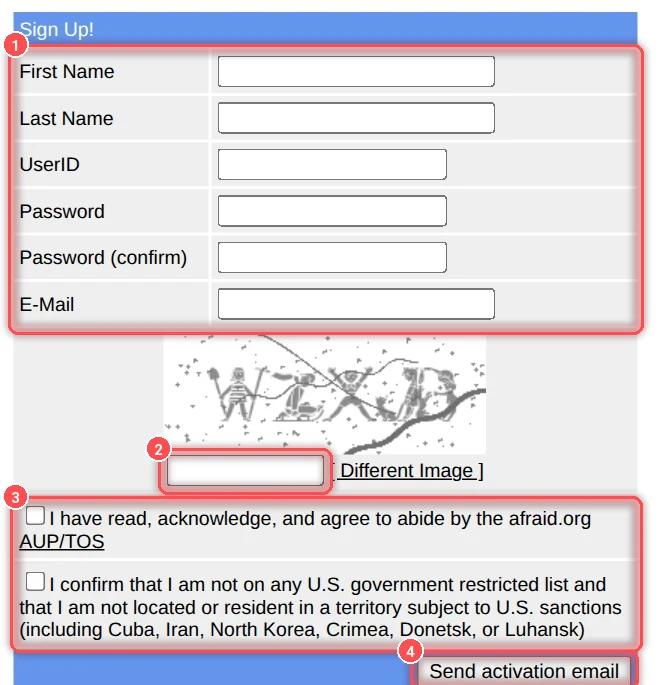
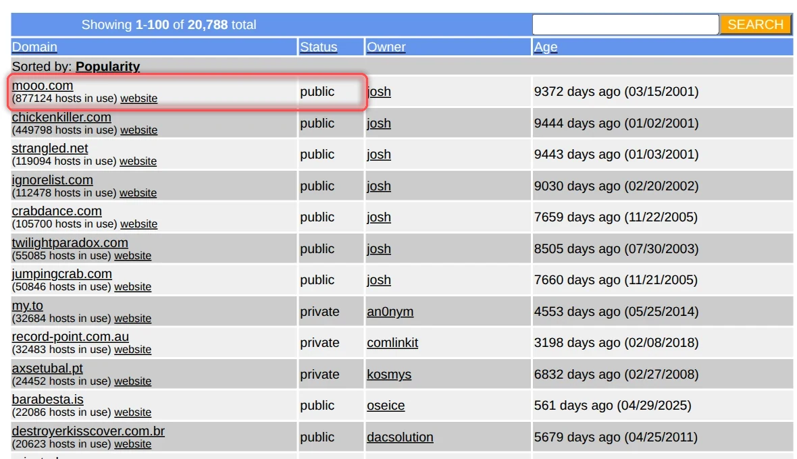
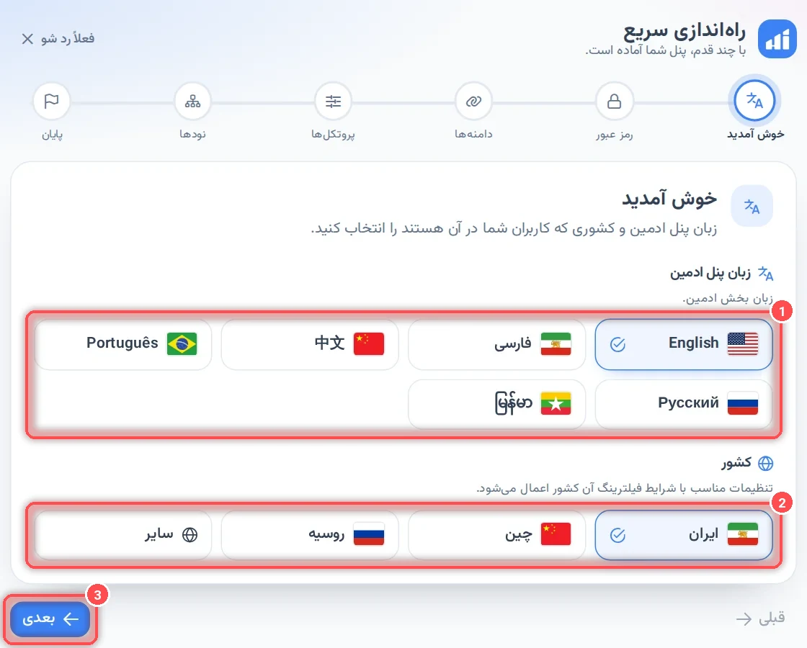
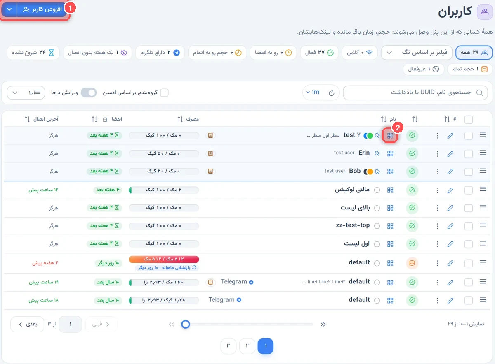
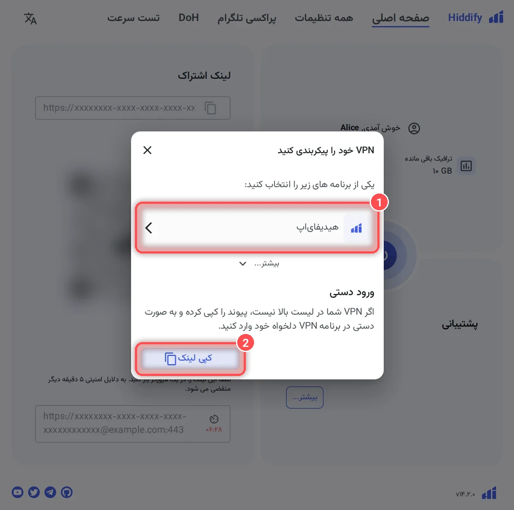
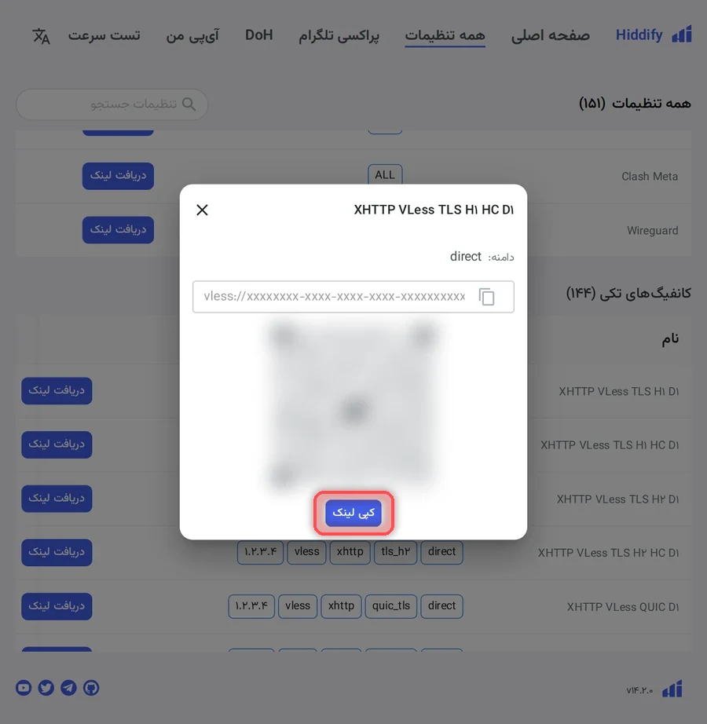

<div dir="rtl" markdown="1">
 
# راهنمای تنظیم دامنه و نهایی کردن نصب

بعد از [نصب هیدیفای‌منیجر](/fa/manager/installation-and-setup/guide/) باید راه‌اندازی را کامل کنید. این صفحه شما را در سه مرحله راهنمایی می‌کند:

1. یک دامنه (یا زیردامنه) بگیرید که به سرور شما اشاره کند.
2. پنل ادمین را باز کنید.
3. دامنه را در پنل وارد کنید و لینک‌های اتصال را بگیرید.

**دامنه** نامی مثل `example.com` است که به آی‌پی سرور شما اشاره می‌کند تا لازم نباشد خودتان و کاربرانتان از آی‌پی خام استفاده کنید. **زیردامنه** نامی زیر یک دامنه است، مثل `vpn.example.com`.

!!! note "تصویرها"
    تصویرهای پنل در این صفحه از هیدیفای‌منیجر نسخه ۱۴.۲ هستند. تصویر صفحه‌ی موقت راه‌اندازی در مرحله‌ی ۲ از نسخه‌ای قدیمی‌تر است.

## مرحله ۱: گرفتن دامنه و زیردامنه

اگر از قبل دامنه دارید، در تنظیمات DNS دامنه‌تان یک زیردامنه بسازید که به آی‌پی سرور اشاره کند و به مرحله‌ی ۲ بروید.

اگر دامنه ندارید، می‌توانید از سایت FreeDNS یک زیردامنه‌ی رایگان بگیرید. ویدئوی زیر همه‌ی مراحل را نشان می‌دهد.

<div align=center markdown=1>

[](https://www.youtube.com/watch?v=l-KKRus2KS0)

</div>

<details markdown="1"><summary>مراحل گرفتن زیردامنه‌ی رایگان از FreeDNS</summary>

!!! warning "شرط تحریم در FreeDNS"
    طبق شرایط استفادهٔ FreeDNS، ساکنان کشورهای تحریمی آمریکا (از جمله ایران) نمی‌توانند از این سرویس استفاده کنند و هنگام ثبت‌نام باید تأیید کنید که مشمول این شرط نیستید. اگر این شرط شامل حال شما می‌شود، به‌جای FreeDNS یک دامنه‌ی ارزان بخرید و در تنظیمات DNS آن یک زیردامنه برای آی‌پی سرور بسازید؛ [انواع دامنه و نحوه‌ی ثبت آن‌ها](/fa/manager/domain-worker-cdn-and-tunneling/Domain-types-and-how-to-register-them/) را ببینید.

1. وارد [سایت FreeDNS](https://freedns.afraid.org/signup/?plan=starter) شوید و فرم ثبت‌نام را پر کنید: نام، UserID، رمز عبور و ایمیل. ایمیل باید درست باشد، چون لینک فعال‌سازی به آن فرستاده می‌شود. متن تصویر امنیتی را وارد کنید، دو گزینه‌ی تأیید پایین فرم را بخوانید و تیک بزنید، و روی `Send activation email` بزنید.

    

2. ایمیلی را که FreeDNS برایتان فرستاده باز کنید و روی لینک فعال‌سازی بزنید.
3. وارد حساب شوید، [فهرست دامنه‌ها](https://freedns.afraid.org/domain/registry/) را باز کنید و یکی از دامنه‌های عمومی را انتخاب کنید. دامنه‌هایی با پسوند `com`، `net` یا `org` انتخاب بهتری هستند.

    

4. نام زیردامنه‌ی دلخواه و آی‌پی سرور خود را وارد کنید و ذخیره کنید.

    

5. زیردامنه‌ای را که ساختید کپی کنید. در مرحله‌ی ۳ به آن نیاز دارید.

</details>

این مراحل یک دامنه‌ی **مستقیم** (direct) می‌سازند که مستقیم به سرور شما اشاره می‌کند. برای آشنایی با انواع دیگر دامنه، مثل دامنه‌ی CDN، [انواع دامنه و نحوه‌ی ثبت آن‌ها](/fa/manager/domain-worker-cdn-and-tunneling/Domain-types-and-how-to-register-them/) را بخوانید.

## مرحله ۲: باز کردن پنل ادمین

روش باز کردن پنل به روش نصب شما بستگی دارد.

<details markdown="1"><summary>اگر با cloud-init نصب کرده‌اید (Hetzner، Vultr، OVH و ...)</summary>

نصب‌کننده یک لینک موقت می‌سازد که **فقط یک ساعت** اعتبار دارد.

1. بعد از روشن شدن سرور دست‌کم ۱۰ دقیقه صبر کنید.
2. آی‌پی سرور را در مرورگر باز کنید. آی‌پی چهار عدد است که با نقطه از هم جدا شده‌اند. مثلاً اگر آی‌پی شما `1.1.1.1` است، آدرس `http://1.1.1.1` را باز کنید.
3. روی لینکی که در آن صفحه هست بزنید تا وارد پنل ادمین شوید.

<div align=center markdown=1>


</div>

اگر یک ساعت گذشته است، از روش SSH که در ادامه آمده لینک‌های ادمین را بگیرید.

</details>

<details markdown="1"><summary>اگر از طریق SSH نصب کرده‌اید</summary>

در پایان نصب، لینک‌های ادمین در ترمینال نمایش داده می‌شوند. یکی از آن‌ها را در مرورگر باز کنید.

- لینک‌هایی را که با عنوان **Secure** (با دامنه و `https://`) مشخص شده‌اند ترجیح دهید. از لینک **Not Secure** که با آی‌پی است فقط وقتی استفاده کنید که بقیه هنوز کار نمی‌کنند.
- لینک ادمین شکلی شبیه `https://your-domain/admin-path/your-admin-id/` دارد. اطلاعات بیشتر: [فرمت صحیح لینک ادمین](/fa/manager/domain-worker-cdn-and-tunneling/The-correct-format-of-admin-link/)

برای دیدن دوباره‌ی لینک‌های ادمین، از طریق SSH به سرور وصل شوید و این دستور را اجرا کنید:

```bash
hiddify admin
```

اگر رمز ادمین را فراموش کرده‌اید، با این دستور آن را بازنشانی کنید:

```bash
hiddify reset-password
```

</details>

## مرحله ۳: نهایی کردن نصب

1. اولین باری که پنل ادمین را باز می‌کنید، ویزارد **راه‌اندازی سریع** باز می‌شود. مرحله‌های آن این‌ها هستند: **خوش آمدید ← رمز عبور ← دامنه‌ها ← پروتکل‌ها ← نودها ← پایان**.

    

2. در **خوش آمدید** زبان پنل ادمین و کشور کاربرانتان را انتخاب کنید و روی **بعدی** بزنید. در **رمز عبور** یک رمز برای ادمین بگذارید.
3. در **دامنه‌ها** دامنه‌ای را که در مرحله‌ی ۱ کپی کردید وارد کنید.
4. مرحله‌های **پروتکل‌ها** و **نودها** را طی کنید (می‌توانید پیش‌فرض‌ها را نگه دارید)، سپس روی **پایان** بزنید و صبر کنید تا پنل پیکربندی را اعمال کند. لینک‌های جدید ادمین را که نشان می‌دهد کپی کنید.

بعداً می‌توانید از **دامنه‌ها ← افزودن دامنه** دامنه‌های بیشتری اضافه کنید.

اگر به مشکل خوردید، [پیکربندی درست پنل هیدیفای‌منیجر](/fa/manager/configuration-and-advanced-settings/How-to-configure-Hiddify-panel-properly/) را بخوانید.

## گرفتن لینک‌های اتصال

1. در پنل ادمین **کاربران** را باز کنید. اگر هنوز کاربری ندارید، با **افزودن کاربر** یکی بسازید.
2. روی دکمه‌ی کد QR در ردیف یک کاربر بزنید تا لینک کاربر را بگیرید، و آن را باز کنید تا صفحه‌ی آن کاربر نمایش داده شود.

    

3. در صفحه‌ی کاربر روی دکمه‌ی اتصال بزنید. پنجره‌ی **VPN خود را پیکربندی کنید** اپ‌هایی را که برای اتصال لازم دارید نشان می‌دهد و با **کپی لینک** می‌توانید لینک اشتراک را برای اپ‌های دیگر کپی کنید.

    

4. برای دیدن کانفیگ‌های تکی آن کاربر، در منوی صفحه‌ی کاربر **همه تنظیمات** را باز کنید و کنار یک کانفیگ روی **دریافت لینک** بزنید. کد QR آن را با اپ خود اسکن کنید، یا روی **کپی لینک** بزنید و لینک را در اپ وارد کنید.

    

برای اتصال، [اپ هیدیفای](/fa/app/How-to-install-Hiddify-app/) را پیشنهاد می‌کنیم که روی اندروید، iOS، ویندوز، مک و لینوکس کار می‌کند.

این صفحه فقط برای شروع سریع است و با این پنل کارهای خیلی بیشتری می‌توانید انجام دهید. برای استفاده‌ی حداکثری از پنل، [پیکربندی درست پنل هیدیفای‌منیجر](/fa/manager/configuration-and-advanced-settings/How-to-configure-Hiddify-panel-properly/) را بخوانید.

</div>
