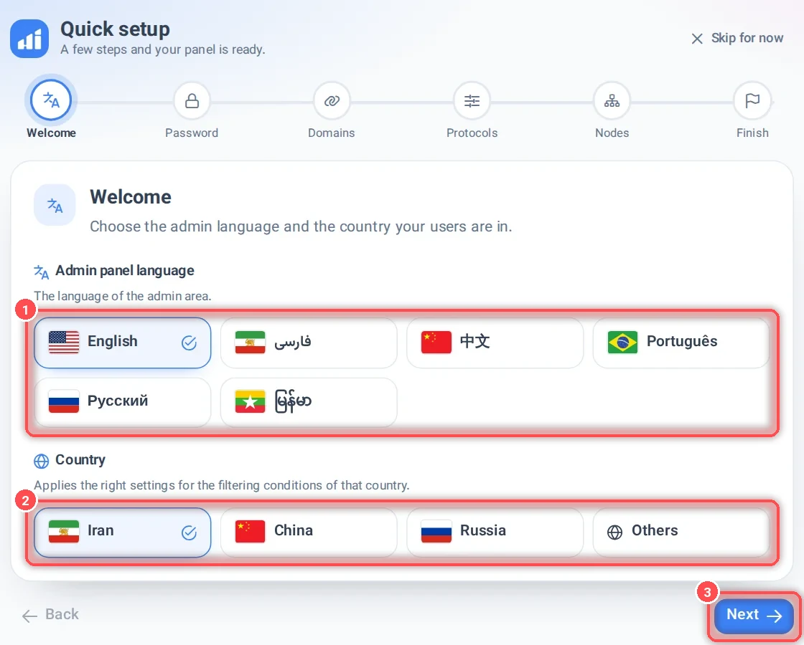
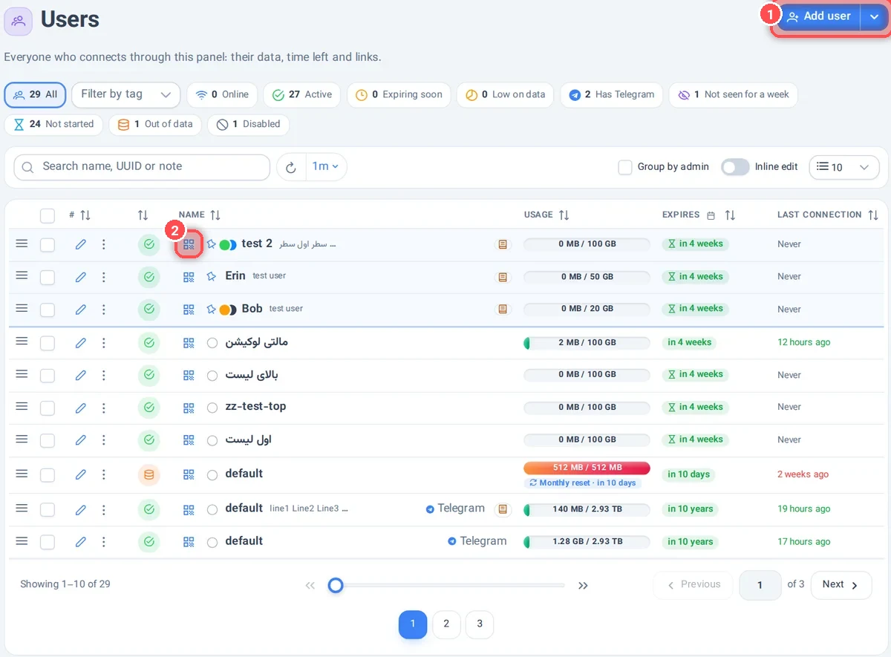
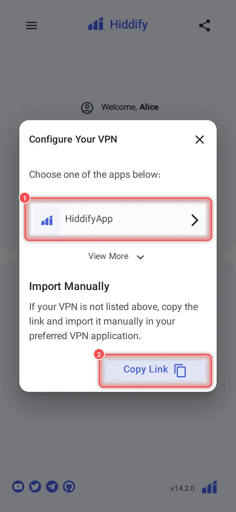
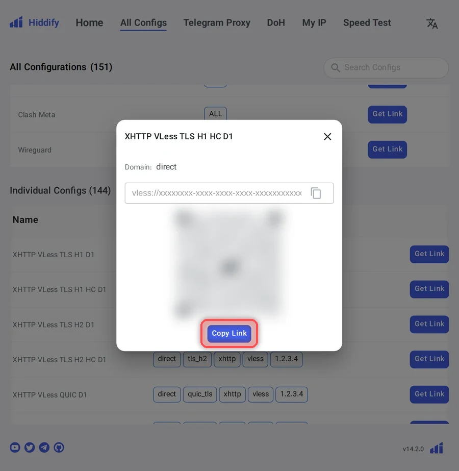

<div dir="ltr" markdown="1">

# Guide for setting up the domain and finalizing the installation

After you [install Hiddify Manager](/manager/installation-and-setup/guide/), you need to finish the setup. This page walks you through it in three steps:

1. Get a domain (or subdomain) that points to your server.
2. Open the admin panel.
3. Enter your domain in the panel and get your connection links.

A **domain** is a name like `example.com` that points to your server's IP address, so you and your users don't have to use the bare IP. A **subdomain** is a name under a domain, like `vpn.example.com`.

!!! note "Screenshots"
    The panel screenshots on this page are from HiddifyManager v14.2. The temporary setup page in step 2 is from an older version.

## Step 1: Get a domain and subdomain

If you already have a domain, create a subdomain for your server's IP address in your domain's DNS settings and skip to step 2.

If you don't have a domain, you can get a free subdomain from FreeDNS. The video below (in Persian) shows all the steps.

<div align=center markdown=1>

[](https://www.youtube.com/watch?v=l-KKRus2KS0)

</div>

<details markdown=1><summary>Steps to get a free subdomain from FreeDNS</summary>

1. Go to [freedns.afraid.org](https://freedns.afraid.org/signup/) and create an account. You don't need to give real personal information, but the email address must be correct.

    

2. Open the email FreeDNS sent you and click the activation link.
3. Log in, open the [domain registry](https://freedns.afraid.org/domain/registry/) and choose one of the public domains. Domains ending in `.com`, `.net` or `.org` are a good choice.

    

4. Enter the subdomain name you want and your server's IP address, then save.

    

5. Copy the subdomain you created. You need it in step 3.

</details>

These steps create a **direct** domain (it points straight to your server). To learn about other domain types, such as CDN domains, see [Domain types and how to register them](/manager/domain-worker-cdn-and-tunneling/Domain-types-and-how-to-register-them/).

## Step 2: Open the admin panel

How you open the panel depends on how you installed Hiddify.

<details markdown="1"><summary>If you used cloud-init (Hetzner, Vultr, OVH, ...)</summary>

The installer creates a temporary link that works for **one hour**.

1. Wait at least 10 minutes after the server starts.
2. Open your server's IP address in your browser. An IP address is four numbers separated by dots. For example, if your IP is `1.1.1.1`, open `http://1.1.1.1`.
3. Click the link on that page to reach the admin panel.

<div align=center markdown=1>


</div>

If the hour has passed, use the SSH method below to get the admin links.

</details>

<details markdown="1"><summary>If you installed over SSH</summary>

At the end of the installation, the installer shows your admin links in the terminal. Open one of them in your browser.

- Prefer the links marked **Secure** (with your domain and `https://`). Use the **Not Secure** IP link only if the others don't work yet.
- An admin link looks like `https://your-domain/admin-path/your-admin-id/`. More about this: [The correct format of the admin link](/manager/domain-worker-cdn-and-tunneling/The-correct-format-of-admin-link/).

To see the admin links again, connect to your server over SSH and run:

```bash
hiddify admin
```

If you forgot the admin password, you can reset it with:

```bash
hiddify reset-password
```

</details>

## Step 3: Finalize the installation

1. The first time you open the admin panel, the **Quick setup** wizard opens. Its steps are **Welcome → Password → Domains → Protocols → Nodes → Finish**.

    

2. In **Welcome**, choose the admin panel language and your users' country, then click **Next**. In **Password**, set an admin password.
3. In **Domains**, enter the domain you copied in step 1.
4. Go through **Protocols** and **Nodes** (you can keep the defaults), then click **Finish** and wait until the panel applies the configuration. Copy the new admin links it shows.

You can add more domains later in **Domains → Add domain**.

If something goes wrong, read [How to configure the Hiddify panel properly](/manager/configuration-and-advanced-settings/How-to-configure-Hiddify-panel-properly/).

## Get your connection links

1. In the admin panel, open **Users**. If there is no user yet, click **Add user** to make one.
2. Click the QR code button in a user's row to get the user's link, and open it to see that user's page.

    

3. On the user page, tap the connect button. The **Configure Your VPN** window shows the apps you can use to connect, and **Copy Link** copies the subscription link for any other app.

    

4. To see the single configs made for that user, open **All Configs** in the menu of the user page and click **Get Link** next to a config. Scan its QR code with your app, or click **Copy Link** and paste the link into it.

    

We recommend [Hiddify App](/app/How-to-install-Hiddify-app/) to connect; it works on Android, iOS, Windows, macOS and Linux.

This page only covers a quick start. The panel can do much more: read [How to configure the Hiddify panel properly](/manager/configuration-and-advanced-settings/How-to-configure-Hiddify-panel-properly/) to get the most out of it.

</div>
